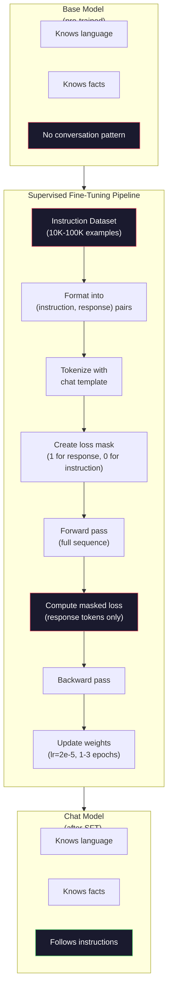

# Penyetelan Instruksi (SFT)

> Model dasar memprediksi token berikutnya. Itu saja. Ia tidak mengikuti instruksi, menjawab pertanyaan, atau menolak permintaan berbahaya. SFT adalah jembatan antara pemrediksi token dan asisten yang berguna. Setiap model yang pernah Anda ajak bicara -- Claude, GPT, Llama Chat -- melewati langkah ini.

**Jenis:** Build
**Bahasa:** Python (dengan numpy)
**Prasyarat:** Fase 10, Pelajaran 04 (Pra-pelatihan Mini GPT)
**Waktu:** ~90 menit

## Tujuan Pembelajaran

- Mengimplementasikan supervised fine-tuning (SFT) yang mengubah model bahasa dasar menjadi asisten yang mengikuti instruksi
- Memformat data pelatihan memakai chat template dengan peran system, user, dan assistant, serta melakukan masking loss pada token non-assistant
- Menjelaskan mengapa SFT diperlukan: model dasar melanjutkan teks alih-alih menjawab pertanyaan
- Menilai kualitas SFT dengan membandingkan respons model dasar terhadap model yang disetel halus pada himpunan instruksi yang disisihkan

## Masalahnya

Anda melatih sebuah model di Pelajaran 04. Ia dapat memprediksi token berikutnya dengan sebuah urutan sebagai masukan. Berikan ia "The transformer architecture" dan ia mungkin melanjutkan dengan "has revolutionized natural language processing." Itu mengesankan untuk seorang pemrediksi token berikutnya.

Sekarang coba ini: berikan ia "What is the capital of France?" Model dasar tidak menjawab "Paris." Ia melanjutkan polanya. Ia mungkin menghasilkan "What is the capital of Germany? What is the capital of Spain?" karena ia belajar dari dokumen yang berisi daftar pertanyaan. Atau ia mungkin menghasilkan "is a question that many people ask" karena itu adalah kelanjutan token berikutnya yang masuk akal. Model itu tidak punya konsep *menjawab*. Ia hanya tahu *melanjutkan*.

Di sinilah jurang antara GPT-3 (model dasar, dirilis Juni 2020) dan ChatGPT (telah disetel untuk mengikuti instruksi, dirilis November 2022). Arsitektur sama. Pra-pelatihan sama. Bedanya adalah 20.000 hingga 100.000 pasangan (instruksi, respons) yang dirakit dengan hati-hati dan mengajarkan model pola percakapan.

Stanford Alpaca membuktikan Anda tidak membutuhkan jutaan contoh. Pada Maret 2023, mereka menyetel halus Llama 7B hanya dengan 52.000 pasangan instruksi-respons yang dihasilkan oleh GPT-3.5. Total biaya: $600. Hasilnya adalah chatbot yang dapat mengikuti instruksi, menjawab pertanyaan, dan melakukan percakapan. Tidak sebaik ChatGPT, tapi mengejutkan dekatnya untuk $600 dan beberapa jam pelatihan.

Llama 2 Chat dari Meta hanya memakai ~27.000 contoh berkualitas tinggi untuk tahap SFT awalnya. Wawasan kuncinya: kualitas lebih penting daripada kuantitas. 27.000 contoh yang ditulis oleh anotator terampil mengalahkan 1 juta contoh berderau yang diambil dari internet.

## Konsepnya

### Apa yang Sebenarnya Dilakukan SFT

Supervised Fine-Tuning melanjutkan loop pelatihan yang sama dari pra-pelatihan -- forward pass, hitung loss, backward pass, perbarui bobot -- tetapi pada jenis data yang berbeda. Alih-alih teks mentah, Anda melatih pada percakapan terstruktur:

```json
{
  "system": "You are a helpful assistant.",
  "user": "What is the capital of France?",
  "assistant": "The capital of France is Paris."
}
```

Model sudah tahu bahwa Paris adalah ibu kota Prancis. Ia mempelajarinya selama pra-pelatihan pada Wikipedia, buku teks, dan halaman web. SFT tidak mengajarkan fakta baru kepada model. Ia mengajarkan model sebuah *perilaku* baru: ketika Anda melihat pertanyaan, hasilkan jawaban. Ketika Anda melihat instruksi, hasilkan penyelesaian. Ketika Anda melihat permintaan berbahaya, hasilkan penolakan.

Pikirkan begini. Pra-pelatihan memberi model pengetahuan. SFT memberi model tata krama.

### Format Data

Tiga format mendominasi industri. Masing-masing mengodekan informasi yang sama -- siapa mengatakan apa -- dengan pembatas berbeda.

**Format Alpaca** (Stanford, Maret 2023):

```json
{
  "instruction": "Summarize the following article in 3 sentences.",
  "input": "The European Central Bank raised interest rates...",
  "output": "The ECB increased rates by 25 basis points..."
}
```

Sederhana dan banyak dipakai. Bidang `input` bersifat opsional -- banyak instruksi tidak memerlukan konteks tambahan. Stanford merilis 52.000 contoh dalam format ini, dihasilkan oleh GPT-3.5 seharga $600. Ini memulai gerakan penyetelan instruksi sumber-terbuka.

**Format ShareGPT** (komunitas, 2023):

```json
{
  "conversations": [
    {"from": "system", "value": "You are a helpful assistant."},
    {"from": "human", "value": "What causes tides?"},
    {"from": "gpt", "value": "Tides are caused by the gravitational pull of the Moon..."},
    {"from": "human", "value": "How often do they occur?"},
    {"from": "gpt", "value": "Most coastal areas experience two high tides and two low tides per day..."}
  ]
}
```

Mendukung percakapan multi-giliran. Bidang "from" memakai "human" dan "gpt" sesuai konvensi, terlepas dari model yang sebenarnya. Vicuna dilatih pada 70.000 percakapan ShareGPT yang diambil dari transkrip ChatGPT yang dibagikan pengguna.

**Format ChatML** (OpenAI, dipakai banyak model sumber-terbuka):

```
<|im_start|>system
You are a helpful assistant.<|im_end|>
<|im_start|>user
What is the capital of France?<|im_end|>
<|im_start|>assistant
The capital of France is Paris.<|im_end|>
```

Memakai token khusus (`<|im_start|>`, `<|im_end|>`) untuk membatasi peran. Token-token ini ditambahkan ke kosakata tokenizer selama fine-tuning. Qwen, Yi, dan banyak model lain memakai ChatML.

Ketiga format melakukan hal yang sama: mereka memberi tahu model "ini instruksinya, ini responsnya, pelajarilah pola ini."

### Mengapa Ini Berhasil

Model sudah mengetahui bahasa dari pra-pelatihan. Ia telah melihat miliaran contoh pertanyaan yang diikuti jawaban, instruksi yang diikuti penyelesaian, dan percakapan antar manusia. Pola-pola itu sudah tersandi dalam bobot.

SFT mengonsentrasikan kemampuan laten ini. Alih-alih model harus mencari tahu dari konteks apakah ia harus menjawab pertanyaan atau melanjutkan dokumen, SFT secara eksplisit melatih pada pola percakapan. Setelah beberapa ribu contoh, model mempelajari: ketika Anda melihat penanda peran assistant, hasilkan respons yang membantu.

Inilah sebabnya 27.000 contoh sudah cukup. Anda tidak sedang mengajari model bahasa Inggris. Anda tidak sedang mengajarinya fakta tentang dunia. Anda sedang mengajarinya satu perilaku sederhana: merespons instruksi. Pengetahuannya sudah ada sejak awal.

### Loss yang Ditutupi (Masked Loss)

Ini adalah detail teknis paling penting dalam SFT, dan kebanyakan tutorial melewatkannya.

Selama pra-pelatihan, Anda menghitung loss pada setiap token. Model belajar memprediksi setiap token berikutnya dalam urutan. Selama SFT, Anda hanya menghitung loss pada token *respons*. Token instruksi ada sebagai konteks, tetapi model tidak dihukum karena "memprediksi" token itu dengan salah.

Mengapa? Karena Anda tidak ingin model belajar *menghasilkan* instruksi. Anda ingin ia belajar *merespons* instruksi. Jika Anda menghitung loss pada token instruksi, Anda sedang melatih model untuk memprediksi "What is the capital of France?" seolah-olah dialah yang bertanya. Itu membuang sinyal gradien dan dapat membingungkan model tentang perannya.

Dalam praktiknya, Anda membuat loss mask: 1 untuk token respons, 0 untuk token instruksi. Kalikan loss per token dengan mask ini sebelum merata-ratakan.

```
Tokens:    [SYS] You are helpful [USER] What is the capital? [ASST] Paris is the capital [EOS]
Loss mask:   0    0    0     0      0     0   0  0     0       1     1    1   1     1      1
```

Hanya token setelah `[ASST]` yang menyumbang loss. Model melihat percakapan penuh selama forward pass (ia membutuhkan instruksi untuk menghasilkan respons yang tepat) tetapi hanya memperbarui bobotnya berdasarkan seberapa baik ia memprediksi respons.

### Hyperparameter Pelatihan

SFT memakai hyperparameter yang sangat berbeda dari pra-pelatihan. Anda tidak melatih dari awal. Anda sedang menyesuaikan model yang sudah bekerja.

| Parameter | Pra-pelatihan (Llama 2 7B) | SFT (Llama 2 Chat) |
|-----------|----------------------------|--------------------|
| Laju pembelajaran | 3e-4 (puncak) | 2e-5 |
| Epoch | 1 (satu lintasan atas data) | 2 |
| Ukuran batch | 4M token | 64 contoh |
| Langkah warmup | 2.000 | 0-100 |
| Weight decay | 0,1 | 0,0-0,1 |
| Ukuran data | 2T token | 27.000 contoh |

Laju pembelajaran 15x lebih rendah untuk SFT. Ini krusial. Laju pembelajaran tinggi selama fine-tuning merusak pengetahuan yang telah dilatih. Model "lupa" apa yang dipelajarinya dan overfit pada dataset fine-tuning yang kecil. Ini adalah catastrophic forgetting.

Dua epoch berarti model melihat setiap contoh pelatihan dua kali. Lebih dari 3 epoch pada dataset kecil menyebabkan hafalan -- model mulai mereproduksi contoh pelatihan kata demi kata alih-alih menggeneralisasi.

### Catastrophic Forgetting

Fine-tuning dapat merusak kemampuan umum. Terlalu lama melatih pada data pengikutan-instruksi dan model kehilangan kemampuannya menulis kode, melakukan matematika, atau menghasilkan teks kreatif. Ia menjadi sangat baik pada format spesifik data pelatihannya dan buruk pada segala hal lain.

Tiga mitigasi:

1. **Laju pembelajaran rendah.** 1e-5 sampai 5e-5. Pembaruan lebih kecil berarti kerusakan lebih sedikit pada fitur yang telah dilatih.

2. **Pelatihan singkat.** 1-3 epoch. Berhenti sebelum model overfit.

3. **Campurkan data pra-pelatihan.** Llama 2 Chat mencampurkan persentase kecil (2-5%) data pra-pelatihan mentah ke dalam dataset SFT. Ini "mengingatkan" model akan kemampuan umumnya sambil mempelajari perilaku pengikutan-instruksi yang baru.

### Angka-Angka Nyata

Menyetel halus model 7B pada 10.000 pasangan instruksi berkualitas tinggi memakan waktu kurang lebih 1 jam pada satu GPU NVIDIA A100 80GB. Berikut hitungannya:

- 10.000 contoh x 512 token rata-rata = 5,12M token
- 2 epoch = 10,24M token total
- Throughput A100 untuk fine-tuning model 7B: ~3.000 token/detik
- 10,24M / 3.000 = ~3.400 detik = ~57 menit

Untuk mini GPT kita (4 lapisan, 128 dimensi), pelatihan hampir seketika. Intinya adalah memahami mekanikanya, bukan skalanya.



```figure
loss-masking
```

## Bangunlah

### Langkah 1: Dataset Instruksi

Buat dataset instruksi sintetis. Dalam produksi, perusahaan seperti Scale AI dan Anthropic mempekerjakan anotator manusia untuk menulisnya. Kita akan membuatnya secara terprogram untuk mendemonstrasikan formatnya.

```python
import numpy as np

INSTRUCTION_DATA = [
    {
        "instruction": "What is the capital of France?",
        "response": "The capital of France is Paris."
    },
    {
        "instruction": "Explain gravity in one sentence.",
        "response": "Gravity is the force that attracts objects with mass toward each other."
    },
    {
        "instruction": "Write a haiku about the ocean.",
        "response": "Waves crash on the shore, salt and foam beneath the sun, endless blue expanse."
    },
    {
        "instruction": "What is 15 multiplied by 7?",
        "response": "15 multiplied by 7 is 105."
    },
    {
        "instruction": "Name three programming languages.",
        "response": "Three programming languages are Python, Rust, and TypeScript."
    },
    {
        "instruction": "Summarize photosynthesis.",
        "response": "Photosynthesis converts sunlight, water, and carbon dioxide into glucose and oxygen."
    },
    {
        "instruction": "What year did World War II end?",
        "response": "World War II ended in 1945."
    },
    {
        "instruction": "Define machine learning.",
        "response": "Machine learning is a field where algorithms learn patterns from data to make predictions."
    },
]
```

Delapan contoh itu sangat sedikit. Stanford Alpaca memakai 52.000. Tetapi mekanikanya identik apakah Anda punya 8 atau 52.000: tokenisasi, masking, hitung loss hanya pada respons.

### Langkah 2: Tokenisasi dengan Chat Template

Ubah pasangan instruksi-respons menjadi urutan token dengan penanda peran khusus. Penanda itu memberi tahu model di mana instruksi berakhir dan di mana respons dimulai.

```python
SPECIAL_TOKENS = {
    "INST_START": 253,
    "INST_END": 254,
    "RESP_START": 255,
}


def tokenize_instruction_pair(instruction, response, vocab_size=256):
    inst_tokens = list(instruction.encode("utf-8"))
    resp_tokens = list(response.encode("utf-8"))

    inst_tokens = [min(t, vocab_size - 4) for t in inst_tokens]
    resp_tokens = [min(t, vocab_size - 4) for t in resp_tokens]

    tokens = (
        [SPECIAL_TOKENS["INST_START"]]
        + inst_tokens
        + [SPECIAL_TOKENS["INST_END"]]
        + [SPECIAL_TOKENS["RESP_START"]]
        + resp_tokens
    )

    return tokens


def create_loss_mask(tokens):
    mask = np.zeros(len(tokens), dtype=np.float32)
    in_response = False

    for i, token in enumerate(tokens):
        if token == SPECIAL_TOKENS["RESP_START"]:
            in_response = True
            continue
        if in_response:
            mask[i] = 1.0

    return mask
```

Loss mask berisi nol untuk semua token instruksi dan satu untuk semua token respons. Token `RESP_START` sendiri mendapat mask 0 karena ia adalah pembatas, bukan bagian dari isi respons.

### Langkah 3: Loss Cross-Entropy yang Ditutupi

Cross-entropy standar, tetapi dikalikan dengan loss mask. Hanya token respons yang menyumbang gradien.

```python
def masked_cross_entropy_loss(logits, targets, loss_mask):
    batch, seq_len, vocab_size = logits.shape
    logits_flat = logits.reshape(-1, vocab_size)
    targets_flat = targets.reshape(-1)
    mask_flat = loss_mask.reshape(-1)

    max_logits = logits_flat.max(axis=-1, keepdims=True)
    log_softmax = logits_flat - max_logits - np.log(
        np.exp(logits_flat - max_logits).sum(axis=-1, keepdims=True)
    )

    per_token_loss = -log_softmax[np.arange(len(targets_flat)), targets_flat]

    masked_loss = per_token_loss * mask_flat
    num_response_tokens = mask_flat.sum()
    if num_response_tokens == 0:
        return 0.0
    loss = masked_loss.sum() / num_response_tokens

    return loss
```

Penyebutnya adalah `num_response_tokens`, bukan `seq_len`. Jika Anda membagi dengan panjang urutan total, instruksi yang panjang akan mengencerkan sinyal gradien. Membagi dengan jumlah token respons memastikan bobot yang sama per token respons terlepas dari panjang instruksi.

### Langkah 4: Loop Pelatihan SFT

Gunakan kembali MiniGPT dari Pelajaran 04. Loop pelatihannya tampak hampir identik dengan pra-pelatihan, tetapi dengan pemformatan instruksi dan loss yang ditutupi.

```python
import sys
import os
sys.path.insert(0, os.path.join(os.path.dirname(__file__), "..", "..", "04-pre-training-mini-gpt", "code"))
from main import MiniGPT, LayerNorm, FeedForward, MultiHeadAttention, TransformerBlock, Embedding


def sft_train(model, dataset, num_epochs=2, lr=2e-5, seq_len=64):
    formatted_data = []
    for example in dataset:
        tokens = tokenize_instruction_pair(example["instruction"], example["response"])
        mask = create_loss_mask(tokens)
        formatted_data.append((tokens, mask))

    print(f"SFT Training: {len(formatted_data)} examples, {num_epochs} epochs, lr={lr}")
    print(f"Total tokens: {sum(len(t) for t, _ in formatted_data):,}")
    print()

    losses = []

    for epoch in range(num_epochs):
        epoch_loss = 0.0
        num_batches = 0

        indices = np.random.permutation(len(formatted_data))

        for idx in indices:
            tokens, mask = formatted_data[idx]

            if len(tokens) < 3:
                continue
            if len(tokens) > seq_len:
                tokens = tokens[:seq_len]
                mask = mask[:seq_len]

            input_ids = np.array(tokens[:-1]).reshape(1, -1)
            target_ids = np.array(tokens[1:]).reshape(1, -1)
            loss_mask = np.array(mask[1:]).reshape(1, -1)

            logits = model.forward(input_ids)
            loss = masked_cross_entropy_loss(logits, target_ids, loss_mask)

            batch_size, s_len, v_size = logits.shape
            probs = np.exp(logits - logits.max(axis=-1, keepdims=True))
            probs = probs / probs.sum(axis=-1, keepdims=True)
            dlogits = probs.copy()
            dlogits[np.arange(batch_size)[:, None], np.arange(s_len), target_ids] -= 1.0

            mask_expanded = loss_mask[:, :, np.newaxis]
            num_resp = loss_mask.sum()
            if num_resp > 0:
                dlogits = dlogits * mask_expanded / num_resp

            for block in model.blocks:
                block.ffn.W1 -= lr * np.random.randn(*block.ffn.W1.shape) * 0.01
                block.ffn.W2 -= lr * np.random.randn(*block.ffn.W2.shape) * 0.01
                block.ffn.b1 -= lr * np.random.randn(*block.ffn.b1.shape) * 0.01
                block.ffn.b2 -= lr * np.random.randn(*block.ffn.b2.shape) * 0.01

            epoch_loss += loss
            num_batches += 1
            losses.append(loss)

        avg_loss = epoch_loss / max(num_batches, 1)
        print(f"Epoch {epoch + 1}/{num_epochs} | Avg Loss: {avg_loss:.4f}")

    return model, losses
```

Laju pembelajaran adalah 2e-5, sama seperti Llama 2 Chat. Bandingkan dengan 3e-4 yang dipakai dalam pra-pelatihan -- 15x lebih kecil. Gradien ditutupi: token instruksi menghasilkan gradien nol. Hanya token respons yang mendorong bobot.

### Langkah 5: Bandingkan Model Dasar vs Model SFT

Seluruh tujuan SFT adalah perubahan perilaku. Mari kita ukur dengan memeriksa bagaimana model merespons masukan berformat instruksi dibandingkan kelanjutan teks mentah.

```python
def generate_response(model, prompt_tokens, max_new_tokens=50, temperature=0.8):
    tokens = list(prompt_tokens)
    seq_len = model.embedding.pos_embed.shape[0]

    for _ in range(max_new_tokens):
        context = np.array(tokens[-seq_len:]).reshape(1, -1)
        logits = model.forward(context)
        next_logits = logits[0, -1, :]

        next_logits = next_logits / max(temperature, 1e-8)
        probs = np.exp(next_logits - next_logits.max())
        probs = probs / probs.sum()
        probs = np.clip(probs, 1e-10, 1.0)
        probs = probs / probs.sum()

        next_token = np.random.choice(len(probs), p=probs)
        tokens.append(int(next_token))

    return tokens


def evaluate_instruction_following(model, instructions):
    print("Evaluating instruction following:")
    print("-" * 50)

    for instruction in instructions:
        tokens = (
            [SPECIAL_TOKENS["INST_START"]]
            + [min(t, 252) for t in list(instruction.encode("utf-8"))]
            + [SPECIAL_TOKENS["INST_END"]]
            + [SPECIAL_TOKENS["RESP_START"]]
        )

        output = generate_response(model, tokens, max_new_tokens=30, temperature=0.6)
        response_start = len(tokens)
        response_tokens = output[response_start:]
        response_bytes = bytes([t for t in response_tokens if t < 128])
        response_text = response_bytes.decode("utf-8", errors="replace")

        print(f"  Q: {instruction}")
        print(f"  A: {response_text[:80]}")
        print()
```

Pada model sangat kecil dengan 8 contoh, responsnya tidak akan bermakna. Itu sudah diperkirakan. Yang penting adalah *strukturnya*: model belajar menghasilkan keluaran setelah penanda respons alih-alih terus menghasilkan lebih banyak instruksi.

### Langkah 6: Ukur Catastrophic Forgetting

Bandingkan kemampuan prediksi token berikutnya pada model sebelum dan sesudah SFT. Jika SFT merusak kemampuan umum, loss pada teks mentah akan meningkat.

```python
def measure_forgetting(model, test_text, seq_len=64):
    tokens = np.array(list(test_text.encode("utf-8")[:512]))

    total_loss = 0.0
    num_windows = 0

    for start in range(0, len(tokens) - seq_len - 1, seq_len):
        input_ids = tokens[start:start + seq_len].reshape(1, -1)
        target_ids = tokens[start + 1:start + seq_len + 1].reshape(1, -1)

        logits = model.forward(input_ids)

        batch, s_len, vocab_size = logits.shape
        logits_flat = logits.reshape(-1, vocab_size)
        targets_flat = target_ids.reshape(-1)

        max_logits = logits_flat.max(axis=-1, keepdims=True)
        log_softmax = logits_flat - max_logits - np.log(
            np.exp(logits_flat - max_logits).sum(axis=-1, keepdims=True)
        )

        loss = -log_softmax[np.arange(len(targets_flat)), targets_flat].mean()
        total_loss += loss
        num_windows += 1

    return total_loss / max(num_windows, 1)
```

Dalam fine-tuning sungguhan, Anda akan melacak metrik ini sepanjang pelatihan. Jika loss teks mentah meningkat lebih dari 10-15%, SFT Anda terlalu agresif. Turunkan laju pembelajaran atau kurangi jumlah epoch.

## Gunakan

### Demo Pipeline SFT Lengkap

```python
if __name__ == "__main__":
    np.random.seed(42)

    test_text = """The transformer architecture processes sequences through self-attention.
Each layer applies multi-head attention followed by a feedforward network.
Residual connections and layer normalization stabilize deep networks.
The model learns to predict the next token given all previous tokens."""

    print("=" * 70)
    print("INSTRUCTION TUNING (SFT) DEMO")
    print("=" * 70)
    print()

    model = MiniGPT(
        vocab_size=256, embed_dim=128, num_heads=4,
        num_layers=4, max_seq_len=128, ff_dim=512
    )
    print(f"Model: {model.count_parameters():,} parameters")
    print(f"Config: 4 layers, 4 heads, 128 dims (mini GPT from Lesson 04)")
    print()

    print("PRE-SFT: Measuring base model loss on raw text")
    base_loss = measure_forgetting(model, test_text)
    print(f"  Base model loss: {base_loss:.4f}")
    print()

    print("=" * 70)
    print("SFT TRAINING")
    print("=" * 70)

    model, losses = sft_train(
        model, INSTRUCTION_DATA, num_epochs=3, lr=2e-5, seq_len=128
    )

    print()
    print("POST-SFT: Measuring fine-tuned model loss on raw text")
    sft_loss = measure_forgetting(model, test_text)
    print(f"  SFT model loss: {sft_loss:.4f}")
    print(f"  Change: {((sft_loss - base_loss) / base_loss * 100):+.1f}%")
    if abs(sft_loss - base_loss) / base_loss < 0.15:
        print("  Minimal forgetting (< 15% change)")
    else:
        print("  Significant forgetting detected")
    print()

    print("=" * 70)
    print("INSTRUCTION FOLLOWING EVALUATION")
    print("=" * 70)
    print()

    test_instructions = [
        "What is the capital of France?",
        "Name a programming language.",
        "Define gravity.",
    ]
    evaluate_instruction_following(model, test_instructions)

    print("=" * 70)
    print("DATA FORMAT EXAMPLES")
    print("=" * 70)
    print()

    for i, example in enumerate(INSTRUCTION_DATA[:3]):
        tokens = tokenize_instruction_pair(example["instruction"], example["response"])
        mask = create_loss_mask(tokens)
        resp_count = int(mask.sum())
        total_count = len(tokens)
        print(f"  Example {i + 1}: {total_count} tokens, {resp_count} response tokens ({resp_count/total_count:.0%} of sequence)")
        print(f"    Instruction: {example['instruction']}")
        print(f"    Response: {example['response']}")
        print()

    print("=" * 70)
    print("TRAINING LOSS CURVE")
    print("=" * 70)
    print()

    if losses:
        window = max(1, len(losses) // 5)
        for i in range(0, len(losses), window):
            chunk = losses[i:i + window]
            avg = sum(chunk) / len(chunk)
            print(f"  Steps {i:3d}-{i + len(chunk) - 1:3d}: avg loss = {avg:.4f}")
```

## Kirimkan

Pelajaran ini menghasilkan `outputs/prompt-sft-data-curator.md` -- sebuah prompt yang membantu Anda merancang dan mengkurasi dataset instruksi untuk SFT. Diberikan kapabilitas target (generasi kode, matematika, percakapan), prompt ini menghasilkan rencana pengumpulan data dengan spesifikasi format, kriteria kualitas, dan persyaratan keragaman.

## Latihan

1. Tambahkan dukungan system prompt. Ubah `tokenize_instruction_pair` agar menerima pesan system dan meletakkannya sebelum instruksi. Buat 5 contoh dengan system prompt berbeda ("You are a poet", "You are a math tutor") dan verifikasi bahwa model melihat system prompt yang berbeda selama pelatihan.

2. Implementasikan pencampuran data. Buat fungsi yang menerima dataset SFT dan korpus teks mentah, lalu menghasilkan batch pelatihan di mana 5% contoh adalah teks mentah (tanpa masking) dan 95% adalah pasangan instruksi (dengan masking). Jalankan 3 epoch dan bandingkan metrik lupa dengan pelatihan SFT murni.

3. Bangun penilai kualitas data. Untuk setiap pasangan instruksi-respons, hitung: (a) panjang respons dalam token, (b) rasio instruksi-terhadap-respons, (c) keragaman kosakata (token unik / total token). Saring contoh dengan panjang respons < 10 token atau keragaman < 0,3. Tunjukkan bagaimana pemfilteran memengaruhi loss akhir.

4. Implementasikan pelatihan percakapan multi-giliran. Kembangkan tokenisasi untuk menangani percakapan 3 giliran (user-assistant-user-assistant-user-assistant). Loss mask sebaiknya mencakup ketiga giliran assistant. Verifikasi mask benar dengan mencetak keselarasan token-mask untuk satu contoh.

5. Bandingkan laju pembelajaran. Latih model yang sama tiga kali dengan lr=1e-4, lr=2e-5, dan lr=1e-6. Plot kurva loss-nya. Pelatihan dengan 1e-4 seharusnya menunjukkan penurunan awal cepat tetapi loss akhir lebih tinggi (overfitting). Pelatihan 1e-6 seharusnya hampir tidak bergerak. Pelatihan 2e-5 seharusnya menjadi titik manisnya.

## Istilah Kunci

| Istilah | Yang Sering Diucapkan Orang | Arti Sebenarnya |
|---------|------------------------------|-----------------|
| SFT | "Fine-tuning pada percakapan" | Supervised Fine-Tuning: melanjutkan pelatihan pada pasangan (instruksi, respons) dengan loss dihitung hanya pada token respons |
| Penyetelan instruksi | "Mengajari model mengikuti instruksi" | Pelatihan pada pasangan instruksi-respons eksplisit agar model dasar mempelajari pola percakapan, bukan pengetahuan baru |
| Loss masking | "Mengabaikan prompt" | Menetapkan loss nol untuk token instruksi sehingga gradien hanya mengalir dari prediksi token respons |
| ChatML | "Chat Markup Language" | Format token yang memakai pembatas `<\|im_start\|>` dan `<\|im_end\|>` untuk menandai peran pembicara dalam data percakapan |
| Format Alpaca | "Format Stanford" | Format JSON dengan bidang instruction/input/output, dipakai untuk 52K contoh hasil GPT-3.5 yang berbiaya $600 |
| Catastrophic forgetting | "Model jadi bodoh" | Fine-tuning merusak kemampuan yang telah dilatih karena pembaruan gradien menimpa pengetahuan umum dengan pola spesifik-tugas |
| Weight tying | "Embedding bersama" | Memakai matriks yang sama untuk embedding token masukan dan head prediksi keluaran, menghemat parameter dan meningkatkan koherensi |
| Chat template | "Cara Anda memformat prompt" | Urutan token spesifik (penanda peran, pembatas) yang menyusun percakapan bagi model |

## Bacaan Lebih Lanjut

- [Ouyang et al., 2022 -- "Training language models to follow instructions with human feedback" (InstructGPT)](https://arxiv.org/abs/2203.02155) -- makalah yang memperkenalkan penyetelan instruksi + RLHF di OpenAI
- [Taori et al., 2023 -- "Stanford Alpaca: An Instruction-following LLaMA Model"](https://github.com/tatsu-lab/stanford_alpaca) -- 52K contoh instruksi seharga $600, membuktikan SFT bekerja pada dataset kecil
- [Touvron et al., 2023 -- "Llama 2: Open Foundation and Fine-Tuned Chat Models"](https://arxiv.org/abs/2307.09288) -- pipeline SFT + RLHF dari Meta dengan 27K contoh berkualitas tinggi
- [Chiang et al., 2023 -- "Vicuna: An Open-Source Chatbot Impressing GPT-4"](https://lmsys.org/blog/2023-03-30-vicuna/) -- pelatihan pada 70K percakapan ShareGPT
- [Zhou et al., 2023 -- "LIMA: Less Is More for Alignment"](https://arxiv.org/abs/2305.11206) -- membuktikan 1.000 contoh yang kurasi dengan cermat dapat sejajar dengan SFT pada dataset jauh lebih besar
