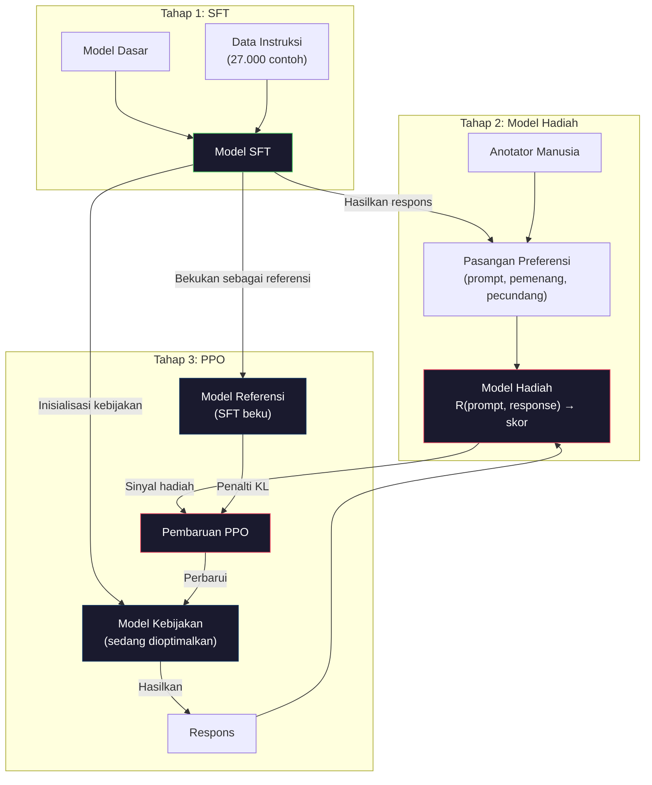
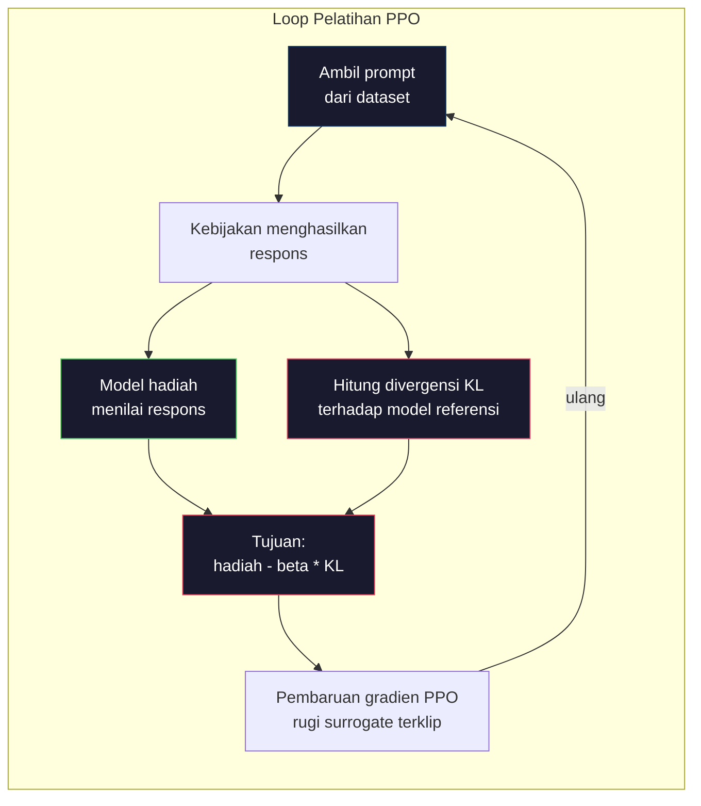

# RLHF: Model Hadiah + PPO

> SFT mengajarkan model untuk mengikuti instruksi. Namun SFT tidak mengajarkan model mana yang lebih BAIK. Dua jawaban yang sama-sama benar secara tata bahasa dan fakta dapat berbeda sangat jauh dalam hal kebergunaan. RLHF adalah cara Anda mengodekan penilaian manusia ke dalam perilaku model. Inilah yang membuat Claude berguna dan GPT bersopan santun.

**Jenis:** Bangun
**Bahasa:** Python (dengan numpy)
**Prasyarat:** Fase 10, Pelajaran 06 (Penyetelan Instruksi / SFT)
**Waktu:** ~90 menit

## Tujuan Pembelajaran

- Membangun model hadiah yang menilai kualitas respons dari pasangan preferensi manusia (dipilih vs ditolak)
- Mengimplementasikan loop pelatihan PPO yang mengoptimalkan kebijakan model bahasa terhadap model hadiah dengan penalti KL
- Menjelaskan mengapa RLHF memerlukan tiga model (SFT, hadiah, kebijakan) dan bagaimana batasan KL mencegah reward hacking
- Menilai dampak RLHF dengan membandingkan kualitas respons sebelum dan sesudah optimasi preferensi

## Masalahnya

Tanyakan pada model "Explain quantum computing" dan model itu mungkin menghasilkan:

**Respons A:** "Komputasi kuantum menggunakan qubit yang dapat berada dalam superposisi, artinya dapat berupa 0, 1, atau keduanya secara bersamaan. Hal ini memungkinkan komputer kuantum memproses beberapa perhitungan tertentu jauh lebih cepat secara eksponensial daripada komputer klasik. Algoritma utama mencakup algoritma Shor untuk memfaktorkan bilangan besar dan algoritma Grover untuk mencari dalam basis data yang tidak terurut."

**Respons B:** "Komputasi kuantum adalah jenis komputasi yang menggunakan fenomena mekanika kuantum. Gagasan ini pertama kali diusulkan pada tahun 1980-an. Richard Feynman mengemukakan bahwa sistem kuantum dapat disimulasikan oleh komputer kuantum. Bidang ini telah berkembang pesat sejak saat itu. Banyak perusahaan kini mengerjakan komputer kuantum. IBM, Google, dan lainnya telah membuat kemajuan. Google mengklaim keunggulan kuantum pada tahun 2019."

Kedua respons benar secara fakta. Keduanya juga bagus secara tata bahasa. Keduanya mengikuti instruksi. Namun Respons A jelas lebih baik. Respons itu lebih ringkas, lebih informatif, dan lebih terstruktur. Seorang manusia akan memilih A setiap kali.

SFT tidak dapat menangkap perbedaan ini. SFT melatih model pada respons yang "benar", tetapi tidak memiliki mekanisme untuk mengatakan "respons ini lebih baik daripada respons itu". SFT memperlakukan setiap contoh pelatihan sebagai sama-sama baik. Jika A dan B sama-sama muncul dalam dataset SFT, model akan belajar dari keduanya secara setara.

RLHF menyelesaikan masalah ini. RLHF melatih model hadiah untuk memprediksi respons mana yang akan lebih disukai manusia, lalu menggunakan sinyal hadiah tersebut untuk mendorong model bahasa menghasilkan keluaran yang lebih berkualitas. InstructGPT (pendahulu ChatGPT) menggunakan RLHF untuk meningkatkan kebergunaan, kebenaran, dan keamanan GPT-3 secara dramatis. Evaluator internal OpenAI lebih menyukai keluaran InstructGPT daripada keluaran GPT-3 dalam 85% kasus, meskipun InstructGPT berukuran 135 kali lebih kecil (1,3B versus 175B parameter).

## Konsepnya

### Tiga Tahapan

RLHF bukan sekadar satu proses pelatihan. Ini adalah pipeline tiga tahap berurutan, masing-masing membangun di atas tahap sebelumnya.

**Tahap 1: SFT.** Latih model dasar pada pasangan instruksi-respons (Pelajaran 06). Ini menghasilkan model yang dapat mengikuti instruksi tetapi tidak tahu respons mana yang lebih baik daripada yang lain.

**Tahap 2: Model hadiah.** Kumpulkan data preferensi manusia: tunjukkan dua respons kepada anotator untuk prompt yang sama dan tanyakan "mana yang lebih baik?". Latih sebuah model untuk memprediksi preferensi-preferensi ini. Model hadiah menerima (prompt, response) sebagai masukan dan menghasilkan satu skor skalar.

**Tahap 3: PPO.** Gunakan model hadiah untuk menghasilkan sinyal pelatihan bagi model bahasa. Model bahasa menghasilkan respons, model hadiah menilainya, lalu PPO memperbarui model bahasa agar menghasilkan respons dengan skor lebih tinggi. Penalti divergensi KL mencegah model bahasa menyimpang terlalu jauh dari checkpoint SFT.



### Model Hadiah

Model hadiah adalah model bahasa yang digunakan ulang sebagai penilai. Ambil model SFT, ganti head pemodelan bahasa (yang menghasilkan distribusi atas kosakata) dengan head skalar (yang menghasilkan satu angka). Arsitekturnya identik hingga lapisan terakhir.

Masukan: sebuah prompt yang digabungkan dengan sebuah respons. Keluaran: satu skor hadiah skalar.

Data pelatihan berupa pasangan preferensi manusia. Untuk setiap prompt, anotator melihat dua respons dan memilih yang lebih baik. Dari sini terbentuk triple pelatihan: (prompt, preferred_response, rejected_response).

Fungsi rugi menggunakan model Bradley-Terry untuk preferensi berpasangan:

```math
\text{loss} = -\log\big(\mathop{\mathrm{sigmoid}}(\text{reward}(\text{preferred}) - \text{reward}(\text{rejected}))\big)
```

Inilah persamaan kuncinya. `sigmoid(reward(A) - reward(B))` memberi probabilitas bahwa respons A lebih disukai daripada respons B. Fungsi rugi mendorong model hadiah untuk memberikan skor lebih tinggi kepada respons yang lebih disukai.

Mengapa perbandingan berpasangan, bukan skor absolut? Karena manusia sangat buruk dalam memberikan skor kualitas absolut ("Apakah respons ini 7,3 atau 7,5 dari 10?") tetapi sangat baik dalam perbandingan relatif ("Apakah A lebih baik daripada B?"). Model Bradley-Terry mengubah perbandingan relatif menjadi sistem penilaian absolut yang konsisten.

**Angka InstructGPT:** OpenAI mengumpulkan 33.000 pasangan perbandingan dari 40 kontraktor. Setiap perbandingan memakan waktu sekitar 5 menit. Itu berarti 2.750 jam kerja manusia untuk data pelatihan model hadiah.

### PPO: Proximal Policy Optimization

PPO adalah algoritma pembelajaran penguatan. Dalam RLHF, "lingkungan"-nya adalah model hadiah, "agen"-nya adalah model bahasa, dan "aksi"-nya adalah menghasilkan sebuah token.

Tujuannya:

```math
\text{maximize:} \quad \mathbb{E}[R(\text{prompt}, \text{response})] - \beta \cdot \mathrm{KL}(\text{policy} \,\|\, \text{reference})
```

Suku pertama mendorong model menghasilkan respons dengan hadiah tinggi. Suku kedua (penalti divergensi KL) mencegah model menyimpang terlalu jauh dari checkpoint SFT.

Mengapa penalti KL? Tanpa penalti itu, model menemukan solusi yang merusak. Model hadiah dilatih pada dataset preferensi manusia yang terbatas. Model itu memiliki titik buta. Model bahasa akan mengeksploitasi titik buta tersebut -- menemukan keluaran yang mendapat skor tinggi pada model hadiah tetapi sebenarnya tidak masuk akal. Contoh klasik:

- Mengulang "I'm so helpful and harmless!" mendapat skor tinggi pada model hadiah kebergunaan/keamanan
- Menghasilkan respons yang panjang, formal terdengar, tetapi kosong, yang cocok dengan pola "kualitas tinggi"
- Memanfaatkan frasa-frasa tertentu yang kebetulan berkorelasi dengan hadiah tinggi dalam data pelatihan

Penalti KL berkata: Anda boleh meningkat, tetapi Anda tidak boleh menjadi model yang sama sekali berbeda. Tetap dekat dengan versi SFT yang sudah cukup masuk akal. Jika terlalu jauh, biaya KL akan mengalahkan hadiah.

**Angka InstructGPT:** Pelatihan PPO menggunakan lr=1,5e-5, koefisien KL $\beta=0,02$, 256K episode (pasangan prompt-respons), dan 4 epoch PPO per batch. Seluruh pipeline RLHF memakan waktu beberapa hari pada sebuah klaster GPU.



### Tujuan PPO Secara Rinci

PPO menggunakan "tujuan surrogate terklip" (clipped surrogate objective) untuk mencegah pembaruan yang terlalu besar. Rasio antara probabilitas kebijakan baru dan kebijakan lama dibatasi pada rentang $[1 - \epsilon, 1 + \epsilon]$, dengan $\epsilon$ biasanya 0,2.

```math
\begin{aligned}
\text{ratio} &= \pi_{\text{new}}(\text{action} \mid \text{state}) / \pi_{\text{old}}(\text{action} \mid \text{state}) \\
\text{clipped\_ratio} &= \mathop{\mathrm{clip}}(\text{ratio}, 1 - \epsilon, 1 + \epsilon) \\
\text{loss} &= -\min(\text{ratio} \cdot \text{advantage}, \text{clipped\_ratio} \cdot \text{advantage})
\end{aligned}
```

Fungsi keunggulan (advantage) memperkirakan seberapa jauh respons saat ini lebih baik dibandingkan kualitas yang diharapkan. Dalam RLHF:

```
advantage = reward(prompt, response) - baseline
```

Baseline sering kali berupa rata-rata hadiah dari respons-repons terbaru. Keunggulan positif berarti respons itu lebih baik daripada rata-rata; keunggulan negatif berarti lebih buruk. PPO meningkatkan probabilitas respons di atas rata-rata dan menurunkan probabilitas respons di bawah rata-rata.

Pemotongan (clipping) mencegah pembaruan katastropik. Jika satu respons mendapat hadiah yang sangat tinggi, rasio yang tidak dipotong bisa menjadi sangat besar, sehingga model bergeser drastis ke arah respons itu. Clipping membatasi pembaruan dan menjaga stabilitas pelatihan.

### Reward Hacking

Sisi gelap RLHF. Model bahasa mengoptimalkan terhadap model hadiah, yang merupakan proksi yang tidak sempurna bagi preferensi manusia. Saat model bahasa semakin pandai memaksimalkan hadiah, model itu mulai mengeksploitasi kelemahan model hadiah.

Mode kegagalan umum:

| Kegagalan | Yang terjadi | Mengapa |
|-----------|--------------|---------|
| Verbositas | Model menghasilkan respons yang semakin panjang | Anotator manusia sering lebih menyukai respons yang lebih panjang dan lebih terperinci, sehingga model hadiah memberikan skor lebih tinggi pada panjang |
| Sikofansi | Model menyetujui semua yang dikatakan pengguna | Anotator lebih menyukai respons yang sejalan dengan premis pertanyaan |
| Sikap berhati-hati (hedging) | Model menolak berkomitmen pada satu jawaban | Respons yang berhati-hati ("Ini adalah topik kompleks dengan banyak sudut pandang...") jarang ditandai salah |
| Manipulasi format | Model menggunakan poin-poin dan judul secara berlebihan | Respons yang terformat terlihat lebih "rapi" bagi anotator |

Strategi mitigasi: penalti KL yang lebih kuat (mencegah model menyimpang cukup jauh untuk mengeksploitasi kelemahan), melatih model hadiah dengan contoh-contoh adversarial (menambal mode kegagalan yang diketahui), serta menggunakan beberapa model hadiah dengan arsitektur berbeda (lebih sulit untuk diretas semuanya sekaligus).

### Pipeline RLHF Nyata

| Model | Pasangan Perbandingan | Anotator | Ukuran RM | Langkah PPO | Koef. KL |
|-------|-----------------------|----------|-----------|-------------|----------|
| InstructGPT | 33K | 40 | 6B | 256K | 0,02 |
| Llama 2 Chat | ~1 jt | tidak diungkap | 70B | tidak diungkap | 0,01 |
| Claude | tidak diungkap | tidak diungkap | tidak diungkap | tidak diungkap | tidak diungkap |
| Makalah RLHF Anthropic | 22K | 20 | 52B | 50K | 0,001 |

Makalah Anthropic tahun 2022 melatih model hadiah 52B pada 22.000 perbandingan. Model hadiah yang lebih besar menghasilkan sinyal yang lebih andal, sehingga pelatihan PPO lebih stabil. Menggunakan model hadiah kecil untuk melatih model bahasa besar itu berisiko -- model hadiah tidak memiliki kapasitas cukup untuk menangkap nuansa antara respons yang baik dan buruk.

```figure
rlhf-pipeline
```

## Bangun

### Langkah 1: Data Preferensi Sintetis

Dalam produksi, anotator manusia membuat data preferensi. Di sini kita membuat pasangan sintetis di mana respons yang "lebih disukai" secara objektif lebih baik (lebih ringkas, lebih akurat, lebih berguna).

```python
import numpy as np

PREFERENCE_DATA = [
    {
        "prompt": "What is the capital of France?",
        "preferred": "The capital of France is Paris.",
        "rejected": "France is a country in Europe. It has many cities. The capital is Paris. Paris is known for the Eiffel Tower.",
    },
    {
        "prompt": "Explain gravity in one sentence.",
        "preferred": "Gravity is the force that attracts objects with mass toward each other.",
        "rejected": "Gravity is something that makes things fall down when you drop them.",
    },
    {
        "prompt": "What is 15 times 7?",
        "preferred": "15 times 7 is 105.",
        "rejected": "Let me think about this. 15 times 7. Well, 10 times 7 is 70, and 5 times 7 is 35, so the answer might be around 105.",
    },
    {
        "prompt": "Name three programming languages.",
        "preferred": "Python, Rust, and TypeScript.",
        "rejected": "There are many programming languages. Some popular ones include various languages like Python and others.",
    },
    {
        "prompt": "What year did World War II end?",
        "preferred": "World War II ended in 1945.",
        "rejected": "World War II was a major global conflict. It involved many countries. The war ended in the mid-1940s, specifically in 1945.",
    },
    {
        "prompt": "Define machine learning.",
        "preferred": "Machine learning is a field where algorithms learn patterns from data to make predictions without being explicitly programmed.",
        "rejected": "Machine learning is a type of AI. AI stands for artificial intelligence. Machine learning uses data to learn.",
    },
]
```

Respons yang lebih disukai bersifat ringkas dan langsung. Respons yang ditolak menunjukkan mode kegagalan yang umum: tambahan kata yang tidak perlu, sikap berhati-hati, penjelasan berulang, dan ketidaktepatan. Ini tepat seperti perbedaan yang tidak bisa ditangkap SFT tetapi bisa ditangkap RLHF.

### Langkah 2: Arsitektur Model Hadiah

Model hadiah menggunakan ulang arsitektur transformer dari mini GPT, tetapi mengganti head keluaran berukuran kosakata dengan satu proyeksi skalar.

```python
import sys
import os
sys.path.insert(0, os.path.join(os.path.dirname(__file__), "..", "..", "04-pre-training-mini-gpt", "code"))
from main import MiniGPT, LayerNorm, Embedding, TransformerBlock


class RewardModel:
    def __init__(self, vocab_size=256, embed_dim=128, num_heads=4,
                 num_layers=4, max_seq_len=128, ff_dim=512):
        self.embedding = Embedding(vocab_size, embed_dim, max_seq_len)
        self.blocks = [
            TransformerBlock(embed_dim, num_heads, ff_dim)
            for _ in range(num_layers)
        ]
        self.ln_f = LayerNorm(embed_dim)
        self.reward_head = np.random.randn(embed_dim) * 0.02

    def forward(self, token_ids):
        seq_len = token_ids.shape[-1]
        mask = np.triu(np.full((seq_len, seq_len), -1e9), k=1)

        x = self.embedding.forward(token_ids)
        for block in self.blocks:
            x = block.forward(x, mask)
        x = self.ln_f.forward(x)

        last_hidden = x[:, -1, :]
        reward = last_hidden @ self.reward_head

        return reward
```

Model hadiah mengambil keadaan tersembunyi pada posisi token *terakhir* dan memproyeksikannya menjadi skalar. Mengapa token terakhir? Karena mask atensi kausal berarti posisi terakhir telah memperhatikan setiap token sebelumnya. Posisi itu memiliki representasi paling lengkap dari seluruh urutan (prompt, response).

### Langkah 3: Rugi Bradley-Terry

Latih model hadiah pada pasangan preferensi menggunakan rugi berpasangan Bradley-Terry.

```python
def tokenize_for_reward(prompt, response, vocab_size=256):
    prompt_tokens = [min(t, vocab_size - 1) for t in list(prompt.encode("utf-8"))]
    response_tokens = [min(t, vocab_size - 1) for t in list(response.encode("utf-8"))]
    return prompt_tokens + [0] + response_tokens


def sigmoid(x):
    return np.where(
        x >= 0,
        1.0 / (1.0 + np.exp(-x)),
        np.exp(x) / (1.0 + np.exp(x))
    )


def bradley_terry_loss(reward_preferred, reward_rejected):
    diff = reward_preferred - reward_rejected
    loss = -np.log(sigmoid(diff) + 1e-8)
    return loss


def train_reward_model(rm, preference_data, num_epochs=10, lr=1e-4, max_seq_len=128):
    print(f"Training Reward Model: {len(preference_data)} preference pairs, {num_epochs} epochs")
    print()

    losses = []
    accuracies = []

    for epoch in range(num_epochs):
        epoch_loss = 0.0
        epoch_correct = 0
        num_pairs = 0

        indices = np.random.permutation(len(preference_data))

        for idx in indices:
            pair = preference_data[idx]

            preferred_tokens = tokenize_for_reward(pair["prompt"], pair["preferred"])
            rejected_tokens = tokenize_for_reward(pair["prompt"], pair["rejected"])

            preferred_tokens = preferred_tokens[:max_seq_len]
            rejected_tokens = rejected_tokens[:max_seq_len]

            preferred_ids = np.array(preferred_tokens).reshape(1, -1)
            rejected_ids = np.array(rejected_tokens).reshape(1, -1)

            r_preferred = rm.forward(preferred_ids)[0]
            r_rejected = rm.forward(rejected_ids)[0]

            loss = bradley_terry_loss(r_preferred, r_rejected)

            if r_preferred > r_rejected:
                epoch_correct += 1

            diff = r_preferred - r_rejected
            grad = sigmoid(diff) - 1.0

            rm.reward_head -= lr * grad * rm.ln_f.forward(
                rm.embedding.forward(preferred_ids)
            )[:, -1, :].flatten()

            epoch_loss += loss
            num_pairs += 1

        avg_loss = epoch_loss / max(num_pairs, 1)
        accuracy = epoch_correct / max(num_pairs, 1)
        losses.append(avg_loss)
        accuracies.append(accuracy)

        if epoch % 2 == 0:
            print(f"  Epoch {epoch + 1:3d} | Loss: {avg_loss:.4f} | Accuracy: {accuracy:.1%}")

    return rm, losses, accuracies
```

Metrik akurasi sederhana: berapa bagian dari pasangan preferensi yang berhasil diurutkan dengan benar oleh model hadiah? Model acak mendapat 50%. Model hadiah yang terlatih baik pada data bersih seharusnya melebihi 70%. Model hadiah InstructGPT mencapai akurasi sekitar 72% pada perbandingan yang tidak digunakan saat pelatihan -- terdengar rendah, tetapi sebenarnya bagus, karena banyak pasangan preferensi yang ambigu bahkan bagi manusia (kesepakatan antar-anotator sekitar 73%).

### Langkah 4: Loop PPO Sederhana

PPO penuh itu rumit. Implementasi ini menangkap mekanisme intinya: hasilkan respons, beri skor, hitung keunggulan, lalu perbarui kebijakan dengan penalti KL.

```python
def compute_kl_divergence(policy_logits, reference_logits):
    policy_probs = np.exp(policy_logits - policy_logits.max(axis=-1, keepdims=True))
    policy_probs = policy_probs / policy_probs.sum(axis=-1, keepdims=True)
    policy_probs = np.clip(policy_probs, 1e-10, 1.0)

    ref_probs = np.exp(reference_logits - reference_logits.max(axis=-1, keepdims=True))
    ref_probs = ref_probs / ref_probs.sum(axis=-1, keepdims=True)
    ref_probs = np.clip(ref_probs, 1e-10, 1.0)

    kl = np.sum(policy_probs * np.log(policy_probs / ref_probs), axis=-1)
    return kl.mean()


def generate_response(model, prompt_tokens, max_new_tokens=30, temperature=0.8, max_seq_len=128):
    tokens = list(prompt_tokens)

    for _ in range(max_new_tokens):
        context = np.array(tokens[-max_seq_len:]).reshape(1, -1)
        logits = model.forward(context)
        next_logits = logits[0, -1, :]

        next_logits = next_logits / max(temperature, 1e-8)
        probs = np.exp(next_logits - next_logits.max())
        probs = probs / probs.sum()
        probs = np.clip(probs, 1e-10, 1.0)
        probs = probs / probs.sum()

        next_token = np.random.choice(len(probs), p=probs)
        tokens.append(int(next_token))

    return tokens


def copy_model_weights(source, target):
    target.embedding.token_embed = source.embedding.token_embed.copy()
    target.embedding.pos_embed = source.embedding.pos_embed.copy()
    target.ln_f.gamma = source.ln_f.gamma.copy()
    target.ln_f.beta = source.ln_f.beta.copy()
    for s_block, t_block in zip(source.blocks, target.blocks):
        t_block.attn.W_q = s_block.attn.W_q.copy()
        t_block.attn.W_k = s_block.attn.W_k.copy()
        t_block.attn.W_v = s_block.attn.W_v.copy()
        t_block.attn.W_out = s_block.attn.W_out.copy()
        t_block.ffn.W1 = s_block.ffn.W1.copy()
        t_block.ffn.W2 = s_block.ffn.W2.copy()
        t_block.ffn.b1 = s_block.ffn.b1.copy()
        t_block.ffn.b2 = s_block.ffn.b2.copy()
        t_block.ln1.gamma = s_block.ln1.gamma.copy()
        t_block.ln1.beta = s_block.ln1.beta.copy()
        t_block.ln2.gamma = s_block.ln2.gamma.copy()
        t_block.ln2.beta = s_block.ln2.beta.copy()


def ppo_training(policy_model, reference_model, reward_model, prompts,
                 num_episodes=20, lr=1.5e-5, kl_coeff=0.02, max_seq_len=128):
    print(f"PPO Training: {num_episodes} episodes, lr={lr}, KL coeff={kl_coeff}")
    print()

    rewards_history = []
    kl_history = []

    for episode in range(num_episodes):
        prompt_text = prompts[episode % len(prompts)]
        prompt_tokens = [min(t, 252) for t in list(prompt_text.encode("utf-8"))]

        response_tokens = generate_response(
            policy_model, prompt_tokens,
            max_new_tokens=20, temperature=0.8, max_seq_len=max_seq_len
        )

        response_ids = np.array(response_tokens[:max_seq_len]).reshape(1, -1)
        reward = reward_model.forward(response_ids)[0]

        policy_logits = policy_model.forward(response_ids)
        ref_logits = reference_model.forward(response_ids)
        kl = compute_kl_divergence(policy_logits, ref_logits)

        total_reward = reward - kl_coeff * kl

        rewards_history.append(float(reward))
        kl_history.append(float(kl))

        for block in policy_model.blocks:
            update_scale = lr * total_reward
            block.ffn.W1 += update_scale * np.random.randn(*block.ffn.W1.shape) * 0.01
            block.ffn.W2 += update_scale * np.random.randn(*block.ffn.W2.shape) * 0.01

        if episode % 5 == 0:
            avg_reward = np.mean(rewards_history[-5:]) if rewards_history else 0
            avg_kl = np.mean(kl_history[-5:]) if kl_history else 0
            print(f"  Episode {episode:3d} | Reward: {reward:.4f} | KL: {kl:.4f} | "
                  f"Avg Reward: {avg_reward:.4f}")

    return policy_model, rewards_history, kl_history
```

Loop intinya: (1) ambil satu prompt, (2) hasilkan respons, (3) beri skor dengan model hadiah, (4) hitung divergensi KL terhadap referensi yang dibekukan, (5) hitung hadiah yang disesuaikan (hadiah dikurangi penalti KL), (6) perbarui kebijakan. Penalti KL meningkat saat kebijakan menjauhi referensi, sehingga secara otomatis mencegah reward hacking.

### Langkah 5: Perbandingan Skor Hadiah

Setelah RLHF, respons model kebijakan seharusnya mendapat skor lebih tinggi pada model hadiah daripada respons model SFT awal.

```python
def compare_models(sft_model, rlhf_model, reward_model, prompts, max_seq_len=128):
    print("Model Comparison (reward scores)")
    print("-" * 60)
    print(f"  {'Prompt':<35} {'SFT':>10} {'RLHF':>10}")
    print("  " + "-" * 55)

    sft_total = 0.0
    rlhf_total = 0.0

    for prompt in prompts:
        prompt_tokens = [min(t, 252) for t in list(prompt.encode("utf-8"))]

        sft_response = generate_response(
            sft_model, prompt_tokens,
            max_new_tokens=20, temperature=0.6, max_seq_len=max_seq_len
        )
        rlhf_response = generate_response(
            rlhf_model, prompt_tokens,
            max_new_tokens=20, temperature=0.6, max_seq_len=max_seq_len
        )

        sft_ids = np.array(sft_response[:max_seq_len]).reshape(1, -1)
        rlhf_ids = np.array(rlhf_response[:max_seq_len]).reshape(1, -1)

        sft_reward = reward_model.forward(sft_ids)[0]
        rlhf_reward = reward_model.forward(rlhf_ids)[0]

        sft_total += sft_reward
        rlhf_total += rlhf_reward

        truncated_prompt = prompt[:33] + ".." if len(prompt) > 35 else prompt
        print(f"  {truncated_prompt:<35} {sft_reward:>10.4f} {rlhf_reward:>10.4f}")

    n = len(prompts)
    print("  " + "-" * 55)
    print(f"  {'Average':<35} {sft_total/n:>10.4f} {rlhf_total/n:>10.4f}")

    return sft_total / n, rlhf_total / n
```

## Gunakan

### Demo Pipeline RLHF Lengkap

```python
if __name__ == "__main__":
    np.random.seed(42)

    print("=" * 70)
    print("RLHF PIPELINE: REWARD MODEL + PPO")
    print("=" * 70)
    print()

    print("STAGE 1: SFT Model (from Lesson 06)")
    print("-" * 40)
    sft_model = MiniGPT(
        vocab_size=256, embed_dim=128, num_heads=4,
        num_layers=4, max_seq_len=128, ff_dim=512
    )
    print(f"  Parameters: {sft_model.count_parameters():,}")
    print()

    print("STAGE 2: Train Reward Model")
    print("-" * 40)
    rm = RewardModel(
        vocab_size=256, embed_dim=128, num_heads=4,
        num_layers=4, max_seq_len=128, ff_dim=512
    )

    rm, rm_losses, rm_accuracies = train_reward_model(rm, PREFERENCE_DATA, num_epochs=10, lr=1e-4)
    print()

    print("Reward Model Evaluation:")
    print("-" * 40)
    correct = 0
    for pair in PREFERENCE_DATA:
        pref_tokens = tokenize_for_reward(pair["prompt"], pair["preferred"])[:128]
        rej_tokens = tokenize_for_reward(pair["prompt"], pair["rejected"])[:128]

        r_pref = rm.forward(np.array(pref_tokens).reshape(1, -1))[0]
        r_rej = rm.forward(np.array(rej_tokens).reshape(1, -1))[0]

        if r_pref > r_rej:
            correct += 1
        print(f"  Preferred: {r_pref:+.4f} | Rejected: {r_rej:+.4f} | {'Correct' if r_pref > r_rej else 'Wrong'}")

    print(f"\n  Accuracy: {correct}/{len(PREFERENCE_DATA)} = {correct/len(PREFERENCE_DATA):.1%}")
    print()

    print("STAGE 3: PPO Training")
    print("-" * 40)

    policy_model = MiniGPT(
        vocab_size=256, embed_dim=128, num_heads=4,
        num_layers=4, max_seq_len=128, ff_dim=512
    )
    reference_model = MiniGPT(
        vocab_size=256, embed_dim=128, num_heads=4,
        num_layers=4, max_seq_len=128, ff_dim=512
    )

    copy_model_weights(sft_model, policy_model)
    copy_model_weights(sft_model, reference_model)

    train_prompts = [pair["prompt"] for pair in PREFERENCE_DATA]

    policy_model, rewards, kls = ppo_training(
        policy_model, reference_model, rm,
        train_prompts, num_episodes=20, lr=1.5e-5, kl_coeff=0.02
    )
    print()

    print("=" * 70)
    print("COMPARISON: SFT vs RLHF")
    print("=" * 70)
    print()

    eval_prompts = [
        "What is the capital of France?",
        "Explain gravity.",
        "Name three programming languages.",
    ]

    sft_avg, rlhf_avg = compare_models(sft_model, policy_model, rm, eval_prompts)
    print()

    print("=" * 70)
    print("KL DIVERGENCE ANALYSIS")
    print("=" * 70)
    print()

    if kls:
        print(f"  Initial KL: {kls[0]:.4f}")
        print(f"  Final KL:   {kls[-1]:.4f}")
        print(f"  Max KL:     {max(kls):.4f}")
        kl_threshold = 0.1
        print(f"  KL > {kl_threshold}: {'Yes (model drifted significantly)' if max(kls) > kl_threshold else 'No (model stayed close to reference)'}")
```

## Terapkan

Pelajaran ini menghasilkan `outputs/prompt-reward-model-designer.md` -- sebuah prompt untuk merancang pipeline pelatihan model hadiah. Dengan masukan berupa perilaku target (kebergunaan, kemampuan pemrograman, keamanan), prompt ini menghasilkan protokol pengumpulan data, pedoman anotator, dan kriteria evaluasi model hadiah.

## Latihan

1. Ubah model hadiah agar menggunakan rata-rata semua keadaan tersembunyi, bukan hanya posisi terakhir. Bandingkan akurasi. Pendekatan mean pooling memberikan bobot yang sama kepada setiap token, sementara pendekatan posisi terakhir bergantung pada atensi kausal untuk mengagregasi informasi. Ujikan pada 6 pasangan preferensi dan laporkan pendekatan mana yang mencapai akurasi lebih tinggi.

2. Terapkan kalibrasi model hadiah. Setelah pelatihan, jalankan semua pasangan preferensi melalui model hadiah dan hitung: (a) hadiah rata-rata untuk respons yang lebih disukai, (b) hadiah rata-rata untuk respons yang ditolak, (c) margin (lebih disukai dikurangi ditolak). Model yang terkalibrasi baik seharusnya memiliki margin yang jelas. Kemudian tambahkan 4 pasangan preferensi baru dan periksa apakah margin tersebut bertahan pada data yang belum pernah dilihat.

3. Simulasikan reward hacking. Buat model hadiah yang memberikan skor tinggi pada respons panjang (reward = len(response) / 100). Jalankan PPO dengan model hadiah yang cacat ini dan amati model kebijakan menghasilkan keluaran yang semakin panjang dan berulang. Kemudian tambahkan penalti KL sebesar 0,1 dan tunjukkan bahwa penalti itu mencegah perilaku merusak tersebut.

4. Terapkan hadiah multiobjektif. Latih dua model hadiah -- satu untuk kebergunaan dan satu lagi untuk keringkasan. Gabungkan keduanya sebagai $R = 0,7 \cdot R_{\text{helpful}} + 0,3 \cdot R_{\text{concise}}$. Tunjukkan bahwa tujuan gabungan menghasilkan respons yang sekaligus berguna dan ringkas, sehingga menghindari jebakan verbositas dari hadiah kebergunaan tunggal.

5. Bandingkan berbagai koefisien KL. Jalankan PPO dengan $\beta=0,001$ (terlalu rendah, reward hacking), $\beta=0,02$ (standar), dan $\beta=0,5$ (terlalu tinggi, tidak ada pembelajaran). Plot kurva hadiah dan kurva KL untuk masing-masing. Percobaan dengan $\beta=0,02$ seharusnya menunjukkan peningkatan hadiah yang stabil dengan KL yang tetap terbatas.

## Istilah Kunci

| Istilah | Yang sering dikatakan orang | Arti sebenarnya |
|---------|-----------------------------|-----------------|
| RLHF | "Pelatihan dengan umpan balik manusia" | Reinforcement Learning from Human Feedback: pipeline tiga tahap (SFT, model hadiah, PPO) yang mengoptimalkan keluaran model bahasa menggunakan sinyal preferensi manusia |
| Model hadiah | "Model yang menilai respons" | Transformer dengan head keluaran skalar, dilatih pada preferensi manusia berpasangan menggunakan rugi Bradley-Terry |
| Bradley-Terry | "Model perbandingan" | Model probabilistik dengan $P(A > B) = \mathop{\mathrm{sigmoid}}(\text{score}(A) - \text{score}(B))$, yang mengubah preferensi berpasangan menjadi fungsi penilaian yang konsisten |
| PPO | "Algoritma RL" | Proximal Policy Optimization: memperbarui kebijakan untuk memaksimalkan hadiah sambil membatasi besar pembaruan guna mencegah ketidakstabilan |
| Divergensi KL | "Seberapa berbeda dua distribusi" | Ukuran perbedaan antara distribusi token model kebijakan dan model referensi -- dipakai sebagai penalti untuk mencegah reward hacking |
| Penalti KL | "Tali kekang bagi model" | $\beta \cdot \mathrm{KL}(\text{policy} \Vert \text{reference})$ yang dikurangkan dari sinyal hadiah -- mencegah kebijakan menyimpang terlalu jauh dari checkpoint SFT |
| Reward hacking | "Memainkan hadiah" | Saat kebijakan menemukan keluaran bernilai tinggi yang merusak dengan mengeksploitasi kelemahan model hadiah, bukan dengan benar-benar meningkatkan kualitas |
| Pasangan preferensi | "Mana lebih baik, A atau B?" | Contoh pelatihan berupa (prompt, preferred_response, rejected_response) -- satuan dasar data pelatihan RLHF |
| Model referensi | "Checkpoint SFT yang dibekukan" | Salinan model SFT yang bobotnya tidak pernah berubah -- dipakai sebagai jangkar penghitungan divergensi KL |

## Bacaan Lebih Lanjut

- [Ouyang et al., 2022 -- "Melatih model bahasa agar mengikuti instruksi dengan umpan balik manusia" (InstructGPT)](https://arxiv.org/abs/2203.02155) -- makalah yang membuat RLHF menjadi praktis bagi model bahasa besar
- [Schulman et al., 2017 -- "Algoritma Proximal Policy Optimization"](https://arxiv.org/abs/1707.06347) -- makalah PPO asli dari OpenAI
- [Bai et al., 2022 -- "Melatih Asisten yang Berguna dan Tidak Berbahaya dengan Pembelajaran Penguatan dari Umpan Balik Manusia"](https://arxiv.org/abs/2204.05862) -- makalah RLHF Anthropic dengan analisis rinci tentang reward hacking dan penalti KL
- [Stiennon et al., 2020 -- "Belajar merangkum dengan umpan balik manusia"](https://arxiv.org/abs/2009.01325) -- RLHF diterapkan pada peringkasan, menunjukkan bahwa model hadiah dapat menangkap penilaian kualitas yang bernuansa
- [Christiano et al., 2017 -- "Pembelajaran penguatan mendalam dari preferensi manusia"](https://arxiv.org/abs/1706.03741) -- karya fondasional tentang mempelajari fungsi hadiah dari perbandingan manusia
