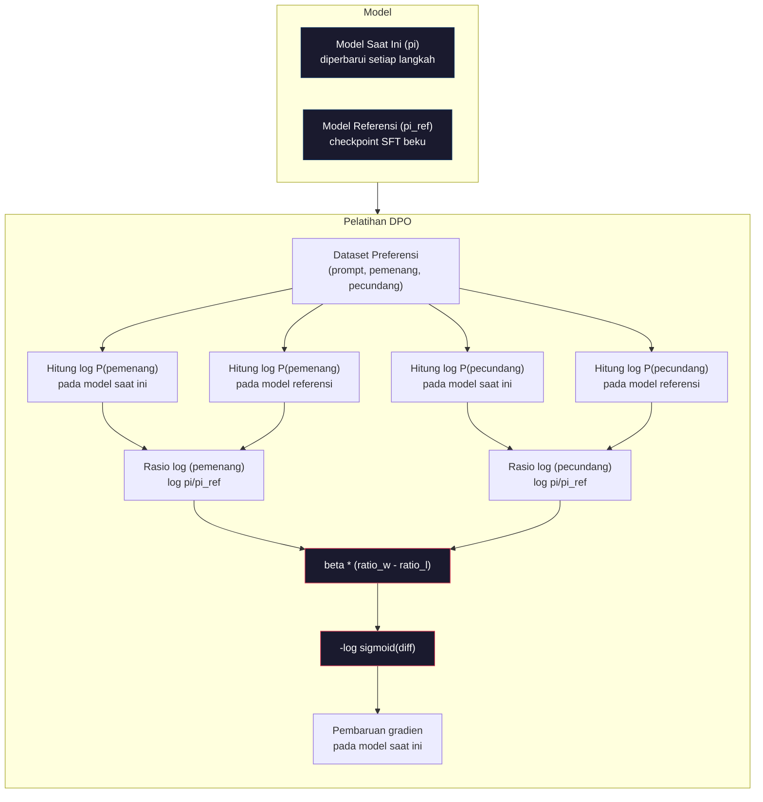

# DPO: Optimasi Preferensi Langsung

> RLHF berhasil. Namun RLHF juga memerlukan pelatihan tiga model (SFT, model hadiah, kebijakan), pengelolaan ketidakstabilan PPO, dan penyetelan penalti KL. DPO bertanya: bagaimana jika Anda bisa melewati semua itu? DPO mengoptimalkan model bahasa secara langsung pada pasangan preferensi. Tanpa model hadiah. Tanpa PPO. Satu loop pelatihan. Hasil yang sama.

**Jenis:** Bangun
**Bahasa:** Python (dengan numpy)
**Prasyarat:** Fase 10, Pelajaran 07 (RLHF)
**Waktu:** ~90 menit

## Tujuan Pembelajaran

- Mengimplementasikan pelatihan DPO yang mengoptimalkan model bahasa secara langsung pada pasangan preferensi tanpa model hadiah terpisah
- Menurunkan fungsi rugi DPO dan menjelaskan bagaimana fungsi itu secara implisit merepresentasikan model hadiah melalui log-probabilitas kebijakan
- Membandingkan DPO dan RLHF dari segi stabilitas pelatihan, biaya komputasi, dan jumlah model yang diperlukan
- Menyetel parameter beta untuk mengontrol seberapa jauh kebijakan yang terlatih menyimpang dari model referensi

## Masalahnya

Anda membangun pipeline RLHF di Pelajaran 07. Tiga tahap. Tiga model. Model SFT, model hadiah, dan model kebijakan yang dioptimalkan dengan PPO. Model hadiah saja memerlukan ribuan pasangan preferensi manusia dan satu loop pelatihan terpisah. PPO memerlukan penyetelan hati-hati pada koefisien KL, laju pembelajaran, rasio klip, dan jumlah epoch.

Dalam praktiknya, pelatihan PPO terkenal tidak stabil. Perubahan kecil pada hiperparameter membuat pelatihan menjadi divergen. Model hadiah adalah proksi yang tidak sempurna bagi preferensi manusia, dan kebijakan menemukan cara untuk mengeksploitasi kelemahannya. Penalti KL membantu, tetapi perlu disetel sendiri -- terlalu rendah dan Anda mendapat reward hacking, terlalu tinggi dan model hampir tidak belajar.

Kompleksitas inilah yang menyebabkan kebanyakan model sumber terbuka kesulitan dengan RLHF selama bertahun-tahun setelah InstructGPT diterbitkan. Pipeline tiga tahap itu rapuh. Setiap tahap memiliki mode kegagalannya sendiri, dan kesalahan saling berlipat.

Pada Mei 2023, Rafael Rafailov, Archit Sharma, dan rekan-rekan di Stanford menerbitkan "Direct Preference Optimization: Your Language Model is Secretly a Reward Model." Wawasan kuncinya: Anda tidak memerlukan model hadiah terpisah. Fungsi hadiah optimal ditentukan secara matematis oleh probabilitas token model bahasa itu sendiri. Anda bisa sepenuhnya melewati model hadiah dan mengoptimalkan model bahasa secara langsung pada pasangan preferensi.

DPO menyederhanakan RLHF menjadi satu langkah pembelajaran terselia. Satu model. Satu fungsi rugi. Satu loop pelatihan. Tanpa pembelajaran penguatan. Zephyr-7B, salah satu model pertama yang memakai DPO dalam skala besar, menyamai atau mengalahkan model yang dilatih dengan RLHF penuh pada beberapa benchmark. Meta menggunakan DPO sebagai bagian dari pipeline penyelarasan Llama 3. Anthropic telah mengutip metode gaya DPO dalam riset penyelarasan mereka.

## Konsepnya

### Wawasan Kunci

RLHF mengoptimalkan tujuan ini:

```math
\text{maximize:} \quad \mathbb{E}[R(x, y)] - \beta \cdot \mathrm{KL}(\pi \,\|\, \pi_{\text{ref}})
```

dengan $R$ adalah model hadiah, $\pi$ adalah kebijakan, $\pi_{\text{ref}}$ adalah model referensi, dan $\beta$ adalah koefisien KL.

Makalah DPO menunjukkan bahwa tujuan ini memiliki solusi optimal berbentuk tertutup. Untuk sebarang fungsi hadiah $R$, kebijakan optimalnya adalah:

```math
\pi^*(y \mid x) = \pi_{\text{ref}}(y \mid x) \cdot \exp(R(x, y) / \beta) / Z(x)
```

dengan $Z(x)$ adalah konstanta normalisasi. Susun ulang:

```math
R(x, y) = \beta \log \frac{\pi^*(y \mid x)}{\pi_{\text{ref}}(y \mid x)} + \beta \log Z(x)
```

Inilah terobosannya. Hadiah dinyatakan seluruhnya dalam hal probabilitas model kebijakan dan probabilitas model referensi. Anda tidak perlu melatih model hadiah terpisah. Hadiahnya bersifat *implisit* dalam rasio probabilitas.

Substitusikan ini ke dalam model preferensi Bradley-Terry:

```math
\begin{aligned}
P(y_w > y_l \mid x) &= \mathop{\mathrm{sigmoid}}(R(x, y_w) - R(x, y_l)) \\
&= \mathop{\mathrm{sigmoid}}\left(\beta \left(\log \frac{\pi(y_w \mid x)}{\pi_{\text{ref}}(y_w \mid x)} - \log \frac{\pi(y_l \mid x)}{\pi_{\text{ref}}(y_l \mid x)}\right)\right)
\end{aligned}
```

Suku-suku $Z(x)$ saling menghilang karena kedua respons bersyarat pada prompt $x$ yang sama. Yang tersisa adalah fungsi dari log-probabilitas model kebijakan dan log-probabilitas model referensi pada respons yang disukai dan ditolak.

### Rugi DPO

```math
L_{\text{DPO}} = -\log \mathop{\mathrm{sigmoid}}\left(\beta \left(\log \frac{\pi(y_w \mid x)}{\pi_{\text{ref}}(y_w \mid x)} - \log \frac{\pi(y_l \mid x)}{\pi_{\text{ref}}(y_l \mid x)}\right)\right)
```

Mari kita bedah setiap bagian:

- **$y_w$** = respons yang lebih disukai (pemenang)
- **$y_l$** = respons yang ditolak (pecundang)
- **$x$** = prompt
- **$\pi$** = model saat ini (sedang dilatih)
- **$\pi_{\text{ref}}$** = model referensi (checkpoint SFT yang dibekukan)
- **$\beta$** = parameter suhu yang mengontrol penyimpangan dari referensi (biasanya 0,1 sampai 0,5)

Rasio `log pi(y|x) / pi_ref(y|x)` adalah rasio log-probabilitas. Ketika rasio ini positif, model saat ini memberikan probabilitas lebih tinggi kepada respons $y$ daripada referensi. Ketika negatif, model saat ini memberikan probabilitas lebih rendah.

Rugi DPO mendorong model untuk menaikkan rasio log-probabilitas pada respons yang lebih disukai dan menurunkannya pada respons yang ditolak. Parameter beta mengontrol seberapa agresif model boleh menyimpang dari referensi -- beta kecil memperbolehkan penyimpangan besar, beta besar menjaga model tetap dekat dengan referensi.



### Mengapa DPO Lebih Sederhana

| Aspek | RLHF (PPO) | DPO |
|-------|-----------|-----|
| Model yang dilatih | 3 (SFT + hadiah + kebijakan) | 1 (hanya kebijakan) |
| Loop pelatihan | 3 (SFT, pelatihan RM, PPO) | 2 (SFT, DPO) |
| Hiperparameter | lr, koef. KL, rasio klip, lr RM, epoch x3 | lr, beta, epoch |
| Model hadiah | Wajib (pelatihan terpisah) | Implisit dalam probabilitas model |
| Algoritma RL | PPO (rumit, tidak stabil) | Pembelajaran terselia (stabil) |
| Memori GPU | 3-4 model dalam memori saat PPO | 2 model (saat ini + referensi) |
| Stabilitas pelatihan | Sensitif terhadap hiperparameter | Tangguh, mirip SFT |

DPO memerlukan dua model dalam memori saat pelatihan -- model saat ini dan referensi yang dibekukan. RLHF memerlukan tiga atau empat: kebijakan, referensi, model hadiah, dan opsional baseline fungsi nilai. Untuk model 70B, setiap salinan memakan 140GB dalam FP16. Penghematan memori dari menghilangkan model hadiah sangat besar.

### Saat DPO Mengalahkan RLHF

**Dataset kecil.** Dengan 5.000-20.000 pasangan preferensi, DPO sering menyamai atau melebihi RLHF. Model hadiah dalam RLHF memerlukan cukup data untuk melakukan generalisasi -- dengan data terbatas, model itu mengalami overfitting dan menghasilkan sinyal hadiah yang tidak andal. DPO menghindari masalah ini karena sama sekali tidak memerlukan model hadiah.

**Komputasi terbatas.** DPO memerlukan sekitar sepertiga komputasi RLHF penuh (satu loop pelatihan, bukan tiga). Bagi tim tanpa klaster GPU besar, ini adalah pilihan praktis.

**Iterasi cepat.** Ingin mencoba 10 dataset preferensi berbeda untuk melihat mana yang menghasilkan model terbaik? DPO memungkinkan Anda menjalankan setiap percobaan dalam hitungan jam. RLHF memerlukan pelatihan ulang model hadiah untuk setiap dataset.

### Saat RLHF Mengalahkan DPO

**Pelatihan skala besar.** Pada skala GPT-4 atau Claude, model hadiah terpisah dalam RLHF dapat menangkap sinyal preferensi yang lebih bernuansa. Model hadiah bertindak sebagai fungsi rugi yang dipelajari dan beradaptasi dengan kriteria kualitas yang kompleks.

**Sinyal hadiah kompleks.** Ketika "lebih baik" mencakup beberapa dimensi (kebergunaan, keamanan, kejujuran), model hadiah dapat mempelajari trade-off multiobjektif ini. DPO memperlakukan setiap pasangan preferensi sebagai sinyal biner -- yang satu lebih baik, yang lain lebih buruk -- tanpa memodelkan alasannya.

**Penyelarasan iteratif.** Pipeline RLHF dapat menghasilkan respons baru dengan kebijakan saat ini, meminta manusia menilainya, dan melatih ulang model hadiah dalam loop online. DPO bekerja pada dataset pasangan preferensi yang tetap. Constitutional AI (pendekatan Anthropic) memanfaatkan sifat iteratif RLHF secara ekstensif.

### Melampaui DPO: KTO, ORPO, SimPO

DPO menginspirasi keluarga metode penyelarasan yang disederhanakan.

**KTO (Kahneman-Tversky Optimization, 2024):** Anda bahkan tidak memerlukan pasangan. KTO bekerja dengan umpan balik tanpa pasangan -- cukup beri label setiap respons sebagai "baik" atau "buruk" tanpa membandingkannya dengan alternatif. Ini menyederhanakan pengumpulan data secara drastis. Alih-alih menunjukkan dua respons kepada anotator dan bertanya "mana yang lebih baik?", Anda menunjukkan satu respons dan bertanya "apakah ini baik?". Fungsi rugi menerapkan loss aversion dari teori prospek: respons buruk diberi penalti lebih besar daripada respons baik yang diberi hadiah.

**ORPO (Odds Ratio Preference Optimization, 2024):** Menggabungkan SFT dan penyelarasan dalam satu langkah pelatihan. Alih-alih melakukan SFT terlebih dahulu lalu DPO, ORPO memodifikasi rugi SFT agar menyertakan sinyal preferensi. Ruginya memiliki dua suku: rugi prediksi token berikutnya standar pada respons yang lebih disukai, ditambah suku odds ratio yang memperlebar jarak antara probabilitas respons yang disukai dan ditolak. Satu loop pelatihan, bukan dua.

**SimPO (Simple Preference Optimization, 2024):** Menghilangkan model referensi sepenuhnya. Alih-alih menghitung rasio log-probabilitas terhadap referensi yang dibekukan, SimPO menggunakan rata-rata log-probabilitas respons (dinormalisasi berdasarkan panjang) sebagai hadiah implisit. Ini menghemat memori (tidak perlu model referensi) dan menyederhanakan pelatihan. Normalisasi panjang mencegah model lebih menyukai respons yang lebih pendek.

| Metode | Tahun | Model dalam Memori | Perlu Pasangan? | Perlu Referensi? | Loop Pelatihan |
|--------|-------|--------------------|-----------------|------------------|----------------|
| RLHF | 2022 | 3-4 | Ya (untuk RM) | Ya | 3 |
| DPO | 2023 | 2 | Ya | Ya | 2 |
| KTO | 2024 | 2 | Tidak (tanpa pasangan) | Ya | 2 |
| ORPO | 2024 | 1 | Ya | Tidak | 1 |
| SimPO | 2024 | 1 | Ya | Tidak | 1 |

Trennya jelas: setiap metode menghilangkan satu lagi lapisan kompleksitas. RLHF memerlukan model hadiah dan PPO. DPO menghilangkan keduanya. KTO menghilangkan data berpasangan. ORPO menghilangkan tahap SFT terpisah. SimPO menghilangkan model referensi. Pajak penyelarasan -- biaya komputasi dan kompleksitas untuk beralih dari model dasar ke model yang selaras -- terus menurun.

### Penerapan DPO Nyata

**Zephyr-7B (HuggingFace, Oktober 2023):** Mistral 7B dasar, SFT pada UltraChat (200.000 contoh), lalu DPO pada UltraFeedback (60.000 pasangan preferensi). Mendapat skor 6,47 pada MT-Bench -- model 7B tertinggi pada saat itu. Sebagai perbandingan, Llama 2 Chat 70B mendapat 6,86, artinya Zephyr mencapai dalam 6% dari model berukuran 10 kali lipatnya hanya dengan penyelarasan DPO.

**Llama 3 (Meta, April 2024):** Menggunakan DPO setelah tahap RLHF awal. Kombinasi ini menunjukkan bahwa DPO dan RLHF dapat saling melengkapi -- RLHF untuk penyelarasan menyeluruh, DPO untuk penyempurnaan terarah.

**Neural Magic / nm-chat (2024):** Menerapkan DPO pada sejumlah model sumber terbuka, secara konsisten menunjukkan perbaikan 5-15% pada benchmark penyelarasan dibandingkan baseline hanya-SFT.

```figure
dpo-loss
```

## Bangun

### Langkah 1: Dataset Preferensi

Format sama seperti RLHF -- triple (prompt, preferred, rejected). DPO mengonsumsi data ini secara langsung tanpa model hadiah antara.

```python
import numpy as np
import sys
import os
sys.path.insert(0, os.path.join(os.path.dirname(__file__), "..", "..", "04-pre-training-mini-gpt", "code"))
from main import MiniGPT, LayerNorm, Embedding, TransformerBlock

PREFERENCE_DATA = [
    {
        "prompt": "What is the capital of France?",
        "preferred": "The capital of France is Paris.",
        "rejected": "France is a country in Europe. It has many cities. The capital is Paris. Paris is known for the Eiffel Tower.",
    },
    {
        "prompt": "Explain gravity in one sentence.",
        "preferred": "Gravity is the force that attracts objects with mass toward each other.",
        "rejected": "Gravity is something that makes things fall down when you drop them.",
    },
    {
        "prompt": "What is 15 times 7?",
        "preferred": "15 times 7 is 105.",
        "rejected": "Let me think about this. 15 times 7. Well, 10 times 7 is 70, and 5 times 7 is 35, so the answer might be around 105.",
    },
    {
        "prompt": "Name three programming languages.",
        "preferred": "Python, Rust, and TypeScript.",
        "rejected": "There are many programming languages. Some popular ones include various languages like Python and others.",
    },
    {
        "prompt": "What year did World War II end?",
        "preferred": "World War II ended in 1945.",
        "rejected": "World War II was a major global conflict. It involved many countries. The war ended in the mid-1940s, specifically in 1945.",
    },
    {
        "prompt": "Define machine learning.",
        "preferred": "Machine learning is a field where algorithms learn patterns from data to make predictions without being explicitly programmed.",
        "rejected": "Machine learning is a type of AI. AI stands for artificial intelligence. Machine learning uses data to learn.",
    },
]
```

### Langkah 2: Log-Probabilitas Urutan

Rugi DPO memerlukan penghitungan total log-probabilitas sebuah respons yang diberikan sebuah prompt. Ini berarti menjalankan model pada urutan lengkap (prompt + respons) dan menjumlahkan log-probabilitas setiap token respons.

```python
def tokenize_sequence(text, vocab_size=256):
    return [min(t, vocab_size - 1) for t in list(text.encode("utf-8"))]


def compute_sequence_log_prob(model, prompt_tokens, response_tokens, max_seq_len=128):
    full_sequence = prompt_tokens + response_tokens
    if len(full_sequence) > max_seq_len:
        full_sequence = full_sequence[:max_seq_len]

    if len(full_sequence) < 2:
        return 0.0

    input_ids = np.array(full_sequence[:-1]).reshape(1, -1)
    target_ids = np.array(full_sequence[1:])

    logits = model.forward(input_ids)
    logits = logits[0]

    max_logits = logits.max(axis=-1, keepdims=True)
    log_probs = logits - max_logits - np.log(
        np.exp(logits - max_logits).sum(axis=-1, keepdims=True)
    )

    prompt_len = len(prompt_tokens)
    response_start = max(0, prompt_len - 1)
    response_end = len(target_ids)

    if response_start >= response_end:
        return 0.0

    response_log_probs = log_probs[response_start:response_end, :]
    response_targets = target_ids[response_start:response_end]

    total_log_prob = 0.0
    for i, target in enumerate(response_targets):
        total_log_prob += response_log_probs[i, target]

    return total_log_prob
```

Fungsi ini adalah mesin kerja DPO. Untuk setiap pasangan preferensi, fungsi ini dijalankan empat kali: model pada respons yang disukai, model pada respons yang ditolak, referensi pada respons yang disukai, referensi pada respons yang ditolak. Itu 4 operasi forward per contoh pelatihan, dibandingkan dengan RLHF yang memerlukan pembangkitan + penilaian hadiah + estimasi nilai + pembaruan PPO. Lebih sederhana, lebih cepat, lebih stabil.

### Langkah 3: Rugi DPO

Inti makalah dalam bentuk kode. Satu fungsi. Satu rugi. Tanpa model hadiah.

```python
def sigmoid(x):
    return np.where(
        x >= 0,
        1.0 / (1.0 + np.exp(-x)),
        np.exp(x) / (1.0 + np.exp(x))
    )


def dpo_loss(policy_logprob_preferred, policy_logprob_rejected,
             ref_logprob_preferred, ref_logprob_rejected, beta=0.1):
    preferred_ratio = policy_logprob_preferred - ref_logprob_preferred
    rejected_ratio = policy_logprob_rejected - ref_logprob_rejected

    logit = beta * (preferred_ratio - rejected_ratio)

    loss = -np.log(sigmoid(logit) + 1e-8)

    preferred_reward = beta * preferred_ratio
    rejected_reward = beta * rejected_ratio

    return loss, {
        "preferred_ratio": float(preferred_ratio),
        "rejected_ratio": float(rejected_ratio),
        "logit": float(logit),
        "implicit_preferred_reward": float(preferred_reward),
        "implicit_rejected_reward": float(rejected_reward),
        "reward_margin": float(preferred_reward - rejected_reward),
    }
```

`preferred_ratio` dan `rejected_ratio` adalah rasio log-probabilitas dari turunan DPO. Ketika model saat ini memberikan probabilitas lebih tinggi kepada respons yang lebih disukai (relatif terhadap referensi) dan probabilitas lebih rendah kepada respons yang ditolak, logit bernilai positif dan ruginya rendah. Sinyal pelatihan mendorong model tepat ke arah ini.

`implicit_preferred_reward` dan `implicit_rejected_reward` adalah hadiah yang secara implisit ditetapkan oleh rugi DPO. Anda dapat mengekstraknya untuk memverifikasi bahwa pelatihan berjalan -- margin antara hadiah yang disukai dan ditolak seharusnya meningkat seiring pelatihan.

### Langkah 4: Loop Pelatihan DPO

Loop pelatihan terselia yang standar. Tanpa PPO. Tanpa model hadiah. Hanya operasi forward dan pembaruan gradien.

```python
def copy_model_weights(source, target):
    target.embedding.token_embed = source.embedding.token_embed.copy()
    target.embedding.pos_embed = source.embedding.pos_embed.copy()
    target.ln_f.gamma = source.ln_f.gamma.copy()
    target.ln_f.beta = source.ln_f.beta.copy()
    for s_block, t_block in zip(source.blocks, target.blocks):
        t_block.attn.W_q = s_block.attn.W_q.copy()
        t_block.attn.W_k = s_block.attn.W_k.copy()
        t_block.attn.W_v = s_block.attn.W_v.copy()
        t_block.attn.W_out = s_block.attn.W_out.copy()
        t_block.ffn.W1 = s_block.ffn.W1.copy()
        t_block.ffn.W2 = s_block.ffn.W2.copy()
        t_block.ffn.b1 = s_block.ffn.b1.copy()
        t_block.ffn.b2 = s_block.ffn.b2.copy()
        t_block.ln1.gamma = s_block.ln1.gamma.copy()
        t_block.ln1.beta = s_block.ln1.beta.copy()
        t_block.ln2.gamma = s_block.ln2.gamma.copy()
        t_block.ln2.beta = s_block.ln2.beta.copy()


def dpo_train(policy_model, reference_model, preference_data,
              num_epochs=5, lr=5e-6, beta=0.1, max_seq_len=128):
    print(f"DPO Training: {len(preference_data)} pairs, {num_epochs} epochs, "
          f"lr={lr}, beta={beta}")
    print()

    losses = []
    margins = []

    for epoch in range(num_epochs):
        epoch_loss = 0.0
        epoch_margin = 0.0
        num_examples = 0

        indices = np.random.permutation(len(preference_data))

        for idx in indices:
            pair = preference_data[idx]

            prompt_tokens = tokenize_sequence(pair["prompt"])
            preferred_tokens = tokenize_sequence(pair["preferred"])
            rejected_tokens = tokenize_sequence(pair["rejected"])

            pi_logprob_w = compute_sequence_log_prob(
                policy_model, prompt_tokens, preferred_tokens, max_seq_len
            )
            pi_logprob_l = compute_sequence_log_prob(
                policy_model, prompt_tokens, rejected_tokens, max_seq_len
            )
            ref_logprob_w = compute_sequence_log_prob(
                reference_model, prompt_tokens, preferred_tokens, max_seq_len
            )
            ref_logprob_l = compute_sequence_log_prob(
                reference_model, prompt_tokens, rejected_tokens, max_seq_len
            )

            loss, metrics = dpo_loss(
                pi_logprob_w, pi_logprob_l,
                ref_logprob_w, ref_logprob_l, beta
            )

            update_direction = 1.0 if metrics["logit"] < 0 else -0.1
            for block in policy_model.blocks:
                block.ffn.W1 += lr * update_direction * np.random.randn(*block.ffn.W1.shape) * 0.01
                block.ffn.W2 += lr * update_direction * np.random.randn(*block.ffn.W2.shape) * 0.01

            epoch_loss += loss
            epoch_margin += metrics["reward_margin"]
            num_examples += 1
            losses.append(float(loss))
            margins.append(metrics["reward_margin"])

        avg_loss = epoch_loss / max(num_examples, 1)
        avg_margin = epoch_margin / max(num_examples, 1)

        print(f"  Epoch {epoch + 1}/{num_epochs} | Loss: {avg_loss:.4f} | "
              f"Avg Margin: {avg_margin:.4f}")

    return policy_model, losses, margins
```

Loop pelatihan ini menyegarkan kesederhanaannya dibandingkan RLHF. Untuk setiap pasangan preferensi: hitung empat log-probabilitas (dua model, dua respons), masukkan ke dalam rugi DPO, hitung gradien, perbarui kebijakan. Tanpa langkah pembangkitan. Tanpa inferensi model hadiah. Tanpa estimasi keunggulan. Tanpa pemotongan.

### Langkah 5: Membandingkan DPO dan RLHF

Ukur margin hadiah implisit dan pergeseran log-probabilitas untuk membandingkan DPO dengan model RLHF dari Pelajaran 07.

```python
def evaluate_preference_accuracy(model, reference_model, preference_data, beta=0.1, max_seq_len=128):
    correct = 0
    total = 0

    for pair in preference_data:
        prompt_tokens = tokenize_sequence(pair["prompt"])
        preferred_tokens = tokenize_sequence(pair["preferred"])
        rejected_tokens = tokenize_sequence(pair["rejected"])

        pi_w = compute_sequence_log_prob(model, prompt_tokens, preferred_tokens, max_seq_len)
        pi_l = compute_sequence_log_prob(model, prompt_tokens, rejected_tokens, max_seq_len)
        ref_w = compute_sequence_log_prob(reference_model, prompt_tokens, preferred_tokens, max_seq_len)
        ref_l = compute_sequence_log_prob(reference_model, prompt_tokens, rejected_tokens, max_seq_len)

        preferred_reward = beta * (pi_w - ref_w)
        rejected_reward = beta * (pi_l - ref_l)

        if preferred_reward > rejected_reward:
            correct += 1
        total += 1

    return correct / max(total, 1)


def analyze_implicit_rewards(model, reference_model, preference_data, beta=0.1, max_seq_len=128):
    print("Implicit Reward Analysis:")
    print("-" * 65)
    print(f"  {'Prompt':<30} {'Pref Reward':>12} {'Rej Reward':>12} {'Margin':>10}")
    print("  " + "-" * 60)

    for pair in preference_data:
        prompt_tokens = tokenize_sequence(pair["prompt"])
        preferred_tokens = tokenize_sequence(pair["preferred"])
        rejected_tokens = tokenize_sequence(pair["rejected"])

        pi_w = compute_sequence_log_prob(model, prompt_tokens, preferred_tokens, max_seq_len)
        pi_l = compute_sequence_log_prob(model, prompt_tokens, rejected_tokens, max_seq_len)
        ref_w = compute_sequence_log_prob(reference_model, prompt_tokens, preferred_tokens, max_seq_len)
        ref_l = compute_sequence_log_prob(reference_model, prompt_tokens, rejected_tokens, max_seq_len)

        pref_reward = beta * (pi_w - ref_w)
        rej_reward = beta * (pi_l - ref_l)
        margin = pref_reward - rej_reward

        truncated = pair["prompt"][:28] + ".." if len(pair["prompt"]) > 30 else pair["prompt"]
        print(f"  {truncated:<30} {pref_reward:>12.4f} {rej_reward:>12.4f} {margin:>10.4f}")

    print()
```

### Langkah 6: Analisis Sensitivitas Beta

Parameter beta adalah padanan DPO untuk koefisien KL dalam RLHF. Parameter ini mengontrol seberapa jauh model boleh menyimpang dari referensi. Percobaan ini menunjukkan pengaruhnya.

```python
def beta_sensitivity_analysis(sft_model, preference_data, betas, max_seq_len=128):
    print("Beta Sensitivity Analysis")
    print("-" * 60)
    print(f"  {'Beta':>8} {'Final Loss':>12} {'Final Margin':>14} {'Accuracy':>10}")
    print("  " + "-" * 55)

    results = []

    for beta in betas:
        policy = MiniGPT(
            vocab_size=256, embed_dim=128, num_heads=4,
            num_layers=4, max_seq_len=max_seq_len, ff_dim=512
        )
        reference = MiniGPT(
            vocab_size=256, embed_dim=128, num_heads=4,
            num_layers=4, max_seq_len=max_seq_len, ff_dim=512
        )
        copy_model_weights(sft_model, policy)
        copy_model_weights(sft_model, reference)

        policy, losses, margins_list = dpo_train(
            policy, reference, preference_data,
            num_epochs=3, lr=5e-6, beta=beta, max_seq_len=max_seq_len
        )

        accuracy = evaluate_preference_accuracy(
            policy, reference, preference_data, beta, max_seq_len
        )

        final_loss = losses[-1] if losses else 0
        final_margin = margins_list[-1] if margins_list else 0

        print(f"  {beta:>8.3f} {final_loss:>12.4f} {final_margin:>14.4f} {accuracy:>10.1%}")
        results.append({
            "beta": beta,
            "final_loss": final_loss,
            "final_margin": final_margin,
            "accuracy": accuracy,
        })

        print()

    return results
```

Beta kecil (0,01) membiarkan model menyimpang bebas dari referensi -- pembelajaran cepat, tetapi berisiko menghasilkan solusi yang merusak. Beta besar (1,0) menjaga model tetap dekat dengan referensi -- stabil, tetapi pembelajaran lambat. Titik optimal untuk sebagian besar aplikasi adalah 0,1 sampai 0,3.

## Gunakan

### Demo Pipeline DPO Lengkap

```python
if __name__ == "__main__":
    np.random.seed(42)

    print("=" * 70)
    print("DPO: DIRECT PREFERENCE OPTIMIZATION")
    print("=" * 70)
    print()

    print("STEP 1: Initialize SFT Model (from Lesson 06)")
    print("-" * 50)
    sft_model = MiniGPT(
        vocab_size=256, embed_dim=128, num_heads=4,
        num_layers=4, max_seq_len=128, ff_dim=512
    )
    print(f"  Parameters: {sft_model.count_parameters():,}")
    print()

    print("STEP 2: DPO Training")
    print("-" * 50)

    policy_model = MiniGPT(
        vocab_size=256, embed_dim=128, num_heads=4,
        num_layers=4, max_seq_len=128, ff_dim=512
    )
    reference_model = MiniGPT(
        vocab_size=256, embed_dim=128, num_heads=4,
        num_layers=4, max_seq_len=128, ff_dim=512
    )
    copy_model_weights(sft_model, policy_model)
    copy_model_weights(sft_model, reference_model)

    policy_model, losses, margins = dpo_train(
        policy_model, reference_model, PREFERENCE_DATA,
        num_epochs=5, lr=5e-6, beta=0.1
    )
    print()

    print("=" * 70)
    print("STEP 3: Evaluate")
    print("=" * 70)
    print()

    pre_accuracy = evaluate_preference_accuracy(
        sft_model, reference_model, PREFERENCE_DATA, beta=0.1
    )
    post_accuracy = evaluate_preference_accuracy(
        policy_model, reference_model, PREFERENCE_DATA, beta=0.1
    )

    print(f"  Preference accuracy (pre-DPO):  {pre_accuracy:.1%}")
    print(f"  Preference accuracy (post-DPO): {post_accuracy:.1%}")
    print()

    analyze_implicit_rewards(policy_model, reference_model, PREFERENCE_DATA, beta=0.1)

    print("=" * 70)
    print("STEP 4: Training Dynamics")
    print("=" * 70)
    print()

    if losses:
        print("  Loss curve:")
        window = max(1, len(losses) // 5)
        for i in range(0, len(losses), window):
            chunk = losses[i:i + window]
            avg = sum(chunk) / len(chunk)
            print(f"    Steps {i:3d}-{i + len(chunk) - 1:3d}: loss = {avg:.4f}")
        print()

    if margins:
        print("  Reward margin curve:")
        window = max(1, len(margins) // 5)
        for i in range(0, len(margins), window):
            chunk = margins[i:i + window]
            avg = sum(chunk) / len(chunk)
            print(f"    Steps {i:3d}-{i + len(chunk) - 1:3d}: margin = {avg:.4f}")
        print()

    print("=" * 70)
    print("STEP 5: Beta Sensitivity")
    print("=" * 70)
    print()

    beta_results = beta_sensitivity_analysis(
        sft_model, PREFERENCE_DATA, betas=[0.01, 0.1, 0.3, 1.0]
    )

    print("=" * 70)
    print("DPO vs RLHF COMPARISON")
    print("=" * 70)
    print()
    print("  DPO advantages:")
    print("    - 1 training loop (vs 3 for RLHF)")
    print("    - 2 models in memory (vs 3-4 for RLHF)")
    print("    - Supervised learning (vs RL, more stable)")
    print("    - No reward model to train or maintain")
    print()
    print("  RLHF advantages:")
    print("    - Separate reward model captures complex preferences")
    print("    - Online learning: generate, rate, retrain")
    print("    - Better for multi-objective alignment")
    print("    - Proven at largest scales (GPT-4, Claude)")
    print()
    print("  Practical guidance:")
    print("    - Start with DPO. It's simpler and often sufficient.")
    print("    - Switch to RLHF if DPO plateaus on your eval metrics.")
    print("    - Many production systems use both: RLHF first, DPO to refine.")
```

## Terapkan

Pelajaran ini menghasilkan `outputs/prompt-alignment-method-selector.md` -- sebuah prompt yang membantu Anda memilih metode penyelarasan yang tepat (SFT, RLHF, DPO, KTO, ORPO, SimPO) untuk kasus penggunaan Anda. Dengan masukan berupa ketersediaan data, anggaran komputasi, dan tujuan penyelarasan, prompt ini merekomendasikan sebuah metode dan rencana pelatihan.

## Latihan

1. Terapkan KTO (Kahneman-Tversky Optimization). KTO tidak memerlukan pasangan -- cukup beri label setiap respons sebagai "baik" atau "buruk". Rugi untuk respons baik adalah `-log(sigmoid(beta * log_ratio))` dan untuk respons buruk adalah `-log(1 - sigmoid(beta * log_ratio))` dengan pengali loss aversion (biasanya 1,5x) pada rugi respons buruk. Latih pada data yang sama (anggap yang lebih disukai sebagai "baik" dan yang ditolak sebagai "buruk" secara independen) dan bandingkan akurasinya dengan DPO.

2. Terapkan DPO ternormalisasi panjang. Alih-alih log-probabilitas mentah, bagi dengan jumlah token respons: `normalized_logprob = total_logprob / num_tokens`. Ini mencegah model lebih menyukai respons lebih pendek (yang memiliki total log-probabilitas lebih tinggi). Bandingkan margin hadiah implisit dengan dan tanpa normalisasi.

3. Bangun rugi gabungan gaya ORPO. Tambahkan rugi prediksi token berikutnya standar pada respons yang lebih disukai ke dalam rugi DPO: `L = L_sft(preferred) + alpha * L_dpo`. Coba nilai alpha 0,1, 0,5, dan 1,0. Rugi gabungan seharusnya menghasilkan model yang sekaligus mengikuti instruksi (dari suku SFT) dan lebih menyukai respons yang lebih baik (dari suku DPO), sehingga menghilangkan perlunya tahap SFT terpisah.

4. Terapkan DPO iteratif. Jalankan DPO selama 3 epoch, lalu hasilkan respons baru dari model yang terlatih, pasangkan dengan respons yang semula lebih disukai sebagai pasangan preferensi baru, dan jalankan DPO lagi. Lakukan dua putaran proses "self-play" ini. Bandingkan akurasi preferensi setelah putaran 1 dan putaran 2 untuk melihat apakah penyempurnaan iteratif membantu.

5. Bandingkan DPO dengan berbagai model referensi. Alih-alih menggunakan checkpoint SFT sebagai referensi, coba: (a) model dasar (sebelum SFT), (b) checkpoint dari epoch 1 DPO, (c) rata-rata bergerak eksponensial dari model kebijakan. Laporkan referensi mana yang menghasilkan akurasi preferensi tertinggi dan kurva pelatihan paling stabil.

## Istilah Kunci

| Istilah | Yang sering dikatakan orang | Arti sebenarnya |
|---------|-----------------------------|-----------------|
| DPO | "RLHF tanpa RL" | Direct Preference Optimization: algoritma pembelajaran terselia yang mengoptimalkan model bahasa secara langsung pada pasangan preferensi, tanpa model hadiah maupun PPO |
| Hadiah implisit | "Hadiah ada di dalam model" | Fungsi hadiah ditentukan oleh rasio log-probabilitas antara kebijakan dan model referensi -- tidak perlu model hadiah terpisah |
| Beta (DPO) | "Suhu" | Mengontrol seberapa jauh kebijakan boleh menyimpang dari model referensi -- beta kecil memperbolehkan penyimpangan besar, beta besar menjaga model tetap dekat |
| Rasio log-probabilitas | "Seberapa jauh model berubah" | $\log \pi(y \mid x) - \log \pi_{\text{ref}}(y \mid x)$ -- nilai positif berarti model saat ini memberikan probabilitas lebih tinggi daripada referensi |
| Model referensi | "Checkpoint yang dibekukan" | Salinan model SFT yang bobotnya tidak pernah berubah -- berfungsi sebagai jangkar penghitungan rasio probabilitas |
| KTO | "DPO tanpa pasangan" | Kahneman-Tversky Optimization: bekerja dengan label "baik" atau "buruk" tanpa pasangan, alih-alih memerlukan pasangan preferensi |
| ORPO | "Penyelarasan satu langkah" | Odds Ratio Preference Optimization: menggabungkan SFT dan penyelarasan dalam satu loop pelatihan dengan menambahkan suku preferensi pada rugi SFT |
| SimPO | "Tanpa perlu referensi" | Simple Preference Optimization: menghilangkan model referensi dengan memakai rata-rata log-probabilitas ternormalisasi panjang sebagai hadiah implisit |
| Pajak penyelarasan | "Biaya membuat model aman" | Komputasi, data, dan kompleksitas tambahan yang diperlukan untuk beralih dari model dasar ke model yang selaras -- DPO menurunkannya secara signifikan |

## Bacaan Lebih Lanjut

- [Rafailov et al., 2023 -- "Optimasi Preferensi Langsung: Model Bahasa Anda Diam-Diam adalah Model Hadiah"](https://arxiv.org/abs/2305.18290) -- makalah DPO yang menyederhanakan penyelarasan dari RLHF menjadi pembelajaran terselia
- [Tunstall et al., 2023 -- "Zephyr: Distilasi Langsung Penyelarasan LM"](https://arxiv.org/abs/2310.16944) -- Zephyr-7B, menunjukkan bahwa DPO pada UltraFeedback menyamai RLHF pada benchmark
- [Ethayarajh et al., 2024 -- "KTO: Penyelarasan Model sebagai Optimasi Teori Prospek"](https://arxiv.org/abs/2402.01306) -- menghilangkan kebutuhan akan preferensi berpasangan
- [Hong et al., 2024 -- "ORPO: Optimasi Preferensi Monolitik tanpa Model Referensi"](https://arxiv.org/abs/2403.07691) -- menggabungkan SFT dan penyelarasan dalam satu langkah
- [Meng et al., 2024 -- "SimPO: Optimasi Preferensi Sederhana dengan Hadiah Tanpa Referensi"](https://arxiv.org/abs/2405.14734) -- menghilangkan model referensi sepenuhnya
- [Laporan Teknis Llama 3](https://arxiv.org/abs/2407.21783) -- pipeline penyelarasan Meta yang menggabungkan RLHF dan DPO
