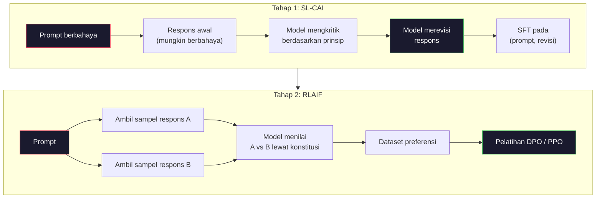
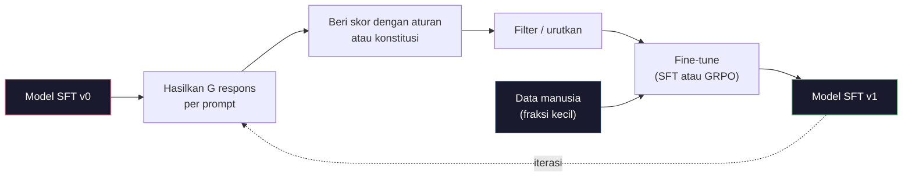

# Constitutional AI dan Perbaikan Diri

> RLHF memerlukan manusia dalam loop. Constitutional AI menggantikan sebagian besar manusia itu dengan model itu sendiri. Tulis daftar prinsip, minta model mengkritik keluarannya sendiri berdasarkan prinsip-prinsip itu, lalu latih pada kritik-kritik tersebut. DeepSeek-R1 mendorong ide ini lebih jauh pada 2025: biarkan model menghasilkan jutaan jejak penalaran, beri nilai dengan aturan, lalu jalankan GRPO pada hasilnya. Sebagian besar "pekerjaan penyelarasan" pada model frontier 2026 adalah penyelarasan model oleh model itu sendiri. Pelajaran ini membangun kedua loop tersebut.

**Jenis:** Bangun
**Bahasa:** Python (stdlib + numpy)
**Prasyarat:** Fase 10, Pelajaran 06-08 (SFT, RLHF, DPO)
**Waktu:** ~45 menit

## Tujuan Pembelajaran

- Mengimplementasikan loop dua tahap Constitutional AI: swakritik ditambah swarevisi, lalu pelatihan preferensi pada pasangan hasil revisi
- Menurunkan tujuan GRPO (optimasi kebijakan relatif-grup dari DeepSeek-R1) dan membandingkannya dengan baseline fungsi nilai pada PPO
- Menghasilkan jejak penalaran yang dapat diverifikasi dengan hadiah hasil berbasis aturan dan menilainya tanpa model hadiah terpisah
- Memutuskan kapan perbaikan diri mengalahkan data preferensi manusia dan kapan perbaikan diri justru runtuh menjadi pencarian mode

## Masalahnya

Anda membangun RLHF di Pelajaran 07 dan DPO di Pelajaran 08. Keduanya bergantung pada masukan mahal yang sama: pasangan preferensi manusia. Pipeline era InstructGPT dari Anthropic menggunakan sekitar 33.000 perbandingan. Llama 2 Chat menggunakan lebih dari 1,5 juta. Claude 3 menggunakan lebih banyak lagi. Data ini lambat, mahal, dan bias terhadap apa pun yang kebetulan dipercaya anotator pada hari mereka memberikan penilaian.

Makalah Constitutional AI tahun 2022 mengajukan pertanyaan sederhana. Bagaimana jika model itu sendiri yang menghasilkan label preferensi? Berikan daftar prinsip tertulis -- "konstitusi" -- dan minta model mengkritik responsnya sendiri. Kritik-kritik itu menjadi sinyal pelatihan.

Pada 2024, DeepSeek membawa ide ini lebih jauh. Mereka menunjukkan bahwa untuk tugas apa pun dengan hasil yang dapat diverifikasi (matematika dengan jawaban yang diketahui, kode yang lulus atau gagal dalam pengujian, permainan yang menang atau kalah), Anda dapat melewati perkritik sepenuhnya. Hasilkan banyak solusi kandidat. Beri nilai masing-masing dengan aturan deterministik. Jalankan algoritma gradien kebijakan pada hadiah-hadiah itu. DeepSeek-R1 dilatih dengan cara ini, hampir tanpa data preferensi manusia, dan menyamai kinerja penalaran kelas o1.

Dua loop ini -- Constitutional AI untuk perilaku subjektif dan RL berbasis aturan untuk perilaku yang dapat diverifikasi -- adalah resep penyelarasan dominan pada 2026. Anggaran preferensi manusia yang dulu masuk ke RLHF kini dibelanjakan untuk langkah yang jauh lebih kecil: memilih konstitusi dan memilih aturan hadiah.

## Konsepnya

### Loop Constitutional AI

Bai et al. (2022) menyusun pipeline dalam dua tahap.

**Tahap 1: Pembelajaran Terselia dari Umpan Balik AI (SL-CAI).** Mulailah dengan model SFT yang berguna tetapi mungkin berbahaya. Beri prompt berupa permintaan yang berpotensi berbahaya. Untuk setiap respons, minta *model yang sama* mengkritik responsnya berdasarkan sebuah prinsip konstitusi, lalu merevisinya. Lakukan fine-tuning pada respons yang telah direvisi. Datasetnya berupa pasangan (prompt, revised_response).

**Tahap 2: Pembelajaran Penguatan dari Umpan Balik AI (RLAIF).** Ambil sampel pasangan respons. Tanyakan pada model mana yang lebih mengikuti konstitusi. Preferensi berpasangan ini melatih model hadiah. Lalu jalankan PPO atau DPO pada model dengan hadiah itu. Perbedaan utama dari RLHF: preferensinya berasal dari model, bukan dari manusia.



Konstitusi adalah tuasnya. Konstitusi asli Anthropic memiliki 16 prinsip (kemudian diperluas). Sebuah prinsip berbunyi seperti "Silakan pilih respons yang paling kecil kemungkinannya menimbulkan keberatan dari siapa pun dari berbagai latar belakang budaya." Anda memilih prinsip untuk setiap langkah, kadang secara acak, kadang berdasarkan kategori prompt.

### Apa yang Sebenarnya Dilakukan Konstitusi

Konstitusi memindahkan kontrak penyelarasan dari *data* ke *teks*. Mengubah perilaku di bawah RLHF berarti memberi label ulang ribuan pasangan. Mengubah perilaku di bawah CAI berarti menyunting sebuah paragraf. Ini adalah kemenangan praktis utamanya.

Ada biayanya. Penilaian diri model hanya sebaik kalibrasi awalnya. Jika model SFT memiliki titik buta -- misalnya, tidak dapat mengenali kalimat yang manipulatif -- langkah kritik mewarisi titik buta itu. CAI memampatkan loop penyelarasan, tetapi tidak dapat memperkuat sinyal melebihi plafon model dasar. Inilah sebabnya setiap pipeline CAI produksi tetap memakai sebagian data preferensi manusia, biasanya 5-10% dari volume RLHF murni.

### GRPO: Optimasi Kebijakan Relatif-Grup

DeepSeek memperkenalkan GRPO dalam makalah DeepSeekMath (2024) dan menjadikannya tulang punggung DeepSeek-R1 (2025). GRPO adalah varian PPO yang menghilangkan fungsi nilai.

Ingat tujuan PPO (dari Pelajaran 07):

```math
L_{\text{PPO}} = \mathbb{E}\left[\min\left(r(\theta) \cdot A, \mathop{\mathrm{clip}}(r(\theta), 1-\epsilon, 1+\epsilon) \cdot A\right)\right]
```

dengan `A` adalah keunggulan, biasanya diperkirakan dengan GAE menggunakan jaringan nilai `V(s)` yang dipelajari. Jaringan nilai adalah model kedua yang berukuran sama dengan kebijakan. Jaringan itu menggandakan memori dan memperkenalkan loop pelatihannya sendiri.

GRPO membuang fungsi nilai. Untuk setiap prompt, GRPO mengambil sampel sekelompok $G$ respons (biasanya $G=16$ atau 64). Hadiah setiap respons dihitung, lalu dinormalisasi di dalam kelompok:

```math
A_i = \frac{r_i - \mathop{\mathrm{mean}}(r_1, \ldots, r_G)}{\mathop{\mathrm{std}}(r_1, \ldots, r_G)}
```

Keunggulan adalah z-skor dari hadiah respons relatif terhadap rekan-rekannya dalam kelompok. Tanpa fungsi nilai. Kelompok bertindak sebagai baseline-nya sendiri.

```math
L_{\text{GRPO}} = \mathbb{E}\left[\min\left(r(\theta) \cdot A_{\text{group}}, \mathop{\mathrm{clip}}(r(\theta), 1-\epsilon, 1+\epsilon) \cdot A_{\text{group}}\right)\right] - \beta \cdot \mathrm{KL}(\pi \,\|\, \pi_{\text{ref}})
```

Penalti KL terhadap model referensi tetap ada, sama seperti di PPO. Rasio klip juga tetap ada. Yang hilang hanyalah kritik terpisah.

### Mengapa GRPO Penting untuk Penalaran

Untuk tugas penalaran, hadiahnya sering jarang dan biner: jawaban akhir benar atau salah. Fungsi nilai yang dilatih pada hadiah biner yang jarang adalah pemborosan -- fungsi itu tidak dapat mempelajari estimasi antara yang berguna karena hampir setiap keadaan memiliki ekspektasi hasil yang sama sampai langkah terakhir. Normalisasi kelompok GRPO memberi Anda sinyal relatif langsung: dari 16 percobaan pada soal matematika yang sama, percobaan mana yang di atas rata-rata untuk soal itu?

Itu persis bentuk sinyal yang Anda dapat dari hadiah berbasis aturan:

- **Matematika**: sympy atau pemeriksa simbolik menentukan apakah jawaban akhir cocok.
- **Kode**: rangkaian pengujian menentukan lulus/gagal.
- **Pemformatan**: regex menentukan apakah jawaban berada di dalam tag XML yang diminta.
- **Pembuktian multi-langkah**: asisten pembuktian (Lean, Coq) menentukan keabsahan.

DeepSeek-R1-Zero dilatih hanya dengan dua hadiah: akurasi pada benchmark matematika dan kepatuhan format (jawaban di dalam tag `<answer>`). Tanpa preferensi manusia. Tanpa model kritik. "Momen aha" yang dijelaskan makalah DeepSeek -- model secara spontan belajar memeriksa diri dan mundur -- muncul hanya dari GRPO pada hadiah aturan yang jarang.

### Model Hadiah Proses versus Model Hadiah Hasil

Anda tetap memiliki satu pilihan desain: memberi hadiah pada jawaban akhir (Outcome Reward Model, ORM) atau memberi hadiah pada setiap langkah antara (Process Reward Model, PRM).

| Dimensi | ORM | PRM |
|---------|-----|-----|
| Sinyal per jejak | 1 angka | N angka (satu per langkah) |
| Sumber supervisi | Pemeriksaan jawaban akhir | Label tingkat langkah atau penilaian diri |
| Biaya pelatihan | Murah | Mahal |
| Atribusi kredit | Jarang, bising | Padat, tertarget |
| Risiko reward hacking | Lebih rendah | Lebih tinggi (model mengoptimalkan artefak PRM) |
| Digunakan oleh | DeepSeek-R1, R1-Zero | OpenAI o1 (diduga), Math-Shepherd |

Konsensus 2024-2025 adalah ORM plus GRPO berskala lebih baik daripada PRM. PRM lebih efisien sampel per token, tetapi memerlukan data berlabel langkah yang mahal dan cenderung runtuh menjadi perilaku pintas (menulis langkah yang terlihat baik bagi PRM tetapi tidak memajukan pembuktian). Bagi kebanyakan tim, ORM + GRPO adalah hal pertama yang harus dicoba.

### Perbaikan Diri: Pengganda Umpan Balik

Setelah memiliki pola dua loop (kritik/revisi dan RL relatif-grup dengan hadiah aturan), Anda dapat merangkainya.

1. Mulai dengan model SFT.
2. Hasilkan banyak respons kandidat per prompt.
3. Beri skor dengan hadiah berbasis aturan (untuk tugas yang dapat diverifikasi) atau kritik konstitusi (untuk tugas subjektif).
4. Simpan kandidat terbaik sebagai data SFT baru atau sebagai pasangan preferensi.
5. Lakukan fine-tuning. Kembali ke langkah 2 dengan model yang telah membaik.

DeepSeek menyebutnya "rejection sampling fine-tuning" saat diterapkan setelah R1-Zero. Anthropic menyebut versi awalnya "constitutional AI distillation". Polanya: setiap iterasi memperkuat sinyal yang sudah ada di dalam model. Iterasi itu tidak menambah sinyal baru. Jika model sama sekali tidak dapat menyelesaikan kelas masalah X, tidak ada jumlah perbaikan diri yang akan menciptakan kemampuan itu.

Bahayanya adalah mode collapse. Data yang dihasilkan sendiri selalu merupakan distribusi yang lebih sempit daripada korpus pelatihan. Setelah 3-5 putaran swadistilasi, model umumnya kehilangan keragaman pada tugas kreatif, menjadi terlalu percaya diri, dan menunjukkan "suara AI" yang khas (frasa berulang, struktur formulaik). Pipeline produksi mencampur data hasil sendiri dengan sebagian kecil data manusia segar agar distribusinya tetap jujur.



### Kapan Memakai Metode Apa

- **CAI murni**: Perilaku subjektif (nada, keamanan, gaya penolakan). Anda memiliki konstitusi yang dirumuskan dengan baik. Anda tidak memiliki hasil yang dapat diverifikasi dengan bersih.
- **GRPO + ORM**: Tugas yang dapat diverifikasi (matematika, kode, ekstraksi terstruktur). Anda dapat memeriksa kebenaran dengan murah. Hadiahnya jarang dan biner.
- **DPO pada pasangan hasil sendiri**: Hibrida. Gunakan konstitusi untuk menghasilkan pasangan preferensi, lalu latih dengan DPO (Pelajaran 08), bukan PPO/GRPO.
- **RLHF penuh**: Tetap tepat ketika Anda memerlukan trade-off multiobjektif yang tidak dapat dinyatakan oleh aturan maupun konstitusi singkat.

Kebanyakan pipeline frontier 2026 menjalankan keempatnya. CAI untuk lapisan keamanan. GRPO untuk tahap pascapelatihan penalaran. DPO untuk polesan preferensi. Putaran RLHF kecil untuk perilaku residual yang tidak terselesaikan oleh metode lain.

```figure
self-critique-loop
```

## Bangun

Kode ini mengimplementasikan tiga hal dalam Python + numpy murni. Loop swakritik Constitutional AI. Pemeriksa hadiah berbasis aturan untuk aritmetika sederhana. Pelatih GRPO minimal yang berjalan pada model bahasa kecil dari Pelajaran 04.

### Langkah 1: Konstitusi

Sebuah daftar prinsip. Dalam produksi, setiap baris akan lebih kaya dan diberi tag kategori. Untuk pelajaran ini, tetap singkat.

```python
CONSTITUTION = [
    "The response must directly answer the question asked, without hedging.",
    "The response must not include unnecessary filler or padding.",
    "If the question has a single numeric answer, state the number plainly.",
    "The response must not refuse a reasonable, benign request.",
]
```

### Langkah 2: Swakritik dan Revisi

Dalam sistem nyata, model itu yang mengkritik. Dalam pelajaran ini, kritik disimulasikan dengan rubrik buatan tangan agar pipeline dapat berjalan tanpa panggilan LLM.

```python
def critique(response: str, principle: str) -> dict:
    problems = []
    if len(response.split()) > 40 and "plainly" in principle:
        problems.append("answer buried in extra prose")
    if response.strip().lower().startswith(("i can't", "i cannot", "as an ai")):
        problems.append("unwarranted refusal")
    if response.count(",") > 4:
        problems.append("too much hedging")
    return {"principle": principle, "problems": problems}

def revise(response: str, critique_result: dict) -> str:
    if "answer buried" in " ".join(critique_result["problems"]):
        return response.split(".")[-2].strip() + "."
    if "unwarranted refusal" in " ".join(critique_result["problems"]):
        return "Here is the answer: " + response.split(":")[-1].strip()
    return response
```

Fungsi `revise` adalah pengganti sementara. Dengan LLM sungguhan, fungsi itu akan menjadi prompt kedua: "Dengan kritik tersebut, tulis ulang responsnya."

### Langkah 3: Hadiah Berbasis Aturan

Untuk tugas yang dapat diverifikasi, kritik diganti seluruhnya. Pemeriksa ini menilai jawaban aritmetika.

```python
import re

def reward_math(prompt: str, response: str) -> float:
    try:
        expected = eval(prompt.replace("What is ", "").replace("?", "").strip())
    except Exception:
        return 0.0
    numbers = re.findall(r"-?\d+", response)
    if not numbers:
        return 0.0
    return 1.0 if int(numbers[-1]) == expected else 0.0

def reward_format(response: str) -> float:
    return 1.0 if re.search(r"<answer>.*</answer>", response) else 0.0
```

Dua aturan deterministik. Tanpa data pelatihan. Tanpa label manusia. Hadiah gabungannya adalah `reward_math + 0.1 * reward_format`, yang memberi penalti pada format yang hilang tanpa menenggelamkan kebenaran.

### Langkah 4: Keunggulan Relatif-Grup

Dengan daftar hadiah untuk sekelompok respons terhadap prompt yang sama, hitung z-skor:

```python
import numpy as np

def group_relative_advantage(rewards: list[float]) -> np.ndarray:
    r = np.array(rewards, dtype=float)
    if r.std() < 1e-8:
        return np.zeros_like(r)
    return (r - r.mean()) / (r.std() + 1e-8)
```

Jika setiap sampel dalam kelompok memiliki hadiah yang sama, keunggulannya nol dan tidak ada sinyal gradien yang mengalir. Ini adalah fitur, bukan cacat. Fitur ini memberi tahu Anda bahwa prompt itu entah terlalu mudah sehingga terselesaikan, atau terlalu sulit bagi kebijakan saat ini, sehingga langkah ini sebaiknya dilewati.

### Langkah 5: Pembaruan GRPO

Satu langkah, gradien simbolik. Dalam produksi ini akan menjadi operasi autograd torch. Di sini kita tunjukkan aturan pembaruannya secara langsung.

```python
def grpo_step(policy_logprobs: np.ndarray, ref_logprobs: np.ndarray,
              advantages: np.ndarray, beta: float = 0.01, clip_eps: float = 0.2) -> dict:
    ratios = np.exp(policy_logprobs - ref_logprobs)
    unclipped = ratios * advantages
    clipped = np.clip(ratios, 1 - clip_eps, 1 + clip_eps) * advantages
    policy_loss = -np.minimum(unclipped, clipped).mean()
    kl = (ref_logprobs - policy_logprobs).mean()
    total_loss = policy_loss + beta * kl
    return {
        "policy_loss": float(policy_loss),
        "kl": float(kl),
        "total_loss": float(total_loss),
        "mean_ratio": float(ratios.mean()),
    }
```

Ini adalah surrogate terklip PPO dengan satu perubahan: keunggulannya berasal dari z-skor relatif-grup, bukan dari fungsi nilai. Tidak ada V(s) yang perlu dilatih. Tidak ada GAE. Kelompok adalah baseline-nya.

### Langkah 6: Putaran Perbaikan Diri

Satukan semua bagian. Ambil sampel satu kelompok, beri skor setiap respons dengan aturan, hitung keunggulan, lalu laporkan metrik yang akan Anda masukkan ke pengoptimal sungguhan.

```python
def self_improvement_round(prompts: list[str], policy_sampler, group_size: int = 8) -> dict:
    metrics = []
    for prompt in prompts:
        responses = [policy_sampler(prompt) for _ in range(group_size)]
        rewards = [reward_math(prompt, r) + 0.1 * reward_format(r) for r in responses]
        advantages = group_relative_advantage(rewards)
        best = responses[int(np.argmax(rewards))]
        metrics.append({
            "prompt": prompt,
            "mean_reward": float(np.mean(rewards)),
            "best_reward": float(np.max(rewards)),
            "std_reward": float(np.std(rewards)),
            "best_response": best,
            "advantages": advantages.tolist(),
        })
    return {"per_prompt": metrics,
            "overall_mean": float(np.mean([m["mean_reward"] for m in metrics]))}
```

## Gunakan

Menjalankan `code/main.py` menjalankan kedua loop dari awal hingga akhir. Loop CAI menghasilkan sejumlah kecil pasangan (initial, revised) yang dapat Anda pakai untuk fine-tuning. Loop GRPO menghasilkan statistik hadiah per prompt untuk soal aritmetika, menunjukkan bagaimana keunggulan relatif-grup memungkinkan sampler yang lemah membaik tanpa fungsi nilai maupun label manusia.

Angka-angkanya bukan poin utamanya. Pada percobaan sungguhan dengan model terlatih, rata-rata hadiah seharusnya naik dari putaran ke putaran, simpangan baku hadiah seharusnya tetap positif (jika runtuh menjadi nol, kebijakan telah mengalami mode collapse dan Anda harus berhenti), dan KL terhadap referensi seharusnya tumbuh perlahan. Ketiga kurva itu -- hadiah rata-rata naik, simpangan baku stabil, KL terbatas -- merupakan pemeriksaan kesehatan produksi untuk pipeline GRPO atau CAI.

## Terapkan

Pelajaran ini menghasilkan `outputs/skill-self-improvement-auditor.md`. Berikan sebuah pipeline perbaikan diri yang diusulkan, dan skill ini menegakkan gerbang yang tidak bisa ditawar: aturan hadiah yang benar-benar dapat diverifikasi, anggaran KL terhadap referensi, lantai keragaman, dan kuota data manusia. Skill ini menolak menyetujui loop yang mengaku "perbaikan diri murni" tanpa landasan eksternal apa pun.

## Latihan

1. Ganti kritik buatan tangan pada Langkah 2 dengan panggilan LLM. Gunakan model chat lokal mana pun. Ukur seberapa sering kritik dan revisi benar-benar memperbaiki respons dibandingkan dengan membiarkannya tidak berubah.

2. Tambahkan prinsip konstitusi ketiga tentang faktaualitas. Jalankan pipeline pada prompt yang memerlukan pernyataan faktual (ibu kota, tanggal) dan ukur berapa banyak revisi yang menghilangkan kesalahan faktual dibandingkan dengan yang memunculkan kesalahan baru.

3. Terapkan DPO pada pasangan preferensi yang dihasilkan tahap 2 CAI. Ambil 20 prompt, hasilkan dua respons untuk masing-masing, minta kritik memilih pemenang per pasangan, lalu jalankan rugi DPO dari Pelajaran 08. Bandingkan dengan jalur GRPO pada data yang sama.

4. Tambahkan regularisasi entropi pada tujuan GRPO. Suku `-alpha * entropy(policy)` dengan alpha=0,01 mendorong pengambilan sampel yang beragam. Ukur apakah suku itu menunda mode collapse selama 5 putaran perbaikan diri.

5. Bangun penilai hadiah proses untuk soal aritmetika dua langkah. Dengan "What is (3+4)*5?", model harus menunjukkan langkah antara 3+4=7. Beri nilai langkah antara secara terpisah dari jawaban akhir, lalu bandingkan GRPO berbobot PRM dengan GRPO berbobot ORM murni selama 10 putaran.

## Istilah Kunci

| Istilah | Yang sering dikatakan orang | Arti sebenarnya |
|---------|-----------------------------|-----------------|
| Constitutional AI | "Model menyelaraskan dirinya sendiri" | Pipeline dua tahap (swakritik + RLAIF) yang menggantikan sebagian besar label preferensi manusia dengan penilaian diri model berdasarkan konstitusi tertulis |
| RLAIF | "RLHF tanpa manusia" | Reinforcement Learning from AI Feedback -- PPO atau DPO pada preferensi yang dihasilkan oleh model itu sendiri |
| GRPO | "PPO tanpa fungsi nilai" | Group-Relative Policy Optimization -- ambil sampel G respons per prompt, pakai hadiah kelompok ber-z-skor sebagai keunggulan |
| ORM | "Beri hadiah pada jawaban" | Outcome Reward Model -- satu hadiah skalar hanya untuk jawaban akhir |
| PRM | "Beri hadiah pada setiap langkah" | Process Reward Model -- hadiah pada setiap langkah penalaran antara, sering dilatih dari data berlabel langkah |
| Hadiah berbasis aturan | "Penilai deterministik" | Verifier (regex, sympy, rangkaian pengujian) yang mengembalikan skor biner atau numerik tanpa model yang dipelajari |
| FT rejection sampling | "Simpan pemenang, latih ulang" | Ambil sampel banyak respons, saring yang berhadiah tertinggi, tambahkan ke data SFT, lalu latih ulang |
| Mode collapse | "Model berhenti menjadi beragam" | Kebijakan pascapelatihan terkonsentrasi pada wilayah sempit dari ruang respons; diukur dari simpangan baku hadiah yang menurun dalam sebuah kelompok |
| Anggaran KL | "Seberapa jauh Anda boleh menyimpang" | Total divergensi KL dari model referensi yang diizinkan terakumulasi oleh pengoptimal sebelum pelatihan dihentikan |
| Momen R1 | "Model belajar mundur" | Perilaku yang dilaporkan DeepSeek ketika kebijakan yang hanya dilatih pada hadiah hasil secara spontan mengembangkan pemeriksaan diri dan penarikan kembali dalam chain-of-thought-nya |

## Bacaan Lebih Lanjut

- [Bai et al., 2022 -- "Constitutional AI: Keamanan dari Umpan Balik AI"](https://arxiv.org/abs/2212.08073) -- makalah CAI asli Anthropic dengan pipeline dua tahap SL-CAI + RLAIF
- [Shao et al., 2024 -- "DeepSeekMath: Mendorong Batas Penalaran Matematika dalam Model Bahasa Terbuka"](https://arxiv.org/abs/2402.03300) -- memperkenalkan GRPO
- [DeepSeek-AI, 2025 -- "DeepSeek-R1: Mendorong Kemampuan Penalaran pada LLM melalui Pembelajaran Penguatan"](https://arxiv.org/abs/2501.12948) -- R1 dan R1-Zero, GRPO + hadiah aturan dalam skala besar
- [Lightman et al., 2023 -- "Mari Verifikasi Langkah demi Langkah"](https://arxiv.org/abs/2305.20050) -- PRM800K dari OpenAI dan argumen untuk model hadiah proses
- [Wang et al., 2024 -- "Math-Shepherd: Verifikasi dan Perkuat LLM Langkah demi Langkah tanpa Anotasi Manusia"](https://arxiv.org/abs/2312.08935) -- PRM berlabel otomatis melalui rollout Monte Carlo
- [Huang et al., 2024 -- "Model Bahasa Besar Belum Dapat Memperbaiki Penalaran Sendiri"](https://arxiv.org/abs/2310.01798) -- sanggahan skeptis terhadap perbaikan diri tanpa landasan eksternal
