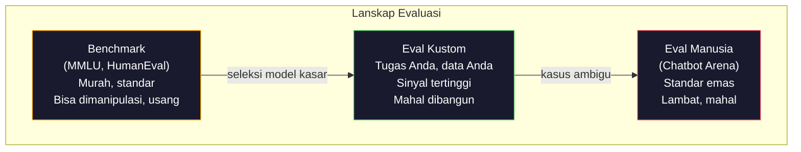
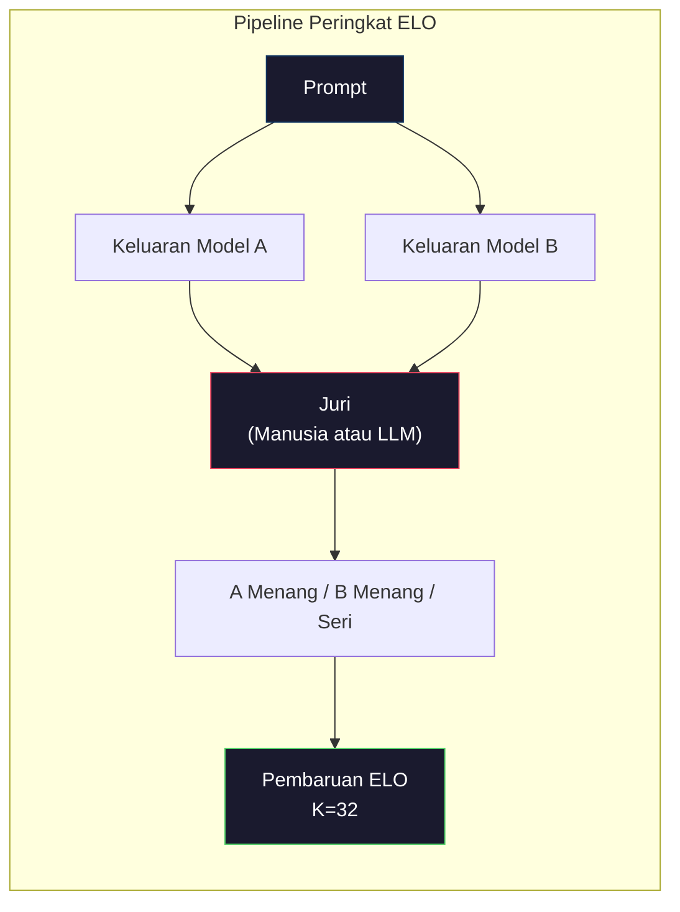

# Evaluasi: Benchmark, Eval, LM Harness

> Hukum Goodhart: ketika sebuah ukuran menjadi target, ukuran itu berhenti menjadi ukuran yang baik. Setiap laboratorium frontier memainkan benchmark. Skor MMLU naik, sementara model masih tidak bisa menghitung dengan andal jumlah huruf R dalam "strawberry". Satu-satunya eval yang penting adalah eval ANDA -- pada tugas ANDA, dengan data ANDA.

**Jenis:** Bangun
**Bahasa:** Python
**Prasyarat:** Fase 10, Pelajaran 01-05 (LLM dari Awal)
**Waktu:** ~90 menit

## Tujuan Pembelajaran

- Membangun harness evaluasi kustom yang menjalankan benchmark pilihan ganda dan pertanyaan terbuka terhadap sebuah model bahasa
- Menjelaskan mengapa benchmark standar (MMLU, HumanEval) jenuh dan gagal membedakan model frontier
- Mengimplementasikan eval spesifik-tugas dengan metrik yang tepat: exact match, F1, BLEU, dan penilaian LLM-sebagai-juri
- Merancang rangkaian evaluasi kustom yang menargetkan kasus penggunaan spesifik Anda, alih-alih hanya bergantung pada papan peringkat publik

## Masalahnya

MMLU diterbitkan pada 2020 dengan 15.908 pertanyaan dalam 57 mata pelajaran. Dalam tiga tahun, model frontier mencapai kejenuhan pada benchmark itu. GPT-4 mendapat 86,4%. Claude 3 Opus mendapat 86,8%. Llama 3 405B mendapat 88,6%. Papan peringkat terkompresi menjadi rentang 3 poin, di mana perbedaan merupakan kebisingan statistik, bukan kesenjangan kemampuan yang nyata.

Sementara itu, model-model yang sama gagal pada tugas yang ditangani anak berusia 10 tahun tanpa berpikir panjang. Claude 3.5 Sonnet, dengan skor 88,7% pada MMLU, pada awalnya tidak dapat menghitung huruf-huruf dalam "strawberry" -- tugas yang tidak memerlukan pengetahuan dunia maupun penalaran, hanya iterasi level karakter. HumanEval menguji pembangkitan kode dengan 164 soal. Model mencapai skor 90%+ pada benchmark itu, tetapi tetap menghasilkan kode yang mogok pada kasus tepi yang akan terlihat oleh pengembang junior mana pun.

Kesenjangan antara kinerja benchmark dan keandalan di dunia nyata adalah masalah utama evaluasi LLM. Benchmark memberi tahu Anda bagaimana sebuah model berkinerja pada benchmark itu. Benchmark hampir tidak memberi tahu Anda bagaimana model itu akan berkinerja pada tugas spesifik Anda, dengan data spesifik Anda, di bawah mode kegagalan spesifik Anda. Jika Anda membangun bot layanan pelanggan, MMLU tidak relevan. Jika Anda membangun asisten kode, HumanEval hanya mencakup pembangkitan tingkat fungsi -- tidak ada yang dikatakan tentang debugging, refactoring, atau penjelasan kode lintas berkas.

Anda memerlukan eval kustom. Bukan karena benchmark tidak berguna -- benchmark berguna untuk seleksi model kasar -- tetapi karena evaluasi akhir harus mencocokkan kondisi penerapan Anda persis.

## Konsepnya

### Lanskap Eval

Ada tiga kategori evaluasi, masing-masing dengan biaya dan kualitas sinyal berbeda.

**Benchmark** adalah rangkaian pengujian standar. MMLU, HumanEval, SWE-bench, MATH, ARC, HellaSwag. Anda menjalankan model terhadap benchmark dan mendapat skor. Keuntungannya: semua orang memakai ujian yang sama, sehingga Anda dapat membandingkan model. Kerugiannya: model dan data pelatihan semakin lama semakin mengontaminasi benchmark ini. Laboratorium melatih pada data yang menyertakan pertanyaan benchmark. Skor naik. Kemampuan mungkin tidak.

**Eval kustom** adalah rangkaian pengujian yang Anda bangun untuk kasus penggunaan spesifik Anda. Anda mendefinisikan masukan, keluaran yang diharapkan, dan fungsi penilaian. Perangkum dokumen hukum dinilai pada dokumen hukum. Pembangkit SQL dinilai pada skema basis data Anda. Eval semacam ini mahal untuk dibuat, tetapi merupakan satu-satunya evaluasi yang memprediksi kinerja produksi.

**Eval manusia** memakai anotator berbayar untuk menilai keluaran model berdasarkan kriteria seperti kebergunaan, kebenaran, kelancaran, dan keamanan. Ini adalah standar emas untuk tugas terbuka di mana penilaian otomatis gagal. Chatbot Arena telah mengumpulkan lebih dari 2 juta suara preferensi manusia dalam 100+ model. Kerugiannya: biaya ($0,10-$2,00 per penilaian) dan kecepatan (jam sampai hari).



### Mengapa Benchmark Rusak

Tiga mekanisme menyebabkan skor benchmark berhenti mencerminkan kemampuan nyata.

**Kontaminasi data.** Korpus pelatihan mengambil data dari internet. Pertanyaan benchmark ada di internet. Model melihat jawabannya saat pelatihan. Ini bukan kecurangan dalam arti tradisional -- laboratorium tidak sengaja memasukkan data benchmark. Tetapi pengambilan data berskala web membuat pengecualiannya hampir mustahil.

**Mengajar untuk ujian.** Laboratorium mengoptimalkan campuran pelatihan demi kinerja benchmark. Jika 5% dari campuran pelatihan berupa pilihan ganda bergaya MMLU, model mempelajari formatnya dan distribusi jawabannya. MMLU adalah pilihan ganda 4 arah. Model mempelajari bahwa distribusi jawaban kira-kira seragam di A/B/C/D, yang membantu bahkan ketika model tidak mengetahui jawabannya.

**Kejenuhan.** Ketika setiap model frontier mencetak 85-90% pada sebuah benchmark, benchmark itu berhenti membedakan. Sisa 10-15% pertanyaan mungkin ambigu, salah label, atau memerlukan pengetahuan domain yang langka. Naik dari 87% ke 89% pada MMLU mungkin berarti model menghafal dua pertanyaan langka lagi, bukan menjadi lebih pintar.

### Perpleksitas: Pemeriksaan Kesehatan Singkat

Perpleksitas mengukur seberapa terkejut sebuah model oleh urutan token. Secara formal, ini adalah eksponensial dari rata-rata negatif log-likelihood:

```math
\text{PPL} = \exp\left(-\frac{1}{N} \sum_i \log P(\text{token}_i \mid \text{context})\right)
```

Perpleksitas 10 berarti model, rata-rata, tidak lebih pasti daripada memilih secara seragam di antara 10 opsi pada setiap posisi token. Lebih rendah lebih baik. GPT-2 mendapat perpleksitas ~30 pada WikiText-103. GPT-3 mendapat ~20. Llama 3 8B mendapat ~7.

Perpleksitas berguna untuk membandingkan model pada himpunan uji yang sama, tetapi memiliki titik buta. Sebuah model dapat memiliki perpleksitas rendah karena pandai memprediksi pola umum, sementara sangat buruk pada pola langka tetapi penting. Perpleksitas juga tidak mengatakan apa pun tentang pengikutan instruksi, penalaran, atau keakuratan fakta. Pakailah sebagai pemeriksaan kewarasan, bukan vonis akhir.

### LLM-sebagai-Juri

Gunakan model kuat untuk menilai keluaran model yang lebih lemah. Idainya sederhana: minta GPT-4o atau Claude Sonnet memberi nilai respons pada skala 1-5 untuk kebenaran, kebergunaan, dan keamanan. Ini berbiaya sekitar $0,01 per penilaian dengan GPT-4o-mini dan berkorelasi mengherankan dengan penilaian manusia -- sekitar 80% kesepakatan pada kebanyakan tugas.

Prompt penilaian lebih penting daripada modelnya. Prompt yang kabur ("Nilai respons ini") menghasilkan skor yang bising. Prompt terstruktur dengan rubrik ("Beri 5 jika jawabannya benar secara fakta dan mengutip sumber, 4 jika benar tetapi tanpa sumber, 3 jika sebagian benar...") menghasilkan skor yang konsisten dan dapat diulang.

Mode kegagalan: model juri menunjukkan bias posisi (lebih menyukai respons pertama dalam perbandingan berpasangan), bias verbositas (lebih menyukai respons panjang), dan preferensi-diri (GPT-4 memberi nilai keluaran GPT-4 lebih tinggi daripada keluaran Claude yang setara). Mitigasinya: acak urutan, normalisasi panjang, dan gunakan juri yang berbeda dari model yang dinilai.

### Peringkat ELO dari Perbandingan Berpasangan

Pendekatan Chatbot Arena. Tunjukkan dua respons terhadap prompt yang sama dari dua model berbeda. Seorang manusia (atau juri LLM) memilih yang lebih baik. Dari ribuan perbandingan itu, hitung peringkat ELO untuk setiap model -- sistem yang sama seperti pada catur.

Keunggulan ELO: peringkat relatif lebih andal daripada penilaian absolut, menangani hasil seri dengan baik, dan konvergen dengan lebih sedikit perbandingan daripada menilai setiap keluaran secara independen. Pada awal 2026, peringkat Chatbot Arena menunjukkan GPT-4o, Claude 3.5 Sonnet, dan Gemini 1.5 Pro berada dalam 20 poin ELO satu sama lain di puncak.



### Kerangka Eval

**lm-evaluation-harness** (EleutherAI): kerangka eval sumber terbuka standar. Mendukung 200+ benchmark. Jalankan model Hugging Face apa pun terhadap MMLU, HellaSwag, ARC, dll. dengan satu perintah. Dipakai oleh Open LLM Leaderboard.

**RAGAS**: kerangka evaluasi khusus untuk pipeline RAG. Mengukur faithfulness (apakah jawaban cocok dengan konteks yang diambil?), relevance (apakah konteks yang diambil relevan dengan pertanyaan?), dan kebenaran jawaban.

**promptfoo**: eval berbasis konfigurasi untuk rekayasa prompt. Tentukan kasus uji dalam YAML, jalankan pada beberapa model, dan dapatkan laporan lulus/gagal. Berguna untuk pengujian regresi prompt -- pastikan perubahan prompt tidak merusak kasus uji yang sudah ada.

### Membangun Eval Kustom

Satu-satunya eval yang penting untuk produksi. Prosesnya:

1. **Definisikan tugas.** Apa yang harus dilakukan model secara tepat? Jelas dan spesifik. "Menjawab pertanyaan" terlalu kabur. "Dengan surat keluhan pelanggan, ekstrak nama produk, kategori masalah, dan sentimen" adalah tugas yang dapat dievaluasi.

2. **Buat kasus uji.** Minimal 50 untuk eval prototipe, 200+ untuk produksi. Setiap kasus uji adalah pasangan (input, expected_output). Sertakan kasus tepi: masukan kosong, masukan adversarial, masukan ambigu, dan masukan dalam bahasa lain.

3. **Definisikan penilaian.** Exact match untuk keluaran terstruktur. BLEU/ROUGE untuk kemiripan teks. LLM-sebagai-juri untuk kualitas terbuka. F1 untuk tugas ekstraksi. Gabungkan beberapa metrik dengan bobot.

4. **Otomatisasi.** Setiap eval berjalan dengan satu perintah. Tanpa langkah manual. Simpan hasil dalam format yang memungkinkan perbandingan dari waktu ke waktu.

5. **Lacak dari waktu ke waktu.** Skor eval tidak bermakna jika berdiri sendiri. Anda memerlukan garis tren. Apakah skor membaik setelah perubahan prompt terakhir? Apakah mengalami regresi setelah mengganti model? Beri versi eval Anda bersamaan dengan prompt Anda.

| Jenis Eval | Biaya per Penilaian | Kesepakatan dengan Manusia | Terbaik untuk |
|------------|---------------------|----------------------------|---------------|
| Exact match | ~$0 | 100% (jika berlaku) | Keluaran terstruktur, klasifikasi |
| BLEU/ROUGE | ~$0 | ~60% | Terjemahan, peringkasan |
| LLM-sebagai-juri | ~$0,01 | ~80% | Generasi terbuka |
| Eval manusia | $0,10-$2,00 | T/A (adalah kebenaran dasar) | Tugas ambigu, berisiko tinggi |

```figure
perplexity-loss
```

## Bangun

### Langkah 1: Kerangka Eval Minimal

Definisikan abstraksi inti. Sebuah kasus eval memiliki masukan, keluaran yang diharapkan, dan kamus metadata opsional. Sebuah penilai menerima prediksi dan referensi, lalu mengembalikan skor antara 0 dan 1.

```python
import json
from collections import Counter

class EvalCase:
    def __init__(self, input_text, expected, metadata=None):
        self.input_text = input_text
        self.expected = expected
        self.metadata = metadata or {}

class EvalSuite:
    def __init__(self, name, cases, scorers):
        self.name = name
        self.cases = cases
        self.scorers = scorers

    def run(self, model_fn):
        results = []
        for case in self.cases:
            prediction = model_fn(case.input_text)
            scores = {}
            for scorer_name, scorer_fn in self.scorers.items():
                scores[scorer_name] = scorer_fn(prediction, case.expected)
            results.append({
                "input": case.input_text,
                "expected": case.expected,
                "prediction": prediction,
                "scores": scores,
            })
        return results
```

### Langkah 2: Fungsi Penilaian

Bangun exact match, token F1, dan penilai LLM-sebagai-juri tiruan.

```python
def exact_match(prediction, expected):
    return 1.0 if prediction.strip().lower() == expected.strip().lower() else 0.0

def token_f1(prediction, expected):
    pred_tokens = set(prediction.lower().split())
    exp_tokens = set(expected.lower().split())
    if not pred_tokens or not exp_tokens:
        return 0.0
    common = pred_tokens & exp_tokens
    precision = len(common) / len(pred_tokens)
    recall = len(common) / len(exp_tokens)
    if precision + recall == 0:
        return 0.0
    return 2 * (precision * recall) / (precision + recall)

def llm_judge_simulated(prediction, expected):
    pred_words = set(prediction.lower().split())
    exp_words = set(expected.lower().split())
    if not exp_words:
        return 0.0
    overlap = len(pred_words & exp_words) / len(exp_words)
    length_penalty = min(1.0, len(prediction) / max(len(expected), 1))
    return round(overlap * 0.7 + length_penalty * 0.3, 3)
```

### Langkah 3: Sistem Peringkat ELO

Implementasikan perbandingan berpasangan dengan pembaruan ELO. Ini persis sistem yang dipakai Chatbot Arena untuk memberi peringkat model.

```python
class ELOTracker:
    def __init__(self, k=32, initial_rating=1500):
        self.ratings = {}
        self.k = k
        self.initial_rating = initial_rating
        self.history = []

    def _ensure_player(self, name):
        if name not in self.ratings:
            self.ratings[name] = self.initial_rating

    def expected_score(self, rating_a, rating_b):
        return 1 / (1 + 10 ** ((rating_b - rating_a) / 400))

    def record_match(self, player_a, player_b, outcome):
        self._ensure_player(player_a)
        self._ensure_player(player_b)

        ea = self.expected_score(self.ratings[player_a], self.ratings[player_b])
        eb = 1 - ea

        if outcome == "a":
            sa, sb = 1.0, 0.0
        elif outcome == "b":
            sa, sb = 0.0, 1.0
        else:
            sa, sb = 0.5, 0.5

        self.ratings[player_a] += self.k * (sa - ea)
        self.ratings[player_b] += self.k * (sb - eb)

        self.history.append({
            "a": player_a, "b": player_b,
            "outcome": outcome,
            "rating_a": round(self.ratings[player_a], 1),
            "rating_b": round(self.ratings[player_b], 1),
        })

    def leaderboard(self):
        return sorted(self.ratings.items(), key=lambda x: -x[1])
```

### Langkah 4: Perhitungan Perpleksitas

Hitung perpleksitas menggunakan probabilitas token. Dalam praktiknya, Anda akan memperolehnya dari logits model. Di sini kami menyimulasikannya dengan distribusi probabilitas.

```python
import numpy as np

def perplexity(log_probs):
    if not log_probs:
        return float("inf")
    avg_neg_log_prob = -np.mean(log_probs)
    return float(np.exp(avg_neg_log_prob))

def token_log_probs_simulated(text, model_quality=0.8):
    np.random.seed(hash(text) % 2**31)
    tokens = text.split()
    log_probs = []
    for i, token in enumerate(tokens):
        base_prob = model_quality
        if len(token) > 8:
            base_prob *= 0.6
        if i == 0:
            base_prob *= 0.7
        prob = np.clip(base_prob + np.random.normal(0, 0.1), 0.01, 0.99)
        log_probs.append(float(np.log(prob)))
    return log_probs
```

### Langkah 5: Agregasi Hasil

Hitung statistik ringkas dari satu kali evaluasi: rata-rata, median, laju lulus pada ambang batas, dan rincian per metrik.

```python
def summarize_results(results, threshold=0.8):
    all_scores = {}
    for r in results:
        for metric, score in r["scores"].items():
            all_scores.setdefault(metric, []).append(score)

    summary = {}
    for metric, scores in all_scores.items():
        arr = np.array(scores)
        summary[metric] = {
            "mean": round(float(np.mean(arr)), 3),
            "median": round(float(np.median(arr)), 3),
            "std": round(float(np.std(arr)), 3),
            "min": round(float(np.min(arr)), 3),
            "max": round(float(np.max(arr)), 3),
            "pass_rate": round(float(np.mean(arr >= threshold)), 3),
            "n": len(scores),
        }
    return summary

def print_summary(summary, suite_name="Eval"):
    print(f"\n{'=' * 60}")
    print(f"  {suite_name} Summary")
    print(f"{'=' * 60}")
    for metric, stats in summary.items():
        print(f"\n  {metric}:")
        print(f"    Mean:      {stats['mean']:.3f}")
        print(f"    Median:    {stats['median']:.3f}")
        print(f"    Std:       {stats['std']:.3f}")
        print(f"    Range:     [{stats['min']:.3f}, {stats['max']:.3f}]")
        print(f"    Pass rate: {stats['pass_rate']:.1%} (threshold >= 0.8)")
        print(f"    N:         {stats['n']}")
```

### Langkah 6: Jalankan Pipeline Lengkap

Rangkai semuanya. Definisikan sebuah tugas, buat kasus uji, simulasikan dua model, jalankan eval, hitung ELO dari perbandingan berpasangan, lalu cetak papan peringkat.

```python
def demo_model_good(prompt):
    responses = {
        "What is the capital of France?": "Paris",
        "What is 2 + 2?": "4",
        "Who wrote Hamlet?": "William Shakespeare",
        "What language is PyTorch written in?": "Python and C++",
        "What is the boiling point of water?": "100 degrees Celsius",
    }
    return responses.get(prompt, "I don't know")

def demo_model_bad(prompt):
    responses = {
        "What is the capital of France?": "Paris is the capital city of France",
        "What is 2 + 2?": "The answer is four",
        "Who wrote Hamlet?": "Shakespeare",
        "What language is PyTorch written in?": "Python",
        "What is the boiling point of water?": "212 Fahrenheit",
    }
    return responses.get(prompt, "Unknown")

cases = [
    EvalCase("What is the capital of France?", "Paris"),
    EvalCase("What is 2 + 2?", "4"),
    EvalCase("Who wrote Hamlet?", "William Shakespeare"),
    EvalCase("What language is PyTorch written in?", "Python and C++"),
    EvalCase("What is the boiling point of water?", "100 degrees Celsius"),
]

suite = EvalSuite(
    name="General Knowledge",
    cases=cases,
    scorers={
        "exact_match": exact_match,
        "token_f1": token_f1,
        "llm_judge": llm_judge_simulated,
    },
)

results_good = suite.run(demo_model_good)
results_bad = suite.run(demo_model_bad)

print_summary(summarize_results(results_good), "Model A (concise)")
print_summary(summarize_results(results_bad), "Model B (verbose)")
```

Model "baik" memberikan jawaban yang tepat. Model "buruk" memberikan parafrasa yang bertele-tele. Exact match menghukum model yang bertele-tele dengan sangat keras. Token F1 dan LLM-sebagai-juri lebih memaklumi. Ini mengilustrasikan mengapa pilihan metrik penting: model yang sama terlihat hebat atau buruk bergantung pada cara Anda menilainya.

### Langkah 7: Turnamen ELO

Jalankan perbandingan berpasangan antarmodel selama beberapa putaran.

```python
elo = ELOTracker(k=32)

for case in cases:
    pred_a = demo_model_good(case.input_text)
    pred_b = demo_model_bad(case.input_text)

    score_a = token_f1(pred_a, case.expected)
    score_b = token_f1(pred_b, case.expected)

    if score_a > score_b:
        outcome = "a"
    elif score_b > score_a:
        outcome = "b"
    else:
        outcome = "tie"

    elo.record_match("model_a_concise", "model_b_verbose", outcome)

print("\nELO Leaderboard:")
for name, rating in elo.leaderboard():
    print(f"  {name}: {rating:.0f}")
```

### Langkah 8: Perbandingan Perpleksitas

Bandingkan perpleksitas antar-"model" dengan tingkat kualitas berbeda.

```python
test_text = "The quick brown fox jumps over the lazy dog in the garden"

for quality, label in [(0.9, "Strong model"), (0.7, "Medium model"), (0.4, "Weak model")]:
    log_probs = token_log_probs_simulated(test_text, model_quality=quality)
    ppl = perplexity(log_probs)
    print(f"  {label} (quality={quality}): perplexity = {ppl:.2f}")
```

## Gunakan

### lm-evaluation-harness (EleutherAI)

Alat standar untuk menjalankan benchmark pada model apa pun.

```python
# pip install lm-eval
# Baris perintah:
# lm_eval --model hf --model_args pretrained=meta-llama/Llama-3.1-8B --tasks mmlu --batch_size 8

# API Python:
# import lm_eval
# results = lm_eval.simple_evaluate(
#     model="hf",
#     model_args="pretrained=meta-llama/Llama-3.1-8B",
#     tasks=["mmlu", "hellaswag", "arc_easy"],
#     batch_size=8,
# )
# print(results["results"])
```

### promptfoo

Eval berbasis konfigurasi untuk rekayasa prompt. Tentukan pengujian dalam YAML dan jalankan pada beberapa penyedia.

```yaml
# promptfoo.yaml
providers:
  - openai:gpt-4o-mini
  - anthropic:claude-3-haiku

prompts:
  - "Answer in one word: {{question}}"

tests:
  - vars:
      question: "What is the capital of France?"
    assert:
      - type: contains
        value: "Paris"
  - vars:
      question: "What is 2 + 2?"
    assert:
      - type: equals
        value: "4"
```

### RAGAS untuk Evaluasi RAG

```python
# pip install ragas
# from ragas import evaluate
# from ragas.metrics import faithfulness, answer_relevancy, context_precision
#
# result = evaluate(
#     dataset,
#     metrics=[faithfulness, answer_relevancy, context_precision],
# )
# print(result)
```

RAGAS mengukur apa yang tidak tertangkap eval umum: apakah jawaban model berlandaskan pada konteks yang diambil, bukan sekadar apakah jawabannya "benar" secara abstrak.

## Terapkan

Pelajaran ini menghasilkan `outputs/prompt-eval-designer.md` -- prompt yang dapat dipakai ulang untuk merancang rangkaian eval kustom bagi tugas apa pun. Berikan deskripsi tugas, dan prompt itu akan menghasilkan kasus uji, fungsi penilaian, dan rekomendasi ambang lulus/gagal.

Pelajaran ini juga menghasilkan `outputs/skill-llm-evaluation.md` -- kerangka pengambilan keputusan untuk memilih strategi evaluasi yang tepat berdasarkan jenis tugas, anggaran, dan persyaratan latensi Anda.

## Latihan

1. Tambahkan penilai "konsistensi" yang menjalankan masukan yang sama melalui model sebanyak 5 kali dan mengukur seberapa sering keluarannya cocok. Jawaban yang tidak konsisten pada masukan deterministik mengungkap prompt yang rapuh atau pengaturan suhu yang terlalu tinggi.

2. Kembangkan pelacak ELO agar mendukung beberapa fungsi juri (exact match, F1, LLM-sebagai-juri) dan memberi bobot padanya. Bandingkan bagaimana papan peringkat berubah ketika Anda memberi bobot besar pada exact match versus pada F1.

3. Bangun rangkaian eval untuk tugas tertentu: klasifikasi email ke dalam 5 kategori. Buat 100 kasus uji dengan contoh beragam, termasuk kasus tepi (email yang bisa masuk beberapa kategori, email kosong, email dalam bahasa lain). Ukur bagaimana "model" berbeda (berbasis aturan, pencocokan kata kunci, LLM tiruan) berkinerja.

4. Terapkan deteksi kontaminasi: dengan sekumpulan pertanyaan eval dan korpus pelatihan, periksa berapa persen pertanyaan eval (atau parafrasa dekatnya) muncul dalam data pelatihan. Ini adalah cara peneliti mengaudit validitas benchmark.

5. Bangun alat "diff model". Dengan hasil eval dari dua versi model, soroti kasus uji mana yang membaik, mana yang mengalami regresi, dan mana yang tetap sama. Ini setara dengan diff kode dalam dunia eval -- penting untuk memahami apakah sebuah perubahan membantu atau merugikan.

## Istilah Kunci

| Istilah | Yang sering dikatakan orang | Arti sebenarnya |
|---------|-----------------------------|-----------------|
| MMLU | "Benchmark-nya" | Massive Multitask Language Understanding -- 15.908 pertanyaan pilihan ganda dalam 57 mata pelajaran, jenuh di atas 88% pada 2025 |
| HumanEval | "Eval kode" | 164 soal penyelesaian fungsi Python dari OpenAI, hanya menguji pembangkitan fungsi terisolasi |
| SWE-bench | "Eval pemrograman nyata" | 2.294 isu GitHub dari 12 repositori Python, mengukur perbaikan bug ujung-ke-ujung termasuk pembangkitan pengujian |
| Perpleksitas | "Seberapa bingung modelnya" | $\exp(-\mathop{\mathrm{avg}}(\log P(\text{token}_i \text{ given context})))$ -- lebih rendah berarti model memberikan probabilitas lebih tinggi pada token aktual |
| Peringkat ELO | "Peringkat catur untuk model" | Penilaian kemampuan relatif yang dihitung dari catatan menang/kalah berpasangan, dipakai Chatbot Arena untuk memberi peringkat 100+ model |
| LLM-sebagai-juri | "Memakai AI untuk menilai AI" | Model kuat memberi skor keluaran model lemah berdasarkan rubrik, ~80% kesepakatan dengan juri manusia dengan biaya ~$0,01 per penilaian |
| Kontaminasi data | "Model sudah melihat ujiannya" | Data pelatihan memuat pertanyaan benchmark, sehingga skor naik tanpa peningkatan kemampuan nyata |
| Rangkaian eval | "Sekumpulan pengujian" | Kumpulan triple (input, expected_output, scorer) yang diberi versi untuk mengukur kemampuan tertentu |
| Laju lulus | "Berapa persen yang benar" | Fraksi kasus eval yang mencetak skor di atas ambang batas -- lebih bermanfaat daripada skor rata-rata karena mengukur keandalan |
| Chatbot Arena | "Situs peringkat model" | Platform LMSYS dengan 2 jt+ suara preferensi manusia, menghasilkan papan peringkat LLM paling dipercaya melalui peringkat ELO |

## Bacaan Lebih Lanjut

- [Hendrycks et al., 2021 -- "Mengukur Pemahaman Bahasa Multitugas Skala Besar"](https://arxiv.org/abs/2009.03300) -- makalah MMLU, masih benchmark LLM yang paling banyak dikutip meskipun sudah jenuh
- [Chen et al., 2021 -- "Mengevaluasi Model Bahasa Besar yang Dilatih pada Kode"](https://arxiv.org/abs/2107.03374) -- makalah HumanEval dari OpenAI, menetapkan metodologi evaluasi pembangkitan kode
- [Zheng et al., 2023 -- "Menilai LLM-sebagai-Juri"](https://arxiv.org/abs/2306.05685) -- analisis sistematis penggunaan LLM untuk mengevaluasi LLM, termasuk temuan bias posisi dan bias verbositas
- [Arena (dulu LMSYS Chatbot Arena)](https://arena.ai/leaderboard) -- platform perbandingan model berbasis keramaian dengan 2 jt+ suara, peringkat LLM dunia nyata paling dipercaya
