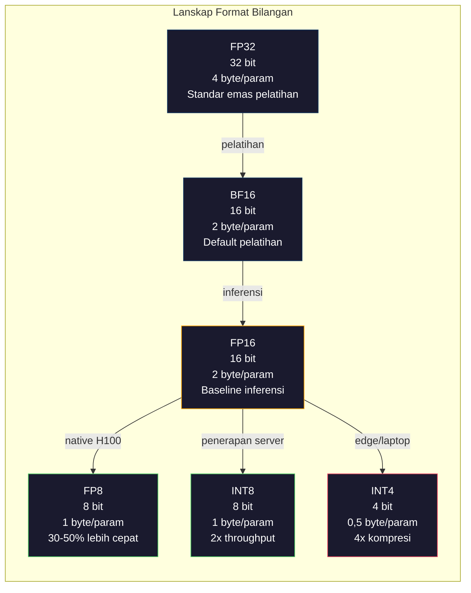
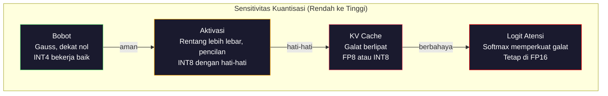
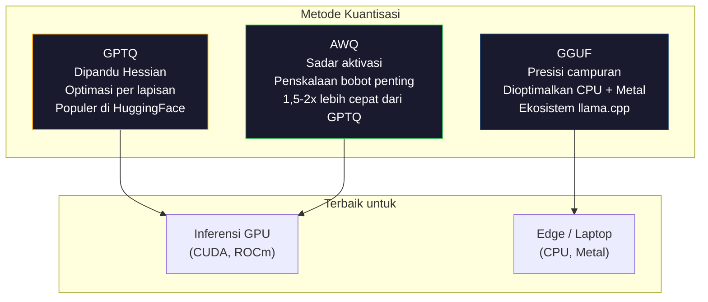

# Kuantisasi: Membuat Model Muat

> Model 70B dalam FP16 memerlukan 140GB. Dua A100 hanya untuk bobot. Kuantisasi ke FP8: satu GPU 80GB. INT4: sebuah MacBook.

**Jenis:** Bangun
**Bahasa:** Python (dengan numpy)
**Prasyarat:** Fase 10, Pelajaran 01-10 (LLM dari Awal)
**Waktu:** ~120 menit

## Tujuan Pembelajaran

- Mengimplementasikan kuantisasi simetris dan asimetris dari FP16 ke INT8 dan INT4, termasuk penskalaan per-tensor dan per-kanal
- Menghitung penghematan memori dari kuantisasi dan menentukan presisi mana yang muat dalam VRAM GPU tertentu
- Menjelaskan perbedaan antara kuantisasi pascapelatihan (PTQ) dan pelatihan sadar-kuantisasi (QAT)
- Menerapkan GPTQ atau AWQ untuk mengkuantisasi model sungguhan dan mengukur trade-off akurasi-memori pada sebuah benchmark

## Masalahnya

Llama 3 70B memiliki 70 miliar parameter. Setiap parameter adalah bilangan floating point 16-bit. Itu 140 miliar byte. 140GB. Satu A100 hanya memiliki 80GB VRAM. Anda bahkan tidak dapat memuat bobotnya, apalagi menjalankan inferensi, pada satu GPU. Anda memerlukan dua A100 seharga $2/jam masing-masing hanya untuk melayani satu model.

Namun 16 bit per parameter itu boros. Kebanyakan bobot dalam jaringan saraf berkumpul di dekat nol. Seluruh rentang dinamis FP16 (dari 0,000000059 sampai 65.504) hampir seluruhnya tidak terpakai. Jika Anda mengukur distribusi aktual bobot pada Llama 3 70B, 95% di antaranya berada antara -0,1 dan +0,1. Anda membakar 16 bit untuk mewakili nilai-nilai yang muat dalam 4 bit.

Kuantisasi mengganti bilangan presisi tinggi dengan bilangan presisi lebih rendah. FP16 ke FP8 memotong memori menjadi setengah. FP16 ke INT4 memotongnya menjadi seperempat. Model 140GB itu menjadi 35GB. Model itu muat pada satu GPU konsumen. Dorong ke kuantisasi 2-bit (agresif, lossy, tetapi berguna untuk sebagian tugas) dan model yang sama berjalan pada laptop 16GB.

Biayanya adalah akurasi. Setiap bit yang Anda hilang menghancurkan informasi. Pertanyaannya adalah seberapa besar akurasi yang Anda hilang dan di mana. Model INT4 yang terkuantisasi dengan baik mempertahankan 95-99% kualitas aslinya pada kebanyakan benchmark. Kuantisasi naif ke INT4 dapat menghancurkan model sepenuhnya. Perbedaan terletak pada tekniknya.

Kuantisasi komunitas terhadap Llama 3 ke INT4 dengan GPTQ menunjukkan kehilangan sekitar 1-2 poin perpleksitas pada WikiText. Mistral merilis checkpoint FP8 dari Mixtral 8x22B dengan kehilangan kualitas yang tidak terukur pada MMLU. Format GGUF menopang llama.cpp, yang menjalankan model 70B pada MacBook berchip seri M. Kuantisasi bukan sekadar trik. Ini adalah jalur penerapan standar untuk setiap model yang lebih besar dari 7B.

## Konsepnya

### Format Bilangan: Apa yang Dilakukan Setiap Bit

Setiap bilangan floating point memiliki tiga bagian: tanda, eksponen, dan mantisa (juga disebut significand). Tanda adalah satu bit. Eksponen menentukan rentang (seberapa besar atau kecil bilangan itu bisa). Mantisa menentukan presisi (berapa banyak angka desimal yang Anda peroleh).

```
FP32:  [1 sign] [8 exponent] [23 mantissa]  = 32 bits
FP16:  [1 sign] [5 exponent] [10 mantissa]  = 16 bits
BF16:  [1 sign] [8 exponent] [7  mantissa]  = 16 bits
FP8:   [1 sign] [4 exponent] [3  mantissa]  = 8  bits (E4M3)
FP8:   [1 sign] [5 exponent] [2  mantissa]  = 8  bits (E5M2)
INT8:  [1 sign] [7 value]                   = 8  bits (uniform steps)
INT4:  [1 sign] [3 value]                   = 4  bits (16 levels total)
```

**FP32** adalah presisi penuh. 23 bit mantisa memberi Anda sekitar 7 digit desimal presisi. Rentang: kira-kira $1.2 \times 10^{-38}$ sampai $3.4 \times 10^{38}$. Pelatihan dulu dilakukan secara eksklusif dalam FP32. Hingga kini masih demikian untuk akumulasi (penjumlahan berjalan selama perkalian matriks).

**FP16** memotong jumlah bit menjadi setengah. 10 bit mantisa memberi sekitar 3,3 digit desimal. Eksponen menyusut menjadi 5 bit, sehingga rentangnya berkurang drastis (nilai maksimum ~65.504). Ini tidak masalah untuk bobot (yang berkumpul di dekat nol), tetapi berbahaya untuk aktivasi dan gradien yang dapat melonjak saat pelatihan. Pelatihan FP16 memerlukan loss scaling untuk mencegah underflow.

**BF16** (Brain Float 16) mempertahankan eksponen 8-bit dari FP32, tetapi menyusutkan mantisa menjadi 7 bit. Rentangnya sama dengan FP32, presisinya lebih rendah daripada FP16. Google merancangnya khusus untuk pembelajaran mendalam. Intuisinya: rentang lebih penting daripada presisi bagi jaringan saraf. Gradien $10^{-20}$ yang underflow menjadi nol dalam FP16 tetap bertahan dalam BF16. Bobot 0,07342 yang dibulatkan menjadi 0,0734 dalam BF16 sudah cukup dekat. Setiap pelatihan modern memakai BF16 atau campuran BF16/FP32.

**FP8** memiliki dua varian. E4M3 (4 eksponen, 3 mantisa) dipakai untuk bobot dan aktivasi selama inferensi. E5M2 (5 eksponen, 2 mantisa) dipakai untuk gradien selama pelatihan, di mana rentang lebih penting daripada presisi. Inferensi FP8 pada GPU H100 mencapai akselerasi 30-50% dibanding FP16 dengan kehilangan kualitas yang dapat diabaikan.

**INT8** adalah format bilangan bulat. Tanpa eksponen, tanpa mantisa. Hanya 256 nilai yang tersebar merata dari -128 sampai 127. Anda memerlukan faktor skala untuk memetakan bobot floating point ke rentang ini. Keuntungannya: aritmetika bilangan bulat lebih cepat dan lebih hemat daya daripada aritmetika floating point. Perkalian matriks INT8 pada A100 berjalan di 624 TOPS, dibandingkan 312 TFLOPS untuk FP16.

**INT4** mendorong lebih jauh. Hanya 16 nilai yang mungkin. Faktor skala melakukan pekerjaan berat. Kualitas sepenuhnya bergantung pada cara Anda memilih skala dan bobot mana yang Anda kuantisasi. Metode INT4 mutakhir (GPTQ, AWQ) mempertahankan 95%+ kualitas model asli.



### Cara Kerja Kuantisasi

Operasi intinya sederhana. Ambil tensor nilai floating point, temukan faktor skala, kalikan, bulatkan ke bilangan bulat terdekat, lalu simpan bilangan bulat beserta faktor skalanya.

**Kuantisasi:**
```
scale = max(abs(tensor)) / max_int_value
quantized = round(tensor / scale)
```

**Dekuantisasi:**
```
reconstructed = quantized * scale
```

Untuk INT8 dengan rentang simetris (-127 sampai 127):
```
scale = max(abs(tensor)) / 127
quantized = clamp(round(tensor / scale), -128, 127)
```

Galatnya adalah galat pembulatan. Setiap nilai dapat meleset paling banyak `scale / 2`. Total galat dalam sebuah lapisan bergantung pada jumlah bobot yang Anda miliki dan seberapa sensitif model terhadap perubahan pada bobot-bobot itu.

**Kuantisasi per-tensor versus per-kanal.** Per-tensor memakai satu faktor skala untuk seluruh matriks bobot. Sederhana, tetapi lossy: jika satu kolom memiliki nilai besar dan kolom lain nilai kecil, nilai-nilai kecil kehilangan sebagian besar presisinya. Per-kanal memakai satu faktor skala per kanal keluaran (per baris atau kolom matriks bobot). Overhead lebih besar (Anda menyimpan N faktor skala, bukan 1), tetapi kualitasnya jauh lebih baik. Setiap metode kuantisasi produksi memakai per-kanal atau granularitas yang lebih halus.

**Kuantisasi asimetris** menambahkan offset titik-nol: `quantized = round(tensor / scale) + zero_point`. Ini menangani distribusi yang tidak terpusat di nol. Aktivasi ReLU, misalnya, selalu tidak negatif. Kuantisasi simetris membuang setengah rentang bilangan bulat untuk nilai negatif yang tidak pernah muncul. Kuantisasi asimetris memetakan rentang aktual [min, max] ke seluruh rentang bilangan bulat.

### Hierarki Sensitivitas

Tidak semua bagian dalam model toleran terhadap kuantisasi secara sama. Ada hierarki yang jelas.

**Bobot (paling tangguh).** Bobot model berubah perlahan selama pelatihan dan mengikuti distribusi kira-kira Gauss yang terpusat di dekat nol. Bobot terkuantisasi dengan baik. Bobot INT8 dengan skala per-kanal menghasilkan hasil hampir tanpa kehilangan. INT4 memerlukan metode lebih canggih, tetapi tetap berfungsi.

**Aktivasi (sensitivitas sedang).** Aktivasi adalah nilai antara yang mengalir melalui jaringan selama inferensi. Rentang dinamisnya lebih lebar daripada bobot dan mengandung pencilan. Satu attention head dapat menghasilkan nilai aktivasi 100 kali lebih besar daripada rata-rata. Pencilan-pencilan ini sangat penting bagi kualitas model. Mengkuantisasinya secara naif menghancurkan informasi. Solusinya: simpan kanal pencilan dengan presisi lebih tinggi (LLM.int8()), atau gunakan skala aktivasi per-token atau per-kanal.

**KV cache (sensitivitas tinggi).** Cache key-value menyimpan keadaan atensi untuk semua token sebelumnya. Pada panjang konteks yang besar, KV cache mendominasi memori. Untuk model 70B dengan konteks 32K, KV cache saja berukuran 40GB dalam FP16. Mengkuantisasi KV cache ke FP8 atau INT8 menghemat memori sangat besar, tetapi galat apa pun berlipat ganda pada semua perhitungan atensi berikutnya. Dampak pada kualitas bertambah seiring panjang urutan.

**Logit atensi (paling sensitif).** Softmax dalam atensi sangat sensitif terhadap perubahan kecil pada masukannya. Galat kuantisasi 0,01 pada logit pra-softmax dapat menggeser distribusi atensi secara berarti. Kebanyakan skema kuantisasi menjaga perhitungan atensi tetap dalam presisi lebih tinggi (FP16 atau BF16), meskipun semua bagian lain dikuantisasi.



### PTQ versus QAT

**Post-Training Quantization (PTQ)** mengkuantisasi model yang sudah terlatih. Tanpa pelatihan ulang. Anda mengambil bobot FP16, menghitung faktor skala, membulatkan, lalu menerapkan. Cepat (menit sampai jam) dan murah. Berfungsi baik untuk INT8 dan FP8. Untuk INT4, PTQ naif sering gagal parah karena galat pembulatan terakumulasi. Metode PTQ canggih (GPTQ, AWQ) memakai data kalibrasi untuk meminimalkan galat kuantisasi.

**Quantization-Aware Training (QAT)** menyisipkan operasi kuantisasi palsu ke dalam operasi forward selama pelatihan. Model belajar menempatkan bobotnya di tempat galat pembulatan kecil. Gradien mengalir melalui kuantisasi palsu memakai straight-through estimator (STE): anggap operasi pembulatan memiliki gradien 1. QAT menghasilkan model INT4 dan INT2 yang lebih baik daripada PTQ, tetapi memerlukan satu siklus pelatihan penuh. Google memakai QAT untuk penyajian Gemini yang efisien. Meta memakai QAT untuk sebagian target penerapan Llama.

| Aspek | PTQ | QAT |
|-------|-----|-----|
| Biaya | Menit sampai jam | Satu siklus pelatihan penuh |
| Kualitas pada INT8 | Sangat baik (< 0,1% kehilangan) | Sangat baik |
| Kualitas pada INT4 | Baik dengan GPTQ/AWQ (1-3% kehilangan) | Lebih baik (< 1% kehilangan) |
| Kualitas pada INT2 | Buruk | Bisa dipakai untuk sebagian tugas |
| Data kalibrasi | 128-1024 contoh | Dataset pelatihan penuh |
| Kapan dipakai | Penerapan, iterasi | Kualitas maksimal pada bit-width rendah |

### GPTQ, AWQ, GGUF

**GPTQ (GPT Quantization)** adalah metode PTQ sekali jalan. GPTQ mengkuantisasi bobot satu lapisan demi satu lapisan, memakai dataset kalibrasi kecil (128 contoh adalah hal umum) untuk mengukur Hessian (informasi orde kedua tentang seberapa sensitif keluaran terhadap setiap bobot). Bobot yang dinyatakan penting oleh Hessian dikuantisasi lebih hati-hati. GPTQ adalah metode pertama yang membuat kuantisasi INT4 menjadi praktis bagi LLM. TheBloke di Hugging Face memopulerkan GPTQ dengan merilis versi terkuantisasi dari ratusan model.

**AWQ (Activation-Aware Weight Quantization)** mengamati bahwa sebagian kecil bobot (sekitar 1%) secara tidak proporsional penting karena dikalikan dengan nilai aktivasi besar. AWQ mengidentifikasi bobot penting ini memakai data kalibrasi dan menskalanya naik sebelum kuantisasi (lalu menskalakan aktivasi terkait turun). Ini menjaga bobot penting berada dalam rentang di mana kuantisasi INT4 akurat. AWQ biasanya menyamai atau sedikit mengalahkan kualitas GPTQ, dengan penerapan 1,5-2x lebih cepat.

**GGUF (GPT-Generated Unified Format)** adalah format berkas yang dipakai llama.cpp dan ekosistemnya. Format ini mendukung kuantisasi campuran: lapisan berbeda mendapat bit-width berbeda. Lapisan pertama dan terakhir (embedding dan head keluaran) biasanya dijaga pada presisi lebih tinggi. Lapisan tengah mendapat INT4 atau INT3. Berkas GGUF mandiri: bobot, tokenizer, dan metadata semuanya dalam satu berkas. Format ini dirancang untuk inferensi CPU dan Apple Silicon, di mana memuat seluruh model ke dalam memori dan menjalankan perkalian matriks pada CPU atau GPU Metal adalah jalur standar. Q4_K_M adalah varian kuantisasi GGUF paling populer, yang menyeimbangkan kualitas dan ukuran.



### Pengukuran Kualitas

Bagaimana Anda tahu apakah model terkuantisasi Anda masih baik?

**Perpleksitas.** Metrik paling umum. Lebih rendah lebih baik. Hitung perpleksitas pada dataset yang tidak dipakai saat pelatihan (WikiText-2 adalah standar) untuk model asli maupun terkuantisasi. Selisihnya memberi tahu Anda berapa banyak informasi yang dihancurkan oleh kuantisasi. Patokan: delta < 0,5 sangat baik, 0,5-1,0 baik, 1,0-2,0 dapat diterima untuk kebanyakan tugas, > 2,0 berarti ada yang salah.

**Benchmark spesifik-tugas.** Jalankan model terkuantisasi pada MMLU, HumanEval, GSM8K, atau rangkaian eval kustom Anda. Bandingkan dengan model asli. Kuantisasi memengaruhi kemampuan berbeda secara tidak merata. Tugas matematika dan kode lebih sensitif terhadap kehilangan presisi daripada pengetahuan umum.

**Perbandingan keluaran.** Hasilkan respons dari kedua model pada prompt yang sama dan bandingkan. LLM-sebagai-juri (Pelajaran 10) bekerja baik di sini. Hitung laju kemenangan: pada berapa bagian prompt model terkuantisasi menyamai atau mengalahkan model asli?

**Latensi dan throughput.** Kuantisasi ada untuk membuat model lebih cepat dan lebih murah. Ukur token per detik, waktu hingga token pertama, dan penggunaan memori. Model terkuantisasi yang lebih lambat dari aslinya lebih buruk daripada tidak berguna.

| Model | Format | Ukuran | Perpleksitas (WikiText-2) | MMLU | Token/detik (A100) |
|-------|--------|--------|---------------------------|------|--------------------|
| Llama 3 70B | FP16 | 140GB | 3,12 | 79,5% | 38 |
| Llama 3 70B | FP8 | 70GB | 3,14 | 79,3% | 55 |
| Llama 3 70B | GPTQ INT4 | 35GB | 4,32 | 77,8% | 72 |
| Llama 3 70B | AWQ INT4 | 35GB | 4,18 | 78,1% | 75 |
| Llama 3 70B | GGUF Q4_K_M | 40GB | 4,25 | 77,9% | 28 (CPU) |

Pola yang muncul: FP8 hampir tanpa biaya. INT4 mengorbankan 1-2 poin MMLU, tetapi menggandakan throughput dan menurunkan memori menjadi seperempat. Trade-off-nya sepadan untuk hampir setiap penerapan.

### Angka Nyata

FP16 ke FP8 pada H100: akselerasi inferensi 30-50%, kehilangan kualitas < 0,1%. Ini kuantisasi yang tanpa keraguan. Setiap penerapan H100 seharusnya memakainya.

FP16 ke INT8 (LLM.int8()): pengurangan memori 2x, kehilangan kualitas < 0,5%. Pendekatan presisi-campuran menjaga fitur pencilan dalam FP16 sementara mengkuantisasi sisanya ke INT8.

FP16 ke INT4 (GPTQ/AWQ): pengurangan memori 4x, kehilangan kualitas 1-3% bergantung pada model dan metode. Ini memungkinkan model 70B berjalan pada satu GPU 48GB.

FP16 ke INT4 (GGUF Q4_K_M): pengurangan memori 3,5x, kehilangan kualitas 1-2%. Dioptimalkan untuk inferensi CPU. Model 70B pada Q4_K_M berukuran sekitar 40GB dan berjalan di 10-15 token/detik pada M3 Max dengan 64GB.

FP16 ke INT2: pengurangan memori 8x, kehilangan kualitas 5-15%. Hanya layak untuk tugas sempit tertentu di mana Anda bisa menoleransi penurunan. Ini masih berada di perbatasan riset, belum siap produksi untuk penggunaan umum.

```figure
quantization
```

## Bangun

### Langkah 1: Representasi Format Bilangan

Bangun representasi level-bit dari setiap format untuk melihat persis apa yang dilakukan tanda, eksponen, dan mantisa.

```python
import numpy as np


def float_to_fp32_bits(value):
    bits = np.float32(value).view(np.uint32)
    sign = (bits >> 31) & 1
    exponent = (bits >> 23) & 0xFF
    mantissa = bits & 0x7FFFFF
    return {"sign": int(sign), "exponent": int(exponent), "mantissa": int(mantissa),
            "exponent_bits": format(int(exponent), '08b'),
            "mantissa_bits": format(int(mantissa), '023b'),
            "value": float(value),
            "actual_exponent": int(exponent) - 127}


def float_to_fp16_bits(value):
    fp16 = np.float16(value)
    bits = fp16.view(np.uint16)
    sign = (bits >> 15) & 1
    exponent = (bits >> 10) & 0x1F
    mantissa = bits & 0x3FF
    return {"sign": int(sign), "exponent": int(exponent), "mantissa": int(mantissa),
            "exponent_bits": format(int(exponent), '05b'),
            "mantissa_bits": format(int(mantissa), '010b'),
            "value": float(fp16),
            "actual_exponent": int(exponent) - 15}


def float_to_bf16_bits(value):
    fp32_bits = np.float32(value).view(np.uint32)
    bf16_bits = (fp32_bits >> 16).astype(np.uint16)
    sign = (bf16_bits >> 15) & 1
    exponent = (bf16_bits >> 7) & 0xFF
    mantissa = bf16_bits & 0x7F
    reconstructed = np.uint32(bf16_bits.astype(np.uint32) << 16).view(np.float32)
    return {"sign": int(sign), "exponent": int(exponent), "mantissa": int(mantissa),
            "exponent_bits": format(int(exponent), '08b'),
            "mantissa_bits": format(int(mantissa), '07b'),
            "value": float(reconstructed),
            "actual_exponent": int(exponent) - 127}


def simulate_fp8_e4m3(value):
    sign = 1 if value < 0 else 0
    abs_val = abs(value)
    max_val = 448.0
    abs_val = min(abs_val, max_val)
    if abs_val == 0:
        return {"sign": sign, "exponent": 0, "mantissa": 0, "value": 0.0,
                "exponent_bits": "0000", "mantissa_bits": "000"}
    exp = int(np.floor(np.log2(abs_val)))
    exp = max(-6, min(8, exp))
    mantissa_val = abs_val / (2.0 ** exp) - 1.0
    mantissa_quant = round(mantissa_val * 8) / 8
    mantissa_quant = max(0, min(0.875, mantissa_quant))
    reconstructed = (1.0 + mantissa_quant) * (2.0 ** exp)
    if sign:
        reconstructed = -reconstructed
    mantissa_int = int(round(mantissa_quant * 8))
    return {"sign": sign, "exponent": exp + 7, "mantissa": mantissa_int,
            "exponent_bits": format(exp + 7, '04b'),
            "mantissa_bits": format(mantissa_int, '03b'),
            "value": float(reconstructed),
            "actual_exponent": exp}


def display_format_comparison(value):
    fp32 = float_to_fp32_bits(value)
    fp16 = float_to_fp16_bits(value)
    bf16 = float_to_bf16_bits(value)
    fp8 = simulate_fp8_e4m3(value)

    print(f"\n  Value: {value}")
    print(f"  {'Format':<8} {'Stored Value':>14} {'Error':>12} {'Sign':>5} {'Exp Bits':>10} {'Man Bits':>25}")
    print(f"  {'-'*76}")
    print(f"  {'FP32':<8} {fp32['value']:>14.6f} {abs(fp32['value'] - value):>12.8f} {fp32['sign']:>5} {fp32['exponent_bits']:>10} {fp32['mantissa_bits']:>25}")
    print(f"  {'FP16':<8} {fp16['value']:>14.6f} {abs(fp16['value'] - value):>12.8f} {fp16['sign']:>5} {fp16['exponent_bits']:>10} {fp16['mantissa_bits']:>25}")
    print(f"  {'BF16':<8} {bf16['value']:>14.6f} {abs(bf16['value'] - value):>12.8f} {bf16['sign']:>5} {bf16['exponent_bits']:>10} {bf16['mantissa_bits']:>25}")
    print(f"  {'FP8e4m3':<8} {fp8['value']:>14.6f} {abs(fp8['value'] - value):>12.8f} {fp8['sign']:>5} {fp8['exponent_bits']:>10} {fp8['mantissa_bits']:>25}")
```

### Langkah 2: Kuantisasi Simetris (Per-Tensor dan Per-Kanal)

Operasi kuantisasi dasar. Per-tensor memakai satu skala untuk seluruh matriks. Per-kanal memakai satu skala per baris atau kolom.

```python
def quantize_symmetric(tensor, num_bits=8):
    qmin = -(2 ** (num_bits - 1))
    qmax = 2 ** (num_bits - 1) - 1
    abs_max = np.max(np.abs(tensor))
    if abs_max == 0:
        return np.zeros_like(tensor, dtype=np.int32), 1.0
    scale = abs_max / qmax
    quantized = np.clip(np.round(tensor / scale), qmin, qmax).astype(np.int32)
    return quantized, float(scale)


def dequantize_symmetric(quantized, scale):
    return quantized.astype(np.float64) * scale


def quantize_per_channel(tensor, num_bits=8, axis=0):
    qmin = -(2 ** (num_bits - 1))
    qmax = 2 ** (num_bits - 1) - 1

    if axis == 0:
        abs_max = np.max(np.abs(tensor), axis=1, keepdims=True)
    else:
        abs_max = np.max(np.abs(tensor), axis=0, keepdims=True)

    abs_max = np.where(abs_max == 0, 1.0, abs_max)
    scales = abs_max / qmax
    quantized = np.clip(np.round(tensor / scales), qmin, qmax).astype(np.int32)
    return quantized, scales.squeeze()


def dequantize_per_channel(quantized, scales, axis=0):
    if axis == 0:
        return quantized.astype(np.float64) * scales.reshape(-1, 1)
    else:
        return quantized.astype(np.float64) * scales.reshape(1, -1)


def quantize_asymmetric(tensor, num_bits=8):
    qmin = 0
    qmax = 2 ** num_bits - 1
    t_min = np.min(tensor)
    t_max = np.max(tensor)
    if t_max == t_min:
        return np.zeros_like(tensor, dtype=np.int32), 1.0, 0
    scale = (t_max - t_min) / (qmax - qmin)
    zero_point = int(np.round(qmin - t_min / scale))
    zero_point = max(qmin, min(qmax, zero_point))
    quantized = np.clip(np.round(tensor / scale + zero_point), qmin, qmax).astype(np.int32)
    return quantized, float(scale), int(zero_point)


def dequantize_asymmetric(quantized, scale, zero_point):
    return (quantized.astype(np.float64) - zero_point) * scale
```

### Langkah 3: Pengukuran Kualitas

Ukur berapa banyak informasi yang dihancurkan kuantisasi. Mean squared error, signal-to-noise ratio, dan kesebangunan kosinus antara tensor asli dan hasil rekonstruksi.

```python
def quantization_error(original, reconstructed):
    diff = original - reconstructed
    mse = float(np.mean(diff ** 2))
    rmse = float(np.sqrt(mse))
    max_error = float(np.max(np.abs(diff)))
    signal_power = float(np.mean(original ** 2))
    snr_db = 10 * np.log10(signal_power / max(mse, 1e-20))

    orig_flat = original.flatten()
    recon_flat = reconstructed.flatten()
    norm_orig = np.linalg.norm(orig_flat)
    norm_recon = np.linalg.norm(recon_flat)
    if norm_orig == 0 or norm_recon == 0:
        cosine_sim = 0.0
    else:
        cosine_sim = float(np.dot(orig_flat, recon_flat) / (norm_orig * norm_recon))

    return {"mse": mse, "rmse": rmse, "max_error": max_error,
            "snr_db": float(snr_db), "cosine_similarity": cosine_sim}


def compare_quantization_methods(tensor, num_bits=8):
    q_pt, s_pt = quantize_symmetric(tensor, num_bits)
    recon_pt = dequantize_symmetric(q_pt, s_pt)
    err_pt = quantization_error(tensor, recon_pt)

    q_pc, s_pc = quantize_per_channel(tensor, num_bits, axis=0)
    recon_pc = dequantize_per_channel(q_pc, s_pc, axis=0)
    err_pc = quantization_error(tensor, recon_pc)

    q_asym, s_asym, zp = quantize_asymmetric(tensor, num_bits)
    recon_asym = dequantize_asymmetric(q_asym, s_asym, zp)
    err_asym = quantization_error(tensor, recon_asym)

    print(f"\n  Quantization Comparison ({num_bits}-bit, tensor shape {tensor.shape}):")
    print(f"  {'Method':<20} {'MSE':>12} {'SNR (dB)':>10} {'Cosine Sim':>12} {'Max Error':>12}")
    print(f"  {'-'*68}")
    print(f"  {'Per-tensor sym':<20} {err_pt['mse']:>12.8f} {err_pt['snr_db']:>10.2f} {err_pt['cosine_similarity']:>12.8f} {err_pt['max_error']:>12.8f}")
    print(f"  {'Per-channel sym':<20} {err_pc['mse']:>12.8f} {err_pc['snr_db']:>10.2f} {err_pc['cosine_similarity']:>12.8f} {err_pc['max_error']:>12.8f}")
    print(f"  {'Asymmetric':<20} {err_asym['mse']:>12.8f} {err_asym['snr_db']:>10.2f} {err_asym['cosine_similarity']:>12.8f} {err_asym['max_error']:>12.8f}")

    return {"per_tensor": err_pt, "per_channel": err_pc, "asymmetric": err_asym}
```

### Langkah 4: Sapuan Bit-Width

Kuantisasi tensor yang sama pada berbagai bit-width (2, 3, 4, 8, 16) dan ukur kualitas pada setiap tingkat. Ini menunjukkan persis di mana tebing kualitas berada.

```python
def bit_width_sweep(tensor):
    print(f"\n  Bit-Width Sweep (tensor shape {tensor.shape}):")
    print(f"  {'Bits':>6} {'Levels':>8} {'MSE':>14} {'SNR (dB)':>10} {'Cosine Sim':>12} {'Compression':>12}")
    print(f"  {'-'*64}")

    results = []
    for bits in [2, 3, 4, 8, 16]:
        q, s = quantize_per_channel(tensor, bits, axis=0)
        recon = dequantize_per_channel(q, s, axis=0)
        err = quantization_error(tensor, recon)
        levels = 2 ** bits
        compression = 32.0 / bits

        print(f"  {bits:>6} {levels:>8} {err['mse']:>14.8f} {err['snr_db']:>10.2f} {err['cosine_similarity']:>12.8f} {compression:>11.1f}x")
        results.append({"bits": bits, "levels": levels, "error": err, "compression": compression})

    return results
```

### Langkah 5: Eksperimen Sensitivitas

Simulasikan kuantisasi pada berbagai bagian transformer dan ukur komponen mana yang paling sensitif. Ini mendemonstrasikan hierarki sensitivitas: bobot < aktivasi < KV cache < atensi.

```python
def simulate_transformer_layer(input_data, weights, kv_scale=1.0):
    hidden = input_data @ weights["qkv"]
    seq_len = hidden.shape[1]
    d_model = weights["qkv"].shape[1] // 3
    q, k, v = hidden[:, :, :d_model], hidden[:, :, d_model:2*d_model], hidden[:, :, 2*d_model:]

    attn_scores = (q @ k.transpose(0, 2, 1)) / np.sqrt(d_model) * kv_scale
    attn_max = np.max(attn_scores, axis=-1, keepdims=True)
    attn_exp = np.exp(attn_scores - attn_max)
    attn_weights = attn_exp / np.sum(attn_exp, axis=-1, keepdims=True)

    attn_output = attn_weights @ v
    output = attn_output @ weights["out"]
    return output, {"q": q, "k": k, "v": v, "attn_scores": attn_scores,
                    "attn_weights": attn_weights, "attn_output": attn_output}


def sensitivity_experiment(batch_size=2, seq_len=16, d_model=64, num_bits=8):
    np.random.seed(42)
    input_data = np.random.randn(batch_size, seq_len, d_model) * 0.1

    weights = {
        "qkv": np.random.randn(d_model, 3 * d_model) * (2.0 / d_model) ** 0.5,
        "out": np.random.randn(d_model, d_model) * (2.0 / d_model) ** 0.5,
    }

    baseline_output, baseline_internals = simulate_transformer_layer(input_data, weights)

    experiments = {}

    q_qkv, s_qkv = quantize_per_channel(weights["qkv"], num_bits, axis=0)
    q_out, s_out = quantize_per_channel(weights["out"], num_bits, axis=0)
    quantized_weights = {
        "qkv": dequantize_per_channel(q_qkv, s_qkv, axis=0),
        "out": dequantize_per_channel(q_out, s_out, axis=0),
    }
    weight_quant_output, _ = simulate_transformer_layer(input_data, quantized_weights)
    experiments["Weights only"] = quantization_error(baseline_output, weight_quant_output)

    _, fresh_internals = simulate_transformer_layer(input_data, weights)
    q_act, s_act = quantize_per_channel(
        fresh_internals["attn_output"].reshape(-1, d_model), num_bits, axis=0
    )
    quant_attn_out = dequantize_per_channel(q_act, s_act, axis=0).reshape(batch_size, seq_len, d_model)
    act_quant_output = quant_attn_out @ weights["out"]
    experiments["Activations only"] = quantization_error(baseline_output, act_quant_output)

    q_k, s_k = quantize_per_channel(fresh_internals["k"].reshape(-1, d_model), num_bits, axis=0)
    q_v, s_v = quantize_per_channel(fresh_internals["v"].reshape(-1, d_model), num_bits, axis=0)
    quant_k = dequantize_per_channel(q_k, s_k, axis=0).reshape(batch_size, seq_len, d_model)
    quant_v = dequantize_per_channel(q_v, s_v, axis=0).reshape(batch_size, seq_len, d_model)
    attn_scores_kv = (fresh_internals["q"] @ quant_k.transpose(0, 2, 1)) / np.sqrt(d_model)
    attn_max_kv = np.max(attn_scores_kv, axis=-1, keepdims=True)
    attn_exp_kv = np.exp(attn_scores_kv - attn_max_kv)
    attn_weights_kv = attn_exp_kv / np.sum(attn_exp_kv, axis=-1, keepdims=True)
    kv_quant_output = (attn_weights_kv @ quant_v) @ weights["out"]
    experiments["KV cache only"] = quantization_error(baseline_output, kv_quant_output)

    noise_scale = np.std(fresh_internals["attn_scores"]) * 0.05
    noisy_scores = fresh_internals["attn_scores"] + np.random.randn(*fresh_internals["attn_scores"].shape) * noise_scale
    noisy_max = np.max(noisy_scores, axis=-1, keepdims=True)
    noisy_exp = np.exp(noisy_scores - noisy_max)
    noisy_weights = noisy_exp / np.sum(noisy_exp, axis=-1, keepdims=True)
    attn_quant_output = (noisy_weights @ fresh_internals["v"]) @ weights["out"]
    experiments["Attention logits (5% noise)"] = quantization_error(baseline_output, attn_quant_output)

    print(f"\n  Sensitivity Experiment ({num_bits}-bit quantization):")
    print(f"  {'Component':<30} {'MSE':>14} {'SNR (dB)':>10} {'Cosine Sim':>12}")
    print(f"  {'-'*68}")
    for name, err in sorted(experiments.items(), key=lambda x: x[1]["mse"]):
        print(f"  {name:<30} {err['mse']:>14.8f} {err['snr_db']:>10.2f} {err['cosine_similarity']:>12.8f}")

    return experiments
```

### Langkah 6: GPTQ Tiruan

GPTQ mengkuantisasi satu kolom demi satu kolom, memakai Hessian untuk memutuskan bagaimana mendistribusikan galat pembulatan. Ini adalah versi sederhana yang menangkap ide intinya: gunakan data kalibrasi untuk mengukur kepentingan bobot, lalu kuantisasi bobot yang paling tidak penting secara lebih agresif.

```python
def simulated_gptq(weight_matrix, calibration_inputs, num_bits=4):
    n_in, n_out = weight_matrix.shape
    qmin = -(2 ** (num_bits - 1))
    qmax = 2 ** (num_bits - 1) - 1

    H = np.zeros((n_in, n_in))
    for x in calibration_inputs:
        x = x.reshape(-1, 1) if x.ndim == 1 else x
        for row in range(x.shape[0]):
            xi = x[row].reshape(-1, 1)
            H += xi @ xi.T
    H /= len(calibration_inputs)
    H += np.eye(n_in) * 1e-4

    weight_importance = np.diag(H)

    quantized = np.zeros_like(weight_matrix, dtype=np.int32)
    scales = np.zeros(n_out)
    errors = np.zeros(n_out)

    W = weight_matrix.copy()

    for col in range(n_out):
        w_col = W[:, col]
        abs_max = np.max(np.abs(w_col))
        if abs_max == 0:
            scales[col] = 1.0
            continue
        scale = abs_max / qmax
        scales[col] = scale

        q_col = np.clip(np.round(w_col / scale), qmin, qmax).astype(np.int32)
        quantized[:, col] = q_col

        quant_error = w_col - q_col * scale
        errors[col] = np.sqrt(np.mean(quant_error ** 2))

        if col < n_out - 1:
            importance_weights = weight_importance / (np.max(weight_importance) + 1e-10)
            for next_col in range(col + 1, min(col + 4, n_out)):
                compensation = quant_error * importance_weights * 0.1
                W[:, next_col] += compensation

    return quantized, scales, {"column_errors": errors,
                               "mean_error": float(np.mean(errors)),
                               "max_error": float(np.max(errors))}


def dequantize_gptq(quantized, scales):
    result = np.zeros_like(quantized, dtype=np.float64)
    for col in range(quantized.shape[1]):
        result[:, col] = quantized[:, col] * scales[col]
    return result
```

### Langkah 7: Simulasi AWQ

AWQ mengidentifikasi bobot penting (yang dikalikan dengan aktivasi besar) dan melindunginya dengan penskalaan sebelum kuantisasi.

```python
def simulated_awq(weight_matrix, calibration_inputs, num_bits=4, salient_fraction=0.01):
    n_in, n_out = weight_matrix.shape
    qmin = -(2 ** (num_bits - 1))
    qmax = 2 ** (num_bits - 1) - 1

    activation_magnitudes = np.zeros(n_in)
    for x in calibration_inputs:
        if x.ndim == 1:
            activation_magnitudes += np.abs(x)
        else:
            activation_magnitudes += np.mean(np.abs(x), axis=0)
    activation_magnitudes /= len(calibration_inputs)

    n_salient = max(1, int(n_in * salient_fraction))
    salient_indices = np.argsort(activation_magnitudes)[-n_salient:]

    scale_factors = np.ones(n_in)
    for idx in salient_indices:
        col_max = np.max(np.abs(weight_matrix[idx, :]))
        if col_max > 0:
            scale_factors[idx] = min(4.0, 1.0 / (col_max + 1e-8) * np.mean(np.abs(weight_matrix)))

    scaled_weights = weight_matrix * scale_factors.reshape(-1, 1)

    quantized, scales = quantize_per_channel(scaled_weights, num_bits, axis=0)
    dequantized = dequantize_per_channel(quantized, scales, axis=0)

    result = dequantized / scale_factors.reshape(-1, 1)

    err = quantization_error(weight_matrix, result)

    return result, {"salient_indices": salient_indices,
                    "scale_factors": scale_factors[salient_indices],
                    "error": err,
                    "n_salient": n_salient}
```

### Langkah 8: Pipeline Lengkap

Rangkai semuanya. Bandingkan kuantisasi naif, per-kanal, GPTQ, dan AWQ pada matriks bobot yang sama.

```python
def full_quantization_comparison(d_in=256, d_out=512, num_bits=4, n_calibration=32):
    np.random.seed(42)

    weight = np.random.randn(d_in, d_out) * 0.02
    outlier_rows = np.random.choice(d_in, size=5, replace=False)
    weight[outlier_rows] *= 10

    calibration = [np.random.randn(8, d_in) * 0.1 for _ in range(n_calibration)]

    q_naive, s_naive = quantize_symmetric(weight, num_bits)
    recon_naive = dequantize_symmetric(q_naive, s_naive)
    err_naive = quantization_error(weight, recon_naive)

    q_pc, s_pc = quantize_per_channel(weight, num_bits, axis=0)
    recon_pc = dequantize_per_channel(q_pc, s_pc, axis=0)
    err_pc = quantization_error(weight, recon_pc)

    q_gptq, s_gptq, gptq_info = simulated_gptq(weight, calibration, num_bits)
    recon_gptq = dequantize_gptq(q_gptq, s_gptq)
    err_gptq = quantization_error(weight, recon_gptq)

    recon_awq, awq_info = simulated_awq(weight, calibration, num_bits)
    err_awq = awq_info["error"]

    print(f"\n  Full Quantization Comparison ({num_bits}-bit, {d_in}x{d_out} matrix)")
    print(f"  Matrix has {len(outlier_rows)} outlier rows (10x scale)")
    print()
    print(f"  {'Method':<20} {'MSE':>14} {'SNR (dB)':>10} {'Cosine Sim':>12}")
    print(f"  {'-'*58}")
    print(f"  {'Naive per-tensor':<20} {err_naive['mse']:>14.8f} {err_naive['snr_db']:>10.2f} {err_naive['cosine_similarity']:>12.8f}")
    print(f"  {'Per-channel':<20} {err_pc['mse']:>14.8f} {err_pc['snr_db']:>10.2f} {err_pc['cosine_similarity']:>12.8f}")
    print(f"  {'Simulated GPTQ':<20} {err_gptq['mse']:>14.8f} {err_gptq['snr_db']:>10.2f} {err_gptq['cosine_similarity']:>12.8f}")
    print(f"  {'Simulated AWQ':<20} {err_awq['mse']:>14.8f} {err_awq['snr_db']:>10.2f} {err_awq['cosine_similarity']:>12.8f}")

    test_input = np.random.randn(4, d_in) * 0.1
    baseline = test_input @ weight
    output_naive = test_input @ recon_naive
    output_pc = test_input @ recon_pc
    output_gptq = test_input @ recon_gptq
    output_awq = test_input @ recon_awq

    print(f"\n  End-to-End Output Error (matmul with test input):")
    print(f"  {'Method':<20} {'Output MSE':>14} {'Output Cosine':>14}")
    print(f"  {'-'*50}")
    for name, output in [("Naive", output_naive), ("Per-channel", output_pc),
                          ("GPTQ", output_gptq), ("AWQ", output_awq)]:
        out_err = quantization_error(baseline, output)
        print(f"  {name:<20} {out_err['mse']:>14.8f} {out_err['cosine_similarity']:>14.8f}")

    return {"naive": err_naive, "per_channel": err_pc, "gptq": err_gptq, "awq": err_awq}


def memory_calculator(num_params_billions, bits_per_param):
    bytes_per_param = bits_per_param / 8
    total_bytes = num_params_billions * 1e9 * bytes_per_param
    total_gb = total_bytes / (1024 ** 3)
    return total_gb


def print_memory_table():
    print("\n  Memory Requirements by Model and Precision:")
    print(f"  {'Model':<15} {'FP32':>8} {'FP16':>8} {'FP8':>8} {'INT8':>8} {'INT4':>8} {'INT2':>8}")
    print(f"  {'-'*64}")
    for name, params in [("7B", 7), ("13B", 13), ("34B", 34), ("70B", 70), ("405B", 405)]:
        fp32 = memory_calculator(params, 32)
        fp16 = memory_calculator(params, 16)
        fp8 = memory_calculator(params, 8)
        int8 = memory_calculator(params, 8)
        int4 = memory_calculator(params, 4)
        int2 = memory_calculator(params, 2)
        print(f"  {name:<15} {fp32:>7.1f}G {fp16:>7.1f}G {fp8:>7.1f}G {int8:>7.1f}G {int4:>7.1f}G {int2:>7.1f}G")


if __name__ == "__main__":
    np.random.seed(42)

    print("=" * 70)
    print("QUANTIZATION: MAKING MODELS FIT")
    print("=" * 70)

    print("\nSTEP 1: Number Format Comparison")
    print("-" * 50)
    for val in [0.1, 3.14159, -0.00073, 42.5, 0.0000012]:
        display_format_comparison(val)

    print("\n\nSTEP 2: Memory Requirements")
    print("-" * 50)
    print_memory_table()

    print("\n\nSTEP 3: Quantization Methods Comparison")
    print("-" * 50)
    weight_matrix = np.random.randn(128, 256) * 0.02
    weight_matrix[0] *= 15
    weight_matrix[42] *= 8
    compare_quantization_methods(weight_matrix, num_bits=8)
    compare_quantization_methods(weight_matrix, num_bits=4)

    print("\n\nSTEP 4: Bit-Width Sweep")
    print("-" * 50)
    sweep_tensor = np.random.randn(64, 128) * 0.05
    bit_width_sweep(sweep_tensor)

    print("\n\nSTEP 5: Sensitivity Experiment")
    print("-" * 50)
    print("\n  INT8:")
    sensitivity_experiment(num_bits=8)
    print("\n  INT4:")
    sensitivity_experiment(num_bits=4)

    print("\n\nSTEP 6: GPTQ vs AWQ vs Naive (INT4)")
    print("-" * 50)
    full_quantization_comparison(d_in=256, d_out=512, num_bits=4)

    print("\n\nSTEP 7: Distribution Analysis")
    print("-" * 50)
    np.random.seed(0)
    simulated_weights = np.random.randn(1000) * 0.02
    abs_vals = np.abs(simulated_weights)
    pct_in_range = np.mean(abs_vals < 0.1) * 100
    print(f"\n  Simulated weight distribution (1000 params, std=0.02):")
    print(f"  Weights in [-0.1, 0.1]: {pct_in_range:.1f}%")
    print(f"  Weights in [-0.05, 0.05]: {np.mean(abs_vals < 0.05) * 100:.1f}%")
    print(f"  Weights in [-0.01, 0.01]: {np.mean(abs_vals < 0.01) * 100:.1f}%")
    print(f"  Max absolute value: {np.max(abs_vals):.6f}")
    print(f"  Mean absolute value: {np.mean(abs_vals):.6f}")

    histogram = np.histogram(simulated_weights, bins=20)
    print(f"\n  Weight histogram:")
    max_count = max(histogram[0])
    for i in range(len(histogram[0])):
        bar_len = int(histogram[0][i] / max_count * 40)
        lo = histogram[1][i]
        hi = histogram[1][i + 1]
        print(f"  [{lo:>7.4f}, {hi:>7.4f}] {'#' * bar_len} ({histogram[0][i]})")

    print("\n\n" + "=" * 70)
    print("DONE")
    print("=" * 70)
```

## Gunakan

### Kuantisasi dengan GPTQModel

```python
# pip install gptqmodel
# from gptqmodel import GPTQConfig, GPTQModel
#
# model_id = "meta-llama/Llama-3.1-8B"
# quant_config = GPTQConfig(bits=4, group_size=128)
#
# model = GPTQModel.load(model_id, quant_config)
# model.quantize(calibration_texts[:128], batch_size=1)
# model.save("llama-8b-gptq-int4")
```

### Kuantisasi ke AWQ dengan LLM Compressor

```python
# pip install llmcompressor
# from transformers import AutoModelForCausalLM, AutoTokenizer
# from llmcompressor import oneshot
# from llmcompressor.modifiers.quantization import QuantizationModifier
# from llmcompressor.modifiers.transform.awq import AWQModifier
#
# model_id = "meta-llama/Llama-3.1-8B"
# model = AutoModelForCausalLM.from_pretrained(model_id)
# tokenizer = AutoTokenizer.from_pretrained(model_id)
#
# recipe = [
#     AWQModifier(duo_scaling="both"),
#     QuantizationModifier(ignore=["lm_head"], scheme="W4A16_ASYM", targets=["Linear"]),
# ]
# oneshot(
#     model=model,
#     dataset="perfectblend",
#     splits="train[:512]",
#     recipe=recipe,
#     max_seq_length=512,
#     num_calibration_samples=256,
# )
# model.save_pretrained("llama-8b-awq-int4", save_compressed=True)
# tokenizer.save_pretrained("llama-8b-awq-int4")
```

AutoGPTQ dan AutoAWQ, alat asli untuk kedua metode ini, telah diarsipkan. GPTQModel dan LLM Compressor adalah penerus yang masih dipelihara.

### Konversi ke GGUF

```bash
# git clone https://github.com/ggml-org/llama.cpp
# cmake -S llama.cpp -B llama.cpp/build && cmake --build llama.cpp/build --config Release
# pip install -r llama.cpp/requirements.txt
# hf download meta-llama/Llama-3.1-8B --local-dir Llama-3.1-8B
# python llama.cpp/convert_hf_to_gguf.py Llama-3.1-8B --outtype f16 --outfile llama-8b-f16.gguf
# llama.cpp/build/bin/llama-quantize llama-8b-f16.gguf llama-8b-q4km.gguf Q4_K_M
# llama.cpp/build/bin/llama-server -m llama-8b-q4km.gguf -c 4096 -ngl 99
```

Konverter tidak memiliki keluaran K-quant (`--outtype` hanya menerima `f32`, `f16`, `bf16`, `q8_0`, `tq1_0`, `tq2_0`, atau `auto`), sehingga `llama-quantize` yang menghasilkan berkas Q4_K_M.

### Melayani model terkuantisasi

```python
# pip install vllm
# vllm serve llama-8b-awq-int4 --max-model-len 8192
```

vLLM secara native mendukung model AWQ dan GPTQ serta membaca metode kuantisasi dari konfigurasi checkpoint, sehingga tidak memerlukan flag `--quantization`. vLLM menangani dekuantisasi selama perkalian matriks dan memakai atensi halaman (paged attention) untuk KV cache. Untuk FP8 pada H100, tambahkan `--quantization fp8_per_tensor` guna mengkuantisasi bobot checkpoint 16-bit saat dimuat.

## Terapkan

Pelajaran ini menghasilkan `outputs/skill-quantization.md`, sebuah kerangka pengambilan keputusan untuk memilih strategi kuantisasi yang tepat. Dengan masukan berupa ukuran model, perangkat keras target, dan persyaratan kualitas, skill ini memberi tahu Anda format, metode, dan langkah validasi mana yang harus dipakai. Skill ini mencakup perhitungan anggaran memori, rekomendasi presisi per komponen, dan resep penerapan untuk vLLM, llama.cpp, dan TensorRT-LLM.

## Latihan

1. Terapkan kuantisasi grup. Alih-alih satu skala per kanal, gunakan satu skala per grup 128 bobot dalam sebuah kanal. Inilah yang sebenarnya dipakai GPTQ dan AWQ. Bandingkan ukuran grup 32, 64, 128, dan 256 pada matriks bobot yang sama. Grup yang lebih kecil memberi kualitas lebih baik, tetapi overhead penyimpanan untuk faktor skala lebih besar.

2. Bangun kuantisasi presisi-campuran. Kuantisasi lapisan pertama dan terakhir dari jaringan multi-lapisan pada INT8, sementara lapisan tengah pada INT4. Bandingkan kualitas keluaran ujung-ke-ujung terhadap INT4 seragam dan INT8 seragam. Ukur penghematan memori dibandingkan semua-INT8.

3. Terapkan straight-through estimator (STE) untuk pelatihan sadar-kuantisasi. Sisipkan operasi kuantisasi/dekuantisasi palsu ke dalam operasi forward dari jaringan dua lapisan sederhana yang dilatih pada tugas regresi. Bandingkan rugi akhir antara model yang dilatih secara normal (lalu PTQ ke INT4) dan model yang dilatih dengan QAT sejak awal.

4. Bangun kuantisasi sadar-pencilan yang terinspirasi LLM.int8(). Deteksi kanal di mana besar aktivasi melebihi 6 kali rata-rata. Simpan kanal-kanal itu dalam FP16 dan kuantisasi sisanya ke INT8. Ukur kualitas ujung-ke-ujung pada lapisan transformer dari Langkah 5 dengan ambang pencilan berbeda (3x, 6x, 10x).

5. Terapkan dasbor kualitas kuantisasi. Dengan sebuah matriks bobot, hitung dan tampilkan: histogram distribusi bobot, distribusi galat kuantisasi, faktor skala per kanal, kanal dengan kuantisasi terburuk (galat rekonstruksi tertinggi), dan kesebangunan kosinus antara keluaran asli dan terkuantisasi dalam 100 masukan acak. Identifikasi kanal mana yang sebaiknya disimpan pada presisi lebih tinggi.

## Istilah Kunci

| Istilah | Yang sering dikatakan orang | Arti sebenarnya |
|---------|-----------------------------|-----------------|
| FP16 | "Presisi setengah" | Floating point 16-bit dengan 5 bit eksponen dan 10 bit mantisa, nilai maksimum 65.504, format inferensi standar |
| BF16 | "Brain float" | Floating point 16-bit dengan 8 bit eksponen (rentang sama dengan FP32) dan 7 bit mantisa, dirancang Google untuk pelatihan |
| FP8 | "Floating point delapan bit" | Dua varian: E4M3 (inferensi, lebih presisi) dan E5M2 (pelatihan, rentang lebih luas), native pada H100 |
| INT8 | "Bilangan bulat delapan bit" | 256 nilai yang tersebar merata dari -128 sampai 127, memerlukan faktor skala untuk dipetakan dari bilangan floating point |
| INT4 | "Bilangan bulat empat bit" | Total 16 tingkat, memerlukan metode canggih (GPTQ, AWQ) untuk menjaga kualitas |
| Kuantisasi per-kanal | "Satu skala per baris" | Memakai faktor skala terpisah untuk setiap kanal keluaran, bukan satu untuk seluruh tensor; secara drastis mengurangi galat |
| GPTQ | "Metode Hessian" | Kuantisasi pascapelatihan memakai informasi orde kedua untuk meminimalkan galat keluaran, satu lapisan demi satu lapisan |
| AWQ | "Sadar aktivasi" | Menskalakan bobot penting (yang dikalikan aktivasi besar) sebelum kuantisasi untuk melindunginya |
| GGUF | "Format llama.cpp" | Berkas model mandiri dengan lapisan presisi-campuran, dioptimalkan untuk inferensi CPU dan Apple Silicon |
| PTQ | "Kuantisasi setelah pelatihan" | Mengubah bobot model terlatih ke presisi lebih rendah tanpa pelatihan ulang; cepat, tetapi terbatas pada kompresi ekstrem |
| QAT | "Kuantisasi selama pelatihan" | Menyisipkan kuantisasi palsu ke dalam operasi forward agar model belajar menoleransi pembulatan; lebih baik pada INT4/INT2 |
| Data kalibrasi | "128 contoh itu" | Dataset kecil yang dijalankan melalui model untuk menghitung statistik aktivasi guna menetapkan faktor skala |
| Faktor skala | "Pengali" | Mengonversi antara rentang floating point dan rentang bilangan bulat: `float_val = int_val * scale` |
| Delta perpleksitas | "Seberapa jauh lebih buruk" | Selisih perpleksitas antara model asli dan terkuantisasi; < 0,5 sangat baik, > 2,0 merupakan masalah |

## Bacaan Lebih Lanjut

- [Frantar et al., 2022 -- "GPTQ: Kuantisasi Pascapelatihan Akurat untuk Transformer Pra-terlatih Generatif"](https://arxiv.org/abs/2210.17323) -- makalah yang membuat kuantisasi INT4 menjadi praktis bagi LLM melalui pembulatan bobot berpandu Hessian
- [Lin et al., 2023 -- "AWQ: Kuantisasi Bobot Sadar-Aktivasi untuk Kompresi dan Akselerasi LLM"](https://arxiv.org/abs/2306.00978) -- melindungi bobot penting dengan penskalaan sebelum kuantisasi, menyamai atau mengalahkan GPTQ
- [Dettmers et al., 2022 -- "LLM.int8(): Perkalian Matriks 8-bit untuk Transformer dalam Skala Besar"](https://arxiv.org/abs/2208.07339) -- INT8 presisi-campuran yang menjaga fitur pencilan dalam FP16, memungkinkan inferensi INT8 tanpa kehilangan kualitas
- [Xiao et al., 2023 -- "SmoothQuant: Kuantisasi Pascapelatihan Akurat dan Efisien untuk Model Bahasa Besar"](https://arxiv.org/abs/2211.10438) -- memindahkan kesulitan kuantisasi dari aktivasi ke bobot untuk penerapan W8A8
- [Micikevicius et al., 2022 -- "Format FP8 untuk Pembelajaran Mendalam"](https://arxiv.org/abs/2209.05433) -- makalah NVIDIA/ARM/Intel yang mendefinisikan format E4M3 dan E5M2 yang kini native pada H100
