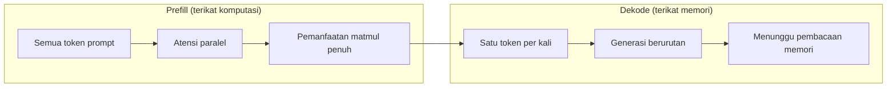
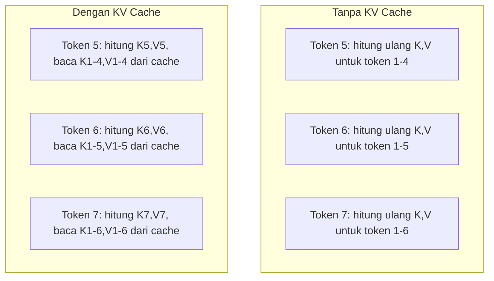
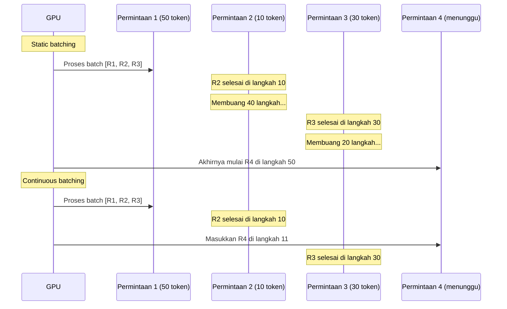
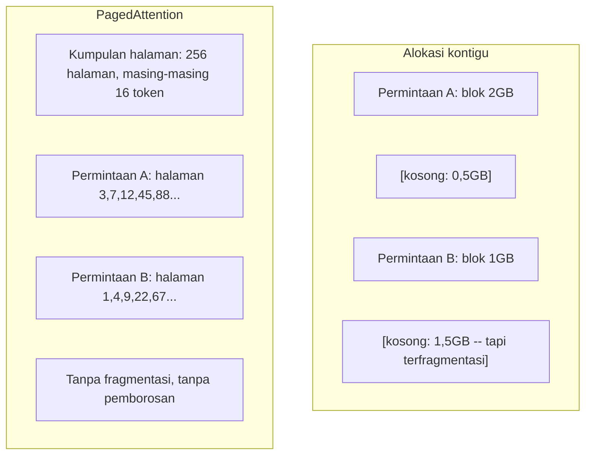
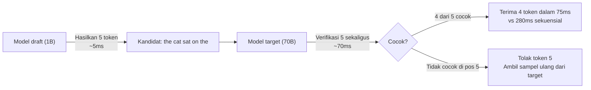

# Optimasi Inferensi

> Dua fase mendefinisikan inferensi LLM. Prefill memproses prompt Anda secara paralel — terikat komputasi. Dekode menghasilkan token satu per satu — terikat memori. Setiap optimasi menargetkan satu atau keduanya.

**Jenis:** Build
**Bahasa:** Python
**Prasyarat:** Fase 10, Pelajaran 01-08 (arsitektur transformer, atensi)
**Waktu:** ~120 menit

## Tujuan Pembelajaran

- Mengimplementasikan KV cache untuk menghilangkan komputasi redundan selama generasi token autoregresif
- Menjelaskan fase prefill dan dekode dalam inferensi LLM serta mengapa masing-masing memiliki bottleneck berbeda (terikat komputasi vs terikat memori)
- Mengimplementasikan konsep continuous batching dan PagedAttention untuk memaksimalkan pemanfaatan GPU di bawah permintaan bersamaan
- Membandingkan teknik optimasi inferensi (KV cache, dekode spekulatif, flash attention) serta trade-off throughput/latensinya

## Masalahnya

Anda menerapkan Llama 3 70B pada 4xA100 GPU. Satu pengguna mendapat ~50 token per detik. Terasa cepat. Lalu 100 pengguna masuk ke endpoint secara bersamaan. Throughput turun menjadi 3 token/detik/pengguna. Tagihan GPU $25.000/bulan Anda melayani respons lebih lambat daripada orang mengetik.

Modelnya sendiri tidak berubah antara 1 pengguna dan 100 pengguna. Bobot sama, arsitektur sama, matematika sama. Yang berubah adalah cara Anda menjadwalkan pekerjaan. Inferensi naif membuang 90%+ daya komputasi GPU yang tersedia. Seorang pengguna yang menunggu token ke-47 memegang satu slot batch penuh sementara bus memori GPU menganggur di antara perkalian matriks. Sementara itu, prompt 2.000 token dari pengguna baru bisa mengisi waktu mati itu dengan komputasi yang berguna.

Ini bukan masalah penskalaan. Ini masalah penjadwalan. Teknik-teknik dalam pelajaran ini — KV caching, continuous batching, PagedAttention, dekode spekulatif, prefix caching — adalah yang membedakan tagihan inferensi $25ribu/bulan dengan $5ribu/bulan untuk lalu lintas yang sama.

vLLM yang melayani Llama 3 70B pada 4xA100-80GB mencapai ~50 token/detik/pengguna pada konkurensi rendah, dan mempertahankan 15-25 TPS/pengguna pada 100 permintaan bersamaan berkat continuous batching dan PagedAttention. Tanpa optimasi ini, perangkat keras yang sama hanya melayani 5 TPS/pengguna pada konkurensi itu. GPU sama, model sama, throughput 4x lipat.

## Konsep

### Prefill vs Dekode

Setiap permintaan inferensi LLM memiliki dua fase yang berbeda.

**Prefill** memproses seluruh prompt masukan. Semua token sudah diketahui, sehingga atensi dapat dihitung secara paralel pada seluruh urutan. Ini adalah perkalian matriks besar — inti GPU tetap sibuk. Bottleneck-nya adalah komputasi: berapa FLOPS yang dapat diberikan perangkat keras Anda per detik. Sebuah A100 melakukan 312 TFLOPS (BF16). Prefill untuk prompt 4.096 token pada model 70B memakan ~400ms pada satu A100.

**Dekode** menghasilkan token keluaran satu per satu. Setiap token baru menghadiri semua token sebelumnya, tetapi hanya satu token yang dihasilkan per forward pass. Matriks bobot berukuran sama seperti saat prefill, tetapi Anda mengalikannya dengan sebuah vektor, bukan matriks. Inti GPU selesai dalam mikrodetik, lalu menunggu kumpulan bobot berikutnya tiba dari memori. Bottleneck-nya adalah bandwidth memori: seberapa cepat Anda dapat mengalirkan bobot model dari HBM ke unit komputasi. A100 memiliki bandwidth 2 TB/s. Model 70B dalam FP16 berukuran 140 GB. Membaca seluruh model sekali memakan 70ms — itulah lantai waktu untuk satu langkah dekode.



Rasio **ops:byte** (juga disebut intensitas aritmetika) menangkap trade-off ini. Ia mengukur berapa operasi yang Anda lakukan per byte yang dibaca dari memori.

```
ops:byte ratio = FLOPs per token / bytes read from memory
```

Saat prefill dengan batch 4.096 token, Anda melakukan ~4.096 operasi multiply-accumulate per bobot yang dimuat. Rasionya tinggi — Anda terikat komputasi. Saat dekode dengan ukuran batch 1, Anda melakukan ~1 operasi per bobot yang dimuat. Rasionya rendah — Anda terikat memori.

Wawasan mendasarnya: *dekode terikat memori karena Anda membaca seluruh model untuk menghasilkan satu token*. Setiap optimasi di bawah ini baik mengurangi apa yang Anda baca, menambah jumlah token yang diproses per pembacaan, atau menghindari pembacaan sama sekali.

### KV Cache

Selama atensi, query tiap token menghadiri vektor key dan value dari semua token sebelumnya. Tanpa caching, menghasilkan token N memerlukan penghitungan ulang proyeksi key dan value untuk semua N-1 token sebelumnya. Token 1 diproyeksikan saat menghasilkan token 2, lalu lagi untuk token 3, lalu lagi untuk token 4. Pada token 1.000, Anda telah memproyeksikan token 1 sebanyak 999 kali.

KV cache menyimpan proyeksi key dan value dari semua token sebelumnya. Saat menghasilkan token N, Anda hanya menghitung key dan value untuk token N, lalu menggabungkannya dengan K/V yang tersimpan dari token 1 sampai N-1.



**Rumus memori KV cache:**

```
KV cache size = 2 * num_layers * num_kv_heads * head_dim * seq_len * bytes_per_param
```

Untuk Llama 3 70B (80 lapisan, 8 KV head dengan GQA, head_dim=128, BF16):

```
per token: 2 * 80 * 8 * 128 * 2 bytes = 327,680 bytes = 320 KB
at 4,096 tokens: 320 KB * 4,096 = 1.28 GB
at 128K tokens: 320 KB * 131,072 = 40 GB
```

Satu percakapan dengan konteks 128K pada Llama 3 70B mengonsumsi 40 GB KV cache — separuh memori A100. Dengan 100 pengguna bersamaan pada 4K token masing-masing, KV cache saja memerlukan 128 GB. Inilah sebabnya manajemen KV cache adalah tantangan pusat optimasi inferensi.

### Continuous Batching

Static batching menunggu hingga kumpulan N permintaan tiba, memprosesnya bersama, dan menunggu *semua* selesai sebelum menerima permintaan baru. Jika satu permintaan memerlukan 500 token dan yang lain 10, permintaan pendek itu menganggur selama 490 langkah dekode setelah selesai.

Continuous batching (juga disebut iteration-level batching) memasukkan permintaan baru ke dalam batch begitu ada permintaan yang selesai. Batch dievaluasi ulang pada setiap langkah dekode. Permintaan yang selesai setelah 10 token langsung digantikan oleh permintaan yang menunggu.



Perbaikan throughput bergantung pada seberapa bervariasinya panjang keluaran. Dengan panjang yang seragam, continuous batching sejajar dengan static batching. Dengan panjang yang bervariasi (kasus yang umum), continuous batching dapat memberi throughput 2-5x lebih tinggi karena slot GPU tidak pernah kosong.

### PagedAttention

KV cache untuk setiap permintaan adalah blok memori kontigu. Saat permintaan datang dan pergi, memori terfragmentasi — persis seperti fragmentasi RAM pada sistem operasi. Permintaan 4K token memerlukan 1,28 GB kontigu. Bahkan jika Anda memiliki 2 GB kosong total, mungkin tidak ada 1,28 GB yang *kontigu*. Anda terpaksa memilih: membuang memori atau menolak permintaan itu.

PagedAttention (dari vLLM) menerapkan memori virtual bergaya OS pada KV cache. Alih-alih mengalokasikan satu blok kontigu per permintaan, ia mengalokasikan "halaman" berukuran tetap (biasanya 16 token per halaman). Halaman bisa berada di mana saja di memori GPU fisik. Tabel halaman memetakan posisi urutan logis tiap permintaan ke lokasi halaman fisik.



PagedAttention juga memungkinkan **copy-on-write** untuk prefiks bersama. Jika 50 permintaan berbagi system prompt yang sama, halaman KV cache untuk system prompt itu disimpan sekali dan direferensikan oleh ke-50 permintaan. Hanya ketika sebuah permintaan menyimpang (pesan pengguna yang berbeda) ia mendapat halamannya sendiri. Ini memotong penggunaan memori secara drastis untuk aplikasi dengan system prompt bersama.

vLLM melaporkan pemborosan memori hampir nol (~4% dibanding ~60-80% pada alokasi naif) berkat PagedAttention.

### Dekode Spekulatif

Dekode lambat karena bersifat sekuensial — Anda menghasilkan satu token, memasukkannya kembali, lalu menghasilkan berikutnya. Tetapi bagaimana jika Anda bisa menebak 5 token berikutnya dengan murah, lalu memverifikasi semuanya sekaligus?

Dekode spekulatif menggunakan **model draft** yang kecil dan cepat untuk menghasilkan K token kandidat. **Model target** yang besar lalu memproses semua K kandidat dalam satu forward pass (yang tampak seperti prefill — paralel, terikat komputasi, efisien). Jika model target setuju dengan prediksi model draft, Anda menerima semua K token dalam waktu satu forward pass target. Jika tidak setuju pada posisi j, Anda menerima token 1 sampai j-1 dan membuang sisanya.



Akselerasi bergantung pada **tingkat penerimaan** — seberapa sering prediksi model draft cocok dengan target. Untuk Llama 3 8B yang mendraft untuk Llama 3 70B, tingkat penerimaan 70-85% adalah hal umum pada bahasa alami. Ini diterjemahkan menjadi akselerasi dekode 2-3x.

Tiga pendekatan dekode spekulatif:

| Metode | Sumber draft | Tingkat penerimaan | Overhead |
|--------|-------------|-----------------|----------|
| Draft-target (Leviathan et al.) | Model kecil terpisah | 70-85% | Memori model draft |
| EAGLE (Li et al.) | Head ringan pada target | 75-90% | ~1% parameter tambahan |
| Lookup n-gram | Tabel n-gram token | 40-60% | Sangat kecil |

**EAGLE** melatih head autoregresif kecil di atas hidden state model target. Head ini memprediksi embedding token berikutnya menggunakan fitur lapisan sebelum terakhir dari model target. Karena ia beroperasi pada representasi model target sendiri (bukan model terpisah), ia mencapai tingkat penerimaan lebih tinggi dengan memori tambahan yang minimal. EAGLE-2 menambahkan pohon draft dinamis yang menyesuaikan jumlah kandidat berdasarkan konteks.

**Dekode spekulatif n-gram** menjaga tabel kelanjutan n-gram dari konteks saat ini atau korpus yang dibangun sebelumnya. Jika draft cocok dengan apa yang pernah muncul dalam percakapan yang sama (pola berulang, kode, keluaran terstruktur), ia langsung "menembak" tanpa overhead jaringan saraf. Tingkat penerimaannya lebih rendah rata-rata, tetapi biaya per spekulasi pada dasarnya gratis.

Dekode spekulatif *eksak secara matematis* — distribusi keluaran identik dengan distribusi model target. Ini bukan aproksimasi. Langkah verifikasi memastikan bahwa setiap token yang diterima memiliki probabilitas persis seperti yang akan ditetapkan model target.

### Prefix Caching

Banyak permintaan berbagi prefiks yang sama. System prompt chatbot. Blok konteks RAG. Sekumpulan contoh few-shot. Tanpa prefix caching, setiap permintaan menghitung ulang KV cache untuk token-token bersama ini dari awal.

Prefix caching menyimpan KV cache untuk prefiks umum dan menggunakannya kembali antar permintaan. Ketika permintaan baru tiba dengan prefiks yang dikenal, sistem menyalin (atau mereferensikan) entri KV yang tersimpan dan hanya menghitung KV untuk sufiks yang unik.

Untuk system prompt 2.000 token yang dibagikan semua permintaan, prefix caching menghilangkan ~400ms prefill per permintaan. Pada 100 permintaan/detik, ini menghemat 40 detik komputasi GPU per detik — lebih dari satu GPU penuh pekerjaan.

RadixAttention dari SGLang mengimplementasikan prefix caching dengan pohon radiks (trie) yang mengindeks prefiks berdasarkan konten tokennya. Permintaan apa pun yang cocok dengan prefiks yang tersimpan mendapat KV cache-nya secara gratis. Pohon ini memungkinkan pencocokan prefiks sebagian — jika Anda berbagi 1.500 dari 2.000 token prefiks dengan entri yang tersimpan, Anda menggunakan kembali 1.500 itu dan menghitung ulang hanya 500.

### Mesin Inferensi

Tiga mesin mendominasi pelayanan LLM produksi:

| Mesin | Inovasi utama | Terbaik untuk |
|--------|---------------|----------|
| vLLM | PagedAttention, continuous batching | Pelayanan umum, kompatibilitas tertinggi |
| SGLang | RadixAttention (prefix caching), generasi terstruktur | Chatbot multi-giliran, dekode terkonstrain |
| TensorRT-LLM | Fusi kernel NVIDIA, kuantisasi FP8 | Throughput maksimum satu GPU pada perangkat keras NVIDIA |

**vLLM** adalah titik awal default. Ia mendukung rentang model terluas, berjalan pada vendor GPU mana pun (NVIDIA, AMD, Intel), dan mencapai throughput kuat lewat PagedAttention + continuous batching. API-nya yang kompatibel dengan OpenAI berarti Anda dapat menggantikannya langsung untuk panggilan API OpenAI apa pun.

**SGLang** dibangun di atas fondasi yang sama dengan vLLM tetapi menambahkan RadixAttention untuk prefix caching dan bahasa khusus domain untuk program LLM terstruktur. Jika beban kerja Anda melibatkan percakapan multi-giliran, penggunaan alat, atau dekode terkonstrain (keluaran JSON, generasi terarah regex), SGLang sering mengungguli vLLM 2-5x lewat penggunaan ulang prefiks.

**TensorRT-LLM** mengompilasi model menjadi kernel GPU NVIDIA yang dioptimalkan. Ia menyatukan operasi (atensi + linear + aktivasi dalam satu kernel), memakai FP8 pada H100, dan terintegrasi dengan NVIDIA Triton Inference Server untuk penerapan produksi. Ia mencapai throughput satu-GPU tertinggi pada perangkat keras NVIDIA tetapi memerlukan lebih banyak penyiapan dan hanya bekerja pada GPU NVIDIA.

Angka dunia nyata untuk Llama 3 70B (4xA100-80GB, BF16):

| Metrik | vLLM | SGLang | TensorRT-LLM |
|--------|------|--------|---------------|
| Throughput (1 pengguna) | ~50 TPS | ~55 TPS | ~65 TPS |
| Throughput (100 pengguna) | ~2.500 total TPS | ~3.200 total TPS | ~3.000 total TPS |
| Waktu hingga token pertama | ~400ms | ~300ms (prefiks kena) | ~350ms |
| Konteks maksimum | 128K | 128K | 128K |

### Kerangka Ops:Byte

Anda tidak dapat mengoptimalkan apa yang tidak Anda ukur. Rasio ops:byte memberi tahu apakah Anda terikat komputasi atau terikat memori, yang menentukan optimasi mana yang penting.

```
Compute roof: peak FLOPS of the GPU
Memory roof:  peak bandwidth * ops:byte ratio
```

Ketika ops:byte rendah (dekode, batch kecil), Anda membentur atap bandwidth memori. Menambah komputasi (clock lebih tinggi, lebih banyak inti) tidak membantu. Anda perlu mengurangi pembacaan memori (kuantisasi, kompresi KV cache) atau menambah ukuran batch agar pembacaan teramortisasi atas lebih banyak pekerjaan berguna.

Ketika ops:byte tinggi (prefill, batch besar), Anda membentur atap komputasi. Optimasi bandwidth memori tidak membantu. Anda memerlukan GPU lebih cepat, fusi kernel, atau presisi lebih rendah untuk memeras lebih banyak FLOPS.

| Skenario | ops:byte | Terikat | Optimasi dengan |
|----------|----------|-------|---------------|
| Prefill, batch=1 | ~4.096 | Komputasi | Fusi kernel, FP8 |
| Dekode, batch=1 | ~1 | Memori | Kuantisasi, kompresi KV |
| Dekode, batch=32 | ~32 | Memori | Batch lebih besar, continuous batching |
| Dekode, batch=256 | ~256 | Transisi | Keduanya penting |
| Dekode, batch=1024 | ~1.024 | Komputasi | Fusi kernel, paralelisme tensor |

Titik persilangan pada A100 adalah sekitar ops:byte = 156 (312 TFLOPS / 2 TB/s). Di bawah 156, Anda terikat memori. Di atas 156, Anda terikat komputasi. Continuous batching mendorong dekode menuju titik persilangan ini dengan mengemas lebih banyak token per iterasi.

```figure
context-window-slide
```

## Bangunlah

### Langkah 1: KV Cache dari Awal

Kita membangun KV cache multi-head yang menyimpan proyeksi key dan value per lapisan, per head, dan menunjukkan pola pertumbuhan memori.

```python
import numpy as np

class KVCache:
    def __init__(self, num_layers, num_heads, head_dim, max_seq_len, dtype=np.float16):
        self.num_layers = num_layers
        self.num_heads = num_heads
        self.head_dim = head_dim
        self.max_seq_len = max_seq_len
        self.dtype = dtype

        self.k_cache = np.zeros(
            (num_layers, num_heads, max_seq_len, head_dim), dtype=dtype
        )
        self.v_cache = np.zeros(
            (num_layers, num_heads, max_seq_len, head_dim), dtype=dtype
        )
        self.seq_len = 0

    def update(self, layer_idx, new_keys, new_values):
        num_new = new_keys.shape[1]
        end = self.seq_len + num_new
        self.k_cache[layer_idx, :, self.seq_len:end, :] = new_keys
        self.v_cache[layer_idx, :, self.seq_len:end, :] = new_values
        return (
            self.k_cache[layer_idx, :, :end, :],
            self.v_cache[layer_idx, :, :end, :]
        )

    def advance(self, num_tokens):
        self.seq_len += num_tokens

    def memory_bytes(self):
        return self.k_cache.nbytes + self.v_cache.nbytes

    def used_bytes(self):
        per_token = 2 * self.num_layers * self.num_heads * self.head_dim * np.dtype(self.dtype).itemsize
        return per_token * self.seq_len
```

### Langkah 2: Atensi dengan KV Cache

Atensi multi-head sederhana yang menggunakan KV cache pada langkah dekode.

```python
def scaled_dot_product_attention(query, keys, values):
    head_dim = query.shape[-1]
    scores = np.matmul(query, keys.transpose(0, 1, 3, 2)) / np.sqrt(head_dim)
    seq_len_q = scores.shape[-2]
    seq_len_k = scores.shape[-1]
    if seq_len_q > 1:
        mask = np.triu(np.ones((seq_len_q, seq_len_k), dtype=np.float32), k=seq_len_k - seq_len_q + 1)
        scores = scores + mask * (-1e9)
    max_scores = np.max(scores, axis=-1, keepdims=True)
    exp_scores = np.exp(scores - max_scores)
    attn_weights = exp_scores / np.sum(exp_scores, axis=-1, keepdims=True)
    return np.matmul(attn_weights, values)


class MultiHeadAttention:
    def __init__(self, d_model, num_heads):
        self.num_heads = num_heads
        self.head_dim = d_model // num_heads
        scale = np.sqrt(2.0 / d_model)
        self.W_q = np.random.randn(d_model, d_model).astype(np.float32) * scale
        self.W_k = np.random.randn(d_model, d_model).astype(np.float32) * scale
        self.W_v = np.random.randn(d_model, d_model).astype(np.float32) * scale
        self.W_o = np.random.randn(d_model, d_model).astype(np.float32) * scale

    def forward(self, x, kv_cache=None, layer_idx=0):
        batch, seq_len, d_model = x.shape
        Q = np.matmul(x, self.W_q).reshape(batch, seq_len, self.num_heads, self.head_dim).transpose(0, 2, 1, 3)
        K = np.matmul(x, self.W_k).reshape(batch, seq_len, self.num_heads, self.head_dim).transpose(0, 2, 1, 3)
        V = np.matmul(x, self.W_v).reshape(batch, seq_len, self.num_heads, self.head_dim).transpose(0, 2, 1, 3)

        if kv_cache is not None:
            K_full, V_full = kv_cache.update(layer_idx, K[0], V[0])
            K = K_full[np.newaxis, :, :, :]
            V = V_full[np.newaxis, :, :, :]
            if seq_len == 1:
                kv_cache.advance(1)

        attn_out = scaled_dot_product_attention(Q, K, V)
        attn_out = attn_out.transpose(0, 2, 1, 3).reshape(batch, -1, d_model)
        return np.matmul(attn_out, self.W_o)
```

### Langkah 3: Simulator Continuous Batching

Ini menyimulasikan perbedaan penjadwalan antara static batching dan continuous batching.

```python
import heapq

class Request:
    def __init__(self, request_id, prompt_tokens, output_tokens, arrival_step):
        self.request_id = request_id
        self.prompt_tokens = prompt_tokens
        self.output_tokens = output_tokens
        self.arrival_step = arrival_step
        self.tokens_generated = 0
        self.start_step = None
        self.end_step = None

    def is_done(self):
        return self.tokens_generated >= self.output_tokens


def simulate_static_batching(requests, batch_size):
    step = 0
    completed = []
    queue = list(requests)
    queue.sort(key=lambda r: r.arrival_step)

    while queue:
        batch = []
        while queue and len(batch) < batch_size:
            r = queue.pop(0)
            r.start_step = max(step, r.arrival_step)
            batch.append(r)

        if batch:
            step = max(step, max(r.start_step for r in batch))
            max_output = max(r.output_tokens for r in batch)
            for r in batch:
                r.tokens_generated = r.output_tokens
                r.end_step = step + max_output
            step += max_output
            completed.extend(batch)

    return completed


def simulate_continuous_batching(requests, batch_size):
    step = 0
    completed = []
    queue = sorted(requests, key=lambda r: r.arrival_step)
    queue_idx = 0
    active = []
    waiting = []

    while queue_idx < len(queue) or active or waiting:
        while queue_idx < len(queue) and queue[queue_idx].arrival_step <= step:
            waiting.append(queue[queue_idx])
            queue_idx += 1

        while waiting and len(active) < batch_size:
            r = waiting.pop(0)
            r.start_step = step
            active.append(r)

        if not active:
            if waiting:
                step += 1
                continue
            elif queue_idx < len(queue):
                step = queue[queue_idx].arrival_step
                continue
            else:
                break

        for r in active:
            r.tokens_generated += 1

        done = [r for r in active if r.is_done()]
        for r in done:
            r.end_step = step + 1
            completed.append(r)
        active = [r for r in active if not r.is_done()]

        step += 1

    return completed


def batching_stats(completed):
    latencies = [r.end_step - r.arrival_step for r in completed]
    total_time = max(r.end_step for r in completed) - min(r.arrival_step for r in completed)
    total_tokens = sum(r.output_tokens for r in completed)
    return {
        "avg_latency": np.mean(latencies),
        "p50_latency": np.median(latencies),
        "p99_latency": np.percentile(latencies, 99),
        "total_time": total_time,
        "throughput": total_tokens / total_time if total_time > 0 else 0,
    }
```

### Langkah 4: Prefix Cache

Prefix cache berbasis trie yang menyimpan entri KV untuk prefiks bersama.

```python
class TrieNode:
    def __init__(self):
        self.children = {}
        self.kv_data = None
        self.hit_count = 0


class PrefixCache:
    def __init__(self, max_entries=1000):
        self.root = TrieNode()
        self.max_entries = max_entries
        self.total_entries = 0
        self.hits = 0
        self.misses = 0

    def _walk(self, token_ids):
        node = self.root
        depth = 0
        for tid in token_ids:
            if tid not in node.children:
                break
            node = node.children[tid]
            depth += 1
        return node, depth

    def lookup(self, token_ids):
        node, depth = self._walk(token_ids)
        if depth > 0:
            self.hits += 1
            current = self.root
            for tid in token_ids[:depth]:
                current = current.children[tid]
                current.hit_count += 1
            kv_entries = []
            current = self.root
            for tid in token_ids[:depth]:
                current = current.children[tid]
                if current.kv_data is not None:
                    kv_entries.append(current.kv_data)
            return depth, kv_entries
        self.misses += 1
        return 0, []

    def insert(self, token_ids, kv_per_token):
        node = self.root
        for i, tid in enumerate(token_ids):
            if tid not in node.children:
                if self.total_entries >= self.max_entries:
                    return i
                node.children[tid] = TrieNode()
                self.total_entries += 1
            node = node.children[tid]
            if i < len(kv_per_token):
                node.kv_data = kv_per_token[i]
        return len(token_ids)

    def hit_rate(self):
        total = self.hits + self.misses
        return self.hits / total if total > 0 else 0.0
```

### Langkah 5: Simulator Dekode Spekulatif

Kita menyimulasikan dekode spekulatif draft-target dengan tingkat penerimaan yang dapat diatur.

```python
class DraftModel:
    def __init__(self, vocab_size, acceptance_rate=0.8):
        self.vocab_size = vocab_size
        self.acceptance_rate = acceptance_rate

    def generate(self, context, num_tokens):
        tokens = np.random.randint(0, self.vocab_size, size=num_tokens)
        return tokens

    def get_probs(self, context, token):
        probs = np.random.dirichlet(np.ones(self.vocab_size))
        return probs


class TargetModel:
    def __init__(self, vocab_size):
        self.vocab_size = vocab_size

    def get_probs(self, context, tokens=None):
        if tokens is not None:
            return [np.random.dirichlet(np.ones(self.vocab_size)) for _ in tokens]
        return np.random.dirichlet(np.ones(self.vocab_size))


def speculative_decode(draft_model, target_model, context, num_speculative=5,
                       draft_cost=1.0, target_cost=10.0, verify_cost=12.0):
    total_tokens = 0
    total_cost = 0.0
    accepted_counts = []
    context = list(context)

    max_tokens = 100

    while total_tokens < max_tokens:
        draft_tokens = draft_model.generate(context, num_speculative)
        total_cost += draft_cost * num_speculative

        target_probs = target_model.get_probs(context, draft_tokens)
        total_cost += verify_cost

        accepted = 0
        for i, token in enumerate(draft_tokens):
            draft_p = draft_model.get_probs(context + list(draft_tokens[:i]), token)
            target_p = target_probs[i]

            r = np.random.random()
            acceptance_prob = min(1.0, target_p[token] / (draft_p[token] + 1e-10))

            if r < draft_model.acceptance_rate:
                accepted += 1
                context.append(token)
                total_tokens += 1
            else:
                new_token = np.random.choice(draft_model.vocab_size, p=target_p)
                context.append(new_token)
                total_tokens += 1
                break

        accepted_counts.append(accepted)

        if accepted == num_speculative:
            bonus_probs = target_model.get_probs(context)
            bonus_token = np.random.choice(draft_model.vocab_size, p=bonus_probs)
            context.append(bonus_token)
            total_tokens += 1

    sequential_cost = total_tokens * target_cost
    return {
        "total_tokens": total_tokens,
        "speculative_cost": total_cost,
        "sequential_cost": sequential_cost,
        "speedup": sequential_cost / total_cost if total_cost > 0 else 1.0,
        "avg_accepted": np.mean(accepted_counts),
        "acceptance_rate": np.mean(accepted_counts) / num_speculative,
    }


def compare_speculation_strategies(vocab_size=1000, num_trials=20):
    results = {}

    for name, acceptance_rate, spec_tokens in [
        ("Draft-target (8B->70B)", 0.78, 5),
        ("EAGLE", 0.85, 6),
        ("N-gram", 0.50, 4),
        ("No speculation", 0.0, 0),
    ]:
        if spec_tokens == 0:
            results[name] = {
                "speedup": 1.0,
                "acceptance_rate": 0.0,
                "avg_accepted": 0.0,
            }
            continue

        trial_results = []
        for _ in range(num_trials):
            draft = DraftModel(vocab_size, acceptance_rate=acceptance_rate)
            target = TargetModel(vocab_size)
            context = list(np.random.randint(0, vocab_size, size=10))
            result = speculative_decode(draft, target, context, num_speculative=spec_tokens)
            trial_results.append(result)

        results[name] = {
            "speedup": np.mean([r["speedup"] for r in trial_results]),
            "acceptance_rate": np.mean([r["acceptance_rate"] for r in trial_results]),
            "avg_accepted": np.mean([r["avg_accepted"] for r in trial_results]),
        }

    return results
```

### Langkah 6: Profiler Memori KV Cache

Hitung kebutuhan memori KV cache untuk konfigurasi model sungguhan.

```python
MODEL_CONFIGS = {
    "Llama-3-8B": {
        "num_layers": 32, "num_kv_heads": 8, "head_dim": 128,
        "model_params_b": 8, "gqa": True,
    },
    "Llama-3-70B": {
        "num_layers": 80, "num_kv_heads": 8, "head_dim": 128,
        "model_params_b": 70, "gqa": True,
    },
    "Llama-3-405B": {
        "num_layers": 126, "num_kv_heads": 8, "head_dim": 128,
        "model_params_b": 405, "gqa": True,
    },
    "Mistral-7B": {
        "num_layers": 32, "num_kv_heads": 8, "head_dim": 128,
        "model_params_b": 7, "gqa": True,
    },
    "GPT-4-est": {
        "num_layers": 120, "num_kv_heads": 96, "head_dim": 128,
        "model_params_b": 1800, "gqa": False,
    },
}


def kv_cache_memory(config, seq_len, dtype_bytes=2):
    per_token = 2 * config["num_layers"] * config["num_kv_heads"] * config["head_dim"] * dtype_bytes
    total = per_token * seq_len
    return {
        "per_token_bytes": per_token,
        "per_token_kb": per_token / 1024,
        "total_bytes": total,
        "total_mb": total / (1024 ** 2),
        "total_gb": total / (1024 ** 3),
    }


def memory_budget(config, gpu_memory_gb, model_dtype_bytes=2, kv_dtype_bytes=2):
    model_memory_gb = config["model_params_b"] * 1e9 * model_dtype_bytes / (1024 ** 3)
    overhead_gb = gpu_memory_gb * 0.1
    available_for_kv = gpu_memory_gb - model_memory_gb - overhead_gb

    if available_for_kv <= 0:
        return {"error": "Model does not fit in GPU memory", "model_memory_gb": model_memory_gb}

    per_token = 2 * config["num_layers"] * config["num_kv_heads"] * config["head_dim"] * kv_dtype_bytes
    max_tokens = int(available_for_kv * (1024 ** 3) / per_token)

    return {
        "gpu_memory_gb": gpu_memory_gb,
        "model_memory_gb": round(model_memory_gb, 1),
        "overhead_gb": round(overhead_gb, 1),
        "available_for_kv_gb": round(available_for_kv, 1),
        "max_total_tokens": max_tokens,
        "max_users_at_2k": max_tokens // 2048,
        "max_users_at_4k": max_tokens // 4096,
        "max_users_at_32k": max_tokens // 32768,
    }
```

## Gunakan

Dengan vLLM:

```python
from vllm import LLM, SamplingParams

llm = LLM(
    model="meta-llama/Meta-Llama-3-70B-Instruct",
    tensor_parallel_size=4,
    enable_prefix_caching=True,
    max_model_len=8192,
    gpu_memory_utilization=0.9,
)

params = SamplingParams(temperature=0.7, max_tokens=256)
outputs = llm.generate(["Explain inference optimization in one paragraph."], params)
```

Dengan SGLang untuk prefix caching + keluaran terstruktur:

```python
import sglang as sgl

@sgl.function
def classify(s, text):
    s += sgl.system("You are a classifier. Output JSON only.")
    s += sgl.user(f"Classify this text: {text}")
    s += sgl.assistant(sgl.gen("result", regex=r'\{"label": "(positive|negative|neutral)"\}'))

runtime = sgl.Runtime(model_path="meta-llama/Meta-Llama-3-70B-Instruct", tp_size=4)
sgl.set_default_backend(runtime)

results = classify.run_batch([
    {"text": "This product is amazing!"},
    {"text": "Terrible experience."},
    {"text": "It was okay I guess."},
])
```

Dengan TensorRT-LLM:

```python
import tensorrt_llm
from tensorrt_llm.runtime import ModelRunner

runner = ModelRunner.from_dir("./llama-70b-trt-engine/", rank=0)

outputs = runner.generate(
    batch_input_ids=[tokenizer.encode("Explain KV caching.")],
    max_new_tokens=256,
    temperature=0.7,
)
```

## Kirimkan

Pelajaran ini menghasilkan:
- `outputs/skill-inference-optimization.md` — skill untuk mendiagnosis dan mengoptimalkan pelayanan inferensi LLM

## Latihan

1. Ubah profiler KV cache untuk membandingkan kuantisasi KV cache FP16 vs FP8 vs INT4. Untuk Llama 3 70B pada konteks 4K, hitung jumlah pengguna maksimum untuk masing-masing pada 4xA100-80GB. Kuantisasi KV ke INT4 seharusnya meningkatkan kapasitas pengguna sekitar 4x.

2. Kembangkan simulator continuous batching agar melacak pemanfaatan GPU (fraksi slot batch yang terisi per langkah). Plot pemanfaatan dari waktu ke waktu untuk static batching dan continuous batching dengan 50 permintaan yang panjang keluarannya mengikuti distribusi Pareto (shape=1,5, scale=20). Continuous batching seharusnya mempertahankan pemanfaatan >80%.

3. Implementasikan versi grouped-query attention (GQA) dari KV cache di mana `num_kv_heads < num_query_heads`. Llama 3 70B menggunakan 64 query head tetapi hanya 8 KV head. Hitung penghematan memori dibanding atensi multi-head penuh (pengurangan 8x pada ukuran KV cache).

4. Bangun prefix cache dengan eviksi LRU. Tetapkan max_entries ke 500 dan hasilkan 1.000 permintaan yang 60%-nya berbagi salah satu dari 5 prefiks umum. Ukur tingkat kena dan bandingkan dengan cache tak terbatas. Dengan eviksi yang baik, tingkat kena harus tetap di atas 55%.

5. Kembangkan simulator dekode spekulatif untuk mengimplementasikan spekulasi berbasis pohon (gaya EAGLE-2). Alih-alih satu rantai token draft K, hasilkan pohon kandidat (misalnya, 2 cabang pada masing-masing dari 3 level = 8 kandidat daun). Bandingkan total token yang diterima per putaran verifikasi dengan spekulasi linear.

## Istilah Kunci

| Istilah | Yang biasa dikatakan | Arti sebenarnya |
|------|----------------|----------------------|
| Prefill | "Memproses prompt" | Menghitung atensi atas semua token masukan secara paralel — terikat komputasi karena perkalian matriks penuh membuat inti GPU tetap sibuk |
| Dekode | "Menghasilkan token" | Menghasilkan satu token per forward pass, membaca seluruh bobot model setiap kali — terikat memori karena komputasi selesai sebelum bobot berikutnya tiba |
| KV cache | "Penembolokan status atensi" | Menyimpan proyeksi key dan value dari semua token sebelumnya agar tidak dihitung ulang pada tiap langkah dekode — menukar memori dengan komputasi |
| Continuous batching | "Batching dinamis" | Memasukkan permintaan baru ke batch yang sedang berjalan begitu permintaan apa pun selesai, dievaluasi setiap iterasi dekode alih-alih menunggu seluruh batch |
| PagedAttention | "Memori virtual untuk KV cache" | Mengalokasikan KV cache dalam halaman berukuran tetap, bukan blok kontigu, sehingga menghilangkan fragmentasi memori dan memungkinkan copy-on-write untuk prefiks bersama |
| Dekode spekulatif | "Draft dan verifikasi" | Menggunakan model draft cepat untuk mengusulkan banyak token, lalu memverifikasi semuanya dalam satu forward pass model target — eksak secara matematis, akselerasi 2-3x |
| EAGLE | "Dekode spekulatif mandiri" | Varian dekode spekulatif yang melatih head ringan pada hidden state model target sendiri, mencapai tingkat penerimaan lebih tinggi daripada model draft terpisah |
| Prefix caching | "Menggunakan ulang KV system prompt" | Menyimpan entri KV cache yang telah dihitung untuk prefiks umum (system prompt, contoh few-shot) dan menggunakannya kembali antar permintaan untuk melewati prefill yang redundan |
| Rasio ops:byte | "Intensitas aritmetika" | Rasio operasi komputasi terhadap byte memori yang dibaca — menentukan apakah beban kerja terikat komputasi (rasio tinggi) atau terikat memori (rasio rendah) |
| Waktu hingga token pertama | "TTFT" | Latensi dari diterimanya permintaan hingga dihasilkannya token keluaran pertama — didominasi waktu prefill untuk prompt panjang |

## Bacaan Lebih Lanjut

- Kwon et al., "Efficient Memory Management for Large Language Model Serving with PagedAttention" (2023) — makalah vLLM yang memperkenalkan manajemen KV cache berhalaman, kini standar industri untuk pelayanan inferensi
- Leviathan et al., "Fast Inference from Transformers via Speculative Decoding" (2023) — makalah dasar yang membuktikan bahwa spekulasi draft-verifikasi menghasilkan distribusi model target yang eksak sekaligus memberi akselerasi 2-3x
- Li et al., "EAGLE: Speculative Sampling Requires Rethinking Feature Uncertainty" (2024) — mencapai tingkat penerimaan lebih tinggi dengan melatih head pada fitur model target sendiri alih-alih memakai model draft terpisah
- Zheng et al., "SGLang: Efficient Execution of Structured Language Model Programs" (2024) — memperkenalkan RadixAttention untuk prefix caching dan model pemrograman untuk program LLM multi-panggilan
- Williams et al., "Roofline: An Insightful Visual Performance Model for Multicore Architectures" (2009) — makalah roofline asli yang merumuskan kerangka ops:byte untuk penalaran bottleneck komputasi vs memori
