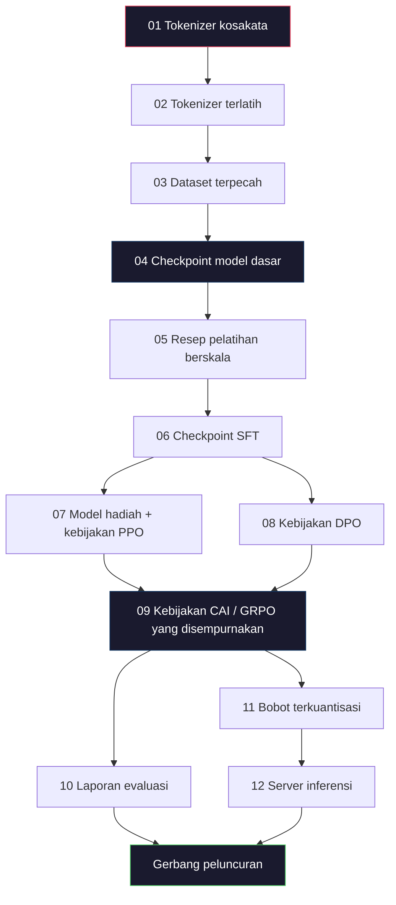
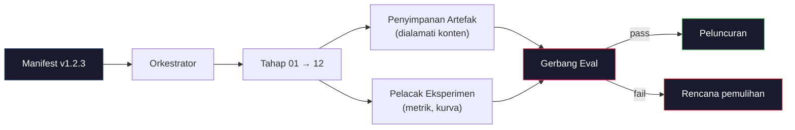

# Membangun Pipeline LLM Lengkap

> Semua yang ada di Pelajaran 01 sampai 12 adalah satu tahap dari satu pipeline. Pelajaran ini adalah kerangka yang mengubah tahap-tahap tersebut menjadi satu jalankan ujung-ke-ujung: tokenisasi, pra-pelatihan, penskalaan, SFT, penyelarasan, evaluasi, kuantisasi, penyajian. Anda tidak akan melatih model 70B di laptop. Anda akan menghasilkan lapisan orkestrasi, manifest, gerbang evaluasi, dan rencana pemulihan yang digunakan tim frontier 2026 untuk memutuskan apa yang diluncurkan. Ini adalah proyek penutup (capstone).

**Jenis:** Build
**Bahasa:** Python (stdlib), Rust
**Prasyarat:** Semua pelajaran Phase 10 01-12
**Waktu:** ~120 menit

## Tujuan Pembelajaran

- Menyusun dua belas pelajaran sebelumnya (dua pelajaran tokenizer, data, pra-pelatihan, penskalaan, SFT, RLHF, DPO, CAI, eval, kuantisasi, inferensi) menjadi satu spesifikasi pipeline yang dapat diulang
- Mendefinisikan kontrak artefak antartahap: apa yang dikonsumsi tiap tahap, apa yang dihasilkannya, dan bagaimana tahap berikutnya memverifikasi inputnya
- Membangun orkestrator yang melacak eksperimen, meng-hash artefak, dan menggerbang keputusan peluncuran pada ambang evaluasi
- Merancang rencana pemulihan: artefak mana yang murah dijalankan ulang, mana yang mahal, dan berapa biaya checkpoint yang rusak

## Masalahnya

Pelajaran-pelajaran sebelumnya masing-masing berjalan. Tokenizer terlatih. GPT kecil terlatih awalnya. Dataset SFT tersusun. Model hadiah terlatih. Jalankan DPO selesai. Evaluasi terukur. Bobot terkuantisasi diekspor. Server inferensi menyala. Masing-masing adalah notebook. Masing-masing memiliki konvensi sendiri, jalur keluaran sendiri, seed sendiri.

Jalankan pelatihan frontier bukanlah notebook. Llama 3 405B memakan 30 juta jam-H100 selama kurang lebih 54 hari. DeepSeek-V3 menggunakan sekitar 2,8 juta jam-H800. Selama waktu itu, satu checkpoint yang rusak, satu kontaminasi data, satu regresi evaluasi dapat merugikan tim satu minggu waktu dinding dan sebulan anggaran GPU. Cara tim bertahan adalah kebersihan pipeline: setiap tahap memiliki input deterministik, output deterministik, manifest, hash, dan gerbang.

Ini adalah proyek penutup. Anda tidak akan menjalankan pipeline secara ujung-ke-ujung di laptop. Anda akan menulis orkestrator yang mengoordinasikan tahap-tahap, manifest yang mendeskripsikan jalankan, verifier yang menggerbang keputusan peluncuran, dan rencana pemutaran ulang yang memungkinkan pihak ketiga menjalankan ulang pekerjaan Anda dari satu berkas. Kodenya kecil; disiplinnya besar.

Pola ini berskala dari 100M sampai 1T parameter tanpa berubah. Empat komponen yang sama -- manifest, orkestrator, gerbang evaluasi, penyimpanan artefak -- menjalankan Llama 3 dan juga menjalankan GPT hobi Anda. Perbedaan terletak pada ukuran angka di dalam konfigurasi tiap tahap, bukan bentuk pipelinenya.

## Konsepnya

### Dua Belas Tahap

Setiap pelajaran Phase 10 adalah satu tahap. Berikut graf dependensi lengkapnya.



Tahap 07 dan 08 dapat berjalan paralel. Semua lainnya adalah dependensi keras. Perubahan pada tahap 02 (tokenizer) membatalkan semua artefak hilir. Perubahan pada tahap 10 (eval) hanya membatalkan keputusan peluncuran.

### Manifest

Manifest adalah satu berkas yang mendeskripsikan suatu jalankan dengan cukup lengkap untuk diputar ulang. Tidak ada yang dihasilkan pipeline yang boleh bergantung pada keadaan yang tidak ada di manifest. Kolom-kolomnya membosankan dan wajib.

```
pipeline_version: 1.2.3
seed: 42
git_commit: a1b2c3d4
stages:
  01_tokenizer:
    recipe: bpe_32k
    input_hash: sha256:...
    output_hash: sha256:...
    wall_clock_sec: 3600
    cost_usd: 12
```

Hash keluaran tahap N adalah hash input tahap N+1. Penyimpangan apa pun membuat pipeline berhenti. Dengan demikian Anda menangkap kerusakan data lebih awal. Dengan demikian pula rekan di benua lain memverifikasi bahwa pemutaran ulangnya atas tahap deterministik menghasilkan artefak yang sama dengan milik Anda.

Dalam praktiknya tim memakai skema YAML kecil plus pemeriksa manifest yang membedakan terhadap jalanan sukses sebelumnya. Delta apa pun di luar kolom yang diharapkan (biaya, waktu dinding) adalah tanda merah.

### Pengetikan Artefak

Keluaran tiap tahap adalah artefak bertipe. Bukan gumpalan direktori, bukan pickle, melainkan tipe bernama dengan skema yang diketahui.

| Tahap | Tipe Artefak | Kolom Kunci |
|-------|--------------|-----------|
| 01-02 | Tokenizer | vocab.json, merges.txt, config.json, hash |
| 03 | Dataset | shards[], jumlah baris, jumlah token, statistik dedup |
| 04-05 | Checkpoint | weights.safetensors, config.json, keadaan pengoptimal, jumlah langkah |
| 06 | Model SFT | checkpoint + resep SFT + campuran data |
| 07 | Model Hadiah | checkpoint RM + hash data preferensi |
| 08-09 | Kebijakan | checkpoint + hash referensi + beta + anggaran KL terpakai |
| 10 | Laporan Eval | skor benchmark + delta regresi + hash data eval |
| 11 | Model Terkuantisasi | bobot terkuantisasi + data kalibrasi + delta akurasi vs FP16 |
| 12 | Spesifikasi Server | endpoint + hash model + konfigurasi + hook observabilitas |

Pengetikan mencegah mode kegagalan paling umum: memakai keluaran tahap 08 sebagai input tahap 06, meluncurkan model terlatih-DPO melalui jalur SFT. Artefak bertipe dan tanda tangan tahap bertipe membuat kesalahan ini menjadi kegagalan waktu kompilasi, bukan kegagalan hari kelima.

### Gerbang Evaluasi

Meluncurkan bukan berarti "pelatihan selesai". Meluncurkan berarti "pelatihan selesai dan gerbang evaluasi lulus". Gerbang didefinisikan sebelum jalankan dimulai.

```
gates:
  mmlu:      >= baseline + 0.5   # tidak ada regresi
  humaneval: >= baseline + 1.0
  truthfulqa: >= baseline         # tidak ada penurunan
  safety_refusal_rate: <= 0.05
  kl_from_reference: <= 25.0
  cost_total_usd: <= 50000
```

Setiap gerbang adalah ambang numerik. Tidak ada gerbang "terlihat bagus". Tidak ada persetujuan subjektif. Jika semua gerbang lulus, artefak ditandai dapat diluncurkan. Jika ada gerbang gagal, jalankan ditahan sambil menunggu override eksplisit oleh peninjau bernama, yang sendiri dicatat di manifest.

Dua gerbang menangkap sebagian besar bencana. Gerbang *regresi* (model baru harus minimal sebagus sebelumnya pada benchmark inti) menangkap bug pelatihan. Gerbang *anggaran KL* (kebijakan terselaraskan tidak boleh menyimpang lebih dari X dari referensinya) menangkap penyelarasan yang berlebihan (overcooked). Setiap pipeline produksi memiliki keduanya.

### Orkestrator

Sepotong kecil kode yang membaca manifest, mendistribusikan tahap, melacak artefak, dan berhenti pada pelanggaran kontrak apa pun. Ini bukan Airflow. Ini bukan Kubeflow. Untuk kebersihan pipeline Anda ingin sesuatu yang membosankan yang Anda tulis sendiri.

Tugas orkestrator sempit:

1. Menyelesaikan DAG dari manifest.
2. Untuk setiap tahap, memeriksa apakah keluaran yang diharapkan sudah ada pada hash yang benar (lewati jika ya).
3. Menjalankan tahap, menangkap stdout/stderr, mengukur waktu dinding dan biaya.
4. Memverifikasi hash keluaran terhadap hash input yang diharapkan tahap hilir.
5. Saat gagal, menulis manifest parsial dengan tahap yang tepat yang gagal dan keluar dengan kode nonzero.

Itu 200 baris Python. Bentuknya seperti berkas `code/main.py` pada pelajaran ini. Di balik layar, pipeline sungguhan memakai `torchrun` atau `ray` untuk mengeksekusi tiap tahap di klaster, tetapi orkestratornya sendiri berjalan pada satu mesin.

### Pelacakan Eksperimen dan Penyimpanan Artefak

Dua sistem eksternal menjadi jangkar pipeline.

**Pelacak eksperimen (wandb, neptune, mlflow).** Mencatat kurva loss, metrik evaluasi, telemetri sistem per tahap. Pelacak adalah tempat Anda pergi ketika perlu membandingkan jalankan A dengan jalankan B tiga minggu kemudian. Tim hampir selalu memakai pelacak terhosting untuk ini -- menulis sendiri membuang waktu yang seharusnya masuk ke pelatihan.

**Penyimpanan artefak (S3, R2, GCS).** Penyimpanan objek immutable untuk checkpoint, dataset, tokenizer, dan laporan evaluasi. Artefak dialamati berdasarkan hash, bukan nama berkas. Nama seperti `latest.pt` adalah jebakan kaki; `ckpt-7b-step-20000-sha256:abc123.safetensors` adalah kontrak.

Orkestrator menulis ke keduanya. Pelacak untuk manusia yang melihat grafik. Penyimpanan artefak untuk tahap berikutnya yang mencari input.

### Perhitungan Biaya

Jalankan frontier memiliki angka dolar yang melekat. Disiplin anggaran terjadi di dua tempat.

**Estimasi prajalankan.** Dari manifest, hitung FLOPs yang diharapkan (untuk pra-pelatihan: 6 x params x tokens), jam-GPU yang diharapkan (FLOPs / throughput puncak / utilisasi), dan biaya dolar pada tarif sewa saat ini. Jika estimasi melebihi gerbang anggaran, pipeline menolak untuk memulai.

**Pelacakan saat jalankan.** Waktu dinding dan biaya per tahap dicatat ke manifest. Setiap selesai tahap, sisa anggaran diperiksa. Jika suatu tahap melampaui, gerbang tahap berikutnya dievaluasi dengan sisa anggaran yang baru. Anda tidak mengetahui kehabisan uang ketika VC menelepon.

Biaya yang dilaporkan Llama 3 adalah $61M. DeepSeek-V3 melaporkan $5,6M untuk jalankan pra-pelatihan utama. Rasio itu sebagian besar efisiensi perangkat keras ditambah mixture-of-experts -- tetapi biaya spesifiknya terlihat karena kedua tim melacaknya per tahap, bukan per jalankan.

### Keterulangan vs Determinisme

Keduanya tidak sama. *Dapat diulang* (reproducible) berarti manifest yang sama plus kode yang sama plus infrastruktur yang sama menghasilkan checkpoint dengan metrik hilir yang setara. *Deterministik* berarti keluaran bit-identik.

Pelatihan LLM modern dapat diulang tetapi tidak deterministik. Urutan reduksi pada pelatihan terdistribusi, nondeterminisme kernel GPU (cuBLAS, flash-attn), dan pembulatan presisi campuran bergabung menghasilkan float yang berbeda pada level 1e-5 antarjalankan. Ini tidak apa-apa untuk metrik akhir, yang tidak bergeser. Ini fatal jika Anda mencoba debug dengan diff bit-level. Obatnya adalah mencatat hash input, hash output, dan metrik utama setiap tahap. Saat pemutaran ulang, hash hanya cocok untuk tahap deterministik, seperti pemrosesan data dan tokenisasi. Tahap pelatihan menulis bobot baru, sehingga hash keluarannya berubah. Untuk tahap-tahap itu, jalankan dinyatakan "terulang" ketika metrik utama cocok, meskipun bobotnya tidak bit-identik.



### Rencana Pemulihan

Sebelum jalankan dimulai, tuliskan apa yang terjadi jika setiap tahap gagal. Tiga kategori.

- **Murah dijalankan ulang** (jam): tokenizer, eval, kuantisasi, server inferensi. Cukup jalankan ulang.
- **Sedang** (hari): SFT, DPO, CAI. Simpan model dasar; jalankan ulang hanya tahap penyelarasan.
- **Mahal** (minggu dan jutaan dolar): pra-pelatihan. Rencana pemulihannya bukan "jalankan ulang", melainkan "pakai checkpoint terakhir yang baik dan jalankan ulang tahap hilir yang lebih murah dengan data revisi".

Karena dependensi tahap bertipe dan ter-hash, orkestrator dapat menghimpun himpunan pemulihan secara otomatis: batalkan tahap yang gagal beserta semua keturunannya. Kegagalan di tahap 06 (SFT) membatalkan 06, 07, 08, 09, 10, 11, 12. Kegagalan di tahap 11 (kuantisasi) hanya membatalkan 11 dan 12. Menamai ini di awal menghindari improvisasi saat tim lelah pukul 4 pagi.

### Resep Produksi yang Teramati pada 2026

Kebanyakan tim frontier menyatu pada kerangka yang sama.

- Tokenizer: BPE 128k dengan byte fallback. Dilatih pada irisan multibahasa kecil yang seimbang.
- Pra-pelatihan: 10-20T token, sebagian besar web plus kode plus sintetis. Pengoptimal Muon atau AdamW. FSDP2 atau DeepSpeed ZeRO-3. Checkpointing gradien. Bobot BF16, master FP32.
- SFT: 500rb-2J pasangan instruksi, campuran manusia dan sintetis, dengan dedup ketat terhadap himpunan eval.
- Penyelarasan: DPO atau CAI + GRPO. RLHF hanya di mana sinyal preferensi terlalu multidimensional untuk DPO.
- Evaluasi: MMLU-Pro, MATH, HumanEval+, GPQA, SWE-Bench Verified, LiveBench, plus himpunan pribadi tersembunyi yang tidak pernah dilihat publik.
- Kuantisasi: GPTQ atau AWQ 4-bit untuk penyajian, 8-bit untuk evaluasi keamanan di mana delta akurasi penting.
- Penyajian: vLLM, TensorRT-LLM, atau buatan dalam negeri (in-house). Continuous batching. Dekode spekulatif. Eviksi KV cache.

Angka-angka berubah setiap enam bulan. Kerangkanya tidak.

```figure
beam-search
```

## Bangunlah

Kode pelajaran ini adalah orkestrator dan pemeriksa manifest, bukan dua belas skrip pelatihan. Setiap tahap disimulasikan dengan placeholder yang menghasilkan artefak keluaran berbentuk dan hash yang benar. Menjalankan orkestrator secara ujung-ke-ujung membuktikan perpipaan (plumbing) pipeline bekerja sebelum Anda membakar uang GPU untuk tahap sungguhan.

Lihat `code/main.py` untuk implementasi lengkap. Bagian kuncinya:

- Dataclass `Manifest`: versi pipeline, seed, commit git, tahap, gerbang.
- Dataclass `Stage`: nama, tipe, input (hash), output (hash), waktu dinding, biaya.
- `Orchestrator.run()`: menyelesaikan DAG, mendistribusikan tahap, memverifikasi hash, memperbarui manifest.
- `EvalGate.check()`: membaca ambang, membandingkan dengan laporan eval terbaru, mengembalikan lulus/gagal.
- `ArtifactStore` (stub dalam memori): put/get berdasarkan hash, menyimulasikan S3.
- `CostTracker`: per tahap dan kumulatif, berhenti ketika batas terlampaui.

Pipeline di `main.py` menjalankan dua belas tahap placeholder, menghasilkan manifest, dan mensimulasikan gerbang evaluasi yang gagal untuk menunjukkan tampilan jalankan yang ditahan. Ganti setiap placeholder dengan skrip pelatihan sungguhan dari pelajaran yang bersesuaian dan Anda memiliki kerangka yang dipakai pipeline frontier sungguhan.

## Pakailah

Alur kerja kanonik memiliki tiga perintah.

```bash
python code/main.py plan    # validasi manifest, hitung estimasi biaya, cetak DAG
python code/main.py run     # jalankan tahap, menulis ke manifest.out.yaml
python code/main.py gate    # baca manifest.out.yaml, terapkan gerbang eval, luncurkan atau tahan
```

Port Rust menjalankan langkah `plan` yang sama:

```bash
rustc --edition 2021 -O code/main.rs -o /tmp/lesson && /tmp/lesson plan
```

Selalu jalankan `plan` terlebih dahulu. Kebanyakan bug pipeline muncul saat perencanaan -- ambang gerbang hilang, hash basi, kelebihan anggaran. Menjalankan `plan` gratis. Menjalankan `run` mahal. Hemat uang dengan menangkap bug di sisi murah.

Keluaran `gate` adalah `SHIP` atau `HOLD: <alasan>`. Jalankan yang ditahan bukan kegagalan; itu titik keputusan. Peninjau bernama baik meng-override (dan override dicatat), maupun menyetujui pemulihan.

## Luncurkan

Pelajaran ini menghasilkan `outputs/skill-llm-pipeline-reviewer.md`. Beri ia manifest pipeline yang diusulkan dan ia memeriksa semua kontrak: pengetikan tahap, rantai hash, gerbang, rencana pemulihan, estimasi biaya. Ia menolak menyetujui manifest dengan gerbang evaluasi yang hilang, anggaran KL tak terikat, atau jalankan yang mencampur data evaluasi dan pelatihan.

## Latihan

1. Perluas orkestrator untuk mendukung eksekusi paralel tahap 07 dan 08. Gunakan modul `concurrent.futures` dari stdlib. Pastikan manifest akhir mencatat keluaran kedua tahap dan hash input tahap 09 adalah kombinasi deterministik keduanya.

2. Tambahkan gerbang "pemeriksaan kontaminasi". Diberikan hash dataset eval dan potongan dataset pelatihan, hitung tumpang tindihnya (pencocokan string eksak atau 13-gram). Gerbang gagal jika tumpang tindih melebihi 0,1%. Beri ia himpunan pelatihan yang terkontaminasi dan pastikan gerbang menahan jalankan.

3. Implementasikan estimator biaya dari prinsip pertama. Untuk tahap 04 (pra-pelatihan), estimasi FLOPs sebagai 6 x params x tokens, asumsikan 40% MFU (model FLOPs utilization) pada H100 di 989 TFLOPs BF16, dengan $2,50/jam-GPU. Laporkan estimasi untuk model 7B yang dilatih pada 2T token. Bandingkan dengan angka Llama 2 yang dipublikasikan.

4. Bangun pemulihan parsial. Simulasikan kegagalan di tahap 09 (CAI), lalu jalankan ulang tahap 09 sampai 12 sambil membiarkan 01-08 tetap ter-cache. Orkestrator harus mendeteksi artefak ter-cache berdasarkan hash dan melewatinya. Ukur waktu dinding yang dihemat dibanding jalankan ulang penuh.

5. Tambahkan observabilitas. Pancarkan span OpenTelemetry untuk setiap tahap, dengan atribut untuk parameter, token yang terlihat, loss, dan biaya. Salurkan span ke kolektor lokal. Intinya bukan dasbor; intinya adalah kesehatan setiap tahap dapat dilacak dari satu ID jejak.

## Istilah Kunci

| Istilah | Apa yang dikatakan orang | Arti sebenarnya |
|---------|--------------------------|-----------------|
| Manifest | "Berkas resep" | YAML atau JSON yang mendeskripsikan versi pipeline, seed, konfigurasi per tahap, dan ambang gerbang -- cukup untuk memutar ulang jalankan |
| Dialamati konten (content-addressed) | "Pakai hash, bukan nama" | Artefak disimpan berdasarkan SHA-256 isinya, sehingga versi A tidak pernah tertukar dengan versi B |
| Gerbang evaluasi | "Kriteria peluncuran" | Ambang numerik pada metrik benchmark dan skor keamanan yang harus lulus sebelum artefak ditandai dapat diluncurkan |
| Anggaran KL | "Seberapa jauh penyelarasan bergeser" | Batas atas $\mathrm{KL}(\text{policy} \Vert \text{reference})$ kumulatif lintas tahap penyelarasan, ditegakkan sebagai gerbang |
| MFU | "Seberapa banyak GPU yang Anda pakai" | Model FLOPs Utilization -- FLOPs tercapai dibanding puncak teoretis. 40% lazim pada skala 70B, 55% pada 7B |
| Rencana pemulihan | "Apa yang kita lakukan saat rusak" | Sekumpulan tindakan tertulis per tahap saat gagal: jalankan ulang, kembali ke versi sebelumnya, latih ulang dengan input revisi |
| Orkestrator | "Konduktor" | Proses yang membaca manifest, mendistribusikan tahap, memverifikasi hash, dan berhenti pada pelanggaran kontrak apa pun |
| Penyimpanan artefak | "S3 berversi untuk bobot" | Penyimpanan objek immutable yang dialamati konten -- satu sumber kebenaran untuk checkpoint, dataset, dan laporan eval |
| Dapat diulang (reproducible) | "Metrik sama saat diputar ulang" | Bobot bit-level berbeda tetapi metrik hilir setara -- target realistis untuk pelatihan LLM terdistribusi |
| Gerbang biaya | "Anda tidak boleh melebihi X" | Estimasi biaya prajalankan plus pelacak saat jalankan -- pipeline menolak memulai jika estimasi melebihi anggaran |

## Bacaan Lanjutan

- [Dubey et al., 2024 -- "The Llama 3 Herd of Models"](https://arxiv.org/abs/2407.21783) -- deskripsi publik paling rinci tentang pipeline frontier, termasuk data, pelatihan, penyelarasan, evaluasi
- [DeepSeek-AI, 2024 -- "DeepSeek-V3 Technical Report"](https://arxiv.org/abs/2412.19437) -- pipeline yang mengutamakan efisiensi dengan biaya sekitar 1/10 pelatihan kelas Llama 3
- [Kaplan et al., 2020 -- "Scaling Laws for Neural Language Models"](https://arxiv.org/abs/2001.08361) -- hubungan penskalaan komputasi-data-parameter yang asli
- [Hoffmann et al., 2022 -- "Training Compute-Optimal Large Language Models (Chinchilla)"](https://arxiv.org/abs/2203.15556) -- koreksi terhadap Kaplan yang menyesuaikan ulang anggaran data modern
- [Dokumentasi PyTorch FSDP2](https://pytorch.org/docs/stable/fsdp.html) -- primitif pelatihan terdistribusi yang menggantikan FSDP1 di PyTorch 2.4+
- [Weights & Biases LLM Reports](https://wandb.ai/site/solutions/llms/) -- manifest sungguhan dan keluaran pelacak eksperimen untuk jalankan LLM sumber terbuka, berguna sebagai templat untuk diadaptasi
