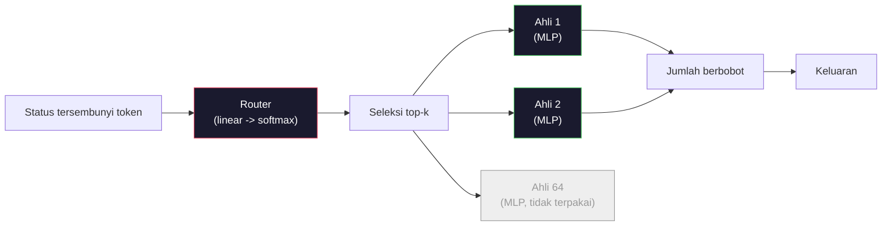

# Model Terbuka: Penelusuran Arsitektur

> Anda membangun GPT-2 Small dari nol di Pelajaran 04. Model terbuka terdepan pada 2026 adalah keluarga yang sama dengan lima atau enam perubahan konkret. RMSNorm alih-alih LayerNorm. SwiGLU alih-alih GELU. RoPE alih-alih posisi yang dipelajari. GQA atau MLA alih-alih MHA penuh. Mixture-of-Experts pada skala besar. Matematika yang sudah Anda ketahui mencakup 95% di antaranya. Pelajaran ini membaca Llama 3, DeepSeek-V3, Mixtral, Qwen, dan Gemma berdampingan serta menyebut baris tepat di mana setiap arsitektur berbeda.

**Jenis:** Belajar
**Bahasa:** Python (stdlib), Rust
**Prasyarat:** Fase 10, Pelajaran 04, 05, 12 (Pra-pelatihan, Penskalaan, Inferensi)
**Waktu:** ~45 menit

## Tujuan Pembelajaran

- Membaca config.json dari Llama 3, Mistral, Mixtral, Gemma 2, Qwen 2.5, dan DeepSeek-V3 serta menjelaskan setiap kolom
- Menyebut perubahan arsitektur spesifik yang dibuat setiap model dibanding GPT-2 Small dan membenarkannya dari prinsip pertama
- Menghitung jumlah parameter, ukuran KV cache, dan memori aktivasi untuk model terbuka mana pun hanya dari konfigurasinya
- Memilih model terbuka yang tepat untuk target deployment tertentu dengan mempertimbangkan keterbatasan latensi, memori, dan kemampuan

## Masalah

Di Pelajaran 04 Anda menulis 350 baris numpy dan mendapat model berbentuk GPT-2. Llama 3 405B memiliki laporan teknis 200 halaman. Insting Anda mengatakan keduanya adalah makhluk yang berbeda. Tidak demikian. Ke-200 halaman itu mendeskripsikan objek yang sama dengan lima atau enam modifikasi yang beralasan kuat, ditambah seribu detail implementasi tentang penskalaan. Kerangka dasarnya — embedding, blok transformer, atensi, MLP, norm, head — tidak berubah.

Pelajaran ini adalah sebuah diff. Untuk setiap keluarga model terbuka besar, kita cantumkan persis apa yang berubah dari GPT-2, mengapa, dan berapa biayanya. Setelah selesai, Anda dapat membaca model card baru dan menerjemahkannya kembali dalam pikiran ke baseline GPT-2.

Manfaat praktisnya: ketika Meta merilis Llama 5 atau DeepSeek merilis V4, Anda tidak memerlukan model mental baru. Anda melihat konfigurasi, menemukan tombol mana yang berubah dari yang sudah dikenal, dan mengetahui implikasi hilirnya. Arsitektur 2026 adalah kotak peralatan yang terbatas. Setiap model baru memilih himpunan bagian yang berbeda.

## Konsep

### Inti yang Invarien

Semua model autoregresif terbuka memiliki:

- Matriks embedding token (vocab_size x hidden_dim).
- Tumpukan N blok decoder: norm, self-attention, residual, norm, MLP, residual.
- Norm akhir dan head linear yang memproyeksikan ke vocab_size (sering diikat bobotnya dengan embedding).
- Masker kausal, loss cross-entropy token berikutnya.

Itulah bentuknya. Selebihnya adalah tombol-tombol.

### Enam Tombol yang Benar-benar Berubah

Pada setiap model terbuka terdepan 2024-2026, enam pilihan desain yang sama dipilih berulang kali:

1. **Normalisasi.** LayerNorm → RMSNorm.
2. **Penyandian posisi.** Absolute yang dipelajari → RoPE (plus varian: YaRN, NTK).
3. **Aktivasi.** GELU → SwiGLU (atau GeGLU).
4. **Pembagian head atensi.** MHA → GQA → MQA → MLA.
5. **MLP padat versus jarang.** Padat → Mixture-of-Experts.
6. **Penempatan pre-norm.** Pre-norm tetap bertahan. Post-norm sudah hilang.

Semua lainnya (jadwal laju pembelajaran, campuran data, ukuran batch, panjang konteks) hidup di konfigurasi pelatihan, bukan di arsitektur. Enam tombol.

### Tombol 1: RMSNorm

LayerNorm mengurangi rata-rata, membagi dengan simpangan baku, menskalakan, dan menggeser. RMSNorm hanya mempertahankan penskalaan:

```math
\mathop{\mathrm{RMSNorm}}(x) = \frac{x}{\sqrt{\mathop{\mathrm{mean}}(x^2) + \epsilon}} \cdot \gamma
```

Tanpa pengurangan rata-rata. Tanpa bias. Satu matmul lebih sedikit per token. Zhang dan Sennrich (2019) berargumen bahwa kinerjanya setara LayerNorm pada terjemahan mesin sambil 10% lebih cepat. Setiap model terbuka modern menggunakannya.

Biaya: tidak ada. Manfaat: kenaikan throughput kecil, kode lebih sederhana.

### Tombol 2: RoPE

Embedding posisi yang dipelajari dulunya adalah tabel pencarian 1024 slot di GPT-2. Konteks 1025 berada di luar ujung tabel. Model tidak dapat mengekstrapolasi melampaui panjang pelatihannya.

Rotary Position Embedding (RoPE, Su et al. 2021) menyuntikkan posisi dengan memutar setiap vektor Q dan K berpasangan sebelum produk titik atensi. Sudut rotasi merupakan fungsi deterministik dari posisi, sehingga tidak ada yang dipelajari dan tidak ada yang bisa habis. Dengan trik penskalaan (interpolasi sadar-NTK, YaRN), model yang dilatih pada konteks 8k dapat direntangkan ke 128k saat inferensi dengan kehilangan akurasi moderat.

```
q_rotated = rotate(q, angle(pos))
k_rotated = rotate(k, angle(pos))
score = q_rotated . k_rotated
```

Setiap Llama, Mistral, Qwen, DeepSeek, dan Gemma menggunakan RoPE. Gemma 2 menggunakan versi hibrida (RoPE pada sebagian besar lapisan, atensi jendela geser lokal pada sisanya).

### Tombol 3: SwiGLU

MLP GPT-2 adalah `x -> gelu(xW1 + b1) -> (...)W2 + b2`. SwiGLU (Shazeer 2020) mengganti aktivasi dengan produk bergerbang:

```math
\mathop{\mathrm{SwiGLU}}(x) = (xW_1) \cdot \mathop{\mathrm{sigmoid}}(xW_1) \cdot xV
```

Dua proyeksi secara paralel alih-alih satu, digerbangi oleh aktivasi Swish. Secara empiris lebih kuat dalam perplexity per parameter. Llama 2 mengadopsinya, semua mengikuti. Ukuran tersembunyi MLP biasanya ditetapkan agar jumlah parameter total cocok dengan MLP padat awal: jika GPT-2 menggunakan `ff_dim = 4 * hidden`, SwiGLU menggunakan `ff_dim = (2/3) * 4 * hidden = 8/3 * hidden`.

### Tombol 4: Pembagian Head Atensi

GPT-2 menggunakan **Multi-Head Attention (MHA)**: setiap head memiliki proyeksi Q, K, V sendiri.

**Multi-Query Attention (MQA, Shazeer 2019)** berbagi satu K dan satu V ke semua head. Memangkas KV cache sebesar num_heads, yaitu pengurangan 12x hingga 32x pada model umum. Akurasi turun sedikit pada benchmark sulit.

**Grouped-Query Attention (GQA, Ainslie et al. 2023)** adalah titik tengah: $G$ kelompok head Q berbagi satu K dan satu V. Llama 3 8B menggunakan GQA dengan 32 head Q dan 8 head KV ($G=8$), sehingga KV cache menyusut 4x dibanding MHA penuh.

**Multi-Head Latent Attention (MLA, DeepSeek 2024)** mengompres K dan V menjadi latensi peringkat rendah bersama, lalu memproyeksikannya kembali per head. Ini makin mengurangi KV cache sambil mempertahankan ekspresivitas per head. DeepSeek-V2 dan V3 mengandalkan teknik ini untuk kinerja konteks panjangnya.

| Skema | Head KV | KV Cache | Akurasi |
|--------|----------|----------|----------|
| MHA    | num_heads | penuh | terbaik |
| GQA    | num_groups (G < num_heads) | pengurangan num_heads / G | mendekati MHA |
| MQA    | 1 | pengurangan num_heads | penurunan kecil |
| MLA    | latensi, dekompresi per head | lebih kecil dari MQA | mendekati MHA |

Untuk model apa pun di atas ~13 miliar parameter, GQA atau MLA pada dasarnya wajib. MHA penuh pada skala besar adalah bencana KV cache.

### Tombol 5: Mixture of Experts

MLP padat mengaktifkan semua parameternya untuk setiap token. MLP MoE memiliki K ahli per blok dan sebuah router yang memilih ahli top-k per token (biasanya top-2). Hanya bobot ahli-ahli itulah yang menjalani lintasan maju untuk token tersebut.

```
router_logits = xW_r
indices, weights = top_k(router_logits, k=2)
output = sum_i weights[i] * expert[indices[i]](x)
```

Daya tariknya: Anda dapat memiliki 64 ahli berukuran 7B masing-masing (jumlah parameter totalnya besar), sementara hanya menjalankan 2 di antaranya per token (sehingga komputasi per token setara model padat 7B). Mixtral 8x7B memiliki 47B parameter total tetapi hanya mengaktifkan 13B per token. DeepSeek-V3 memiliki 671B parameter total tetapi hanya mengaktifkan 37B per token.



Kelebihan: komputasi sama, parameter lebih banyak, kapasitas lebih baik. Kekurangan: memori ahli tetap harus disimpan (sehingga pelayanan memerlukan VRAM lebih besar daripada model padat setara), menyeimbangkan beban router itu sulit, dan menyetel halus router saat penyelarasan merupakan bidang risiko tersendiri.

### Tombol 6: Pre-norm Tetap Bertahan

Transformer awal menerapkan layer norm setelah setiap sublapisan. Setiap model terbuka sejak GPT-2 menempatkannya *sebelum* setiap sublapisan. Pre-norm jauh lebih mudah dilatih pada kedalaman. Tidak ada yang perlu diperdebatkan.

### Diff Model per Model

Berikut tabel yang membuat semuanya konkret.

| Model | Tahun | Total Param | Param Aktif | Norm | Aktivasi | Posisi | Atensi | MoE | Konteks |
|-------|------|-------------|---------------|------|-----------|----------|-----------|-----|---------|
| GPT-2 Small | 2019 | 124M | 124M | LayerNorm | GELU | Dipelajari | MHA (12 head) | tidak | 1k |
| Llama 3 8B | 2024 | 8B | 8B | RMSNorm | SwiGLU | RoPE | GQA (32/8) | tidak | 128k |
| Llama 3 70B | 2024 | 70B | 70B | RMSNorm | SwiGLU | RoPE | GQA (64/8) | tidak | 128k |
| Llama 3 405B | 2024 | 405B | 405B | RMSNorm | SwiGLU | RoPE | GQA (128/16) | tidak | 128k |
| Mistral 7B | 2023 | 7.2B | 7.2B | RMSNorm | SwiGLU | RoPE | GQA | tidak | 32k |
| Mixtral 8x7B | 2023 | 47B | 13B | RMSNorm | SwiGLU | RoPE | GQA | ya (8 ahli, top-2) | 32k |
| Gemma 2 9B | 2024 | 9B | 9B | RMSNorm (pre+post) | GeGLU | RoPE + sliding | GQA | tidak | 8k |
| Qwen 2.5 72B | 2024 | 72B | 72B | RMSNorm | SwiGLU | RoPE (YaRN) | GQA (64/8) | tidak | 128k |
| DeepSeek V2 236B | 2024 | 236B | 21B | RMSNorm | SwiGLU | RoPE | MLA | ya (160 ahli, top-6) | 128k |
| DeepSeek V3 | 2024 | 671B | 37B | RMSNorm | SwiGLU | RoPE | MLA | ya (256 ahli, top-8) | 128k |
| Spark-X2.5 4B | 2026 | 4.1B | 4.1B | RMSNorm | GeGLU | RoPE + sliding (3:1) | GQA (16/4), keluaran bergerbang | tidak | 1M |

Pindai kolom-kolomnya. RMSNorm universal. SwiGLU atau saudara GeGLU-nya universal. RoPE universal. GQA universal di atas 7B kecuali ketika digantikan MLA. MoE adalah pembeda di ujung atas.

### Membaca config.json

Konfigurasi Llama 3 8B:

```
{
  "hidden_size": 4096,
  "intermediate_size": 14336,
  "num_hidden_layers": 32,
  "num_attention_heads": 32,
  "num_key_value_heads": 8,
  "max_position_embeddings": 131072,
  "rope_theta": 500000.0,
  "rms_norm_eps": 1e-5,
  "vocab_size": 128256
}
```

Setiap kolom bersesuaian dengan sesuatu yang sudah Anda implementasikan.
Konfigurasi yang lebih baru menambah beberapa kolom yang mengubah aritmetika, sehingga kalkulator
membacanya saat kolom itu ada:

- `head_dim`: ditetapkan eksplisit ketika nilainya bukan `hidden_size / num_attention_heads`. Gemma 2 9B memiliki hidden 3584 dan 16 head tetapi `head_dim` 256, sehingga proyeksi Q-nya berukuran 3584 x 4096, bukan persegi.
- `tie_word_embeddings`: apakah head LM menggunakan kembali matriks embedding. Llama 3 8B tidak mengikatnya, yang berarti 525 juta parameter terlewat jika Anda hanya menghitung embedding sekali.
- `layer_types` dan `sliding_window`: lapisan mana yang menghadiri konteks penuh dan mana yang hanya menghadiri W token terakhir.

- `hidden_size`: dimensi embedding.
- `intermediate_size`: ukuran tersembunyi MLP (3.5x hidden — matematika SwiGLU).
- `num_hidden_layers`: kedalaman tumpukan.
- `num_attention_heads`: head Q.
- `num_key_value_heads`: head KV (GQA).
- `max_position_embeddings`: panjang konteks pelatihan.
- `rope_theta`: frekuensi dasar RoPE. Meta menskalakannya dari 10k bawaan menjadi 500k untuk ekstrapolasi konteks panjang.
- `rms_norm_eps`: stabilitas numerik.
- `vocab_size`: token.

Dari kolom-kolom ini saja Anda menghitung parameter total, KV cache, dan memori aktivasi puncak. Lihat `code/main.py` untuk rumus exact-nya.

### Anggaran Memori Aktivasi

Aktivasi mendominasi memori pelatihan di atas beberapa miliar parameter. Aturan praktis untuk pra-pelatihan (dengan checkpointing gradien):

```
activation_mem ~ batch_size * seq_len * hidden_size * num_layers * bytes_per_element
```

Untuk Llama 3 8B pada batch 1, seq 8192, BF16, 32 lapisan, hidden 4096: sekitar 8 GB hanya untuk aktivasi dengan checkpointing, 40 GB tanpanya. Inilah sebabnya flash-attention dan ring-attention penting — keduanya menulis ulang komputasi atensi agar aktivasi muat.

### Anggaran KV Cache

Untuk inferensi pada konteks maksimum:

```
kv_cache = 2 * num_layers * num_kv_heads * head_dim * max_seq_len * bytes_per_element
```

Llama 3 8B pada konteks 128k, BF16, head_dim = hidden / num_heads = 128:
`2 * 32 * 8 * 128 * 131072 * 2 = 17.2 GB` per urutan.

Bobot 8B berukuran 16 GB dalam BF16. KV cache untuk satu urutan 128k lebih besar daripada bobotnya. Inilah tekanan memori yang mendorong GQA, MLA, dan riset kuantisasi KV cache.

Rumus di atas mengasumsikan setiap lapisan menyimpan seluruh urutan. Lapisan jendela geser hanya perlu W token terakhir, sehingga pada model hibrida penjumlahannya dilakukan per lapisan:

```
kv_cache = 2 * num_kv_heads * head_dim * bytes_per_element
           * (full_layers * max_seq_len + sliding_layers * min(W, max_seq_len))
```

Spark-X2.5 4B menjalankan tiga lapisan jendela geser ($W = 512$) untuk setiap lapisan atensi penuh: 9 lapisan penuh dan 27 lapisan geser dari 36. Pada konteks 1M token itu sekitar 38,7 GB (36 GiB) per urutan dalam BF16. Jika ke-36 lapisan menyimpan konteks penuh, angkanya 154,6 GB (144 GiB). Lapisan penuh menanggung hampir seluruh biaya, sehingga rasio lapisan penuh terhadap lapisan geser adalah angka pertama yang harus Anda baca pada model konteks panjang.

### Kapan Setiap Model Menang

- **Satu GPU 80GB, tanpa MoE**: Llama 3 8B, Mistral 7B, Gemma 2 9B. Mudah dilayani, dukungan alat luas.
- **Satu node (8x80GB), kapasitas besar**: Llama 3 70B, Qwen 2.5 72B. Kemampuan terbuka padat tertinggi.
- **Kemampuan terbuka terbesar, terima kompleksitas MoE**: DeepSeek V3, Mixtral 8x22B. Kemampuan terbaik per FLOP aktif.
- **Kebutuhan konteks panjang**: Llama 3 (128k dengan penskalaan RoPE), DeepSeek (keunggulan MLA).
- **Pelayanan latensi rendah**: Gemma 2 9B (jendela geser memangkas komputasi konteks panjang).
- **Konteks panjang dengan anggaran memori kecil**: model hibrida jendela geser seperti Spark-X2.5 4B, tempat hanya seperempat lapisan yang membayar biaya konteks penuh.

```figure
rmsnorm-vs-layernorm
```

## Membangunnya

Kode pelajaran ini adalah sebuah kalkulator. Diberikan config.json apa pun, kode ini mencetak jumlah parameter per komponen, KV cache pada konteks maksimum, rasio MLP SwiGLU, dan kesimpulan singkat tentang arsitekturnya (padat / GQA / MLA / MoE).

```python
config = {
    "hidden_size": 4096, "intermediate_size": 14336,
    "num_hidden_layers": 32, "num_attention_heads": 32,
    "num_key_value_heads": 8, "vocab_size": 128256,
    "max_position_embeddings": 131072,
}
```

Skrip menelusuri arsitektur kolom per kolom, menghitung jumlah parameter untuk embedding, atensi (dengan pengurangan GQA dan `head_dim` eksplisit saat konfigurasi menetapkannya), MLP (dengan ekspansi SwiGLU atau GeGLU), layernorm, serta head LM ketika tidak diikat ke embedding. Skrip lalu menghitung KV cache pada panjang konteks yang dinyatakan, lapisan per lapisan sehingga lapisan jendela geser dibatasi pada jendelanya, dan mencetak ringkasan.

Untuk model padat, totalnya cocok persis dengan jumlah parameter yang dipublikasikan: Llama 3 8B menghasilkan 8,030,261,248; Gemma 2 9B menghasilkan 9,241,705,984; dan Spark-X2.5 4B menghasilkan 4,112,079,360. Qwen 2.5 72B selisih 819,200, itulah Latihan 1.

Lihat `code/main.py` untuk implementasinya.

## Menggunakannya

Jalankan kalkulator pada konfigurasi Llama 3 8B, Mistral 7B, Mixtral 8x7B, dan DeepSeek V3 yang disertakan dalam skrip. Bandingkan rincian parameternya. Perhatikan bahwa model MoE memiliki jumlah parameter total yang jauh lebih besar daripada model padat, tetapi jumlah parameter aktifnya sering lebih kecil. Perhatikan pula bahwa KV cache DeepSeek V3 lebih kecil daripada Llama 3 405B meskipun parameter totalnya lebih banyak — itulah MLA beraksi.

Lalu bandingkan Gemma 2 9B dan Spark-X2.5 4B. Untuk keduanya, skrip mencetak KV cache yang benar-benar dibutuhkan dan KV cache yang akan dibutuhkan jika setiap lapisan adalah atensi penuh. Gemma 2 bergantian 1:1 pada konteks 8k, sehingga penghematannya modest. Spark-X2.5 bergantian 3:1 dengan jendela 512 token pada 1M, sehingga penghematannya 4x.

Kemudian masukkan konfigurasi model lain yang Anda miliki secara lokal, bacalah ringkasan, dan putuskan apakah model itu muat di GPU Anda.

## Merilisnya

Pelajaran ini menghasilkan `outputs/skill-open-model-picker.md`. Dengan target deployment (jenis GPU, VRAM, panjang konteks, anggaran latensi) dan profil tugas (chat, kode, penalaran, konteks panjang), skill ini merekomendasikan model terbuka, skema kuantisasi dari Pelajaran 11, dan tumpukan inferensi dari Pelajaran 12, dengan penalaran eksplisit tentang enam tombol arsitektur tersebut.

## Latihan

1. Baca konfigurasi Qwen 2.5 72B dari HuggingFace. Hitung parameter total dari nol. Bandingkan dengan nilai yang dilaporkan HF dan identifikasi sumber selisihnya (pembulatan head dim, faktor pembagian KV, dan sebagainya).

2. DeepSeek V3 menggunakan 256 ahli dengan routing top-8. Hitung rasio ahli yang diaktifkan terhadap total ahli dan bandingkan dengan top-2 dari 8 pada Mixtral 8x7B. Apa yang disiratkan pergeseran dari jarang (25%) menjadi jarang yang lebih padat (3%) tentang kapasitas per FLOP?

3. Hitung KV cache untuk Llama 3 405B pada konteks 128k dalam FP8 dan BF16. Pada FP8, nilainya setengah dari BF16. Berapa urutan paralel yang dapat Anda layani pada satu node 8xH100 (80GB masing-masing = 640GB total, dikurangi memori bobot)?

4. Gemma 2 bergantian antara lapisan atensi penuh dan lapisan atensi jendela geser. Tuliskan matematika untuk KV cache ketika setengah lapisan menggunakan jendela geser 4096 token alih-alih konteks penuh. Berapa memori yang dihemat pada total konteks 8k?

5. Temukan model terbuka terdepan baru yang dirilis setelah pelajaran ini ditulis. Identifikasi tombol mana dari enam tombol yang dipilihnya dan apakah ia memperkenalkan tombol ketujuh. Kurikulum akan terasa usang segera setelah arsitektur baru dirilis — tujuannya adalah memperbarui tabel Anda tanpa membangun ulang model mental Anda.

## Istilah Kunci

| Istilah | Yang orang katakan | Yang sebenarnya dimaksud |
|------|----------------|----------------------|
| RMSNorm | "LayerNorm tanpa rata-rata" | Normalisasi hanya dengan akar rata-rata kuadrat, disertai skala yang dipelajari — lebih murah dan sebanding dengan LayerNorm |
| RoPE | "Posisi rotasi" | Memutar setiap vektor Q dan K berpasangan dalam 2D dengan sudut yang bergantung pada posisi — mengekstrapolasi melampaui panjang pelatihan dengan trik penskalaan |
| SwiGLU | "Aktivasi MLP baru" | Unit linear bergerbang dengan Swish: `(xW1) * sigmoid(xW1) * xV` — standar pada setiap model terbuka 2024 ke atas |
| GQA | "Atensi titik tengah" | Grouped-Query Attention: G kelompok head Q berbagi satu head K dan satu head V — menyusutkan KV cache tanpa penurunan akurasi seperti MQA |
| MLA | "Atensi ala DeepSeek" | Multi-Head Latent Attention: mengompres K/V menjadi latensi peringkat rendah bersama, lalu mendekompresi per head — KV cache terkecil untuk model besar |
| MoE | "Ahli jarang" | Mixture of Experts: N MLP per blok, router memilih top-k per token — total parameter besar, parameter aktif kecil |
| Routing top-k | "Pilih k ahli per token" | Router menghitung skor per ahli dan mengaktifkan k skor tertinggi — k lazim berkisar dari 2 (Mixtral) hingga 8 (DeepSeek) |
| YaRN | "Rentangkan RoPE" | Yet another RoPE extension — menginterpolasi sudut rotasi untuk memperpanjang konteks dari 8k menjadi 128k+ saat inferensi |
| Atensi jendela geser | "Jangan hadiri semuanya" | Setiap token hanya menghadiri W token terakhir — membatasi biaya atensi menjadi $O(W)$ per token, digunakan pada Gemma 2 dan Mistral awal |
| Param aktif | "Yang berjalan per token" | Untuk model MoE, jumlah parameter yang menjalani lintasan maju per token (jauh lebih kecil daripada total param) — menentukan FLOP per token |

## Bacaan Lanjutan

- [Dubey et al., 2024 — "The Llama 3 Herd of Models"](https://arxiv.org/abs/2407.21783) — referensi arsitektur dan pelatihan untuk keluarga Llama 3 padat
- [DeepSeek-AI, 2024 — "DeepSeek-V3 Technical Report"](https://arxiv.org/abs/2412.19437) — MLA ditambah penyeimbangan beban tanpa loss bantu ditambah MoE 671B
- [Jiang et al., 2024 — "Mixtral of Experts"](https://arxiv.org/abs/2401.04088) — makalah kanonik model terbuka MoE
- [Su et al., 2021 — "RoFormer: Enhanced Transformer with Rotary Position Embedding"](https://arxiv.org/abs/2104.09864) — makalah RoPE
- [Shazeer, 2020 — "GLU Variants Improve Transformer"](https://arxiv.org/abs/2002.05202) — SwiGLU, GeGLU, dan kerabatnya
- [Ainslie et al., 2023 — "GQA: Training Generalized Multi-Query Transformer Models"](https://arxiv.org/abs/2305.13245) — makalah GQA
- [Gemma 2 Team, 2024 — "Gemma 2: Improving Open Language Models at a Practical Size"](https://arxiv.org/abs/2408.00118) — atensi penuh+geser hibrida, pre+post-norm
- [Qwen Team, 2024 — "Qwen 2.5 Technical Report"](https://arxiv.org/abs/2412.15115) — perluasan konteks YaRN dan resep pelatihan konteks panjang
