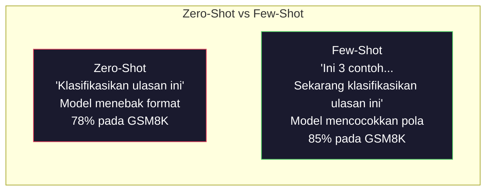
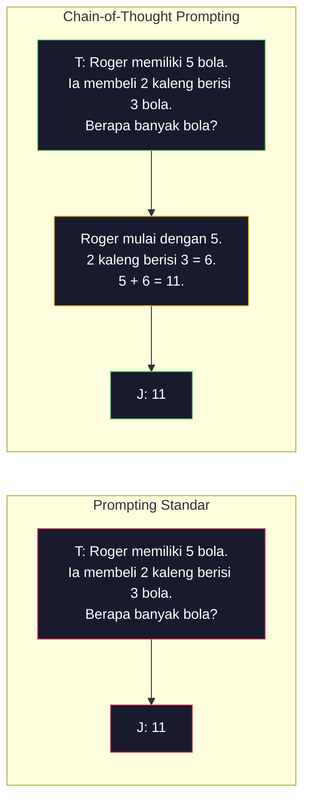
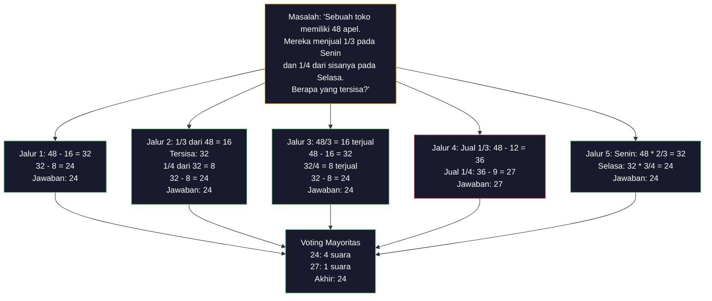
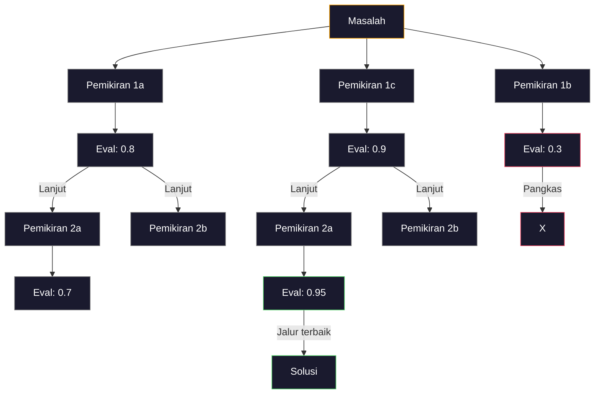

# Few-Shot, Chain-of-Thought, Tree-of-Thought

> Memberi tahu model apa yang harus dilakukan adalah prompting. Menunjukkannya cara berpikir adalah rekayasa. Selisih antara akurasi 78% dan 91% pada model yang sama, tugas yang sama, data yang sama bukanlah model yang lebih baik. Itu adalah strategi penalaran yang lebih baik.

**Jenis:** Bangun
**Bahasa:** Python
**Prasyarat:** Pelajaran 11.01 (Prompt Engineering)
**Waktu:** ~45 menit

## Tujuan Pembelajaran

- Menerapkan few-shot prompting dengan memilih dan memformat demonstrasi contoh yang memaksimalkan akurasi tugas
- Menerapkan penalaran chain-of-thought (CoT) untuk meningkatkan akurasi pada masalah multi-langkah seperti soal cerita matematika
- Membangun prompt tree-of-thought yang menjelajahi beberapa jalur penalaran dan memilih yang terbaik
- Mengukur peningkatan akurasi dari zero-shot vs few-shot vs CoT pada benchmark standar

## Masalah

Anda membangun aplikasi les matematika. Prompt Anda berbunyi: "Selesaikan soal cerita ini." GPT-5 menjawab benar 94% waktu pada GSM8K, benchmark matematika tingkat sekolah dasar standar. Anda mengira sudah mencapai puncak. Tidak — chain-of-thought masih menambah 3-4 poin.

Tambahkan lima kata -- "Let's think step by step" -- dan akurasi melonjak ke 91%. Tambahkan beberapa contoh yang dikerjakan lengkap dan akurasi mencapai 95%. Model yang sama. Temperature yang sama. Biaya API yang sama. Satu-satunya perbedaan adalah Anda memberi model kertas coretan.

Ini bukan trik. Ini cara kerja penalaran. Manusia tidak menyelesaikan masalah multi-langkah dalam satu lompatan mental. Transformer juga tidak. Saat Anda memaksa model menghasilkan token antara, token-token itu menjadi bagian dari konteks untuk token berikutnya. Setiap langkah penalaran memberi masukan pada langkah berikutnya. Model secara harfiah menghitung jalannya menuju jawaban.

Tetapi "berpikir langkah demi langkah" hanyalah awal, bukan akhir. Bagaimana jika Anda mengambil sampel lima jalur penalaran dan melakukan voting mayoritas? Bagaimana jika Anda membiarkan model menjelajahi pohon kemungkinan, mengevaluasi dan memangkas cabang? Bagaimana jika Anda menyelingi penalaran dengan penggunaan alat? Ini bukan hipotesis. Ini teknik-teknik yang telah dipublikasikan dengan perbaikan yang terukur, dan Anda akan membangun semuanya dalam pelajaran ini.

## Konsep

### Zero-Shot vs Few-Shot: Saat Contoh Mengalahkan Instruksi

Zero-shot prompting memberi model sebuah tugas dan tidak lebih. Few-shot prompting memberinya contoh terlebih dahulu.

Wei dkk. (2022) mengukur hal ini pada 8 benchmark. Untuk tugas sederhana seperti klasifikasi sentimen, zero-shot dan few-shot memiliki kinerja dalam selisih 2%. Untuk tugas kompleks seperti aritmetika multi-langkah dan penalaran simbolik, few-shot meningkatkan akurasi sebesar 10-25%.

Intuisinya: contoh adalah instruksi yang dipadatkan. Alih-alih mendeskripsikan format keluaran, Anda menunjukkan format itu. Alih-alih menjelaskan proses penalaran, Anda mendemonstrasikannya. Model mencocokkan pola pada contoh lebih andal daripada menafsirkan instruksi abstrak.



**Saat few-shot menang:** tugas yang sensitif terhadap format, klasifikasi, ekstraksi terstruktur, jargon khusus domain, tugas apa pun di mana model perlu mencocokkan pola tertentu.

**Saat zero-shot menang:** pertanyaan faktual sederhana, tugas kreatif di mana contoh membatasi kreativitas, tugas di mana mencari contoh yang baik lebih sulit daripada menulis instruksi yang baik.

### Pemilihan Contoh: Kemiripan Mengalahkan Keacakan

Tidak semua contoh sama. Memilih contoh yang mirip dengan masukan target mengungguli pemilihan acak sebesar 5-15% pada tugas klasifikasi (Liu dkk., 2022). Tiga prinsip:

1. **Kemiripan semantik**: pilih contoh yang paling dekat dengan masukan dalam ruang embedding
2. **Keanekaragaman label**: cakup semua kategori keluaran dalam contoh Anda
3. **Pencocokan tingkat kesulitan**: samakan tingkat kompleksitas masalah target

Jumlah optimal contoh untuk sebagian besar tugas adalah 3-5. Di bawah 3, model tidak memiliki cukup sinyal untuk mengekstrak pola. Di atas 5, Anda mencapai penurunan hasil yang semakin kecil dan membuang-buang token jendela konteks. Untuk klasifikasi dengan banyak label, gunakan satu contoh per label.

### Chain-of-Thought: Memberi Model Kertas Coretan

Chain-of-Thought (CoT) prompting diperkenalkan oleh Wei dkk. (2022) di Google Brain. Gagasannya sederhana: alih-alih meminta model hanya memberikan jawaban, minta ia menunjukkan langkah-langkah penalarannya terlebih dahulu.



Mengapa ini bekerja secara mekanis? Setiap token yang dihasilkan transformer menjadi konteks bagi token berikutnya. Tanpa CoT, model harus memadatkan seluruh penalaran ke dalam keadaan tersembunyi dari satu lintasan maju. Dengan CoT, model mengeksternalisasi komputasi antara sebagai token. Setiap token penalaran memperluas kedalaman komputasi efektif.

**Benchmark GSM8K (matematika tingkat sekolah dasar, 8.5K soal):**

| Model | Zero-Shot | Zero-Shot CoT | Few-Shot CoT |
|-------|-----------|---------------|--------------|
| GPT-4o | 78% | 91% | 95% |
| GPT-5 | 94% | 97% | 98% |
| o4-mini (penalaran) | 97% | — | — |
| Claude Opus 4.7 | 93% | 97% | 98% |
| Gemini 3 Pro | 92% | 96% | 98% |
| Llama 4 70B | 80% | 89% | 94% |
| DeepSeek-V3.1 | 89% | 94% | 96% |

**Catatan tentang model penalaran.** Model seperti seri-o OpenAI (o3, o4-mini) dan DeepSeek-R1 menjalankan chain-of-thought secara internal sebelum mengeluarkan jawaban. Menambahkan "Let's think step by step" ke model penalaran bersifat redundan dan kadang kontraproduktif — mereka sudah melakukannya.

Dua ragam CoT:

**Zero-shot CoT**: tambahkan "Let's think step by step" ke prompt. Tidak perlu contoh. Kojima dkk. (2022) menunjukkan kalimat tunggal ini meningkatkan akurasi pada tugas aritmetika, akal sehat, dan penalaran simbolik.

**Few-shot CoT**: berikan contoh yang menyertakan langkah penalaran. Lebih efektif daripada zero-shot CoT karena model melihat format penalaran persis yang Anda harapkan.

**Saat CoT merugikan**: pengambilan fakta sederhana ("Apa ibu kota Prancis?"), klasifikasi satu langkah, tugas di mana kecepatan lebih penting daripada akurasi. CoT menambah 50-200 token overhead penalaran per kueri. Untuk tugas dengan throughput tinggi dan kompleksitas rendah, itu adalah biaya yang terbuang.

### Self-Consistency: Ambil Banyak Sampel, Voting Sekali

Wang dkk. (2023) memperkenalkan self-consistency. Wawasannya: satu jalur CoT dapat mengandung kesalahan penalaran. Tetapi jika Anda mengambil sampel N jalur penalaran independen (dengan temperature > 0) dan melakukan voting mayoritas pada jawaban akhir, kesalahan saling menghilangkan.



Self-consistency meningkatkan akurasi GSM8K dari 56.5% (CoT tunggal) menjadi 74.4% dengan N=40 pada eksperimen PaLM 540B awal. Pada GPT-5 perbaikannya kecil (97% menjadi 98%) karena akurasi dasar sudah jenuh. Teknik ini paling bersinar pada model dengan akurasi CoT dasar 60-85% — titik manis di mana kesalahan jalur tunggal sering terjadi tetapi tidak sistematis. Untuk model penalaran (seri-o, R1), self-consistency terserap ke dalam pengambilan sampel internal bawaan.

Trade-off-nya: N sampel berarti biaya dan latensi API N kali lipat. Dalam praktiknya, N=5 menangkap sebagian besar manfaat. N=3 adalah minimum untuk voting yang bermakna. N > 10 memberi hasil yang semakin kecil pada sebagian besar tugas.

### Tree-of-Thought: Eksplorasi Bercabang

Yao dkk. (2023) memperkenalkan Tree-of-Thought (ToT). Jika CoT mengikuti satu jalur penalaran linear, ToT menjelajahi beberapa cabang dan mengevaluasi mana yang paling menjanjikan sebelum melanjutkan.



ToT memiliki tiga komponen:

1. **Pembangkitan pemikiran**: menghasilkan beberapa kandidat langkah berikutnya
2. **Evaluasi keadaan**: memberi skor setiap kandidat (LLM itu sendiri dapat digunakan sebagai evaluator)
3. **Algoritme pencarian**: BFS atau DFS melintasi pohon, memangkas cabang dengan skor rendah

Pada tugas Game of 24 (gabungkan 4 angka dengan operasi aritmetika menjadi 24), GPT-4 dengan prompting standar menyelesaikan 7.3% soal. Dengan CoT, 4.0% (CoT justru merugikan di sini karena ruang pencarian luas). Dengan ToT, 74%.

ToT mahal. Setiap simpul dalam pohon memerlukan panggilan LLM. Pohon dengan faktor cabang 3 dan kedalaman 3 memerlukan hingga 39 panggilan LLM. Gunakan hanya untuk masalah yang ruang pencariannya besar tetapi dapat dievaluasi — perencanaan, pemecahan teka-teki, pemecahan masalah kreatif dengan batasan.

### ReAct: Berpikir + Bertindak

Yao dkk. (2022) menggabungkan jejak penalaran dengan tindakan. Model bergantian antara berpikir (menghasilkan penalaran) dan bertindak (memanggil alat, mencari, menghitung).

```mermaid
graph LR
    Q["Pertanyaan:\nBerapa jumlah\npenduduk negara\ntempat Menara Eiffel\nberada?"]
    T1["Pemikiran: Saya perlu\nmenemukan negara mana\nyang memiliki Menara Eiffel"]
    A1["Tindakan: cari\n'lokasi Menara Eiffel'"]
    O1["Pengamatan:\nParis, Prancis"]
    T2["Pemikiran: Sekarang saya perlu\njumlah penduduk Prancis"]
    A2["Tindakan: cari\n'jumlah penduduk Prancis 2024'"]
    O2["Pengamatan:\n68.4 juta"]
    T3["Pemikiran: Saya sudah\nmemiliki jawabannya"]
    F["Jawaban:\n68.4 juta"]

    Q --> T1 --> A1 --> O1 --> T2 --> A2 --> O2 --> T3 --> F

    style Q fill:#1a1a2e,stroke:#ffa500,color:#fff
    style T1 fill:#1a1a2e,stroke:#51cf66,color:#fff
    style A1 fill:#1a1a2e,stroke:#e94560,color:#fff
    style O1 fill:#1a1a2e,stroke:#808080,color:#fff
    style T2 fill:#1a1a2e,stroke:#51cf66,color:#fff
    style A2 fill:#1a1a2e,stroke:#e94560,color:#fff
    style O2 fill:#1a1a2e,stroke:#808080,color:#fff
    style T3 fill:#1a1a2e,stroke:#51cf66,color:#fff
    style F fill:#1a1a2e,stroke:#51cf66,color:#fff
```



ReAct mengungguli CoT murni pada tugas yang padat pengetahuan karena dapat membumikan penalarannya pada data nyata. Pada HotpotQA (penjawaban pertanyaan multihop), ReAct dengan GPT-4 mencapai 35.1% exact match berbanding 29.4% untuk CoT saja. Kekuatan sesungguhnya adalah kesalahan penalaran dikoreksi oleh pengamatan — model dapat memperbarui rencananya di tengah eksekusi.

ReAct adalah fondasi agen AI modern. Setiap kerangka kerja agen (LangChain, CrewAI, AutoGen) menerapkan suatu varian dari loop Pemikiran-Tindakan-Pengamatan. Anda akan membangun agen lengkap di Fase 14. Pelajaran ini membahas pola prompting-nya.

### Structured Prompting: Tag XML, Pemisah, dan Header

Seiring prompt menjadi kompleks, struktur mencegah model mencampuradukkan bagian-bagian. Tiga pendekatan:

**Tag XML** (paling baik dengan Claude, solid di mana saja):
```
<context>
You are reviewing a pull request.
The codebase uses TypeScript and React.
</context>

<task>
Review the following diff for bugs, security issues, and style violations.
</task>

<diff>
{diff_content}
</diff>

<output_format>
List each issue with: file, line, severity (critical/warning/info), description.
</output_format>
```

**Header Markdown** (universal):
```
## Role
Senior security engineer at a fintech company.

## Task
Analyze this API endpoint for vulnerabilities.

## Input
{api_code}

## Rules
- Focus on OWASP Top 10
- Rate each finding: critical, high, medium, low
- Include remediation steps
```

**Pemisah** (minimal tetapi efektif):
```
---INPUT---
{user_text}
---END INPUT---

---INSTRUCTIONS---
Summarize the above in 3 bullet points.
---END INSTRUCTIONS---
```

### Prompt Chaining: Dekomposisi Berurutan

Beberapa tugas terlalu kompleks untuk satu prompt. Prompt chaining memecahnya menjadi beberapa langkah, di mana keluaran satu prompt menjadi masukan prompt berikutnya.


Chaining mengungguli prompt tunggal karena tiga alasan:

1. **Setiap langkah lebih sederhana**: model menangani satu tugas yang terfokus alih-alih memutar semua hal sekaligus
2. **Keluaran antara dapat diperiksa**: Anda dapat memvalidasi dan mengoreksi di antara langkah
3. **Langkah berbeda dapat memakai model berbeda**: gunakan model murah untuk ekstraksi, model mahal untuk penalaran

### Perbandingan Kinerja

| Teknik | Paling Cocok Untuk | Akurasi GSM8K (GPT-5) | Panggilan API | Overhead Token | Kompleksitas |
|--------|--------------------|-----------------------|---------------|----------------|--------------|
| Zero-Shot | Tugas sederhana | 94% | 1 | Tidak ada | Sangat mudah |
| Few-Shot | Pencocokan format | 96% | 1 | 200-500 token | Rendah |
| Zero-Shot CoT | Dorongan penalaran cepat | 97% | 1 | 50-200 token | Sangat mudah |
| Few-Shot CoT | Akurasi maksimum dalam satu panggilan | 98% | 1 | 300-600 token | Rendah |
| Self-Consistency (N=5) | Penalaran berisiko tinggi | 98.5% | 5 | Biaya token 5x | Sedang |
| Model penalaran (o4-mini) | Pengganti CoT drop-in | 97% | 1 | tersembunyi (2-10x internal) | Sangat mudah |
| Tree-of-Thought | Masalah pencarian/perencanaan | N/A (74% pada Game of 24) | 10-40+ | Biaya token 10-40x | Tinggi |
| ReAct | Penalaran berbasis pengetahuan | N/A (35.1% pada HotpotQA) | 3-10+ | Bervariasi | Tinggi |
| Prompt Chaining | Tugas kompleks multi-langkah | 96% (pipeline) | 2-5 | Biaya token 2-5x | Sedang |

Teknik yang tepat bergantung pada tiga faktor: kebutuhan akurasi, anggaran latensi, dan toleransi biaya. Untuk sebagian besar sistem produksi, few-shot CoT dengan fallback self-consistency 3 sampel mencakup 90% kasus penggunaan.

```figure
few-shot-curve
```

## Bangun

Kita akan membangun pemecah soal matematika yang menggabungkan few-shot prompting, penalaran chain-of-thought, dan voting self-consistency dalam satu pipeline. Lalu kita akan menambahkan tree-of-thought untuk soal sulit.

Implementasi lengkap ada di `code/advanced_prompting.py`. Berikut komponen-komponen kuncinya.

### Langkah 1: Penyimpanan Contoh Few-Shot

Komponen pertama mengelola contoh few-shot dan memilih yang paling relevan untuk suatu masalah.

```python
GSM8K_EXAMPLES = [
    {
        "question": "Janet's ducks lay 16 eggs per day. She eats three for breakfast every morning and bakes muffins for her friends every day with four. She sells every egg at the farmers' market for $2. How much does she make every day at the farmers' market?",
        "reasoning": "Janet's ducks lay 16 eggs per day. She eats 3 and bakes 4, using 3 + 4 = 7 eggs. So she has 16 - 7 = 9 eggs left. She sells each for $2, so she makes 9 * 2 = $18 per day.",
        "answer": "18"
    },
    ...
]
```

Setiap contoh memiliki tiga bagian: pertanyaan, rantai penalaran, dan jawaban akhir. Rantai penalaranlah yang mengubah contoh few-shot biasa menjadi contoh few-shot CoT.

### Langkah 2: Pembangun Prompt Chain-of-Thought

Pembangun prompt merakit pesan sistem, contoh few-shot dengan rantai penalaran, dan pertanyaan target menjadi satu prompt.

```python
def build_cot_prompt(question, examples, num_examples=3):
    system = (
        "You are a math problem solver. "
        "For each problem, show your step-by-step reasoning, "
        "then give the final numerical answer on the last line "
        "in the format: 'The answer is [number]'."
    )

    example_text = ""
    for ex in examples[:num_examples]:
        example_text += f"Q: {ex['question']}\n"
        example_text += f"A: {ex['reasoning']} The answer is {ex['answer']}.\n\n"

    user = f"{example_text}Q: {question}\nA:"
    return system, user
```

Batasan format ("The answer is [number]") sangat penting. Tanpa itu, self-consistency tidak dapat mengekstrak dan membandingkan jawaban lintas sampel.

### Langkah 3: Voting Self-Consistency

Ambil sampel N jalur penalaran dan pilih jawaban mayoritas.

```python
def self_consistency_solve(question, examples, client, model, n_samples=5):
    system, user = build_cot_prompt(question, examples)

    answers = []
    reasonings = []
    for _ in range(n_samples):
        response = client.chat.completions.create(
            model=model,
            messages=[
                {"role": "system", "content": system},
                {"role": "user", "content": user}
            ],
            temperature=0.7
        )
        text = response.choices[0].message.content
        reasonings.append(text)
        answer = extract_answer(text)
        if answer is not None:
            answers.append(answer)

    vote_counts = Counter(answers)
    best_answer = vote_counts.most_common(1)[0][0] if vote_counts else None
    confidence = vote_counts[best_answer] / len(answers) if best_answer else 0

    return best_answer, confidence, reasonings, vote_counts
```

Temperature 0.7 penting. Pada temperature 0.0, semua N sampel akan identik, sehingga tujuannya gagal. Anda memerlukan cukup keacakan untuk menghasilkan jalur penalaran yang beragam, tetapi tidak sampai model menghasilkan omong kosong.

### Langkah 4: Pemecah Tree-of-Thought

Untuk masalah yang gagal dipecahkan dengan penalaran linear, ToT menjelajahi beberapa pendekatan dan mengevaluasi arah mana yang paling menjanjikan.

```python
def tree_of_thought_solve(question, client, model, breadth=3, depth=3):
    thoughts = generate_initial_thoughts(question, client, model, breadth)
    scored = [(t, evaluate_thought(t, question, client, model)) for t in thoughts]
    scored.sort(key=lambda x: x[1], reverse=True)

    for current_depth in range(1, depth):
        next_thoughts = []
        for thought, score in scored[:2]:
            extensions = extend_thought(thought, question, client, model, breadth)
            for ext in extensions:
                ext_score = evaluate_thought(ext, question, client, model)
                next_thoughts.append((ext, ext_score))
        scored = sorted(next_thoughts, key=lambda x: x[1], reverse=True)

    best_thought = scored[0][0] if scored else ""
    return extract_answer(best_thought), best_thought
```

Evaluatornya sendiri adalah panggilan LLM. Anda bertanya pada model: "Pada skala 0.0 sampai 1.0, seberapa menjanjikan jalur penalaran ini untuk menyelesaikan masalah?" Ini adalah wawasan kunci ToT — model mengevaluasi solusi parsialnya sendiri.

### Langkah 5: Pipeline Lengkap

Pipeline menggabungkan semua teknik dengan strategi eskalasi.

```python
def solve_with_escalation(question, examples, client, model):
    single_answer, _ = few_shot_cot_solve(question, examples, client, model)

    sc_answer, confidence, _, _ = self_consistency_solve(
        question, examples, client, model, n_samples=5
    )

    if confidence >= 0.8 and single_answer == sc_answer:
        return sc_answer, "self_consistency", confidence

    tot_answer, _ = tree_of_thought_solve(question, client, model)
    return tot_answer, "tree_of_thought", None
```

Logika eskalasi: coba yang murah (CoT tunggal) terlebih dahulu. Satu jalur deterministik tidak memberikan suara, sehingga pemeriksaan kualitasnya adalah kesepakatan: jawaban temperature-0 harus cocok dengan jawaban mayoritas dari jalur-jalur yang diambil sampelnya. Jika tidak, atau jika keyakinan self-consistency di bawah 0.8 (kurang dari 4 dari 5 sampel setuju), eskalasi ke ToT. Ini menyeimbangkan biaya dan akurasi — sebagian besar masalah selesai dengan murah, masalah sulit mendapat komputasi lebih.

## Gunakan

### Prompt Few-Shot Berbasis Templat

LangChain menyediakan dukungan bawaan untuk templat prompt dan penguraian keluaran yang menyederhanakan pola few-shot dan CoT:

```python
from langchain_core.prompts import FewShotPromptTemplate, PromptTemplate
from langchain_openai import ChatOpenAI

example_prompt = PromptTemplate(
    input_variables=["question", "reasoning", "answer"],
    template="Q: {question}\nA: {reasoning} The answer is {answer}."
)

few_shot_prompt = FewShotPromptTemplate(
    examples=examples,
    example_prompt=example_prompt,
    suffix="Q: {input}\nA: Let's think step by step.",
    input_variables=["input"]
)

llm = ChatOpenAI(model="gpt-4o", temperature=0.7)
chain = few_shot_prompt | llm
result = chain.invoke({"input": "If a train travels 120 km in 2 hours..."})
```

LangChain juga memiliki kelas `ExampleSelector` untuk pemilihan kemiripan semantik:

```python
from langchain_core.example_selectors import SemanticSimilarityExampleSelector
from langchain_openai import OpenAIEmbeddings

selector = SemanticSimilarityExampleSelector.from_examples(
    examples,
    OpenAIEmbeddings(),
    k=3
)
```

### Prompt Terkompilasi

DSPy memperlakukan strategi prompting sebagai modul yang dapat dioptimalkan. Alih-alih merancang prompt CoT secara manual, Anda mendefinisikan signature dan membiarkan DSPy mengoptimalkan prompt tersebut:

```python
import dspy

dspy.configure(lm=dspy.LM("openai/gpt-4o", temperature=0.7))

class MathSolver(dspy.Module):
    def __init__(self):
        self.solve = dspy.ChainOfThought("question -> answer")

    def forward(self, question):
        return self.solve(question=question)

solver = MathSolver()
result = solver(question="Janet's ducks lay 16 eggs per day...")
```

`ChainOfThought` milik DSPy secara otomatis menambahkan jejak penalaran. `dspy.majority` menerapkan self-consistency:

```python
result = dspy.majority(
    [solver(question=q) for _ in range(5)],
    field="answer"
)
```

### Perbandingan: From-Scratch vs Kerangka Kerja

| Fitur | From-Scratch (pelajaran ini) | LangChain | DSPy |
|-------|------------------------------|-----------|------|
| Kontrol atas format prompt | Penuh | Berbasis templat | Otomatis |
| Self-consistency | Voting manual | Manual | Bawaan (`dspy.majority`) |
| Pemilihan contoh | Logika kustom | `ExampleSelector` | `dspy.BootstrapFewShot` |
| Tree-of-Thought | Pencarian pohon kustom | Rantai komunitas | Tidak bawaan |
| Optimasi prompt | Iterasi manual | Manual | Kompilasi otomatis |
| Paling cocok untuk | Pembelajaran, pipeline kustom | Alur kerja standar | Riset, optimasi |

## Rilis

Pelajaran ini menghasilkan dua artefak.

**1. Prompt Reasoning Chain** (`outputs/prompt-reasoning-chain.md`): templat prompt siap produksi untuk few-shot CoT dengan self-consistency. Masukkan contoh dan domain masalah Anda.

**2. Skill Pemilihan Pola CoT** (`outputs/skill-cot-patterns.md`): kerangka keputusan untuk memilih teknik penalaran yang tepat berdasarkan jenis tugas, kebutuhan akurasi, dan batasan biaya.

## Latihan

1. **Ukur selisihnya**: Ambil 10 soal GSM8K. Selesaikan masing-masing dengan zero-shot, few-shot, zero-shot CoT, dan few-shot CoT. Catat akurasi untuk masing-masing. Teknik mana yang memberi lonjakan terbesar pada model Anda?

2. **Eksperimen pemilihan contoh**: Untuk 10 soal yang sama, bandingkan pemilihan contoh acak dengan contoh serupa yang dipilih manual. Ukur perbedaan akurasi. Pada titik mana kualitas contoh lebih penting daripada jumlah contoh?

3. **Kurva biaya self-consistency**: Jalankan self-consistency dengan N=1, 3, 5, 7, 10 pada 20 soal GSM8K. Plot akurasi terhadap biaya (total token). Di mana titik tekuk kurva untuk model Anda?

4. **Bangun loop ReAct**: Perluas pipeline dengan alat kalkulator. Saat model menghasilkan ekspresi matematika, jalankan dengan `eval()` Python (di dalam sandbox) dan masukkan kembali hasilnya. Ukur apakah penalaran berbasis alat mengungguli CoT murni.

5. **ToT untuk tugas kreatif**: Adaptasi pemecah Tree-of-Thought untuk tugas menulis kreatif: "Tulis cerita 6 kata yang lucu sekaligus sedih." Gunakan LLM sebagai evaluator. Apakah eksplorasi bercabang menghasilkan keluaran kreatif yang lebih baik daripada generasi sekali jalan?

## Istilah Kunci

| Istilah | Yang orang katakan | Arti sebenarnya |
|---------|--------------------|-----------------|
| Few-shot prompting | "Beri beberapa contoh" | Menyertakan demonstrasi masukan-keluaran dalam prompt untuk mengunci format keluaran dan perilaku model |
| Chain-of-Thought | "Buat ia berpikir langkah demi langkah" | Memicu token penalaran antara yang memperluas komputasi efektif model sebelum menghasilkan jawaban akhir |
| Self-Consistency | "Jalankan berkali-kali" | Mengambil sampel N jalur penalaran yang beragam pada temperature > 0 dan memilih jawaban akhir paling umum melalui voting mayoritas |
| Tree-of-Thought | "Biarkan ia menjelajahi pilihan" | Pencarian terstruktur atas cabang-cabang penalaran di mana setiap solusi parsial dievaluasi dan hanya jalur yang menjanjikan yang dikembangkan |
| ReAct | "Berpikir + penggunaan alat" | Menyelingi jejak penalaran dengan tindakan eksternal (pencarian, komputasi, panggilan API) dalam loop Pemikiran-Tindakan-Pengamatan |
| Prompt chaining | "Pecah menjadi langkah-langkah" | Mendekomposisi tugas kompleks menjadi prompt berurutan di mana setiap keluaran menjadi masukan berikutnya |
| Zero-shot CoT | "Cukup tambahkan 'berpikir langkah demi langkah'" | Menambahkan frasa pemicu penalaran ke prompt tanpa contoh apa pun, mengandalkan kemampuan penalaran laten model |

## Bacaan Lanjutan

- [Chain-of-Thought Prompting Elicits Reasoning in Large Language Models](https://arxiv.org/abs/2201.11903) — Wei dkk. 2022. Makalah CoT orisinal dari Google Brain. Baca bagian 2-3 untuk hasil intinya.
- [Self-Consistency Improves Chain of Thought Reasoning in Language Models](https://arxiv.org/abs/2203.11171) — Wang dkk. 2023. Makalah self-consistency. Tabel 1 berisi semua angka yang Anda butuhkan.
- [Tree of Thoughts: Deliberate Problem Solving with Large Language Models](https://arxiv.org/abs/2305.10601) — Yao dkk. 2023. Makalah ToT. Hasil Game of 24 di bagian 4 adalah sorotannya.
- [ReAct: Synergizing Reasoning and Acting in Language Models](https://arxiv.org/abs/2210.03629) — Yao dkk. 2022. Fondasi agen AI modern. Bagian 3 menjelaskan loop Pemikiran-Tindakan-Pengamatan.
- [Large Language Models are Zero-Shot Reasoners](https://arxiv.org/abs/2205.11916) — Kojima dkk. 2022. Makalah "Let's think step by step". Efektivitasnya mengejutkan mengingat kesederhanaannya.
- [DSPy: Compiling Declarative Language Model Calls into Self-Improving Pipelines](https://arxiv.org/abs/2310.03714) — Khattab dkk. 2023. Memperlakukan prompting sebagai masalah kompilasi. Baca jika Anda ingin melampaui prompt engineering manual.
- [OpenAI — Reasoning models guide](https://platform.openai.com/docs/guides/reasoning) — panduan vendor tentang kapan chain-of-thought menjadi mode "penalaran" internal yang ditagih per token, berbanding trik di tingkat prompt.
- [Lightman et al., "Let's Verify Step by Step" (2023)](https://arxiv.org/abs/2305.20050) — model hadiah proses (process reward models, PRM) yang menilai setiap langkah dalam rantai; sinyal supervisi penalaran yang mengungguli hadiah berbasis hasil akhir saja.
- [Snell et al., "Scaling LLM Test-Time Compute Optimally" (2024)](https://arxiv.org/abs/2408.03314) — studi sistematis tentang panjang CoT, pengambilan sampel self-consistency, dan MCTS; ke mana "berpikir langkah demi langkah" pergi ketika akurasi lebih penting daripada latensi.
