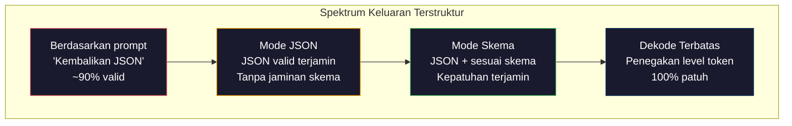
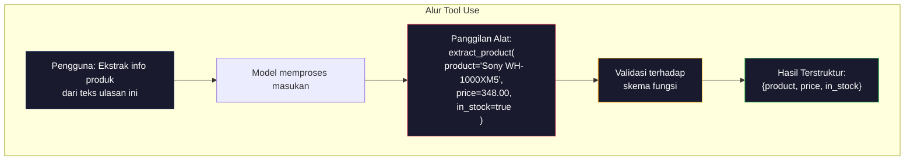

# Keluaran Terstruktur: JSON, Validasi Skema, Dekode Terbatas

> LLM Anda mengembalikan sebuah string. Aplikasi Anda membutuhkan JSON. Jurang ini telah meruntuhkan lebih banyak sistem produksi daripada halusinasi model mana pun. Keluaran terstruktur adalah jembatan antara bahasa alami dan data bertipe. Lakukan dengan benar dan LLM Anda menjadi API yang andal. Lakukan dengan salah dan Anda akan mengurai teks bebas dengan regex pada pukul 03.00 pagi.

**Jenis:** Build
**Bahasa:** Python
**Prasyarat:** Fase 10, Pelajaran 01-05 (LLM dari Awal)
**Waktu:** ~90 menit
**Terkait:** Fase 5 · 20 (Keluaran Terstruktur & Dekode Terbatas) membahas teori pada level decoder (prosesor logit FSM/CFG, Outlines, XGrammar). Pelajaran ini berfokus pada permukaan SDK produksi (OpenAI `response_format`, tool use Anthropic, Instructor) — bacalah Fase 5 · 20 terlebih dahulu jika Anda ingin memahami apa yang terjadi di bawah API.

## Tujuan Pembelajaran

- Mengimplementasikan mode JSON dan keluaran yang dibatasi skema menggunakan parameter API OpenAI dan Anthropic
- Membangun lapisan validasi Pydantic yang menolak keluaran LLM yang malformed dan mencoba ulang dengan umpan balik error
- Menjelaskan bagaimana dekode terbatas memaksa JSON yang valid pada level token tanpa praproses pasca
- Merancang prompt ekstraksi yang tangguh yang secara andal mengubah teks tidak terstruktur menjadi struktur data bertipe

## Masalahnya

Anda meminta LLM: "Ekstrak nama produk, harga, dan ketersediaan dari teks ini." Ia menjawab:

```
The product is the Sony WH-1000XM5 headphones, which cost $348.00 and are currently in stock.
```

Itu adalah jawaban yang sepenuhnya benar. Juga sepenuhnya tidak berguna bagi aplikasi Anda. Sistem inventaris Anda membutuhkan `{"product": "Sony WH-1000XM5", "price": 348.00, "in_stock": true}`. Anda membutuhkan objek JSON dengan kunci tertentu, tipe tertentu, dan batasan nilai tertentu. Anda tidak membutuhkan sebuah kalimat.

Solusi naif: tambahkan "Balas dalam JSON" ke prompt Anda. Ini berhasil 90% waktu. Pada 10% sisanya, model membungkus JSON dalam pagar kode markdown, atau menambahkan pembuka seperti "Berikut JSON-nya:", atau menghasilkan JSON yang tidak valid secara sintaks karena menutup kurung terlalu cepat. Pengurai JSON Anda crash. Pipeline Anda rusak. Anda menambahkan try/except dan loop percobaan ulang. Percobaan ulang kadang menghasilkan data yang berbeda. Sekarang Anda memiliki masalah konsistensi di atas masalah parsing.

Ini bukan masalah rekayasa prompt. Ini masalah dekode. Model menghasilkan token dari kiri ke kanan. Pada setiap posisi, ia memilih token berikutnya paling mungkin dari kosakata berisi 100K+ pilihan. Sebagian besar pilihan itu akan menghasilkan JSON yang tidak valid pada posisi tertentu. Jika model baru saja menghasilkan `{"price":`, token berikutnya harus berupa digit, tanda kutip (untuk string), `null`, `true`, `false`, atau tanda negatif. Apa pun selain itu menghasilkan JSON tidak valid. Tanpa batasan, model bisa memilih kata Inggris yang sangat wajar tetapi salah secara katastropik dari sisi sintaks.

## Konsepnya

### Spektrum Keluaran Terstruktur

Ada empat tingkat kontrol keluaran terstruktur, masing-masing lebih andal dari sebelumnya.



**Berdasarkan prompt** ("Balas dalam JSON yang valid"): tanpa penegakan. Model biasanya patuh, tetapi kadang tidak. Keandalan: ~90%. Mode gagal: pagar markdown, teks pembuka, keluaran terpotong, struktur salah.

**Mode JSON**: API menjamin keluaran berupa JSON yang valid. `response_format: { type: "json_object" }` dari OpenAI mengaktifkan ini. Keluarannya akan terurai tanpa error. Namun keluaran itu mungkin tidak sesuai skema yang Anda harapkan -- kunci tambahan, tipe salah, kolom hilang.

**Mode skema**: API menerima JSON Schema dan menjamin keluaran sesuai dengan skema itu. Pada 2026, semua penyedia besar mendukungnya secara native: `response_format: { type: "json_schema", json_schema: {...} }` dari OpenAI (juga sebagai `tool_choice="required"`), tool use Anthropic dengan `input_schema`, serta `response_schema` + `response_mime_type: "application/json"` dari Gemini. Keluarannya memiliki kunci, tipe, dan batasan persis yang Anda tentukan.

**Dekode terbatas**: pada setiap posisi token selama generasi, decoder menyaring semua token yang akan menghasilkan keluaran tidak valid. Jika skema meminta angka dan model akan menghasilkan huruf, token itu diberi probabilitas nol. Model hanya dapat menghasilkan token yang mengarah pada keluaran valid. Inilah yang diterapkan secara internal oleh mode keluaran terstruktur OpenAI dan pustaka seperti Outlines serta Guidance.

### JSON Schema: Bahasa Kontrak

JSON Schema adalah cara Anda memberi tahu model (atau lapisan validasi) seperti apa bentuk keluaran yang harus dihasilkan. Setiap sistem keluaran terstruktur besar menggunakannya.

```json
{
  "type": "object",
  "properties": {
    "product": { "type": "string" },
    "price": { "type": "number", "minimum": 0 },
    "in_stock": { "type": "boolean" },
    "categories": {
      "type": "array",
      "items": { "type": "string" }
    }
  },
  "required": ["product", "price", "in_stock"]
}
```

Skema ini menyatakan: keluaran harus berupa objek dengan `product` bertipe string, `price` berupa angka tak negatif, `in_stock` berupa boolean, dan array opsional `categories` berisi string. Keluaran apa pun yang tidak cocok ditolak.

Skema menangani kasus-kasus sulit: objek bersarang, array dengan item bertipe, enum (membatasi string pada nilai tertentu), pencocokan pola (regex pada string), dan kombinator (oneOf, anyOf, allOf untuk keluaran polimorfik).

### Pola Pydantic

Di Python, Anda tidak menulis JSON Schema dengan tangan. Anda mendefinisikan model Pydantic dan ia akan menghasilkan skemanya untuk Anda.

```python
from pydantic import BaseModel

class Product(BaseModel):
    product: str
    price: float
    in_stock: bool
    categories: list[str] = []
```

Ini menghasilkan JSON Schema yang sama dengan di atas. Pustaka Instructor (dan SDK OpenAI) menerima model Pydantic secara langsung: berikan kelas modelnya, dapatkan kembali instance yang sudah tervalidasi. Jika keluaran LLM tidak cocok, Instructor mencoba ulang secara otomatis.

### Function Calling / Tool Use

Antarmuka alternatif untuk masalah yang sama. Alih-alih meminta model menghasilkan JSON secara langsung, Anda mendefinisikan "alat" (fungsi) dengan parameter bertipe. Model menghasilkan panggilan fungsi dengan argumen terstruktur. OpenAI menyebutnya "function calling". Anthropic menyebutnya "tool use". Hasilnya sama: data terstruktur.



Tool use lebih disukai ketika model perlu memilih fungsi mana yang dipanggil, bukan hanya mengisi parameter. Jika Anda memiliki 10 skema ekstraksi berbeda dan model harus memilih yang tepat berdasarkan masukan, tool use memberi Anda cả pemilihan skema maupun keluaran terstruktur.

### Mode Gagal Umum

Bahkan dengan penegakan skema, keluaran terstruktur bisa gagal dengan cara yang halus.

**Nilai halusinatif**: keluarannya sesuai skema tetapi berisi data rekaan. Model menghasilkan `{"price": 299.99}` padahal teks menyebut $348. Validasi skema tidak dapat menangkap ini -- tipenya benar, nilainya salah.

**Kebingungan enum**: Anda membatasi suatu kolom pada `["in_stock", "out_of_stock", "preorder"]`. Model menghasilkan `"available"` -- secara semantik benar, tetapi tidak ada dalam himpunan yang diizinkan. Dekode terbatas yang baik mencegah ini. Pendekatan berbasis prompt tidak.

**Kedalaman objek bersarang**: skema yang sangat dalam (4+ level) menghasilkan lebih banyak error. Setiap level sarang menjadi tempat lain di mana model bisa kehilangan jejak struktur.

**Panjang array**: model bisa menghasilkan terlalu banyak atau terlalu sedikit item dalam array. Skema mendukung `minItems` dan `maxItems`, tetapi tidak semua penyedia menegakannya pada level dekode.

**Penghilangan kolom opsional**: model menghilangkan kolom yang secara teknis opsional tetapi secara semantik penting bagi kasus Anda. Jadikan kolom itu wajib dalam skema meskipun datanya kadang tidak ada -- paksa model menghasilkan `null` secara eksplisit.

```figure
mx-schema-funnel
```

## Bangun

### Langkah 1: Validator JSON Schema

Bangun validator dari awal yang memeriksa apakah objek Python sesuai dengan JSON Schema. Inilah yang berjalan pada sisi keluaran untuk memverifikasi kepatuhan.

```python
import json

def validate_schema(data, schema):
    errors = []
    _validate(data, schema, "", errors)
    return errors

def _validate(data, schema, path, errors):
    schema_type = schema.get("type")

    if schema_type == "object":
        if not isinstance(data, dict):
            errors.append(f"{path}: expected object, got {type(data).__name__}")
            return
        for key in schema.get("required", []):
            if key not in data:
                errors.append(f"{path}.{key}: required field missing")
        properties = schema.get("properties", {})
        for key, value in data.items():
            if key in properties:
                _validate(value, properties[key], f"{path}.{key}", errors)

    elif schema_type == "array":
        if not isinstance(data, list):
            errors.append(f"{path}: expected array, got {type(data).__name__}")
            return
        min_items = schema.get("minItems", 0)
        max_items = schema.get("maxItems", float("inf"))
        if len(data) < min_items:
            errors.append(f"{path}: array has {len(data)} items, minimum is {min_items}")
        if len(data) > max_items:
            errors.append(f"{path}: array has {len(data)} items, maximum is {max_items}")
        items_schema = schema.get("items", {})
        for i, item in enumerate(data):
            _validate(item, items_schema, f"{path}[{i}]", errors)

    elif schema_type == "string":
        if not isinstance(data, str):
            errors.append(f"{path}: expected string, got {type(data).__name__}")
            return
        enum_values = schema.get("enum")
        if enum_values and data not in enum_values:
            errors.append(f"{path}: '{data}' not in allowed values {enum_values}")

    elif schema_type == "number":
        if not isinstance(data, (int, float)):
            errors.append(f"{path}: expected number, got {type(data).__name__}")
            return
        minimum = schema.get("minimum")
        maximum = schema.get("maximum")
        if minimum is not None and data < minimum:
            errors.append(f"{path}: {data} is less than minimum {minimum}")
        if maximum is not None and data > maximum:
            errors.append(f"{path}: {data} is greater than maximum {maximum}")

    elif schema_type == "boolean":
        if not isinstance(data, bool):
            errors.append(f"{path}: expected boolean, got {type(data).__name__}")

    elif schema_type == "integer":
        if not isinstance(data, int) or isinstance(data, bool):
            errors.append(f"{path}: expected integer, got {type(data).__name__}")
```

### Langkah 2: Model ke Skema ala Pydantic

Bangun konverter kelas-ke-skema minimalis. Definisikan sebuah kelas Python dan hasilkan JSON Schema-nya secara otomatis.

```python
class SchemaField:
    def __init__(self, field_type, required=True, default=None, enum=None, minimum=None, maximum=None):
        self.field_type = field_type
        self.required = required
        self.default = default
        self.enum = enum
        self.minimum = minimum
        self.maximum = maximum

def python_type_to_schema(field):
    type_map = {
        str: "string",
        int: "integer",
        float: "number",
        bool: "boolean",
    }

    schema = {}

    if field.field_type in type_map:
        schema["type"] = type_map[field.field_type]
    elif field.field_type == list:
        schema["type"] = "array"
        schema["items"] = {"type": "string"}
    elif isinstance(field.field_type, dict):
        schema = field.field_type

    if field.enum:
        schema["enum"] = field.enum
    if field.minimum is not None:
        schema["minimum"] = field.minimum
    if field.maximum is not None:
        schema["maximum"] = field.maximum

    return schema

def model_to_schema(name, fields):
    properties = {}
    required = []

    for field_name, field in fields.items():
        properties[field_name] = python_type_to_schema(field)
        if field.required:
            required.append(field_name)

    return {
        "type": "object",
        "properties": properties,
        "required": required,
    }
```

### Langkah 3: Filter Token Terbatas

Simulasikan dekode terbatas. Diberikan string JSON parsial dan sebuah skema, tentukan kategori token mana yang valid pada posisi saat ini.

```python
def next_valid_tokens(partial_json, schema):
    stripped = partial_json.strip()

    if not stripped:
        return ["{"]

    try:
        json.loads(stripped)
        return ["<EOS>"]
    except json.JSONDecodeError:
        pass

    last_char = stripped[-1] if stripped else ""

    if last_char == "{":
        return ['"', "}"]
    elif last_char == '"':
        if stripped.endswith('":'):
            return ['"', "0-9", "true", "false", "null", "[", "{"]
        return ["a-z", '"']
    elif last_char == ":":
        return [" ", '"', "0-9", "true", "false", "null", "[", "{"]
    elif last_char == ",":
        return [" ", '"', "{", "["]
    elif last_char in "0123456789":
        return ["0-9", ".", ",", "}", "]"]
    elif last_char == "}":
        return [",", "}", "]", "<EOS>"]
    elif last_char == "]":
        return [",", "}", "<EOS>"]
    elif last_char == "[":
        return ['"', "0-9", "true", "false", "null", "{", "[", "]"]
    else:
        return ["any"]

def demonstrate_constrained_decoding():
    partial_states = [
        '',
        '{',
        '{"product"',
        '{"product":',
        '{"product": "Sony"',
        '{"product": "Sony",',
        '{"product": "Sony", "price":',
        '{"product": "Sony", "price": 348',
        '{"product": "Sony", "price": 348}',
    ]

    print(f"{'Partial JSON':<45} {'Valid Next Tokens'}")
    print("-" * 80)
    for state in partial_states:
        valid = next_valid_tokens(state, {})
        display = state if state else "(empty)"
        print(f"{display:<45} {valid}")
```

### Langkah 4: Pipeline Ekstraksi

Gabungkan semuanya menjadi pipeline ekstraksi: definisikan skema, simulasikan LLM yang menghasilkan keluaran terstruktur, validasi keluarannya, dan tangani percobaan ulang.

```python
def simulate_llm_extraction(text, schema, attempt=0):
    if "headphones" in text.lower() or "sony" in text.lower():
        if attempt == 0:
            return '{"product": "Sony WH-1000XM5", "price": 348.00, "in_stock": true, "categories": ["audio", "headphones"]}'
        return '{"product": "Sony WH-1000XM5", "price": 348.00, "in_stock": true}'

    if "laptop" in text.lower():
        return '{"product": "MacBook Pro 16", "price": 2499.00, "in_stock": false, "categories": ["computers"]}'

    return '{"product": "Unknown", "price": 0, "in_stock": false}'

def extract_with_retry(text, schema, max_retries=3):
    for attempt in range(max_retries):
        raw = simulate_llm_extraction(text, schema, attempt)

        try:
            data = json.loads(raw)
        except json.JSONDecodeError as e:
            print(f"  Attempt {attempt + 1}: JSON parse error -- {e}")
            continue

        errors = validate_schema(data, schema)
        if not errors:
            return data

        print(f"  Attempt {attempt + 1}: Schema validation errors -- {errors}")

    return None

product_schema = {
    "type": "object",
    "properties": {
        "product": {"type": "string"},
        "price": {"type": "number", "minimum": 0},
        "in_stock": {"type": "boolean"},
        "categories": {"type": "array", "items": {"type": "string"}},
    },
    "required": ["product", "price", "in_stock"],
}
```

### Langkah 5: Jalankan Pipeline Penuh

```python
def run_demo():
    print("=" * 60)
    print("  Structured Output Pipeline Demo")
    print("=" * 60)

    print("\n--- Schema Definition ---")
    product_fields = {
        "product": SchemaField(str),
        "price": SchemaField(float, minimum=0),
        "in_stock": SchemaField(bool),
        "categories": SchemaField(list, required=False),
    }
    generated_schema = model_to_schema("Product", product_fields)
    print(json.dumps(generated_schema, indent=2))

    print("\n--- Schema Validation ---")
    test_cases = [
        ({"product": "Test", "price": 10.0, "in_stock": True}, "Valid object"),
        ({"product": "Test", "price": -5.0, "in_stock": True}, "Negative price"),
        ({"product": "Test", "in_stock": True}, "Missing price"),
        ({"product": "Test", "price": "ten", "in_stock": True}, "String as price"),
        ("not an object", "String instead of object"),
    ]

    for data, label in test_cases:
        errors = validate_schema(data, product_schema)
        status = "PASS" if not errors else f"FAIL: {errors}"
        print(f"  {label}: {status}")

    print("\n--- Constrained Decoding Simulation ---")
    demonstrate_constrained_decoding()

    print("\n--- Extraction Pipeline ---")
    texts = [
        "The Sony WH-1000XM5 headphones are priced at $348 and currently available.",
        "The new MacBook Pro 16-inch laptop costs $2499 but is sold out.",
        "This is a random sentence with no product info.",
    ]

    for text in texts:
        print(f"\n  Input: {text[:60]}...")
        result = extract_with_retry(text, product_schema)
        if result:
            print(f"  Output: {json.dumps(result)}")
        else:
            print(f"  Output: FAILED after retries")
```

## Pakai

### Keluaran Terstruktur OpenAI

```python
# from openai import OpenAI
# from pydantic import BaseModel
#
# client = OpenAI()
#
# class Product(BaseModel):
#     product: str
#     price: float
#     in_stock: bool
#
# response = client.beta.chat.completions.parse(
#     model="gpt-5-mini",
#     messages=[
#         {"role": "system", "content": "Extract product information."},
#         {"role": "user", "content": "Sony WH-1000XM5, $348, in stock"},
#     ],
#     response_format=Product,
# )
#
# product = response.choices[0].message.parsed
# print(product.product, product.price, product.in_stock)
```

Mode keluaran terstruktur OpenAI menggunakan dekode terbatas secara internal. Setiap token yang dihasilkan model dijamin menghasilkan keluaran yang sesuai skema Pydantic. Tidak perlu percobaan ulang. Tidak perlu validasi. Batasannya sudah tertanam dalam proses dekode.

### Tool Use Anthropic

```python
# import anthropic
#
# client = anthropic.Anthropic()
#
# response = client.messages.create(
#     model="claude-opus-4-7",
#     max_tokens=1024,
#     tools=[{
#         "name": "extract_product",
#         "description": "Extract product information from text",
#         "input_schema": {
#             "type": "object",
#             "properties": {
#                 "product": {"type": "string"},
#                 "price": {"type": "number"},
#                 "in_stock": {"type": "boolean"},
#             },
#             "required": ["product", "price", "in_stock"],
#         },
#     }],
#     messages=[{"role": "user", "content": "Extract: Sony WH-1000XM5, $348, in stock"}],
# )
```

Anthropic mencapai keluaran terstruktur melalui tool use. Model menghasilkan panggilan alat dengan argumen terstruktur yang sesuai `input_schema`. Hasil sama, permukaan API berbeda.

### Pustaka Instructor

```python
# pip install instructor
# import instructor
# from openai import OpenAI
# from pydantic import BaseModel
#
# client = instructor.from_openai(OpenAI())
#
# class Product(BaseModel):
#     product: str
#     price: float
#     in_stock: bool
#
# product = client.chat.completions.create(
#     model="gpt-5-mini",
#     response_model=Product,
#     messages=[{"role": "user", "content": "Sony WH-1000XM5, $348, in stock"}],
# )
```

Instructor membungkus klien LLM apa pun dan menambahkan percobaan ulang otomatis dengan validasi. Jika percobaan pertama gagal validasi, ia mengirim error kembali ke model sebagai konteks dan memintanya memperbaiki keluaran. Ini bekerja dengan penyedia mana pun, bukan hanya OpenAI.

## Kirim

Pelajaran ini menghasilkan `outputs/prompt-structured-extractor.md` -- templat prompt yang dapat dipakai ulang untuk mengekstrak data terstruktur dari teks apa pun dengan sebuah definisi skema. Beri ia JSON Schema dan teks tidak terstruktur, dan ia mengembalikan JSON yang tervalidasi.

Pelajaran ini juga menghasilkan `outputs/skill-structured-outputs.md` -- kerangka keputusan untuk memilih strategi keluaran terstruktur yang tepat berdasarkan penyedia, kebutuhan keandalan, dan kompleksitas skema.

## Latihan

1. Kembangkan validator skema agar mendukung `oneOf` (data harus cocok dengan tepat satu dari beberapa skema). Ini menangani keluaran polimorfik -- misalnya, sebuah kolom yang bisa berupa objek `Product` atau `Service` dengan bentuk berbeda.

2. Bangun alat "diff skema" yang membandingkan dua skema dan mengidentifikasi perubahan yang merusak (kolom wajib dihapus, tipe diubah) versus perubahan yang tidak merusak (kolom opsional ditambahkan, batasan dilonggarkan). Ini penting untuk versioning skema ekstraksi Anda di produksi.

3. Implementasikan simulator dekode terbatas yang lebih realistis. Diberikan JSON Schema dan kosakata 100 token (huruf, digit, tanda baca, kata kunci), jalankan generasi langkah demi langkah, dengan menyaring token yang tidak valid pada setiap posisi. Ukur persentase kosakata yang valid pada setiap langkah.

4. Bangun rangkaian evaluasi ekstraksi. Buat 50 deskripsi produk dengan keluaran JSON berlabel manual. Jalankan pipeline ekstraksi Anda pada ke-50 deskripsi itu dan ukur exact match, akurasi tingkat kolom, dan kepatuhan tipe. Identifikasi kolom mana yang paling sulit diekstrak dengan benar.

5. Tambahkan "skor kepercayaan" pada pipeline ekstraksi Anda. Untuk setiap kolom yang diekstrak, perkirakan seberapa yakin modelnya (berdasarkan probabilitas token, atau dengan menjalankan ekstraksi 3 kali dan mengukur konsistensi). Tandai kolom dengan kepercayaan rendah untuk ditinjau manusia.

## Istilah Kunci

| Istilah | Apa yang orang katakan | Apa yang sebenarnya dimaksud |
|---------|------------------------|------------------------------|
| Mode JSON | "Mengembalikan JSON" | Flag API yang menjamin keluaran JSON yang valid secara sintaks, tetapi tidak menegakkan skema tertentu |
| Keluaran terstruktur | "JSON bertipe" | Keluaran yang sesuai dengan JSON Schema tertentu dengan kunci, tipe, dan batasan yang benar |
| Dekode terbatas | "Generasi terpandu" | Pada setiap posisi token, sembunyikan token yang akan menghasilkan keluaran tidak valid -- menjamin 100% kepatuhan skema |
| JSON Schema | "Cetakan JSON" | Bahasa deklaratif untuk mendeskripsikan struktur, tipe, dan batasan data JSON (dipakai oleh OpenAPI, JSON Forms, dll.) |
| Pydantic | "Dataclass Python+" | Pustaka Python yang mendefinisikan model data dengan validasi tipe, dipakai FastAPI dan Instructor untuk menghasilkan JSON Schema |
| Function calling | "Tool use" | LLM menghasilkan pemanggilan fungsi terstruktur (nama + argumen bertipe) alih-alih teks bebas -- didukung oleh OpenAI maupun Anthropic |
| Instructor | "Pydantic untuk LLM" | Pustaka Python yang membungkus klien LLM agar mengembalikan instance Pydantic tervalidasi, dengan percobaan ulang otomatis saat validasi gagal |
| Token masking | "Menyaring kosakata" | Menetapkan probabilitas token tertentu menjadi nol selama generasi sehingga model tidak dapat menghasilkannya |
| Kepatuhan skema | "Sesuai bentuknya" | Keluaran memiliki setiap kolom wajib, tipe benar, nilai dalam batasan, dan tidak ada kolom tambahan yang dilarang |
| Loop percobaan ulang | "Coba lagi sampai berhasil" | Kirim error validasi kembali ke model dan minta ia memperbaiki keluaran -- Instructor melakukan ini otomatis, hingga batas maksimum yang dapat dikonfigurasi |

## Bacaan Lebih Lanjut

- [Panduan Keluaran Terstruktur OpenAI](https://platform.openai.com/docs/guides/structured-outputs) -- dokumentasi resmi untuk dekode terbatas berbasis JSON Schema di API OpenAI
- [Willard & Louf, 2023 -- "Efficient Guided Generation for Large Language Models"](https://arxiv.org/abs/2307.09702) -- makalah Outlines, menjelaskan cara mengompilasi JSON Schema menjadi mesin state hingga untuk batasan level token
- [Dokumentasi Instructor](https://python.useinstructor.com/) -- pustaka standar untuk mendapatkan keluaran terstruktur dari LLM mana pun dengan validasi Pydantic dan percobaan ulang
- [Panduan Tool Use Anthropic](https://docs.anthropic.com/en/docs/tool-use) -- bagaimana Claude mengimplementasikan keluaran terstruktur lewat tool use dengan `input_schema` JSON Schema
- [Spesifikasi JSON Schema](https://json-schema.org/) -- spesifikasi lengkap untuk bahasa skema yang dipakai setiap sistem keluaran terstruktur besar
- [Pustaka Outlines](https://github.com/outlines-dev/outlines) -- generasi terbatas sumber terbuka menggunakan regex dan JSON Schema yang dikompilasi menjadi mesin state hingga
- [Dong et al., "XGrammar: Flexible and Efficient Structured Generation Engine for Large Language Models" (MLSys 2025)](https://arxiv.org/abs/2411.15100) -- mesin grammar mutakhir saat ini; kompilasi pushdown-automaton yang menyaring token dalam ~100 ns/token.
- [Beurer-Kellner et al., "Prompting Is Programming: A Query Language for Large Language Models" (LMQL)](https://arxiv.org/abs/2212.06094) -- makalah LMQL yang membingkai dekode terbatas sebagai bahasa kueri dengan batasan tipe dan nilai.
- [Microsoft Guidance (dokumentasi framework)](https://github.com/guidance-ai/guidance) -- generasi terbatas berbasis templat; pelengkap agnostik vendor bagi Outlines dan XGrammar.
