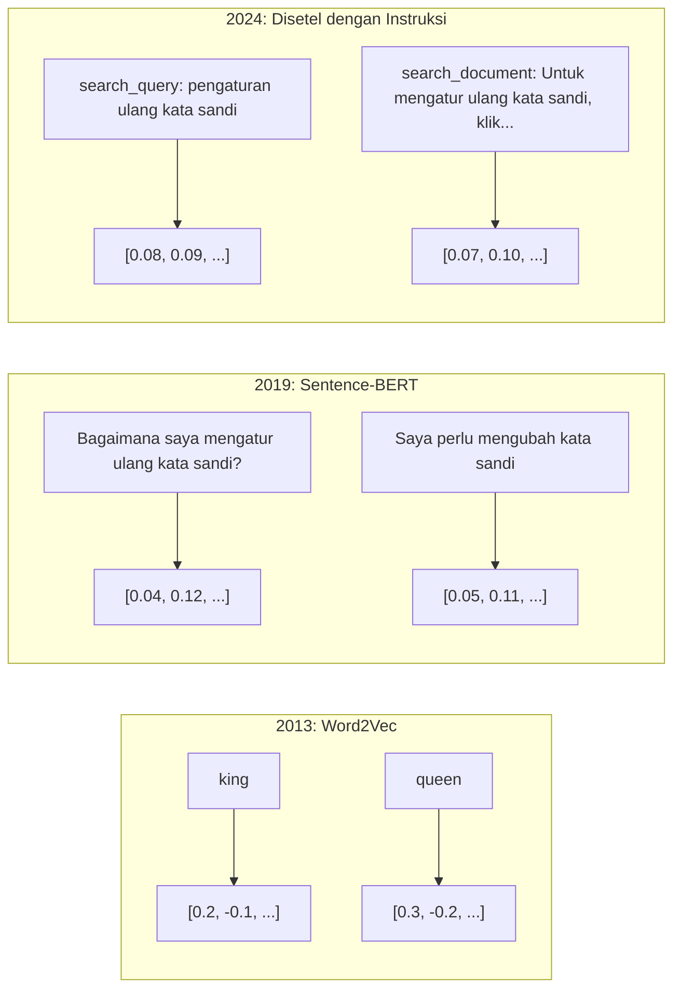
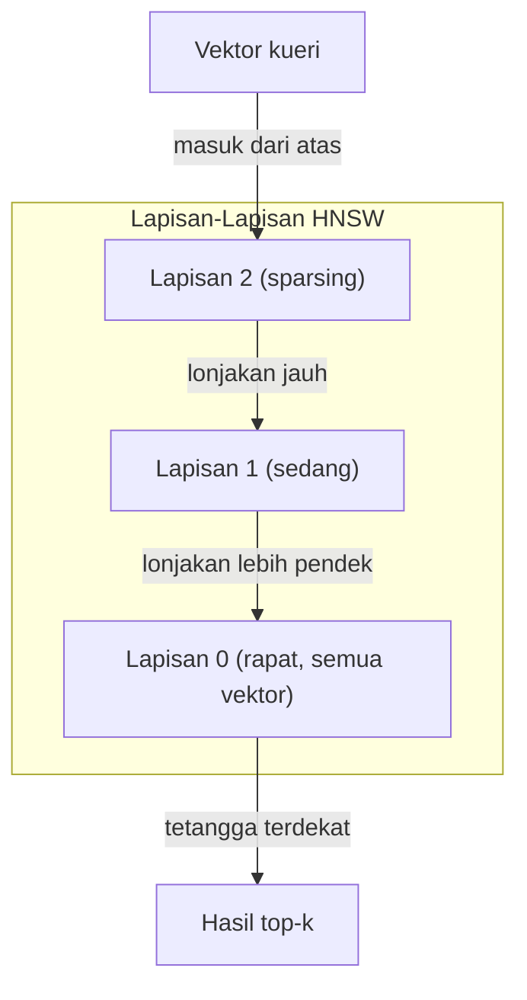
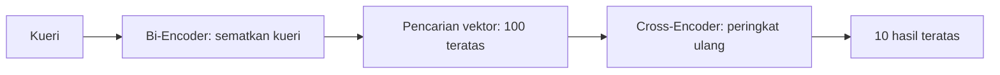

# Embedding & Representasi Vektor

> Teks bersifat diskrit. Matematika bersifat kontinu. Setiap kali Anda meminta LLM mencari dokumen yang "serupa", membandingkan makna, atau melakukan pencarian melampaui kata kunci, Anda bergantung pada sebuah jembatan antara kedua dunia ini. Jembatan itu adalah embedding. Jika Anda tidak memahami embedding, Anda tidak memahami AI modern. Anda hanya memakainya.

**Jenis:** Build
**Bahasa:** Python
**Prasyarat:** Fase 11, Pelajaran 01 (Rekayasa Prompt)
**Waktu:** ~75 menit
**Terkait:** Fase 5 · 22 (Pendalaman Model Embedding) membahas dense vs sparse vs multi-vektor, pemotongan Matryoshka, dan pemilihan model per sumbu. Pelajaran ini berfokus pada pipeline produksi (basis data vektor, HNSW, matematika kesamaan). Bacalah Fase 5 · 22 sebelum memilih model.

## Tujuan Pembelajaran

- Menghasilkan embedding teks menggunakan penyedia API dan model sumber terbuka, serta menghitung kesamaan kosinus di antaranya
- Menjelaskan mengapa embedding menyelesaikan masalah ketidaksesuaian kosakata yang tidak dapat ditangani pencarian kata kunci
- Membangun indeks pencarian semantik yang mengambil dokumen berdasarkan makna, bukan kecocokan kata kunci persis
- Menilai kualitas embedding menggunakan benchmark pengambilan (precision@k, recall) dan memilih model embedding yang tepat untuk tugas Anda

## Masalahnya

Anda memiliki 10.000 tiket dukungan. Seorang pelanggan menulis "pembayaran saya tidak berhasil". Anda perlu menemukan tiket lama yang serupa. Pencarian kata kunci menemukan tiket yang memuat "pembayaran" dan "tidak berhasil". Ia melewatkan "transaksi gagal", "tagihan ditolak", dan "error penagihan". Tiket-tiket itu menggambarkan masalah yang persis sama dengan kata-kata yang benar-benar berbeda.

Ini adalah masalah ketidaksesuaian kosakata. Bahasa manusia memiliki puluhan cara untuk mengatakan hal yang sama. Pencarian kata kunci memperlakukan setiap kata sebagai simbol independen tanpa makna. Ia tidak dapat tahu bahwa "ditolak" dan "tidak berhasil" merujuk pada konsep yang sama.

Anda memerlukan representasi teks di mana makna, bukan ejaan, yang menentukan kesamaan. Anda memerlukan cara untuk menempatkan "pembayaran saya tidak berhasil" dan "transaksi ditolak" berdekatan dalam suatu ruang matematis, sambil menjauhkan "pembayaran saya tiba tepat waktu" meskipun kedua kalimat memuat kata "pembayaran".

Representasi itu adalah embedding.

## Konsepnya

### Apa Itu Embedding?

Embedding adalah vektor padat berisi bilangan floating-point yang mewakili makna teks. Kata "padat" penting -- setiap dimensi membawa informasi, berbeda dengan representasi jarang (bag-of-words, TF-IDF) di mana sebagian besar dimensi bernilai nol.

"The cat sat on the mat" berubah menjadi sesuatu seperti `[0.023, -0.041, 0.087, ..., 0.012]` -- daftar 768 hingga 3072 angka, bergantung pada model. Angka-angka ini mengodekan makna. Anda tidak pernah memeriksanya secara langsung. Anda membandingkannya.

### Terobosan Word2Vec

Pada 2013, Tomas Mikolov dan rekan-rekannya di Google mempublikasikan Word2Vec. Wawasan intinya: latih jaringan saraf untuk memprediksi sebuah kata dari kata-kata di sekitarnya (atau kata-kata di sekitar dari sebuah kata), dan bobot lapisan tersembunyi menjadi representasi vektor yang bermakna.

Hasil yang terkenal:

```
king - man + woman = queen
```

Aritmetika vektor pada embedding kata menangkap relasi semantik. Arah dari "man" ke "woman" kira-kira sama dengan arah dari "king" ke "queen". Saat itulah bidang ini menyadari bahwa geometri dapat mengodekan makna.

Word2Vec menghasilkan vektor 300 dimensi. Setiap kata mendapat satu vektor tanpa memedulikan konteks. "Bank" dalam "river bank" dan "bank account" memiliki embedding yang sama. Keterbatasan ini mendorong dekade penelitian berikutnya.

### Dari Kata ke Kalimat

Embedding kata mewakili token tunggal. Sistem produksi perlu menyematkan kalimat, paragraf, atau dokumen utuh. Empat pendekatan muncul:

**Rata-rata**: ambil rata-rata semua vektor kata dalam kalimat. Murah, kehilangan informasi, tetapi cukup baik untuk teks pendek. Urutan kata hilang seluruhnya -- "dog bites man" dan "man bites dog" menghasilkan embedding yang identik.

**Token CLS**: model transformer (BERT, 2018) menghasilkan embedding token khusus [CLS] yang mewakili seluruh masukan. Lebih baik daripada rata-rata, tetapi token [CLS] dilatih untuk prediksi kalimat berikutnya, bukan kesamaan.

**Pembelajaran kontrastif**: latih model secara eksplisit untuk mendekatkan pasangan serupa dan menjauhkan pasangan yang tidak serupa. Sentence-BERT (Reimers & Gurevych, 2019) memakai pendekatan ini dan menjadi fondasi model embedding modern. Diberikan "Bagaimana saya mengatur ulang kata sandi?" dan "Saya perlu mengubah kata sandi", model mempelajari bahwa keduanya harus memiliki vektor yang hampir identik.

**Embedding yang disetel dengan instruksi**: pendekatan terbaru. Model seperti E5 dan GTE menerima awalan tugas ("search_query:", "search_document:") yang memberi tahu model jenis embedding apa yang harus dihasilkan. Ini memungkinkan satu model melayani banyak tugas.



### Model Embedding Modern

Pasar telah menetap pada segelintir pilihan siap produksi (skor MTEB per awal 2026, MTEB v2):

| Model | Penyedia | Dimensi | MTEB | Konteks | Biaya / 1M token |
|-------|----------|---------|------|---------|------------------|
| Gemini Embedding 2 | Google | 3072 (Matryoshka) | 67,7 (pengambilan) | 8192 | $0,15 |
| embed-v4 | Cohere | 1024 (Matryoshka) | 65,2 | 128K | $0,12 |
| voyage-4 | Voyage AI | 1024/2048 (Matryoshka) | 66,8 | 32K | $0,12 |
| text-embedding-3-large | OpenAI | 3072 (Matryoshka) | 64,6 | 8192 | $0,13 |
| text-embedding-3-small | OpenAI | 1536 (Matryoshka) | 62,3 | 8192 | $0,02 |
| BGE-M3 | BAAI | 1024 (dense+sparse+ColBERT) | 63,0 multilingual | 8192 | Bobot terbuka |
| Qwen3-Embedding | Alibaba | 4096 (Matryoshka) | 66,9 | 32K | Bobot terbuka |
| Nomic-embed-v2 | Nomic | 768 (Matryoshka) | 63,1 | 8192 | Bobot terbuka |

MTEB (Massive Text Embedding Benchmark) v2 mencakup 100+ tugas di bidang pengambilan, klasifikasi, klasterisasi, peringkasan ulang, dan summarisasi. Semakin tinggi semakin baik. Pada 2026, model dengan bobot terbuka (Qwen3-Embedding, BGE-M3) sejajar atau mengungguli model tertutup yang di-hosting pada sebagian besar sumbu. Gemini Embedding 2 memimpin pengambilan murni; Voyage/Cohere memimpin domain tertentu (keuangan, hukum, kode). Selalu lakukan benchmark pada kueri Anda sendiri sebelum memutuskan.

### Metrik Kesamaan

Diberikan dua vektor embedding, ada tiga cara mengukur seberapa serupa keduanya:

**Kesamaan kosinus**: kosinus sudut antara dua vektor. Rentangnya dari -1 (berlawanan) hingga 1 (arah identik). Mengabaikan besar vektor -- kalimat 10 kata dan dokumen 500 kata bisa memperoleh skor 1,0 jika arahnya sama. Ini adalah pilihan default untuk 90% kasus penggunaan.

```math
\mathop{\mathrm{cosine\_sim}}(a, b) = \frac{\mathop{\mathrm{dot}}(a, b)}{\lVert a \rVert \cdot \lVert b \rVert}
```

**Hasil kali titik**: hasil kali dalam mentah dari dua vektor. Identik dengan kesamaan kosinus ketika vektor sudah dinormalisasi (panjang satuan). Lebih cepat dihitung. Embedding OpenAI sudah dinormalisasi, sehingga hasil kali titik dan kosinus memberi peringkat yang sama.

```math
\mathop{\mathrm{dot}}(a, b) = \sum_i a_i b_i
```

**Jarak Euklides (L2)**: jarak garis lurus dalam ruang vektor. Semakin kecil semakin serupa. Sensitif terhadap perbedaan besar vektor. Pakai ini ketika posisi absolut dalam ruang yang penting, bukan hanya arahnya.

```math
\mathop{\mathrm{L2}}(a, b) = \sqrt{\sum_i (a_i - b_i)^2}
```

Kapan memakai yang mana:

| Metrik | Pakai ketika | Hindari ketika |
|--------|--------------|----------------|
| Kesamaan kosinus | Membandingkan teks dengan panjang berbeda; sebagian besar tugas pengambilan | Besar vektor membawa informasi |
| Hasil kali titik | Embedding sudah dinormalisasi; kecepatan maksimal | Vektor memiliki besar yang beragam |
| Jarak Euklides | Klasterisasi; masalah tetangga terdekat spasial | Membandingkan dokumen dengan panjang sangat berbeda |

### Basis Data Vektor dan HNSW

Pencarian kesamaan brute-force membandingkan kueri dengan setiap vektor yang tersimpan. Pada 1 juta vektor dengan 1536 dimensi, itu berarti 1,5 miliar operasi perkalian-penjumlahan per kueri. Terlalu lambat.

Basis data vektor menyelesaikan ini dengan algoritma Approximate Nearest Neighbor (ANN). Algoritma dominannya adalah HNSW (Hierarchical Navigable Small World):

1. Bangun graf vektor berlapis-lapis
2. Lapisan atas bersparsing -- koneksi jangkauan jauh antarklaster yang terpisah
3. Lapisan bawah rapat -- koneksi butir halus antarvektor yang berdekatan
4. Pencarian dimulai dari lapisan atas, lalu turun secara greedy untuk menyempurnakan hasil
5. Mengembalikan hasil top-k perkiraan dalam waktu $O(\log n)$, bukan $O(n)$

HNSW menukar sedikit kehilangan akurasi (biasanya recall 95-99%) dengan kecepatan yang luar biasa. Pada 10 juta vektor, brute-force memakan waktu beberapa detik. HNSW memakan waktu milidetik.



Pilihan produksi:

| Basis Data | Jenis | Paling cocok untuk | Skala maksimal |
|------------|-------|--------------------|----------------|
| Pinecone | SaaS terkelola | Produksi tanpa operasi | Miliaran |
| Weaviate | Sumber terbuka | Swa-hosting, pencarian hibrida | 100Jt+ |
| Qdrant | Sumber terbuka | Kinerja tinggi, pemfilteran | 100Jt+ |
| ChromaDB | Tertanam | Prototyping, pengembangan lokal | 1Jt |
| pgvector | Ekstensi Postgres | Sudah memakai Postgres | 10Jt |
| FAISS | Pustaka | Dalam proses, riset | 1M+ |

### Strategi Pemotongan (Chunking)

Dokumen terlalu panjang untuk disematkan sebagai satu vektor. PDF 50 halaman mencakup puluhan topik -- embedding-nya menjadi rata-rata dari semuanya, mirip dengan apa pun secara spesifik. Anda memotong dokumen menjadi bagian-bagian (chunk) dan menyematkan masing-masing.

**Pemotongan ukuran tetap**: potong setiap N token dengan tumpang tindih M token. Sederhana dan dapat diprediksi. Bekerja baik ketika dokumen tidak memiliki struktur jelas. Chunk 512 token dengan tumpang tindih 50 token: chunk 1 adalah token 0-511, chunk 2 adalah token 462-973.

**Pemotongan berbasis kalimat**: potong pada batas kalimat, mengelompokkan kalimat hingga mencapai batas token. Setiap chunk minimal satu kalimat lengkap. Lebih baik daripada ukuran tetap karena Anda tidak pernah memotong sebuah gagasan di tengah.

**Pemotongan rekursif**: coba memotong pada batas terbesar terlebih dahulu (judul bagian). Jika masih terlalu besar, coba batas paragraf. Lalu batas kalimat. Lalu batas karakter. Ini adalah `RecursiveCharacterTextSplitter` dari LangChain dan bekerja baik untuk korpus berformat campuran.

**Pemotongan semantik**: sematkan setiap kalimat, lalu kelompokkan kalimat berurutan yang embedding-nya serupa. Ketika kesamaan embedding turun di bawah ambang batas, mulai chunk baru. Mahal (memerlukan penyematan setiap kalimat secara terpisah), tetapi menghasilkan chunk paling koheren.

| Strategi | Kompleksitas | Kualitas | Paling cocok untuk |
|----------|--------------|----------|--------------------|
| Ukuran tetap | Rendah | Cukup | Teks tidak terstruktur, log |
| Berbasis kalimat | Rendah | Baik | Artikel, surel |
| Rekursif | Sedang | Baik | Markdown, HTML, dokumen campuran |
| Semantik | Tinggi | Terbaik | Kualitas pengambilan yang kritis |

Titik manis untuk sebagian besar sistem: chunk 256-512 token dengan tumpang tindih 50 token.

### Bi-Encoder vs Cross-Encoder

Bi-encoder menyematkan kueri dan dokumen secara terpisah, lalu membandingkan vektor. Cepat -- Anda menyematkan kueri sekali dan membandingkannya dengan embedding dokumen yang sudah dihitung sebelumnya. Inilah yang Anda pakai untuk pengambilan.

Cross-encoder menerima kueri dan sebuah dokumen sebagai satu masukan dan menghasilkan skor relevansi. Lambat -- ia memproses setiap pasangan kueri-dokumen melalui model penuh. Namun jauh lebih akurat karena dapat melakukan atensi lintas token kueri dan dokumen secara bersamaan.

Pola produksinya: bi-encoder mengambil 100 kandidat teratas, cross-encoder memberi peringkat ulang menjadi 10 teratas. Inilah pipeline retrieve-then-rerank.



Model peringkat ulang: Cohere Rerank 3.5 ($2 per 1000 kueri), BGE-reranker-v2 (gratis, sumber terbuka), Jina Reranker v2 (gratis, sumber terbuka).

### Embedding Matryoshka

Embedding tradisional bersifat semua-atau-tidak-ada. Vektor 1536 dimensi memakai 1536 angka float. Anda tidak bisa memotongnya menjadi 256 dimensi tanpa pelatihan ulang.

Matryoshka Representation Learning (Kusupati et al., 2022) memperbaiki ini. Model dilatih sehingga N dimensi pertama menangkap informasi yang paling penting, seperti boneka bersarang Rusia. Memotong embedding Matryoshka 1536-d menjadi 256 dimensi kehilangan sebagian akurasi, tetapi tetap berfungsi.

text-embedding-3-small dan text-embedding-3-large dari OpenAI mendukung pemotongan Matryoshka melalui parameter `dimensions`. Meminta 256 dimensi, bukan 1536, memangkas penyimpanan 6x dengan kehilangan akurasi sekitar 3-5% pada benchmark MTEB.

### Kuantisasi Biner

Embedding 1536 dimensi yang disimpan sebagai float32 memakan 6.144 byte. Kalikan dengan 10 juta dokumen: 61 GB hanya untuk vektor.

Kuantisasi biner mengubah setiap float menjadi satu bit: nilai positif menjadi 1, nilai negatif menjadi 0. Penyimpanan turun dari 6.144 byte menjadi 192 byte -- pengurangan 32x. Kesamaan dihitung dengan jarak Hamming (menghitung bit yang berbeda), yang dapat dilakukan CPU dalam satu instruksi.

Penurunan akurasi sekitar 5-10% pada recall pengambilan. Pola umumnya: kuantisasi biner untuk pencarian tahap pertama atas jutaan vektor, lalu beri skor ulang 1000 teratas dengan vektor presisi penuh. Ini memberi Anda 95%+ akurasi presisi penuh dengan memori 32x lebih sedikit.

```figure
cosine-similarity
```

## Bangun

Kita membangun mesin pencarian semantik dari awal. Tanpa basis data vektor. Tanpa API embedding eksternal. Python murni dengan numpy untuk komputasinya.

### Langkah 1: Pemotongan Teks

```python
def chunk_text(text, chunk_size=200, overlap=50):
    words = text.split()
    chunks = []
    start = 0
    while start < len(words):
        end = start + chunk_size
        chunk = " ".join(words[start:end])
        chunks.append(chunk)
        start += chunk_size - overlap
    return chunks


def chunk_by_sentences(text, max_chunk_tokens=200):
    sentences = text.replace("\n", " ").split(".")
    sentences = [s.strip() + "." for s in sentences if s.strip()]
    chunks = []
    current_chunk = []
    current_length = 0
    for sentence in sentences:
        sentence_length = len(sentence.split())
        if current_length + sentence_length > max_chunk_tokens and current_chunk:
            chunks.append(" ".join(current_chunk))
            current_chunk = []
            current_length = 0
        current_chunk.append(sentence)
        current_length += sentence_length
    if current_chunk:
        chunks.append(" ".join(current_chunk))
    return chunks
```

### Langkah 2: Membangun Embedding dari Awal

Kita mengimplementasikan embedding padat sederhana menggunakan TF-IDF dengan normalisasi L2. Ini bukan embedding saraf, tetapi mengikuti kontrak yang sama: teks masuk, vektor berukuran tetap keluar, teks serupa menghasilkan vektor serupa.

```python
import math
import numpy as np
from collections import Counter

class SimpleEmbedder:
    def __init__(self):
        self.vocab = []
        self.idf = []
        self.word_to_idx = {}

    def fit(self, documents):
        vocab_set = set()
        for doc in documents:
            vocab_set.update(doc.lower().split())
        self.vocab = sorted(vocab_set)
        self.word_to_idx = {w: i for i, w in enumerate(self.vocab)}
        n = len(documents)
        self.idf = np.zeros(len(self.vocab))
        for i, word in enumerate(self.vocab):
            doc_count = sum(1 for doc in documents if word in doc.lower().split())
            self.idf[i] = math.log((n + 1) / (doc_count + 1)) + 1

    def embed(self, text):
        words = text.lower().split()
        count = Counter(words)
        total = len(words) if words else 1
        vec = np.zeros(len(self.vocab))
        for word, freq in count.items():
            if word in self.word_to_idx:
                tf = freq / total
                vec[self.word_to_idx[word]] = tf * self.idf[self.word_to_idx[word]]
        norm = np.linalg.norm(vec)
        if norm > 0:
            vec = vec / norm
        return vec
```

### Langkah 3: Fungsi Kesamaan

```python
def cosine_similarity(a, b):
    dot = np.dot(a, b)
    norm_a = np.linalg.norm(a)
    norm_b = np.linalg.norm(b)
    if norm_a == 0 or norm_b == 0:
        return 0.0
    return float(dot / (norm_a * norm_b))


def dot_product(a, b):
    return float(np.dot(a, b))


def euclidean_distance(a, b):
    return float(np.linalg.norm(a - b))
```

### Langkah 4: Indeks Vektor dengan Pencarian Brute-Force

```python
class VectorIndex:
    def __init__(self):
        self.vectors = []
        self.texts = []
        self.metadata = []

    def add(self, vector, text, meta=None):
        self.vectors.append(vector)
        self.texts.append(text)
        self.metadata.append(meta or {})

    def search(self, query_vector, top_k=5, metric="cosine"):
        scores = []
        for i, vec in enumerate(self.vectors):
            if metric == "cosine":
                score = cosine_similarity(query_vector, vec)
            elif metric == "dot":
                score = dot_product(query_vector, vec)
            elif metric == "euclidean":
                score = -euclidean_distance(query_vector, vec)
            else:
                raise ValueError(f"Unknown metric: {metric}")
            scores.append((i, score))
        scores.sort(key=lambda x: x[1], reverse=True)
        results = []
        for idx, score in scores[:top_k]:
            results.append({
                "text": self.texts[idx],
                "score": score,
                "metadata": self.metadata[idx],
                "index": idx
            })
        return results

    def size(self):
        return len(self.vectors)
```

### Langkah 5: Mesin Pencarian Semantik

```python
class SemanticSearchEngine:
    def __init__(self, chunk_size=200, overlap=50):
        self.embedder = SimpleEmbedder()
        self.index = VectorIndex()
        self.chunk_size = chunk_size
        self.overlap = overlap

    def index_documents(self, documents, source_names=None):
        all_chunks = []
        all_sources = []
        for i, doc in enumerate(documents):
            chunks = chunk_text(doc, self.chunk_size, self.overlap)
            all_chunks.extend(chunks)
            name = source_names[i] if source_names else f"doc_{i}"
            all_sources.extend([name] * len(chunks))
        self.embedder.fit(all_chunks)
        for chunk, source in zip(all_chunks, all_sources):
            vec = self.embedder.embed(chunk)
            self.index.add(vec, chunk, {"source": source})
        return len(all_chunks)

    def search(self, query, top_k=5, metric="cosine"):
        query_vec = self.embedder.embed(query)
        return self.index.search(query_vec, top_k, metric)

    def search_with_scores(self, query, top_k=5):
        results = self.search(query, top_k)
        return [
            {
                "text": r["text"][:200],
                "source": r["metadata"].get("source", "unknown"),
                "score": round(r["score"], 4)
            }
            for r in results
        ]
```

### Langkah 6: Membandingkan Metrik Kesamaan

```python
def compare_metrics(engine, query, top_k=3):
    results = {}
    for metric in ["cosine", "dot", "euclidean"]:
        hits = engine.search(query, top_k=top_k, metric=metric)
        results[metric] = [
            {"score": round(h["score"], 4), "preview": h["text"][:80]}
            for h in hits
        ]
    return results
```

## Pakai

Dengan API embedding produksi, arsitekturnya tetap identik. Hanya embedder yang berubah:

```python
from openai import OpenAI

client = OpenAI()

def openai_embed(texts, model="text-embedding-3-small", dimensions=None):
    kwargs = {"model": model, "input": texts}
    if dimensions:
        kwargs["dimensions"] = dimensions
    response = client.embeddings.create(**kwargs)
    return [item.embedding for item in response.data]
```

Pemotongan Matryoshka dengan OpenAI -- model sama, dimensi lebih sedikit, penyimpanan lebih rendah:

```python
full = openai_embed(["semantic search query"], dimensions=1536)
compact = openai_embed(["semantic search query"], dimensions=256)
```

Vektor 256-d memakai penyimpanan 6x lebih sedikit. Untuk 10 juta dokumen, itu 10 GB berbanding 61 GB. Kehilangan akurasi sekitar 3-5% pada benchmark standar.

Untuk peringkasan ulang dengan Cohere:

```python
import cohere

co = cohere.ClientV2()

results = co.rerank(
    model="rerank-v3.5",
    query="What is the refund policy?",
    documents=["Full refund within 30 days...", "No refunds after 90 days..."],
    top_n=3
)
```

Untuk embedding lokal tanpa ketergantungan API:

```python
from sentence_transformers import SentenceTransformer

model = SentenceTransformer("BAAI/bge-small-en-v1.5")
embeddings = model.encode(["semantic search query", "another document"])
```

Kelas VectorIndex dari bagian Bangun bekerja dengan salah satu dari ini. Ganti fungsi embeddingnya, pertahankan logika pencarian.

## Kirim

Pelajaran ini menghasilkan:
- `outputs/prompt-embedding-advisor.md` -- prompt untuk memilih model embedding dan strategi bagi kasus penggunaan tertentu
- `outputs/skill-embedding-patterns.md` -- skill yang mengajarkan agen cara memakai embedding secara efektif di produksi

## Latihan

1. **Perbandingan metrik**: jalankan 5 kueri yang sama terhadap dokumen contoh memakai kesamaan kosinus, hasil kali titik, dan jarak Euklides. Catat 3 hasil teratas untuk masing-masing. Pada kueri mana metrik tidak sepakat? Mengapa?

2. **Eksperimen ukuran chunk**: indeks dokumen contoh dengan ukuran chunk 50, 100, 200, dan 500 kata. Untuk masing-masing, jalankan 5 kueri dan catat skor kesamaan teratas. Plot hubungan antara ukuran chunk dan kualitas pengambilan. Temukan titik di mana chunk yang lebih besar mulai merugikan.

3. **Simulasi Matryoshka**: bangun SimpleEmbedder yang menghasilkan vektor 500-d. Potong menjadi 50, 100, 200, dan 500 dimensi. Ukur bagaimana recall pengambilan menurun pada setiap pemotongan. Ini menyimulasikan perilaku Matryoshka tanpa memerlukan trik pelatihan yang sebenarnya.

4. **Kuantisasi biner**: ambil embedding dari mesin pencarian, ubah menjadi biner (1 jika positif, 0 jika negatif), dan implementasikan pencarian jarak Hamming. Bandingkan 10 hasil teratas dengan kesamaan kosinus presisi penuh. Ukur persentase tumpang tindihnya.

5. **Pemotongan berbasis kalimat**: ganti pemotongan ukuran tetap dengan `chunk_by_sentences`. Jalankan kueri yang sama dan bandingkan skor pengambilan. Apakah menghormati batas kalimat meningkatkan hasil?

## Istilah Kunci

| Istilah | Apa yang orang katakan | Apa yang sebenarnya dimaksud |
|---------|------------------------|------------------------------|
| Embedding | "Teks jadi angka" | Vektor padat di mana kedekatan geometris mengodekan kesamaan semantik |
| Word2Vec | "Embedding original" | Model 2013 yang mempelajari vektor kata dengan memprediksi kata konteks; membuktikan aritmetika vektor mengodekan makna |
| Kesamaan kosinus | "Seberapa mirip dua vektor" | Kosinus sudut antarvektor; 1 = arah identik, 0 = ortogonal, -1 = berlawanan |
| HNSW | "Pencarian vektor cepat" | Graf Hierarchical Navigable Small World -- struktur berlapis yang memungkinkan pencarian tetangga terdekat perkiraan dalam $O(\log n)$ |
| Bi-encoder | "Sematkan terpisah, bandingkan cepat" | Mengodekan kueri dan dokumen secara terpisah menjadi vektor; memungkinkan prakomputasi dan pengambilan cepat |
| Cross-encoder | "Peringkat ulang lambat tapi akurat" | Memproses pasangan kueri-dokumen secara bersamaan melalui model penuh; akurasi lebih tinggi, tanpa prakomputasi |
| Embedding Matryoshka | "Vektor yang bisa dipotong" | Embedding yang dilatih agar N dimensi pertama menangkap informasi paling penting, memungkinkan penyimpanan berukuran variabel |
| Kuantisasi biner | "Embedding 1-bit" | Mengubah vektor float menjadi biner (hanya bit tanda) untuk penghematan penyimpanan 32x dengan pencarian jarak Hamming |
| Chunking | "Potong dokumen untuk disematkan" | Memecah dokumen menjadi segmen 256-512 token agar masing-masing dapat disematkan dan diambil secara terpisah |
| Basis data vektor | "Mesin pencari untuk embedding" | Penyimpanan data yang dioptimalkan untuk menyimpan vektor dan melakukan pencarian tetangga terdekat perkiraan dalam skala besar |
| Pembelajaran kontrastif | "Latih dengan perbandingan" | Pendekatan pelatihan yang mendekatkan embedding pasangan serupa dan menjauhkan embedding pasangan tidak serupa |
| MTEB | "Benchmark embedding" | Massive Text Embedding Benchmark -- 56 dataset dalam 8 tugas; standar untuk membandingkan model embedding |

## Bacaan Lebih Lanjut

- Mikolov et al., "Efficient Estimation of Word Representations in Vector Space" (2013) -- makalah Word2Vec yang memulai revolusi embedding dengan analogi king-queen
- Reimers & Gurevych, "Sentence-BERT: Sentence Embeddings using Siamese BERT-Networks" (2019) -- cara melatih bi-encoder untuk kesamaan tingkat kalimat, fondasi model embedding modern
- Kusupati et al., "Matryoshka Representation Learning" (2022) -- teknik di balik embedding berdimensi variabel yang diadopsi OpenAI untuk text-embedding-3
- Malkov & Yashunin, "Efficient and Robust Approximate Nearest Neighbor using Hierarchical Navigable Small World Graphs" (2018) -- makalah HNSW, algoritma di balik sebagian besar pencarian vektor produksi
- Panduan Embedding OpenAI (platform.openai.com/docs/guides/embeddings) -- referensi praktis untuk model text-embedding-3 termasuk reduksi dimensi Matryoshka
- Papan Peringkat MTEB (huggingface.co/spaces/mteb/leaderboard) -- benchmark langsung yang membandingkan semua model embedding lintas tugas dan bahasa
- [Muennighoff et al., "MTEB: Massive Text Embedding Benchmark" (EACL 2023)](https://arxiv.org/abs/2210.07316) -- benchmark yang mendefinisikan 8 kategori tugas (klasifikasi, klasterisasi, klasifikasi pasangan, peringkasan ulang, pengambilan, STS, summarisasi, penambangan bitext) yang dilaporkan papan peringkat; bacalah sebelum mempercayai satu skor MTEB mana pun.
- [Dokumentasi Sentence Transformers](https://www.sbert.net/) -- referensi utama untuk bi-encoder vs cross-encoder, strategi pooling, dan pipeline RAG ingest-split-embed-store yang diimplementasikan pelajaran ini.
