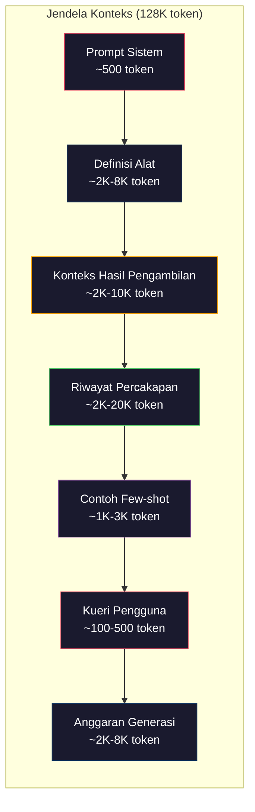
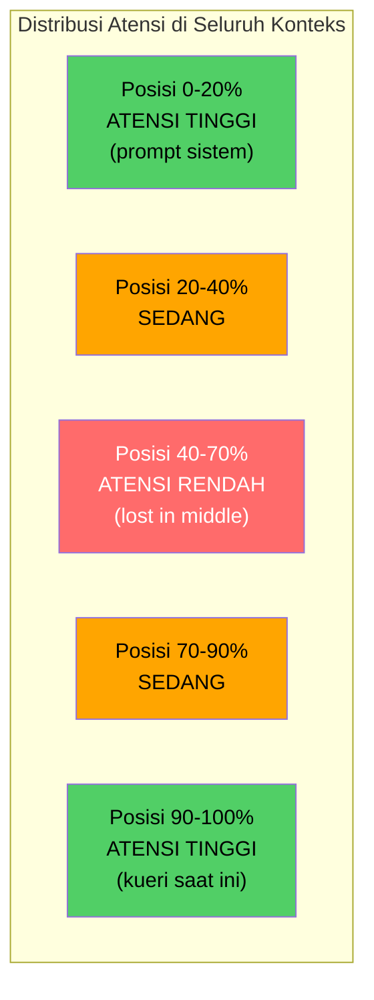
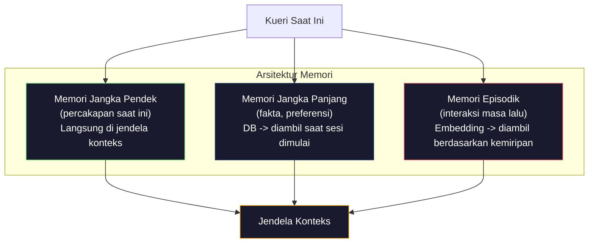

# Context Engineering: Jendela, Anggaran, Memori, dan Pengambilan

> Prompt engineering hanyalah bagian kecil. Context engineering adalah keseluruhan permainannya. Prompt adalah string yang Anda ketik. Konteks adalah segala sesuatu yang masuk ke jendela model: instruksi sistem, dokumen yang diambil, definisi alat, riwayat percakapan, contoh few-shot, dan prompt itu sendiri. Insinyur AI terbaik tahun 2026 adalah insinyur konteks. Mereka memutuskan apa yang masuk, apa yang tidak, dan dalam urutan apa.

**Jenis:** Bangun
**Bahasa:** Python
**Prasyarat:** Fase 10 (LLM dari Awal), Fase 11 Pelajaran 01-02
**Waktu:** ~90 menit
**Terkait:** Fase 11 · 15 (Prompt Caching) — tata letak yang ramah cache adalah pengembangan dari context engineering. Fase 5 · 28 (Evaluasi Konteks Panjang) untuk cara mengukur lost-in-the-middle dengan NIAH/RULER.

## Tujuan Pembelajaran

- Menghitung anggaran token di semua komponen jendela konteks (prompt sistem, alat, riwayat, dokumen yang diambil, ruang generasi)
- Menerapkan strategi pengelolaan jendela konteks: pemotongan, peringkasan, dan jendela geser untuk riwayat percakapan
- Memprioritaskan dan mengurutkan komponen konteks untuk memaksimalkan atensi model pada informasi yang paling relevan
- Membangun perakit konteks yang mengalokasikan token secara dinamis berdasarkan jenis kueri dan ruang jendela yang tersedia

## Masalah

Claude Opus 4.7 memiliki jendela 200K token (1M dalam beta). GPT-5 memiliki 400K. Gemini 3 Pro memiliki 2M. Llama 4 mengklaim 10M. Angka-angka ini terdengar sangat besar sampai Anda mengisinya.

Berikut rincian nyata untuk asisten pemrograman. Prompt sistem: 500 token. Definisi alat untuk 50 alat: 8,000 token. Dokumentasi yang diambil: 4,000 token. Riwayat percakapan (10 giliran): 6,000 token. Kueri pengguna saat ini: 200 token. Anggaran generasi (keluaran maksimum): 4,000 token. Total: 22,700 token. Itu hanya 18% dari jendela 128K.

Tetapi atensi tidak berskala linear dengan panjang konteks. Model dengan 128K token konteks membayar biaya atensi kuadratik ($O(n^2)$ pada transformer standar, meskipun sebagian besar model produksi menggunakan varian atensi efisien). Lebih penting lagi, akurasi pengambilan menurun. Uji "Needle in a Haystack" menunjukkan model kesulitan menemukan informasi yang ditempatkan di tengah konteks panjang. Penelitian Liu dkk. (2023) menunjukkan LLM mengambil informasi di awal dan akhir konteks panjang dengan akurasi hampir sempurna, tetapi akurasi turun 10-20% untuk informasi yang ditempatkan di tengah (posisi 40-70% dari konteks). Efek "lost-in-the-middle" ini bervariasi antarmodel tetapi memengaruhi semua arsitektur saat ini.

Pelajaran praktisnya: memiliki 200K token yang tersedia tidak berarti menggunakan 200K token itu efektif. Konteks 10K token yang disusun cermat sering mengungguli konteks 100K token yang dibuang-buang. Context engineering adalah disiplin memaksimalkan rasio sinyal terhadap deraian dalam jendela konteks.

Setiap token yang Anda masukkan ke jendela menggeser token yang bisa membawa informasi lebih relevan. Setiap definisi alat yang tidak relevan, setiap giliran percakapan yang basi, setiap potongan teks hasil pengambilan yang tidak menjawab pertanyaan — semuanya membuat model sedikit lebih buruk dalam tugasnya.

## Konsep

### Jendela Konteks adalah Sumber Daya yang Langka

Anggap jendela konteks sebagai RAM, bukan disk. Ia cepat dan dapat diakses langsung, tetapi terbatas. Anda tidak bisa memasukkan semuanya. Anda harus memilih.



Setiap komponen berebut ruang. Menambah definisi alat berarti mengurangi ruang untuk riwayat percakapan. Menambah konteks hasil pengambilan berarti mengurangi ruang untuk contoh few-shot. Context engineering adalah seni mengalokasikan anggaran ini untuk memaksimalkan kinerja tugas.

### Lost-in-the-Middle

Temuan empiris paling penting dalam context engineering. Model lebih memperhatikan informasi di awal dan akhir konteks. Informasi di tengah mendapat skor atensi lebih rendah dan lebih mungkin diabaikan.

Liu dkk. (2023) mengujinya secara sistematis. Mereka menempatkan satu dokumen relevan di antara 20 dokumen tidak relevan pada berbagai posisi dan mengukur akurasi jawaban. Saat dokumen relevan berada di awal atau akhir, akurasinya 85-90%. Saat berada di tengah (posisi 10 dari 20), akurasi turun menjadi 60-70%.

Ini memiliki implikasi rekayasa langsung:

- Letakkan informasi paling penting di awal (prompt sistem, instruksi kritis)
- Letakkan kueri saat ini dan konteks paling relevan di akhir (bias kedekatan membantu)
- Perlakukan bagian tengah konteks sebagai zona prioritas terendah
- Jika terpaksa memasukkan informasi di tengah, duplikasi poin kuncinya di akhir



### Komponen Konteks

**Prompt sistem**: menetapkan persona, batasan, dan aturan perilaku. Ini ditempatkan paling awal dan tetap konstan di setiap giliran. Claude Code menggunakan sekitar 6,000 token untuk prompt sistemnya, termasuk definisi alat dan instruksi perilaku. Buatlah ringkas. Setiap kata dalam prompt sistem diulang pada setiap panggilan API.

**Definisi alat**: setiap alat menambah 50-200 token (nama, deskripsi, skema parameter). 50 alat dengan masing-masing 150 token adalah 7,500 token sebelum percakapan apa pun terjadi. Pemilihan alat dinamis — hanya menyertakan alat yang relevan dengan kueri saat ini — dapat menguranginya sebesar 60-80%.

**Konteks hasil pengambilan**: dokumen dari basis data vektor, hasil pencarian, isi berkas. Kualitas pengambilan secara langsung menentukan kualitas respons. Pengambilan yang buruk lebih jelek daripada tidak ada pengambilan — ia mengisi jendela dengan deraian dan secara aktif menyesatkan model.

**Riwayat percakapan**: setiap pesan pengguna dan respons asisten sebelumnya. Tumbuh secara linear dengan panjang percakapan. Percakapan 50 giliran dengan 200 token per giliran menghasilkan 10,000 token riwayat. Sebagian besar tidak relevan dengan kueri saat ini.

**Contoh few-shot**: pasangan masukan/keluaran yang mendemonstrasikan perilaku yang diinginkan. Dua atau tiga contoh yang dipilih dengan baik sering meningkatkan kualitas keluaran lebih daripada ribuan token instruksi. Tetapi contoh memakan ruang.

**Anggaran generasi**: token yang disisihkan untuk respons model. Jika Anda mengisi jendela sampai penuh, model tidak punya ruang untuk menjawab. Sisihkan minimal 2,000-4,000 token untuk generasi.

### Strategi Kompresi Konteks

**Peringkasan riwayat**: alih-alih menyimpan semua giliran sebelumnya secara verbatim, ringkas percakapan secara berkala. "Kita mendiskusikan X, memutuskan Y, dan pengguna menginginkan Z" dalam 100 token menggantikan 10 giliran yang memakan 2,000 token. Jalankan peringkasan saat riwayat melebihi ambang batas (mis. 5,000 token).

**Pemfilteran relevansi**: beri skor setiap dokumen hasil pengambilan terhadap kueri saat ini dan buang dokumen di bawah ambang batas. Jika Anda mengambil 10 potongan tetapi hanya 3 yang relevan, buang 7 sisanya. Lebih baik memiliki 3 potongan yang sangat relevan daripada 10 potongan yang biasa saja.

**Pemangkasan alat**: klasifikasikan niat kueri pengguna dan sertakan hanya alat yang relevan dengan niat itu. Pertanyaan tentang kode tidak memerlukan alat kalender. Pertanyaan tentang penjadwalan tidak memerlukan alat sistem berkas. Ini dapat mengurangi definisi alat dari 8,000 token menjadi 1,000.

**Peringkasan rekursif**: untuk dokumen yang sangat panjang, ringkas secara bertahap. Pertama ringkas setiap bagian, lalu ringkas ringkasan tersebut. Dokumen 50 halaman menjadi intisari 500 token yang menangkap poin-poin kunci.

### Sistem Memori

Context engineering mencakup tiga cakrawala waktu.

**Memori jangka pendek**: percakapan saat ini. Disimpan langsung di jendela konteks. Tumbuh pada setiap giliran. Dikelola dengan peringkasan dan pemotongan.

**Memori jangka panjang**: fakta dan preferensi yang bertahan lintas percakapan. "Pengguna lebih menyukai TypeScript." "Proyek menggunakan PostgreSQL." Disimpan dalam basis data, diambil saat sesi dimulai. Claude Code menyimpannya dalam berkas CLAUDE.md. ChatGPT menyimpannya dalam fitur memori.

**Memori episodik**: interaksi masa lalu tertentu yang mungkin relevan. "Selasa lalu, kita memperbaiki masalah serupa di modul autentikasi." Disimpan sebagai embedding, diambil saat percakapan saat ini cocok dengan episode masa lalu.



### Perakitan Konteks Dinamis

Wawasan kuncinya: kueri berbeda memerlukan konteks berbeda. Prompt sistem statis + alat statis + riwayat statis adalah pemborosan. Sistem terbaik merakit konteks secara dinamis untuk setiap kueri.

1. Klasifikasikan niat kueri
2. Pilih alat yang relevan (bukan semua alat)
3. Ambil dokumen yang relevan (bukan himpunan tetap)
4. Sertakan giliran riwayat yang relevan (bukan seluruh riwayat)
5. Tambahkan contoh few-shot yang sesuai dengan jenis tugas
6. Urutkan semuanya berdasarkan kepentingan: yang kritis di awal, yang penting di akhir, yang opsional di tengah

Inilah yang membedakan aplikasi AI yang baik dari yang luar biasa. Modelnya sama. Konteksnya pembedanya.

```figure
lost-in-the-middle
```

## Bangun

### Langkah 1: Penghitung Token

Anda tidak dapat menganggarkan apa yang tidak dapat Anda ukur. Bangun penghitung token sederhana (perkiraan dengan memisahkan spasi, karena hitungan pastinya bergantung pada tokenizer).

```python
import json
import numpy as np
from collections import OrderedDict

def count_tokens(text):
    if not text:
        return 0
    return int(len(text.split()) * 1.3)

def count_tokens_json(obj):
    return count_tokens(json.dumps(obj))
```

### Langkah 2: Pengelola Anggaran Konteks

Abstraksi intinya. Pengelola anggaran melacak berapa token yang digunakan setiap komponen dan memberlakukan batas.

```python
class ContextBudget:
    def __init__(self, max_tokens=128000, generation_reserve=4000):
        self.max_tokens = max_tokens
        self.generation_reserve = generation_reserve
        self.available = max_tokens - generation_reserve
        self.allocations = OrderedDict()

    def allocate(self, component, content, max_tokens=None):
        tokens = count_tokens(content)
        if max_tokens and tokens > max_tokens:
            words = content.split()
            target_words = int(max_tokens / 1.3)
            content = " ".join(words[:target_words])
            tokens = count_tokens(content)

        used = sum(self.allocations.values())
        if used + tokens > self.available:
            allowed = self.available - used
            if allowed <= 0:
                return None, 0
            words = content.split()
            target_words = int(allowed / 1.3)
            content = " ".join(words[:target_words])
            tokens = count_tokens(content)

        self.allocations[component] = tokens
        return content, tokens

    def remaining(self):
        used = sum(self.allocations.values())
        return self.available - used

    def utilization(self):
        used = sum(self.allocations.values())
        return used / self.max_tokens

    def report(self):
        total_used = sum(self.allocations.values())
        lines = []
        lines.append(f"Context Budget Report ({self.max_tokens:,} token window)")
        lines.append("-" * 50)
        for component, tokens in self.allocations.items():
            pct = tokens / self.max_tokens * 100
            bar = "#" * int(pct / 2)
            lines.append(f"  {component:<25} {tokens:>6} tokens ({pct:>5.1f}%) {bar}")
        lines.append("-" * 50)
        lines.append(f"  {'Used':<25} {total_used:>6} tokens ({total_used/self.max_tokens*100:.1f}%)")
        lines.append(f"  {'Generation reserve':<25} {self.generation_reserve:>6} tokens")
        lines.append(f"  {'Remaining':<25} {self.remaining():>6} tokens")
        return "\n".join(lines)
```

### Langkah 3: Penyusunan Ulang Lost-in-the-Middle

Terapkan strategi penyusunan ulang: item paling penting ditempatkan di awal dan akhir, item paling tidak penting di tengah.

```python
def reorder_lost_in_middle(items, scores):
    paired = sorted(zip(scores, items), reverse=True)
    sorted_items = [item for _, item in paired]

    if len(sorted_items) <= 2:
        return sorted_items

    first_half = sorted_items[::2]
    second_half = sorted_items[1::2]
    second_half.reverse()

    return first_half + second_half

def score_relevance(query, documents):
    query_words = set(query.lower().split())
    scores = []
    for doc in documents:
        doc_words = set(doc.lower().split())
        if not query_words:
            scores.append(0.0)
            continue
        overlap = len(query_words & doc_words) / len(query_words)
        scores.append(round(overlap, 3))
    return scores
```

### Langkah 4: Pemampat Riwayat Percakapan

Ringkas giliran percakapan lama untuk merebut kembali anggaran token.

```python
class ConversationManager:
    def __init__(self, max_history_tokens=5000):
        self.turns = []
        self.summaries = []
        self.max_history_tokens = max_history_tokens

    def add_turn(self, role, content):
        self.turns.append({"role": role, "content": content})
        self._compress_if_needed()

    def _compress_if_needed(self):
        total = sum(count_tokens(t["content"]) for t in self.turns)
        if total <= self.max_history_tokens:
            return

        while total > self.max_history_tokens and len(self.turns) > 4:
            old_turns = self.turns[:2]
            summary = self._summarize_turns(old_turns)
            self.summaries.append(summary)
            self.turns = self.turns[2:]
            total = sum(count_tokens(t["content"]) for t in self.turns)

    def _summarize_turns(self, turns):
        parts = []
        for t in turns:
            content = t["content"]
            if len(content) > 100:
                content = content[:100] + "..."
            parts.append(f"{t['role']}: {content}")
        return "Previous: " + " | ".join(parts)

    def get_context(self):
        parts = []
        if self.summaries:
            parts.append("[Conversation Summary]")
            for s in self.summaries:
                parts.append(s)
        parts.append("[Recent Conversation]")
        for t in self.turns:
            parts.append(f"{t['role']}: {t['content']}")
        return "\n".join(parts)

    def token_count(self):
        return count_tokens(self.get_context())
```

### Langkah 5: Pemilih Alat Dinamis

Sertakan hanya alat yang relevan dengan kueri saat ini. Klasifikasikan niat, lalu filter.

```python
TOOL_REGISTRY = {
    "read_file": {
        "description": "Read contents of a file",
        "tokens": 120,
        "categories": ["code", "files"],
    },
    "write_file": {
        "description": "Write content to a file",
        "tokens": 150,
        "categories": ["code", "files"],
    },
    "search_code": {
        "description": "Search for patterns in codebase",
        "tokens": 130,
        "categories": ["code"],
    },
    "run_command": {
        "description": "Execute a shell command",
        "tokens": 140,
        "categories": ["code", "system"],
    },
    "create_calendar_event": {
        "description": "Create a new calendar event",
        "tokens": 180,
        "categories": ["calendar"],
    },
    "list_emails": {
        "description": "List recent emails",
        "tokens": 160,
        "categories": ["email"],
    },
    "send_email": {
        "description": "Send an email message",
        "tokens": 200,
        "categories": ["email"],
    },
    "web_search": {
        "description": "Search the web for information",
        "tokens": 140,
        "categories": ["research"],
    },
    "query_database": {
        "description": "Run a SQL query on the database",
        "tokens": 170,
        "categories": ["code", "data"],
    },
    "generate_chart": {
        "description": "Generate a chart from data",
        "tokens": 190,
        "categories": ["data", "visualization"],
    },
}

def classify_intent(query):
    query_lower = query.lower()

    intent_keywords = {
        "code": ["code", "function", "bug", "error", "file", "implement", "refactor", "debug", "test"],
        "calendar": ["meeting", "schedule", "calendar", "appointment", "event"],
        "email": ["email", "mail", "send", "inbox", "message"],
        "research": ["search", "find", "what is", "how does", "explain", "look up"],
        "data": ["data", "query", "database", "chart", "graph", "analytics", "sql"],
    }

    scores = {}
    for intent, keywords in intent_keywords.items():
        score = sum(1 for kw in keywords if kw in query_lower)
        if score > 0:
            scores[intent] = score

    if not scores:
        return ["code"]

    max_score = max(scores.values())
    return [intent for intent, score in scores.items() if score >= max_score * 0.5]

def select_tools(query, token_budget=2000):
    intents = classify_intent(query)
    relevant = {}
    total_tokens = 0

    for name, tool in TOOL_REGISTRY.items():
        if any(cat in intents for cat in tool["categories"]):
            if total_tokens + tool["tokens"] <= token_budget:
                relevant[name] = tool
                total_tokens += tool["tokens"]

    return relevant, total_tokens
```

### Langkah 6: Pipeline Perakitan Konteks Lengkap

Rangkai semuanya. Diberikan sebuah kueri, rakit konteks optimal secara dinamis.

```python
class ContextEngine:
    def __init__(self, max_tokens=128000, generation_reserve=4000):
        self.budget = ContextBudget(max_tokens, generation_reserve)
        self.conversation = ConversationManager(max_history_tokens=5000)
        self.system_prompt = (
            "You are a helpful AI assistant. You have access to tools for "
            "code editing, file management, web search, and data analysis. "
            "Use the appropriate tools for each task. Be concise and accurate."
        )
        self.knowledge_base = [
            "Python 3.12 introduced type parameter syntax for generic classes using bracket notation.",
            "The project uses PostgreSQL 16 with pgvector for embedding storage.",
            "Authentication is handled by Supabase Auth with JWT tokens.",
            "The frontend is built with Next.js 15 using the App Router.",
            "API rate limits are set to 100 requests per minute per user.",
            "The deployment pipeline uses GitHub Actions with Docker multi-stage builds.",
            "Test coverage must be above 80% for all new modules.",
            "The codebase follows the repository pattern for data access.",
        ]

    def assemble(self, query):
        self.budget = ContextBudget(self.budget.max_tokens, self.budget.generation_reserve)

        system_content, _ = self.budget.allocate("system_prompt", self.system_prompt, max_tokens=1000)

        tools, tool_tokens = select_tools(query, token_budget=2000)
        tool_text = json.dumps(list(tools.keys()))
        tool_content, _ = self.budget.allocate("tools", tool_text, max_tokens=2000)

        relevance = score_relevance(query, self.knowledge_base)
        threshold = 0.1
        relevant_docs = [
            doc for doc, score in zip(self.knowledge_base, relevance)
            if score >= threshold
        ]

        if relevant_docs:
            doc_scores = [s for s in relevance if s >= threshold]
            reordered = reorder_lost_in_middle(relevant_docs, doc_scores)
            doc_text = "\n".join(reordered)
            doc_content, _ = self.budget.allocate("retrieved_context", doc_text, max_tokens=3000)

        history_text = self.conversation.get_context()
        if history_text.strip():
            history_content, _ = self.budget.allocate("conversation_history", history_text, max_tokens=5000)

        query_content, _ = self.budget.allocate("user_query", query, max_tokens=500)

        return self.budget

    def chat(self, query):
        self.conversation.add_turn("user", query)
        budget = self.assemble(query)
        response = f"[Response to: {query[:50]}...]"
        self.conversation.add_turn("assistant", response)
        return budget


def run_demo():
    print("=" * 60)
    print("  Context Engineering Pipeline Demo")
    print("=" * 60)

    engine = ContextEngine(max_tokens=128000, generation_reserve=4000)

    print("\n--- Query 1: Code task ---")
    budget = engine.chat("Fix the bug in the authentication module where JWT tokens expire too early")
    print(budget.report())

    print("\n--- Query 2: Research task ---")
    budget = engine.chat("What is the best approach for implementing vector search in PostgreSQL?")
    print(budget.report())

    print("\n--- Query 3: After conversation history builds up ---")
    for i in range(8):
        engine.conversation.add_turn("user", f"Follow-up question number {i+1} about the implementation details of the system")
        engine.conversation.add_turn("assistant", f"Here is the response to follow-up {i+1} with technical details about the architecture")

    budget = engine.chat("Now implement the changes we discussed")
    print(budget.report())

    print("\n--- Tool Selection Examples ---")
    test_queries = [
        "Fix the bug in auth.py",
        "Schedule a meeting with the team for Tuesday",
        "Show me the database query performance stats",
        "Search for best practices on error handling",
    ]

    for q in test_queries:
        tools, tokens = select_tools(q)
        intents = classify_intent(q)
        print(f"\n  Query: {q}")
        print(f"  Intents: {intents}")
        print(f"  Tools: {list(tools.keys())} ({tokens} tokens)")

    print("\n--- Lost-in-the-Middle Reordering ---")
    docs = ["Doc A (most relevant)", "Doc B (somewhat relevant)", "Doc C (least relevant)",
            "Doc D (relevant)", "Doc E (moderately relevant)"]
    scores = [0.95, 0.60, 0.20, 0.80, 0.50]
    reordered = reorder_lost_in_middle(docs, scores)
    print(f"  Original order: {docs}")
    print(f"  Scores:         {scores}")
    print(f"  Reordered:      {reordered}")
    print(f"  (Most relevant at start and end, least relevant in middle)")
```

## Gunakan

### Konteks yang Dikelola Harness

Claude Code mengelola konteks dengan pendekatan berlapis. Prompt sistem memuat aturan perilaku dan definisi alat (~6K token). Saat Anda membuka berkas, isinya disuntikkan sebagai konteks. Saat Anda mencari, hasilnya ditambahkan. Giliran percakapan lama diringkas. CLAUDE.md menyediakan memori jangka panjang yang bertahan lintas sesi.

Keputusan rekayasa kuncinya: Claude Code tidak membuang seluruh basis kode Anda ke dalam konteks. Ia mengambil berkas yang relevan sesuai permintaan. Inilah context engineering dalam praktiknya.

### Pemuatan Konteks Dinamis

Cursor mengindeks seluruh basis kode Anda menjadi embedding. Saat Anda mengetik kueri, ia mengambil berkas dan blok kode paling relevan menggunakan kemiripan vektor. Hanya potongan-potongan itu yang masuk ke jendela konteks. Basis kode 500K baris dikompresi menjadi 5-10 blok kode paling relevan.

Inilah polanya: embedding semuanya, ambil sesuai permintaan, sertakan hanya yang penting.

### Memori Jangka Panjang Asisten

ChatGPT menyimpan preferensi dan fakta pengguna sebagai memori jangka panjang. Pada setiap awal percakapan, memori yang relevan diambil dan disertakan dalam prompt sistem. "Pengguna lebih menyukai Python" hanya memakan 5 token tetapi menghemat ratusan token instruksi yang diulang lintas percakapan.

### RAG sebagai Context Engineering

Retrieval-Augmented Generation adalah context engineering yang diformalkan. Alih-alih memasukkan pengetahuan ke dalam bobot model (pelatihan) atau prompt sistem (konteks statis), Anda mengambil dokumen relevan saat kueri dan menyuntikkannya ke jendela konteks. Seluruh pipeline RAG — pemotongan, embedding, pengambilan, peringkasan ulang — ada untuk menyelesaikan satu masalah: menempatkan informasi yang tepat ke dalam jendela konteks.

## Rilis

Pelajaran ini menghasilkan `outputs/prompt-context-optimizer.md` — prompt yang dapat digunakan ulang untuk mengaudit strategi perakitan konteks dan merekomendasikan optimasi. Berikan prompt sistem, jumlah alat, panjang riwayat rata-rata, dan strategi pengambilan Anda; prompt itu akan mengidentifikasi pemborosan token dan menyarankan perbaikan.

Pelajaran ini juga menghasilkan `outputs/skill-context-engineering.md` — kerangka keputusan untuk merancang pipeline perakitan konteks berdasarkan jenis tugas, ukuran jendela konteks, dan anggaran latensi.

## Latihan

1. Tambahkan "detektor pemborosan token" ke kelas ContextBudget. Komponen yang menggunakan lebih dari 30% anggaran harus ditandai, dan strategi kompresi yang spesifik untuk setiap jenis komponen harus disarankan (ringkas riwayat, pangkas alat, urutkan ulang dokumen).

2. Terapkan deduplikasi semantik untuk konteks hasil pengambilan. Jika dua dokumen hasil pengambilan memiliki kemiripan lebih dari 80% (berdasarkan tumpang tindih kata atau kemiripan kosinus dari embedding-nya), simpan hanya yang berskor lebih tinggi. Ukur seberapa besar anggaran token yang berhasil dikembalikan.

3. Bangun alat "putar ulang konteks". Diberikan transkrip percakapan, putar ulang melalui ContextEngine dan visualisasikan bagaimana alokasi anggaran berubah dari giliran ke giliran. Plot penggunaan token per komponen dari waktu ke waktu. Identifikasi giliran saat konteks mulai dikompresi.

4. Terapkan pemilih alat berbasis prioritas. Alih-alih biner termasuk/tidak termasuk, beri setiap alat skor relevansi terhadap kueri saat ini. Sertakan alat dalam urutan relevansi menurun sampai anggaran alat habis. Bandingkan kinerja tugas dengan 5, 10, 20, dan 50 alat yang disertakan.

5. Bangun pemampat konteks multistrategi. Terapkan tiga strategi kompresi (pemotongan, peringkasan, ekstraksi kalimat kunci) dan benchmark pada himpunan 20 dokumen. Ukur trade-off antara rasio kompresi dan retensi informasi (apakah versi terkompresi masih memuat jawaban atas kueri?).

## Istilah Kunci

| Istilah | Yang orang katakan | Arti sebenarnya |
|---------|--------------------|-----------------|
| Jendela konteks | "Seberapa banyak yang bisa dibaca model" | Jumlah maksimum token (masukan + keluaran) yang diproses model dalam satu lintasan maju — 400K untuk GPT-5, 200K (beta 1M) untuk Claude Opus 4.7, 2M untuk Gemini 3 Pro |
| Context engineering | "Prompt engineering tingkat lanjut" | Disiplin memutuskan apa yang masuk ke jendela konteks, dalam urutan apa, dan dengan prioritas apa — mencakup pengambilan, kompresi, pemilihan alat, dan pengelolaan memori |
| Lost-in-the-middle | "Model lupa hal-hal di tengah" | Temuan empiris bahwa LLM lebih memperhatikan awal dan akhir konteks, dengan penurunan akurasi 10-20% untuk informasi yang ditempatkan di tengah |
| Anggaran token | "Berapa token yang tersisa" | Alokasi eksplisit kapasitas jendela konteks ke komponen-komponen (prompt sistem, alat, riwayat, pengambilan, generasi) dengan batas per komponen |
| Konteks dinamis | "Memuat sesuatu secara langsung" | Merakit jendela konteks secara berbeda untuk setiap kueri berdasarkan klasifikasi niat, pemilihan alat yang relevan, dan hasil pengambilan |
| Peringkasan riwayat | "Mengompresi percakapan" | Mengganti giliran percakapan lama secara verbatim dengan ringkasan ringkas, mengurangi biaya token sambil mempertahankan informasi kunci |
| Pemangkasan alat | "Hanya menyertakan alat yang relevan" | Mengklasifikasikan niat kueri dan hanya menyertakan definisi alat yang cocok, mengurangi biaya token alat sebesar 60-80% |
| Memori jangka panjang | "Mengingat lintas sesi" | Fakta dan preferensi yang disimpan dalam basis data dan diambil saat sesi dimulai — CLAUDE.md, ChatGPT Memory, dan sistem serupa |
| Memori episodik | "Mengingat kejadian masa lalu tertentu" | Interaksi masa lalu yang disimpan sebagai embedding dan diambil saat kueri saat ini mirip dengan percakapan masa lalu |
| Anggaran generasi | "Ruang untuk jawaban" | Token yang disisihkan untuk keluaran model — jika konteks mengisi jendela sampai penuh, model tidak punya ruang untuk merespons |

## Bacaan Lanjutan

- [Liu et al., 2023 -- "Lost in the Middle: How Language Models Use Long Contexts"](https://arxiv.org/abs/2307.03172) — studi definitif tentang atensi yang bergantung pada posisi, menunjukkan bahwa model kesulitan dengan informasi di tengah konteks panjang
- [Anthropic's Contextual Retrieval blog post](https://www.anthropic.com/news/contextual-retrieval) — bagaimana Anthropic menangani pengambilan potongan yang sadar konteks, mengurangi kegagalan pengambilan sebesar 49%
- [Simon Willison's "Context Engineering"](https://simonwillison.net/2025/Jun/27/context-engineering/) — postingan blog yang memberi nama disiplin ini dan membedakannya dari prompt engineering
- [LangChain documentation on RAG](https://python.langchain.com/docs/tutorials/rag/) — implementasi praktis retrieval-augmented generation sebagai pola context engineering
- [Greg Kamradt's Needle in a Haystack test](https://github.com/gkamradt/LLMTest_NeedleInAHaystack) — benchmark yang mengungkap kegagalan pengambilan yang bergantung pada posisi di semua model utama
- [Pope et al., "Efficiently Scaling Transformer Inference" (2022)](https://arxiv.org/abs/2211.05102) — mengapa panjang konteks mendorong memori dan latensi, serta bagaimana KV cache, MQA, dan GQA mengubah perhitungan anggaran.
- [Agrawal et al., "SARATHI: Efficient LLM Inference by Piggybacking Decodes with Chunked Prefills" (2023)](https://arxiv.org/abs/2308.16369) — dua fase inferensi yang membuat prompt panjang mahal di TTFT tetapi murah di TPOT; sumber kebenaran di balik trade-off pengemasan konteks.
- [Ainslie et al., "GQA: Training Generalized Multi-Query Transformer Models from Multi-Head Checkpoints" (EMNLP 2023)](https://arxiv.org/abs/2305.13245) — makalah grouped-query attention yang memangkas memori KV 8× pada decoder produksi tanpa kehilangan kualitas.
