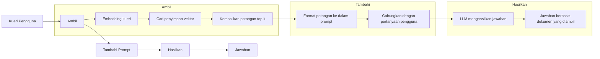
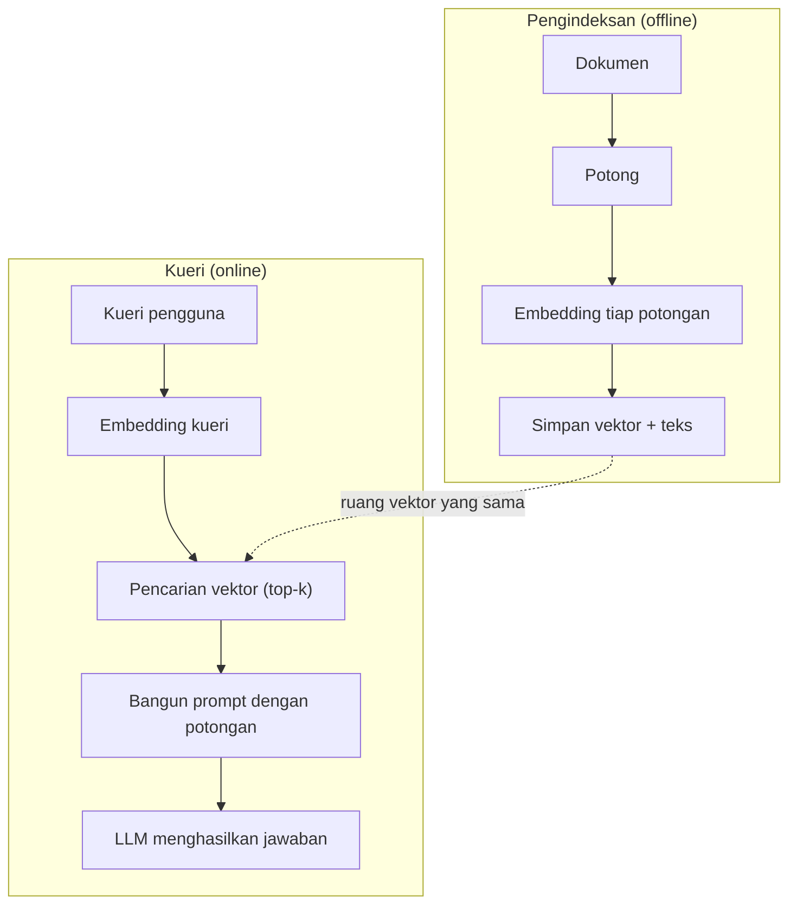

# RAG (Retrieval-Augmented Generation)

> LLM Anda tahu segalanya hingga batas waktu pelatihannya. Ia tidak tahu apa pun tentang dokumen perusahaan Anda, basis kode Anda, atau catatan rapat pekan lalu. RAG mengatasi ini dengan mengambil dokumen relevan dan memasukkannya ke dalam prompt. Ini adalah pola yang paling banyak diterapkan di AI produksi. Jika Anda hanya membangun satu hal dari kursus ini, bangunlah pipeline RAG.

**Jenis:** Bangun
**Bahasa:** Python
**Prasyarat:** Fase 10 (LLM dari Awal), Fase 11 Pelajaran 01-05
**Waktu:** ~90 menit
**Terkait:** Fase 5 · 23 (Strategi Pemotongan untuk RAG) untuk keenam algoritme pemotongan dan kapan masing-masing unggul. Fase 5 · 22 (Pendalaman Model Embedding) untuk memilih embedder. Fase 11 · 07 (RAG Lanjutan) untuk pencarian hibrida, peringkasan ulang, dan transformasi kueri.

## Tujuan Pembelajaran

- Bangun pipeline RAG lengkap: pemuatan dokumen, pemotongan, embedding, penyimpanan vektor, pengambilan, dan generasi
- Terapkan pencarian semantik menggunakan basis data vektor (ChromaDB, FAISS, atau Pinecone) dengan pengindeksan yang tepat
- Jelaskan mengapa RAG lebih disukai daripada fine-tuning untuk aplikasi berbasis pengetahuan (biaya, kesegaran, atribusi)
- Evaluasi kualitas RAG menggunakan metrik pengambilan (presisi, recall) dan metrik generasi (faithfulness, relevansi)

## Masalah

Anda membangun chatbot untuk perusahaan Anda. Seorang pelanggan bertanya, "Apa kebijakan pengembalian dana untuk paket enterprise?" LLM menjawab dengan jawaban umum tentang kebijakan pengembalian dana SaaS pada umumnya. Kebijakan yang sebenarnya, terkubur di wiki internal 200 halaman, menyatakan bahwa pelanggan enterprise mendapatkan jendela 60 hari dengan pengembalian dana pro-rata. LLM tidak pernah melihat dokumen ini. Ia tidak mungkin mengetahui hal yang tidak pernah dilatihkannya.

Fine-tuning adalah salah satu solusinya. Ambil LLM, latih dengan dokumen internal Anda, lalu deploy model yang diperbarui. Ini berhasil, tetapi memiliki masalah serius. Fine-tuning memakan biaya komputasi ribuan dolar. Model menjadi usang seketika sebuah dokumen berubah. Anda tidak punya cara untuk mengetahui sumber mana yang digunakan model. Dan jika perusahaan mengakuisisi lini produk lain bulan depan, Anda harus fine-tuning lagi.

RAG adalah solusi lainnya. Biarkan model tetap apa adanya. Saat ada pertanyaan masuk, cari potongan relevan di penyimpanan dokumen Anda, tempelkan ke dalam prompt sebelum pertanyaan, dan biarkan model menjawab dengan potongan-potongan tersebut sebagai konteks. Penyimpanan dokumen dapat diperbarui dalam hitungan menit. Anda dapat melihat persis dokumen mana yang diambil. Model itu sendiri tidak pernah berubah. Inilah sebabnya RAG menjadi pola dominan di produksi: lebih murah, lebih segar, lebih dapat diaudit, dan bekerja dengan LLM mana pun.

## Konsep

### Pola RAG

Seluruh pola ini muat dalam empat langkah:



Kueri → Ambil → Tambahi prompt → Hasilkan. Setiap sistem RAG mengikuti pola ini. Perbedaan antarsistem RAG produksi ada pada rincian tiap langkah: bagaimana Anda memotong, bagaimana Anda melakukan embedding, bagaimana Anda mencari, dan bagaimana Anda menyusun prompt.

### Mengapa RAG Mengalahkan Fine-Tuning

| Perhatian | Fine-tuning | RAG |
|---------|------------|-----|
| Biaya | $1.000-$100.000+ per pelatihan | $0,01-$0,10 per kueri (embedding + LLM) |
| Kesegaran | Usang hingga dilatih ulang | Diperbarui dalam hitungan menit dengan mengindeks ulang dokumen |
| Kemampuan audit | Tidak dapat melacak jawaban ke sumber | Dapat menunjukkan potongan yang tepat yang diambil |
| Halusinasi | Tetap berhalusinasi bebas | Berbasis dokumen yang diambil |
| Privasi data | Data pelatihan tertanam dalam bobot | Dokumen tetap berada di penyimpan vektor Anda |

Fine-tuning mengubah bobot model secara permanen. RAG mengubah konteks model secara sementara. Untuk sebagian besar aplikasi, konteks sementara itulah yang Anda inginkan.

Satu kasus di mana fine-tuning menang: ketika Anda memerlukan model untuk mengadopsi gaya, nada, atau pola penalaran tertentu yang tidak dapat dicapai hanya dengan prompting. Untuk pengambilan pengetahuan faktual, RAG menang setiap kali.

### Model Embedding

Model embedding mengubah teks menjadi vektor padat. Teks yang serupa menghasilkan vektor yang saling dekat di ruang berdimensi tinggi ini. "Bagaimana saya mengatur ulang kata sandi?" dan "Saya perlu mengubah kata sandi" menghasilkan vektor yang hampir identik meskipun hanya memiliki sedikit kesamaan kata. "Kucing itu duduk di atas tikar" menghasilkan vektor yang sangat berbeda.

Model embedding umum (deretan 2026 — lihat Fase 5 · 22 untuk analisis lengkap):

| Model | Dimensi | Penyedia | Catatan |
|-------|-----------|----------|-------|
| text-embedding-3-small | 1536 (Matryoshka) | OpenAI | Rasio harga/kinerja terbaik untuk sebagian besar kasus penggunaan |
| text-embedding-3-large | 3072 (Matryoshka) | OpenAI | Akurasi lebih tinggi, dapat dipotong menjadi 256/512/1024 |
| Gemini Embedding 2 | 3072 (Matryoshka) | Google | Pengambilan MTEB teratas; konteks 8K |
| voyage-4 | 1024/2048 (Matryoshka) | Voyage AI | Varian domain (kode, keuangan, hukum) |
| Cohere embed-v4 | 1024 (Matryoshka) | Cohere | Multibahasa kuat, konteks 128K |
| BGE-M3 | 1024 (padat + jarang + ColBERT) | BAAI (bobot terbuka) | Tiga tampilan dari satu model |
| Qwen3-Embedding | 4096 (Matryoshka) | Alibaba (bobot terbuka) | Skor pengambilan bobot-terbuka tertinggi |
| all-MiniLM-L6-v2 | 384 | Bobot terbuka (Sentence Transformers) | Dasar untuk prototyping |

Untuk pelajaran ini, kita membangun embedding sederhana sendiri menggunakan TF-IDF. Bukan karena TF-IDF yang digunakan sistem produksi, melainkan karena ini membuat konsepnya menjadi nyata: teks masuk, vektor keluar, teks serupa menghasilkan vektor serupa.

### Kesamaan Vektor

Dengan dua vektor, bagaimana Anda mengukur kesamaan? Tiga pilihan:

**Cosine similarity**: kosinus sudut antara dua vektor. Berkisar dari -1 (berlawanan) sampai 1 (identik). Mengabaikan magnitudo, hanya peduli arah. Ini adalah pilihan utama untuk RAG.

```math
\mathop{\mathrm{cosine\_sim}}(a, b) = \frac{\mathop{\mathrm{dot}}(a, b)}{\lVert a \rVert \cdot \lVert b \rVert}
```

**Dot product**: hasil kali dalam mentah. Vektor yang lebih besar mendapat skor lebih tinggi. Berguna ketika magnitudo membawa informasi (dokumen yang lebih panjang mungkin lebih relevan).

```math
\mathop{\mathrm{dot}}(a, b) = \sum_i a_i b_i
```

**L2 (Euclidean) distance**: jarak garis lurus di ruang vektor. Jarak lebih kecil = lebih serupa. Sensitif terhadap perbedaan magnitudo.

```math
\mathop{\mathrm{L2}}(a, b) = \sqrt{\sum_i (a_i - b_i)^2}
```

Cosine similarity adalah standar. Ia menangani dokumen dengan panjang berbeda dengan baik karena menormalkan berdasarkan magnitudo. Ketika seseorang berkata "pencarian vektor," hampir selalu yang dimaksud adalah cosine similarity.

### Strategi Pemotongan

Dokumen terlalu panjang untuk di-embedding sebagai satu vektor. PDF 50 halaman mungkin menghasilkan embedding yang buruk karena berisi lusinan topik. Sebaliknya, Anda memotong dokumen menjadi potongan-potongan (chunk) dan melakukan embedding pada masing-masing potongan.

**Fixed-size chunking**: potong setiap N token. Sederhana dan dapat diprediksi. Potongan 512 token dengan tumpang tindih 50 token berarti potongan 1 adalah token 0-511, potongan 2 adalah token 462-973, dan seterusnya. Tumpang tindih ini memastikan Anda tidak memotong kalimat pada batas yang kurang beruntung.

**Semantic chunking**: potong pada batas alami. Paragraf, bagian, atau header markdown. Setiap potongan adalah unit makna yang koheren. Lebih kompleks diterapkan tetapi menghasilkan pengambilan yang lebih baik.

**Recursive chunking**: coba potong pada batas terbesar terlebih dahulu (header bagian). Jika sebuah bagian masih terlalu besar, potong pada batas paragraf. Jika sebuah paragraf masih terlalu besar, potong pada batas kalimat. Ini adalah pendekatan LangChain RecursiveCharacterTextSplitter dan bekerja dengan baik dalam praktiknya.

Ukuran potongan lebih penting dari yang dibayangkan orang:

- Terlalu kecil (64-128 token): setiap potongan kehilangan konteks. "Ia meningkat 15% kuartal lalu" tidak berarti apa-apa tanpa mengetahui apa yang dimaksud dengan "ia".
- Terlalu besar (2048+ token): setiap potongan mencakup beberapa topik, mencairkan relevansi. Saat Anda mencari data pendapatan, Anda mendapat potongan yang 10% tentang pendapatan dan 90% tentang jumlah karyawan.
- Titik manis (256-512 token): cukup konteks untuk mandiri, cukup fokus untuk tetap relevan.

Sebagian besar sistem RAG produksi menggunakan potongan 256-512 token dengan tumpang tindih 50 token. Pedoman RAG Anthropic merekomendasikan rentang ini.

### Basis Data Vektor

Setelah memiliki embedding, Anda perlu tempat untuk menyimpan dan mencarinya. Pilihannya:

| Basis data | Jenis | Paling cocok untuk |
|----------|------|----------|
| FAISS | Pustaka (dalam proses) | Prototyping, dataset kecil hingga menengah |
| Chroma | DB ringan | Pengembangan lokal, deployment kecil |
| Pinecone | Layanan terkelola | Produksi tanpa beban operasional |
| Weaviate | DB sumber terbuka | Produksi yang di-host sendiri |
| pgvector | Ekstensi Postgres | Jika Anda sudah menggunakan Postgres |
| Qdrant | DB sumber terbuka | Host-sendiri berkinerja tinggi |

Untuk pelajaran ini, kita membangun penyimpan vektor sederhana di memori. Ia menyimpan vektor dalam sebuah list dan melakukan pencarian cosine similarity secara brute-force. Ini setara dengan FAISS dengan indeks datar. Penyimpanan ini diskalakan hingga mungkin 100.000 vektor sebelum mulai lambat. Sistem produksi menggunakan algoritme nearest neighbor aproksimasi (ANN) seperti HNSW untuk mencari jutaan vektor dalam milidetik.

### Pipeline Lengkap



Fase pengindeksan berjalan sekali per dokumen (atau saat dokumen diperbarui). Fase kueri berjalan pada setiap permintaan pengguna. Di produksi, pengindeksan mungkin memproses jutaan dokumen selama berjam-jam. Kueri harus merespons dalam waktu kurang dari satu detik.

### Angka Nyata

Sebagian besar sistem RAG produksi menggunakan parameter berikut:

- **k = 5 sampai 10** potongan yang diambil per kueri
- **Ukuran potongan = 256 sampai 512 token** dengan tumpang tindih 50 token
- **Anggaran konteks**: 2.500-5.000 token konten yang diambil per kueri
- **Total prompt**: ~8.000-16.000 token (system prompt + potongan yang diambil + riwayat percakapan + kueri pengguna)
- **Dimensi embedding**: 384-3072 tergantung model
- **Throughput pengindeksan**: 100-1.000 dokumen per detik dengan embedding via API
- **Latensi kueri**: 50-200 ms untuk pengambilan, 500-3000 ms untuk generasi

```figure
rag-chunking
```

## Bangun

### Langkah 1: Pemotongan Dokumen

```python
def chunk_text(text, chunk_size=200, overlap=50):
    words = text.split()
    chunks = []
    start = 0
    while start < len(words):
        end = start + chunk_size
        chunk = " ".join(words[start:end])
        chunks.append(chunk)
        start += chunk_size - overlap
    return chunks
```

### Langkah 2: Embedding TF-IDF

Kita membangun fungsi embedding sederhana. TF-IDF (Term Frequency-Inverse Document Frequency) bukan embedding neural, tetapi mengubah teks menjadi vektor dengan cara yang menangkap kepentingan kata. Kata yang sering muncul dalam dokumen mendapat TF lebih tinggi. Kata yang langka di seluruh korpus mendapat IDF lebih tinggi. Hasil kalinya adalah vektor di mana kata yang penting dan khas memiliki nilai tinggi.

```python
import math
from collections import Counter

def build_vocabulary(documents):
    vocab = set()
    for doc in documents:
        vocab.update(doc.lower().split())
    return sorted(vocab)

def compute_tf(text, vocab):
    words = text.lower().split()
    count = Counter(words)
    total = len(words)
    return [count.get(word, 0) / total for word in vocab]

def compute_idf(documents, vocab):
    n = len(documents)
    idf = []
    for word in vocab:
        doc_count = sum(1 for doc in documents if word in doc.lower().split())
        idf.append(math.log((n + 1) / (doc_count + 1)) + 1)
    return idf

def tfidf_embed(text, vocab, idf):
    tf = compute_tf(text, vocab)
    return [t * i for t, i in zip(tf, idf)]
```

### Langkah 3: Pencarian Cosine Similarity

```python
def cosine_similarity(a, b):
    dot = sum(x * y for x, y in zip(a, b))
    norm_a = math.sqrt(sum(x * x for x in a))
    norm_b = math.sqrt(sum(x * x for x in b))
    if norm_a == 0 or norm_b == 0:
        return 0.0
    return dot / (norm_a * norm_b)

def search(query_embedding, stored_embeddings, top_k=5):
    scores = []
    for i, emb in enumerate(stored_embeddings):
        sim = cosine_similarity(query_embedding, emb)
        scores.append((i, sim))
    scores.sort(key=lambda x: x[1], reverse=True)
    return scores[:top_k]
```

### Langkah 4: Penyusunan Prompt

Di sinilah bagian "augmented" pada RAG terjadi. Ambil potongan yang diambil, format menjadi prompt, dan minta LLM menjawab berdasarkan konteks yang diberikan.

```python
def build_rag_prompt(query, retrieved_chunks):
    context = "\n\n---\n\n".join(
        f"[Source {i+1}]\n{chunk}"
        for i, chunk in enumerate(retrieved_chunks)
    )
    return f"""Answer the question based ONLY on the following context.
If the context doesn't contain enough information, say "I don't have enough information to answer that."

Context:
{context}

Question: {query}

Answer:"""
```

### Langkah 5: Pipeline RAG Lengkap

```python
class RAGPipeline:
    def __init__(self):
        self.chunks = []
        self.embeddings = []
        self.vocab = []
        self.idf = []

    def index(self, documents):
        all_chunks = []
        for doc in documents:
            all_chunks.extend(chunk_text(doc))
        self.chunks = all_chunks
        self.vocab = build_vocabulary(all_chunks)
        self.idf = compute_idf(all_chunks, self.vocab)
        self.embeddings = [
            tfidf_embed(chunk, self.vocab, self.idf)
            for chunk in all_chunks
        ]

    def query(self, question, top_k=5):
        query_emb = tfidf_embed(question, self.vocab, self.idf)
        results = search(query_emb, self.embeddings, top_k)
        retrieved = [(self.chunks[i], score) for i, score in results]
        prompt = build_rag_prompt(
            question, [chunk for chunk, _ in retrieved]
        )
        return prompt, retrieved
```

### Langkah 6: Generasi (simulasi)

Di produksi, di sinilah Anda memanggil API LLM. Untuk pelajaran ini, kita menyimulasikan generasi dengan mengekstrak kalimat paling relevan dari konteks yang diambil.

```python
def simple_generate(prompt, retrieved_chunks):
    query_words = set(prompt.lower().split("question:")[-1].split())
    best_sentence = ""
    best_score = 0
    for chunk in retrieved_chunks:
        for sentence in chunk.split("."):
            sentence = sentence.strip()
            if not sentence:
                continue
            words = set(sentence.lower().split())
            overlap = len(query_words & words)
            if overlap > best_score:
                best_score = overlap
                best_sentence = sentence
    return best_sentence if best_sentence else "I don't have enough information."
```

## Gunakan

Dengan model embedding dan LLM sungguhan, kode hampir tidak berubah:

```python
from openai import OpenAI

client = OpenAI()

def embed(text):
    response = client.embeddings.create(
        model="text-embedding-3-small",
        input=text
    )
    return response.data[0].embedding

def generate(prompt):
    response = client.chat.completions.create(
        model="gpt-4o-mini",
        messages=[{"role": "user", "content": prompt}],
        temperature=0
    )
    return response.choices[0].message.content
```

Atau dengan Anthropic:

```python
import anthropic

client = anthropic.Anthropic()

def generate(prompt):
    response = client.messages.create(
        model="claude-sonnet-5",
        max_tokens=1024,
        messages=[{"role": "user", "content": prompt}]
    )
    return response.content[0].text
```

Pipeline-nya sama. Tukar fungsi embedding. Tukar fungsi generasi. Logika pengambilan, pemotongan, penyusunan prompt -- semuanya identik apa pun model yang Anda gunakan.

Untuk penyimpanan vektor berskala besar, ganti pencarian brute-force dengan basis data vektor yang tepat:

```python
import chromadb

client = chromadb.Client()
collection = client.create_collection("my_docs")

collection.add(
    documents=chunks,
    ids=[f"chunk_{i}" for i in range(len(chunks))]
)

results = collection.query(
    query_texts=["What is the refund policy?"],
    n_results=5
)
```

Chroma menangani embedding secara internal (secara default menggunakan all-MiniLM-L6-v2) dan menyimpan vektor dalam basis data lokal. Pola yang sama, mekanisme di baliknya yang berbeda.

## Rilis

Pelajaran ini menghasilkan:
- `outputs/prompt-rag-architect.md` -- prompt untuk merancang sistem RAG bagi kasus penggunaan tertentu
- `outputs/skill-rag-pipeline.md` -- skill yang mengajarkan agen cara membangun dan men-debug pipeline RAG

## Latihan

1. Ganti embedding TF-IDF dengan pendekatan bag-of-words sederhana (biner: 1 jika kata hadir, 0 jika tidak). Bandingkan kualitas pengambilan pada dokumen contoh. TF-IDF seharusnya lebih unggul karena memberi bobot lebih tinggi pada kata langka.

2. Eksperimen dengan ukuran potongan: coba 50, 100, 200, dan 500 kata pada kumpulan dokumen yang sama. Untuk setiap ukuran, jalankan 5 kueri yang sama dan hitung berapa banyak yang mengembalikan potongan relevan di top-3. Temukan titik manis di mana kualitas pengambilan mencapai puncaknya.

3. Tambahkan metadata ke setiap potongan (nama dokumen sumber, posisi potongan). Ubah template prompt agar menyertakan atribusi sumber sehingga LLM mengutip sumbernya.

4. Terapkan evaluasi sederhana: dengan 10 pasangan pertanyaan-jawaban, jalankan setiap pertanyaan melalui pipeline RAG, lalu ukur persentase potongan yang diambil yang memuat jawaban. Ini adalah recall pengambilan pada k.

5. Bangun pipeline RAG yang sadar percakapan: simpan riwayat 3 pertukaran terakhir dan sertakan dalam prompt bersama potongan yang diambil. Uji dengan pertanyaan lanjutan seperti "Bagaimana dengan enterprise?" setelah bertanya tentang harga.

## Istilah Kunci

| Istilah | Yang orang katakan | Arti sebenarnya |
|------|----------------|----------------------|
| RAG | "AI yang membaca dokumen Anda" | Ambil dokumen relevan, tempel ke dalam prompt, dan hasilkan jawaban yang berbasis pada dokumen tersebut |
| Embedding | "Ubah teks jadi angka" | Representasi vektor padat dari teks di mana makna serupa menghasilkan vektor serupa |
| Basis data vektor | "Mesin pencari untuk AI" | Penyimpan data yang dioptimalkan untuk menyimpan vektor dan menemukan tetangga terdekat berdasarkan kesamaan |
| Pemotongan (chunking) | "Potong dokumen jadi bagian-bagian" | Memecah dokumen menjadi segmen lebih kecil (biasanya 256-512 token) agar masing-masing dapat di-embedding dan diambil secara mandiri |
| Cosine similarity | "Seberapa mirip dua vektor" | Kosinus sudut antara dua vektor; 1 = arah identik, 0 = ortogonal, -1 = berlawanan |
| Pengambilan top-k | "Ambil k kecocokan terbaik" | Kembalikan k potongan paling mirip dengan kueri dari penyimpan vektor |
| Jendela konteks | "Seberapa banyak teks yang bisa dilihat LLM" | Jumlah token maksimum yang dapat diproses LLM dalam satu permintaan; potongan yang diambil harus muat di dalamnya |
| Generasi tambahan (augmented generation) | "Jawab menggunakan konteks yang diberikan" | Menghasilkan respons dengan dokumen yang diambil sebagai konteks, bukan hanya mengandalkan pengetahuan hasil pelatihan |
| TF-IDF | "Penilaian kepentingan kata" | Term Frequency dikali Inverse Document Frequency; memberi bobot kata berdasarkan seberapa khasnya dalam sebuah korpus |
| Pengindeksan | "Menyiapkan dokumen untuk pencarian" | Proses offline memotong, melakukan embedding, dan menyimpan dokumen agar dapat dicari saat kueri |

## Bacaan Lanjutan

- Lewis et al., "Retrieval-Augmented Generation for Knowledge-Intensive NLP Tasks" (2020) -- makalah RAG asli dari Facebook AI Research yang memformalkan pola ambil-lalu-hasilkan
- Dokumentasi RAG Anthropic (docs.anthropic.com) -- pedoman praktis untuk ukuran potongan, penyusunan prompt, dan evaluasi
- Pinecone Learning Center, "What is RAG?" -- penjelasan visual yang jelas tentang pipeline RAG dengan pertimbangan produksi
- Sentence-BERT: Reimers & Gurevych (2019) -- makalah di balik model embedding all-MiniLM, yang menunjukkan cara melatih bi-encoder untuk kesamaan semantik
- [Karpukhin et al., "Dense Passage Retrieval for Open-Domain Question Answering" (EMNLP 2020)](https://arxiv.org/abs/2004.04906) -- makalah DPR yang membuktikan pengambilan bi-encoder padat mengalahkan BM25 pada QA domain-terbuka dan menetapkan pola untuk retriever RAG modern.
- [LlamaIndex High-Level Concepts](https://docs.llamaindex.ai/en/stable/getting_started/concepts.html) -- konsep utama yang perlu diketahui saat membangun pipeline RAG: pemuat data, parser node, indeks, retriever, dan penyintesis respons.
- [LangChain RAG tutorial](https://python.langchain.com/docs/tutorials/rag/) -- orkestrator dengan "rasa" berbeda; pandangan chain-of-runnables pada pola ambil-lalu-hasilkan yang sama.
