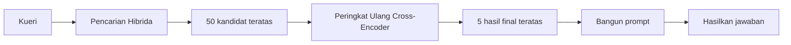
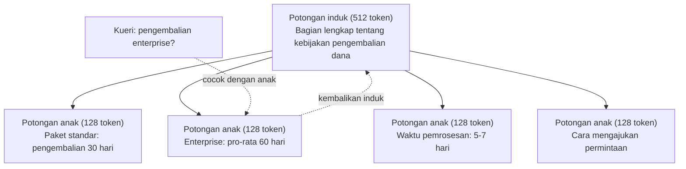
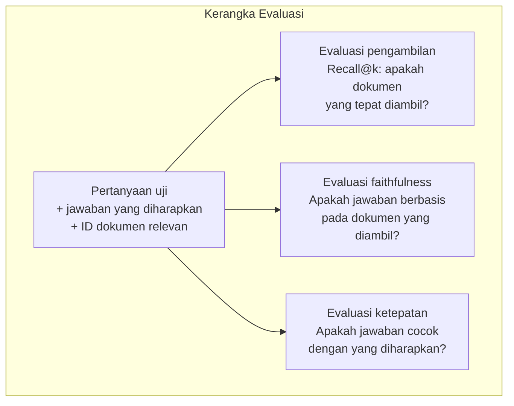

# RAG Lanjutan (Pemotongan, Peringkasan Ulang, Pencarian Hibrida)

> RAG dasar mengambil potongan top-k yang paling mirip. Itu berhasil untuk pertanyaan sederhana. Pendekatan ini gagal untuk penalaran multi-langkah, kueri ambigu, dan korpus besar. RAG lanjutan adalah perbedaan antara demo yang berjalan pada 10 dokumen dan sistem yang berjalan pada 10 juta dokumen.

**Jenis:** Bangun
**Bahasa:** Python, TypeScript
**Prasyarat:** Fase 11, Pelajaran 06 (RAG)
**Waktu:** ~90 menit
**Terkait:** Fase 5 · 23 (Strategi Pemotongan untuk RAG) mencakup keenam algoritme pemotongan — rekursif, semantik, kalimat, dokumen-induk, late chunking, contextual retrieval — dengan benchmark Vectara/Anthropic. Pelajaran ini melanjutkannya: pencarian hibrida, peringkasan ulang, dan transformasi kueri.

## Tujuan Pembelajaran

- Terapkan strategi pemotongan lanjutan (semantik, rekursif, induk-anak) yang mempertahankan struktur dan konteks dokumen
- Bangun pipeline pencarian hibrida yang menggabungkan pencocokan kata kunci BM25 dengan pencarian vektor semantik dan peringkat ulang cross-encoder
- Terapkan teknik transformasi kueri (HyDE, multi-kueri, step-back) untuk meningkatkan pengambilan pada pertanyaan ambigu atau kompleks
- Diagnosa dan perbaiki kegagalan RAG umum: potongan salah yang diambil, jawaban tidak ada dalam konteks, kerusakan penalaran multi-langkah

## Masalah

Anda membangun pipeline RAG dasar di Pelajaran 06. Ia berhasil untuk pertanyaan langsung pada korpus kecil. Sekarang coba ini:

**Kueri ambigu**: "Berapa pendapatan kuartal lalu?" Pencarian semantik mengembalikan potongan tentang strategi pendapatan, proyeksi pendapatan, dan pemikiran CFO tentang pertumbuhan pendapatan. Semuanya secara semantik mirip dengan kata "pendapatan." Tidak ada yang memuat angka sebenarnya. Potongan yang benar berbunyi "$47,2 juta pada Q3 2025" tetapi menggunakan kata "earnings" alih-alih "revenue." Model embedding menganggap "strategi pendapatan" lebih dekat dengan kueri daripada "pendapatan Q3 sebesar $47,2 juta."

**Pertanyaan multi-langkah**: "Tim mana yang memiliki peningkatan skor kepuasan pelanggan tertinggi?" Ini memerlukan pencarian skor kepuasan setiap tim, membandingkannya, dan mengidentifikasi nilai maksimum. Tidak ada satu potongan pun yang memuat jawabannya. Informasinya tersebar di laporan-laporan tim.

**Masalah korpus besar**: Anda memiliki 2 juta potongan. Jawaban yang benar ada di potongan #1.847.293. Pengambilan top-5 Anda menghasilkan potongan #14, #89.201, #1.200.000, #44, dan #901.333. Dekat dalam ruang embedding, tetapi tidak ada yang memuat jawaban. Pada skala ini, pencarian nearest neighbor aproksimasi memasukkan cukup banyak galat sehingga hasil relevan tersingkir dari top-k.

RAG dasar gagal karena kesamaan vektor tidak sama dengan relevansi. Sebuah potongan bisa mirip secara semantik dengan kueri tanpa berguna untuk menjawabnya. RAG lanjutan mengatasi ini dengan empat teknik: pencarian hibrida (tambahkan pencocokan kata kunci), peringkasan ulang (skor kandidat lebih cermat), transformasi kueri (perbaiki kueri sebelum mencari), dan pemotongan yang lebih baik (ambil pada granularitas yang tepat).

## Konsep

### Pencarian Hibrida: Semantik + Kata Kunci

Pencarian semantik (kesamaan vektor) pandai memahami makna. "Bagaimana saya membatalkan langganan?" cocok dengan "Langkah-langkah menghentikan paket Anda" meskipun keduanya tidak memiliki kata yang sama. Namun ia melewatkan kecocokan persis. "Kode error E-4021" mungkin tidak cocok dengan potongan yang memuat "E-4021" jika model embedding menganggapnya sebagai noise.

Pencarian kata kunci (BM25) sebaliknya. Ia unggul pada kecocokan persis. "E-4021" cocok sempurna. Tetapi "batalkan langganan saya" tidak menghasilkan hasil apa pun jika dokumen menyatakan "hentikan paket Anda."

Pencarian hibrida menjalankan keduanya, lalu menggabungkan hasilnya.

**BM25** (Best Matching 25) adalah algoritme pencarian kata kunci standar. Ia telah menjadi tulang punggung mesin pencari sejak 1990-an. Rumusnya:

```
BM25(q, d) = jumlahkan untuk suku t dalam q:
    IDF(t) * (tf(t,d) * (k1 + 1)) / (tf(t,d) + k1 * (1 - b + b * |d| / avgdl))
```

Di mana tf(t,d) adalah frekuensi suku t dalam dokumen d, IDF(t) adalah inverse document frequency, |d| adalah panjang dokumen, avgdl adalah panjang dokumen rata-rata, k1 mengontrol saturasi frekuensi suku (default 1.2), dan b mengontrol normalisasi panjang (default 0.75).

Dalam bahasa sederhana: BM25 memberi skor lebih tinggi pada dokumen yang memuat suku kueri (terutama yang langka), tetapi dengan pengembalian yang menurun untuk suku yang berulang. Dokumen dengan kata "revenue" 50 kali tidak 50 kali lebih relevan daripada dokumen yang memuatnya sekali.

### Fusi Peringkat Resiprok (RRF)

Anda memiliki dua daftar berperingkat: satu dari pencarian vektor, satu dari BM25. Bagaimana cara menggabungkannya? Fusi Peringkat Resiprok adalah pendekatan standar.

```
RRF_score(d) = jumlahkan untuk peringkat R:
    1 / (k + rank_R(d))
```

Di mana k adalah konstanta (biasanya 60) yang mencegah hasil peringkat teratas mendominasi.

Dokumen yang berperingkat #1 di pencarian vektor dan #5 di BM25 mendapat: 1/(60+1) + 1/(60+5) = 0,0164 + 0,0154 = 0,0318

Dokumen yang berperingkat #3 di pencarian vektor dan #2 di BM25 mendapat: 1/(60+3) + 1/(60+2) = 0,0159 + 0,0161 = 0,0320

RRF secara alami menyeimbangkan kedua sinyal. Dokumen yang berperingkat tinggi di kedua daftar mendapat skor terbaik. Dokumen yang berperingkat #1 di satu daftar tetapi tidak ada di daftar lain mendapat skor sedang. Ini tangguh karena menggunakan peringkat, bukan skor mentah, sehingga perbedaan distribusi skor antara kedua sistem tidak menjadi masalah.

### Peringkasan Ulang

Pengambilan (baik vektor, kata kunci, maupun hibrida) cepat tetapi tidak presisi. Ia menggunakan bi-encoder: kueri dan setiap dokumen di-embedding secara terpisah, lalu dibandingkan. Embedding dihitung sekali dan disimpan dalam cache. Ini diskalakan hingga jutaan dokumen.

Peringkasan ulang menggunakan cross-encoder: kueri dan dokumen kandidat dimasukkan bersama ke dalam model yang menghasilkan skor relevansi. Model melihat kedua teks secara bersamaan dan dapat menangkap interaksi butir halus di antaranya. Sebuah cross-encoder dapat memahami bahwa "Apa pendapatan Q3?" sangat relevan dengan potongan yang memuat "$47,2 juta pada Q3" meskipun bi-encoder melewatkan hubungan tersebut.

Trade-off-nya: cross-encoder 100-1000 kali lebih lambat daripada bi-encoder karena memproses pasangan kueri-dokumen secara bersamaan. Anda tidak dapat menghitung skor cross-encoder sebelumnya untuk sejuta dokumen. Solusinya: ambil kumpulan kandidat yang lebih besar (top-50 dari pencarian hibrida), lalu beri peringkat ulang dengan cross-encoder untuk mendapatkan top-5 final.



Model peringkasan ulang umum (deretan 2026):
- Cohere Rerank 3.5: API terkelola, multibahasa, peningkatan recall terbaik pada korpus campuran
- Voyage rerank-2.5: API terkelola, latensi terendah di antara opsi yang di-host
- Jina-Reranker-v2 Multilingual: bobot terbuka, 100+ bahasa
- bge-reranker-v2-m3: bobot terbuka, baseline yang kuat
- cross-encoder/ms-marco-MiniLM-L-6-v2: bobot terbuka, berjalan di CPU untuk prototyping
- ColBERTv2 / Jina-ColBERT-v2: peringkat ulang multi-vektor interaksi-late — $O(\text{tokens})$ dan bukan $O(\text{docs})$ pada saat pemberian skor

### Transformasi Kueri

Kadang masalahnya bukan pengambilan, melainkan kuerinya sendiri. "Apa itu tadi soal perubahan kebijakan baru?" adalah kueri pencarian yang buruk. Tidak ada istilah spesifik di dalamnya. Embedding-nya kabur. Tidak ada sistem pengambilan yang bisa menemukan dokumen yang tepat dari situ.

**Penulisan ulang kueri**: tulis ulang kueri pengguna menjadi kueri pencarian yang lebih baik. LLM dapat melakukan ini:

```
Pengguna: "Apa itu tadi soal perubahan kebijakan baru?"
Hasil tulis ulang: "Perubahan dan pembaruan kebijakan terbaru"
```

**HyDE (Hypothetical Document Embeddings)**: alih-alih mencari dengan kueri, hasilkan jawaban hipotetis, lakukan embedding pada jawaban itu, lalu cari dokumen nyata yang serupa.

```
Kueri: "Apa kebijakan pengembalian dana untuk enterprise?"
Jawaban hipotetis: "Pelanggan enterprise memenuhi syarat untuk pengembalian dana penuh
dalam 60 hari sejak pembelian. Pengembalian dana dihitung pro-rata berdasarkan
sisa masa langganan dan diproses dalam 5-7 hari kerja."
```

Lakukan embedding pada jawaban hipotetis dan cari dokumen nyata yang mirip. Intuisinya: jawaban hipotetis berada lebih dekat dalam ruang embedding dengan jawaban nyata daripada pertanyaan awal. Pertanyaan dan jawaban memiliki struktur linguistik yang berbeda. Dengan menghasilkan jawaban hipotetis, Anda menjembatani jarak antara "ruang pertanyaan" dan "ruang jawaban" dalam embedding.

HyDE menambahkan satu panggilan LLM sebelum pengambilan. Ini menambah latensi 500-2000 ms. Sepadan ketika kualitas pengambilan buruk pada kueri mentah.

### Pemotongan Induk-Anak

Pemotongan standar memaksa sebuah trade-off: potongan kecil untuk pengambilan presisi, potongan besar untuk konteks yang cukup. Pemotongan induk-anak menghilangkan trade-off ini.

Indeks potongan kecil (128 token) untuk pengambilan. Saat sebuah potongan kecil diambil, kembalikan potongan induknya (512 token) untuk prompt. Potongan kecil mencocokkan kueri dengan presisi. Potongan induk memberikan konteks yang cukup agar LLM menghasilkan jawaban yang baik.



Kueri "pengembalian enterprise?" cocok dengan potongan anak C2 secara presisi. Namun prompt menerima potongan induk penuh P, yang menyertakan konteks di sekitarnya tentang waktu pemrosesan dan proses pengajuan.

### Pemfilteran Metadata

Sebelum menjalankan pencarian vektor, filter korpus berdasarkan metadata: tanggal, sumber, kategori, penulis, bahasa. Ini menyempitkan ruang pencarian dan mencegah hasil yang tidak relevan.

"Apa yang berubah dalam kebijakan keamanan bulan lalu?" seharusnya hanya mencari dokumen dari 30 hari terakhir dalam kategori keamanan. Tanpa pemfilteran metadata, Anda mencari seluruh korpus dan mungkin mengambil dokumen keamanan berusia 2 tahun yang kebetulan mirip secara semantik.

Sistem RAG produksi menyimpan metadata di samping setiap potongan: dokumen sumber, tanggal pembuatan, kategori, penulis, versi. Basis data vektor mendukung pra-pemfilteran berdasarkan metadata sebelum pencarian kesamaan, yang krusial untuk kinerja pada skala besar.

### Evaluasi

Anda membangun sistem RAG. Bagaimana Anda tahu apakah sistem itu bekerja? Tiga metrik:

**Pengambilan relevan (Recall@k)**: untuk sekumpulan pertanyaan uji dengan dokumen relevan yang sudah diketahui, berapa persentase dokumen relevan yang muncul di hasil top-k? Jika jawaban sebuah pertanyaan ada di potongan #47, apakah potongan #47 muncul di top-5?

**Faithfulness**: apakah jawaban yang dihasilkan berbasis pada dokumen yang diambil? Jika potongan yang diambil menyatakan "jendela pengembalian 60 hari" sementara model menyatakan "jendela pengembalian 90 hari", itu kegagalan faithfulness. Model berhalusinasi meskipun konteksnya sudah benar.

**Ketepatan jawaban**: apakah jawaban yang dihasilkan cocok dengan jawaban yang diharapkan? Ini metrik ujung-ke-ujung. Ia menggabungkan kualitas pengambilan dan kualitas generasi.

Pemeriksaan faithfulness sederhana: ambil setiap klaim dalam jawaban yang dihasilkan dan verifikasi bahwa klaim itu muncul (secara substansi) dalam potongan yang diambil. Jika jawaban memuat fakta yang tidak ada di potongan mana pun, kemungkinan besar itu halusinasi.



```figure
agentic-rag-loop
```

## Bangun

### Langkah 1: Implementasi BM25

```python
import math
from collections import Counter

class BM25:
    def __init__(self, k1=1.2, b=0.75):
        self.k1 = k1
        self.b = b
        self.docs = []
        self.doc_lengths = []
        self.avg_dl = 0
        self.doc_freqs = {}
        self.n_docs = 0

    def index(self, documents):
        self.docs = documents
        self.n_docs = len(documents)
        self.doc_lengths = []
        self.doc_freqs = {}

        for doc in documents:
            words = doc.lower().split()
            self.doc_lengths.append(len(words))
            unique_words = set(words)
            for word in unique_words:
                self.doc_freqs[word] = self.doc_freqs.get(word, 0) + 1

        self.avg_dl = sum(self.doc_lengths) / self.n_docs if self.n_docs else 1

    def score(self, query, doc_idx):
        query_words = query.lower().split()
        doc_words = self.docs[doc_idx].lower().split()
        doc_len = self.doc_lengths[doc_idx]
        word_counts = Counter(doc_words)
        score = 0.0

        for term in query_words:
            if term not in word_counts:
                continue
            tf = word_counts[term]
            df = self.doc_freqs.get(term, 0)
            idf = math.log((self.n_docs - df + 0.5) / (df + 0.5) + 1)
            numerator = tf * (self.k1 + 1)
            denominator = tf + self.k1 * (1 - self.b + self.b * doc_len / self.avg_dl)
            score += idf * numerator / denominator

        return score

    def search(self, query, top_k=10):
        scores = [(i, self.score(query, i)) for i in range(self.n_docs)]
        scores.sort(key=lambda x: x[1], reverse=True)
        return scores[:top_k]
```

### Langkah 2: Fusi Peringkat Resiprok

```python
def reciprocal_rank_fusion(ranked_lists, k=60):
    scores = {}
    for ranked_list in ranked_lists:
        for rank, (doc_id, _) in enumerate(ranked_list):
            if doc_id not in scores:
                scores[doc_id] = 0.0
            scores[doc_id] += 1.0 / (k + rank + 1)
    fused = sorted(scores.items(), key=lambda x: x[1], reverse=True)
    return fused
```

### Langkah 3: Pipeline Pencarian Hibrida

```python
def hybrid_search(query, chunks, vector_embeddings, vocab, idf, bm25_index, top_k=5, fusion_k=60):
    query_emb = tfidf_embed(query, vocab, idf)
    vector_results = search(query_emb, vector_embeddings, top_k=top_k * 3)
    bm25_results = bm25_index.search(query, top_k=top_k * 3)
    fused = reciprocal_rank_fusion([vector_results, bm25_results], k=fusion_k)
    return fused[:top_k]
```

### Langkah 4: Peringkat Ulang Sederhana

Di produksi, Anda akan menggunakan model cross-encoder. Di sini kita membangun peringkat ulang yang menilai relevansi kueri-dokumen menggunakan tumpang tindih kata, kepentingan suku, dan pencocokan frasa.

```python
def rerank(query, candidates, chunks):
    query_words = set(query.lower().split())
    stop_words = {"the", "a", "an", "is", "are", "was", "were", "what", "how",
                  "why", "when", "where", "do", "does", "for", "of", "in", "to",
                  "and", "or", "on", "at", "by", "it", "its", "this", "that",
                  "with", "from", "be", "has", "have", "had", "not", "but"}
    query_terms = query_words - stop_words

    scored = []
    for doc_id, initial_score in candidates:
        chunk = chunks[doc_id].lower()
        chunk_words = set(chunk.split())

        term_overlap = len(query_terms & chunk_words)

        query_bigrams = set()
        q_list = [w for w in query.lower().split() if w not in stop_words]
        for i in range(len(q_list) - 1):
            query_bigrams.add(q_list[i] + " " + q_list[i + 1])
        bigram_matches = sum(1 for bg in query_bigrams if bg in chunk)

        position_boost = 0
        for term in query_terms:
            pos = chunk.find(term)
            if pos != -1 and pos < len(chunk) // 3:
                position_boost += 0.5

        rerank_score = (
            term_overlap * 1.0
            + bigram_matches * 2.0
            + position_boost
            + initial_score * 5.0
        )
        scored.append((doc_id, rerank_score))

    scored.sort(key=lambda x: x[1], reverse=True)
    return scored
```

### Langkah 5: HyDE (Hypothetical Document Embeddings)

```python
def hyde_generate_hypothesis(query):
    templates = {
        "what": "The answer to '{query}' is as follows: Based on our documentation, {topic} involves specific policies and procedures that define how the process works.",
        "how": "To address '{query}': The process involves several steps. First, you need to initiate the request. Then, the system processes it according to the defined rules.",
        "default": "Regarding '{query}': Our records indicate specific details and policies related to this topic that provide a comprehensive answer."
    }
    query_lower = query.lower()
    if query_lower.startswith("what"):
        template = templates["what"]
    elif query_lower.startswith("how"):
        template = templates["how"]
    else:
        template = templates["default"]

    topic_words = [w for w in query.lower().split()
                   if w not in {"what", "is", "the", "how", "do", "does", "a", "an",
                                "for", "of", "to", "in", "on", "at", "by", "and", "or"}]
    topic = " ".join(topic_words) if topic_words else "this topic"

    return template.format(query=query, topic=topic)


def hyde_search(query, chunks, vector_embeddings, vocab, idf, top_k=5):
    hypothesis = hyde_generate_hypothesis(query)
    hypothesis_emb = tfidf_embed(hypothesis, vocab, idf)
    results = search(hypothesis_emb, vector_embeddings, top_k)
    return results, hypothesis
```

### Langkah 6: Pemotongan Induk-Anak

```python
def create_parent_child_chunks(text, parent_size=200, child_size=50):
    words = text.split()
    parents = []
    children = []
    child_to_parent = {}

    parent_idx = 0
    start = 0
    while start < len(words):
        parent_end = min(start + parent_size, len(words))
        parent_text = " ".join(words[start:parent_end])
        parents.append(parent_text)

        child_start = start
        while child_start < parent_end:
            child_end = min(child_start + child_size, parent_end)
            child_text = " ".join(words[child_start:child_end])
            child_idx = len(children)
            children.append(child_text)
            child_to_parent[child_idx] = parent_idx
            child_start += child_size

        parent_idx += 1
        start += parent_size

    return parents, children, child_to_parent
```

### Langkah 7: Evaluasi Faithfulness

```python
def evaluate_faithfulness(answer, retrieved_chunks):
    answer_sentences = [s.strip() for s in answer.split(".") if len(s.strip()) > 10]
    if not answer_sentences:
        return 1.0, []

    grounded = 0
    ungrounded = []
    context = " ".join(retrieved_chunks).lower()

    for sentence in answer_sentences:
        words = set(sentence.lower().split())
        stop_words = {"the", "a", "an", "is", "are", "was", "were", "and", "or",
                      "to", "of", "in", "for", "on", "at", "by", "it", "this", "that"}
        content_words = words - stop_words
        if not content_words:
            grounded += 1
            continue

        matched = sum(1 for w in content_words if w in context)
        ratio = matched / len(content_words) if content_words else 0

        if ratio >= 0.5:
            grounded += 1
        else:
            ungrounded.append(sentence)

    score = grounded / len(answer_sentences) if answer_sentences else 1.0
    return score, ungrounded


def evaluate_retrieval_recall(queries_with_relevant, retrieval_fn, k=5):
    total_recall = 0.0
    results = []

    for query, relevant_indices in queries_with_relevant:
        retrieved = retrieval_fn(query, k)
        retrieved_indices = set(idx for idx, _ in retrieved)
        relevant_set = set(relevant_indices)
        hits = len(retrieved_indices & relevant_set)
        recall = hits / len(relevant_set) if relevant_set else 1.0
        total_recall += recall
        results.append({
            "query": query,
            "recall": recall,
            "hits": hits,
            "total_relevant": len(relevant_set)
        })

    avg_recall = total_recall / len(queries_with_relevant) if queries_with_relevant else 0
    return avg_recall, results
```

## Gunakan

Dengan cross-encoder sungguhan untuk peringkasan ulang:

```python
from sentence_transformers import CrossEncoder

reranker = CrossEncoder("cross-encoder/ms-marco-MiniLM-L-6-v2")

def rerank_with_cross_encoder(query, candidates, chunks, top_k=5):
    pairs = [(query, chunks[doc_id]) for doc_id, _ in candidates]
    scores = reranker.predict(pairs)
    scored = list(zip([doc_id for doc_id, _ in candidates], scores))
    scored.sort(key=lambda x: x[1], reverse=True)
    return scored[:top_k]
```

Dengan peringkat ulang terkelola dari Cohere:

```python
import cohere

co = cohere.Client()

def rerank_with_cohere(query, candidates, chunks, top_k=5):
    docs = [chunks[doc_id] for doc_id, _ in candidates]
    response = co.rerank(
        model="rerank-english-v3.0",
        query=query,
        documents=docs,
        top_n=top_k
    )
    return [(candidates[r.index][0], r.relevance_score) for r in response.results]
```

Untuk HyDE dengan LLM sungguhan:

```python
import anthropic

client = anthropic.Anthropic()

def hyde_with_llm(query):
    response = client.messages.create(
        model="claude-sonnet-5",
        max_tokens=256,
        messages=[{
            "role": "user",
            "content": f"Write a short paragraph that would be a good answer to this question. Do not say you don't know. Just write what the answer would look like.\n\nQuestion: {query}"
        }]
    )
    return response.content[0].text
```

Untuk pencarian hibrida produksi dengan Weaviate:

```python
import weaviate

client = weaviate.connect_to_local()

collection = client.collections.get("Documents")
response = collection.query.hybrid(
    query="enterprise refund policy",
    alpha=0.5,
    limit=10
)
```

Parameter alpha mengontrol keseimbangan: 0,0 = kata kunci murni (BM25), 1,0 = vektor murni, 0,5 = bobot sama. Sebagian besar sistem produksi menggunakan alpha antara 0,3 dan 0,7.

## Rilis

Pelajaran ini menghasilkan:
- `outputs/prompt-advanced-rag-debugger.md` -- prompt untuk mendiagnosis dan memperbaiki masalah kualitas RAG
- `outputs/skill-advanced-rag.md` -- skill untuk membangun RAG kelas produksi dengan pencarian hibrida dan peringkasan ulang

## Latihan

1. Bandingkan BM25 vs pencarian vektor vs pencarian hibrida pada dokumen contoh. Untuk kelima kueri uji, catat pendekatan mana yang mengembalikan potongan paling relevan di posisi #1. Pencarian hibrida seharusnya menang pada minimal 3 dari 5.

2. Terapkan filter metadata. Tambahkan kolom "category" ke setiap dokumen (security, billing, api, product). Sebelum menjalankan pencarian vektor, filter potongan hanya pada kategori yang relevan. Uji dengan "What encryption is used?" dan verifikasi bahwa hanya potongan kategori security yang dicari.

3. Bangun pipeline HyDE lengkap menggunakan fungsi generate sederhana dari Pelajaran 06. Bandingkan kualitas pengambilan (relevansi top-3) antara pencarian kueri langsung dan pencarian HyDE pada kelima kueri uji. HyDE seharusnya memperbaiki hasil untuk kueri kabur.

4. Terapkan strategi pemotongan induk-anak pada dokumen contoh. Gunakan child_size=30 dan parent_size=100. Cari dengan potongan anak tetapi kembalikan potongan induk dalam prompt. Bandingkan jawaban yang dihasilkan dengan pemotongan standar chunk_size=50.

5. Buat dataset evaluasi: 10 pertanyaan dengan potongan jawaban yang sudah diketahui. Ukur Recall@3, Recall@5, dan Recall@10 untuk (a) pencarian vektor saja, (b) BM25 saja, (c) pencarian hibrida, (d) hibrida + peringkasan ulang. Plot hasilnya dan identifikasi di mana peringkasan ulang paling membantu.

## Istilah Kunci

| Istilah | Yang orang katakan | Arti sebenarnya |
|------|----------------|----------------------|
| BM25 | "Pencarian kata kunci" | Algoritme peringkat probabilistik yang menilai dokumen berdasarkan frekuensi suku, inverse document frequency, dan normalisasi panjang dokumen |
| Pencarian hibrida | "Yang terbaik dari dua dunia" | Menjalankan pencarian semantik (vektor) dan kata kunci (BM25) secara paralel, lalu menggabungkan hasil dengan fusi peringkat |
| Fusi Peringkat Resiprok | "Gabungkan daftar berperingkat" | Mengombinasikan beberapa daftar berperingkat dengan menjumlahkan 1/(k + rank) untuk setiap dokumen di semua daftar |
| Peringkasan ulang | "Penilaian putaran kedua" | Menggunakan model cross-encoder yang lebih mahal untuk menilai ulang kumpulan kandidat dari pengambilan awal |
| Cross-encoder | "Model kueri-dokumen gabungan" | Model yang menerima kueri dan dokumen sebagai satu masukan, menghasilkan skor relevansi; lebih akurat daripada bi-encoder tetapi terlalu lambat untuk pencarian seluruh korpus |
| Bi-encoder | "Model embedding mandiri" | Model yang melakukan embedding pada kueri dan dokumen secara terpisah; cepat karena embedding dihitung sebelumnya, tetapi kurang akurat daripada cross-encoder |
| HyDE | "Cari dengan jawaban palsu" | Hasilkan jawaban hipotetis untuk kueri, lakukan embedding padanya, lalu cari dokumen nyata yang serupa |
| Pemotongan induk-anak | "Cari kecil, konteks besar" | Indeks potongan kecil untuk pengambilan presisi, tetapi kembalikan potongan induk yang lebih besar agar konteksnya cukup |
| Pemfilteran metadata | "Sempitkan sebelum mencari" | Memfilter dokumen berdasarkan atribut (tanggal, sumber, kategori) sebelum pencarian vektor untuk menyempitkan ruang pencarian |
| Faithfulness | "Apakah tetap berbasis pada sumber?" | Apakah jawaban yang dihasilkan didukung oleh dokumen yang diambil, bukan dihalusinasi dari data pelatihan model |

## Bacaan Lanjutan

- Robertson & Zaragoza, "The Probabilistic Relevance Framework: BM25 and Beyond" (2009) -- referensi definitif untuk BM25, menjelaskan landasan probabilistik di balik rumusnya
- Cormack et al., "Reciprocal Rank Fusion Outperforms Condorcet and Individual Rank Learning Methods" (2009) -- makalah RRF asli yang menunjukkan bahwa ia mengalahkan metode fusi yang lebih kompleks
- Gao et al., "Precise Zero-Shot Dense Retrieval without Relevance Labels" (2022) -- makalah HyDE yang mendemonstrasikan bahwa embedding dokumen hipotetis meningkatkan pengambilan tanpa data pelatihan apa pun
- Nogueira & Cho, "Passage Re-ranking with BERT" (2019) -- menunjukkan bahwa peringkasan ulang cross-encoder di atas BM25 secara signifikan meningkatkan kualitas pengambilan
- [Khattab et al., "DSPy: Compiling Declarative Language Model Calls into Self-Improving Pipelines" (2023)](https://arxiv.org/abs/2310.03714) -- memperlakukan penyusunan prompt dan pemilihan bobot sebagai masalah pengoptimalan atas pipeline pengambilan; bacalah ini untuk "memprogram LLM" alih-alih "memberi prompt LLM."
- [Edge et al., "From Local to Global: A Graph RAG Approach to Query-Focused Summarization" (Microsoft Research 2024)](https://arxiv.org/abs/2404.16130) -- makalah GraphRAG: ekstraksi entitas-relasi + deteksi komunitas Leiden untuk ringkasan berfokus kueri; perbedaan pengambilan global vs lokal.
- [Asai et al., "Self-RAG: Learning to Retrieve, Generate, and Critique through Self-Reflection" (ICLR 2024)](https://arxiv.org/abs/2310.11511) -- RAG dengan evaluasi diri menggunakan token refleksi; batas agenik di luar pola statis ambil-lalu-hasilkan.
- [LangChain Query Construction blog](https://blog.langchain.dev/query-construction/) -- cara menerjemahkan kueri bahasa alami menjadi kueri basis data terstruktur (Text-to-SQL, Cypher) sebagai langkah sebelum pengambilan.
