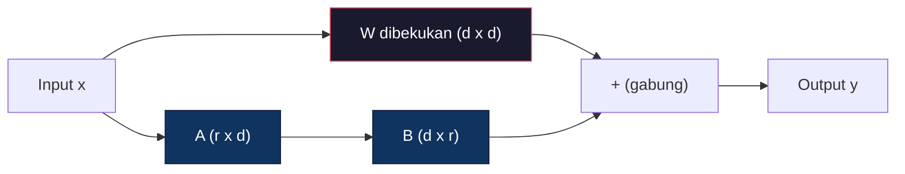
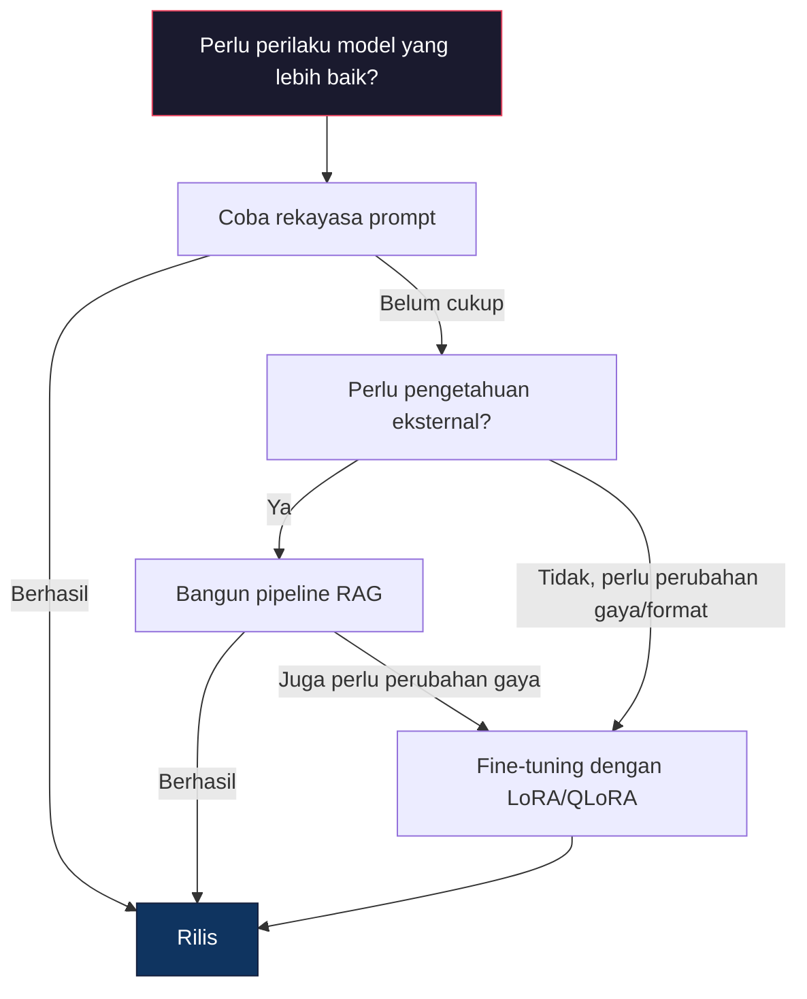

# Fine-Tuning dengan LoRA & QLoRA

> Fine-tuning penuh model 7B memerlukan 56 GB VRAM. Anda tidak memilikinya. Perusahaan kebanyakan juga tidak. LoRA memungkinkan Anda melakukan fine-tuning model yang sama dalam 6 GB dengan melatih kurang dari 1% parameter. Ini bukan kompromi -- pada sebagian besar tugas, kualitasnya setara dengan fine-tuning penuh. Seluruh ekosistem fine-tuning open-source berjalan pada satu trik ini.

**Jenis:** Bangun
**Bahasa:** Python
**Prasyarat:** Fase 10, Pelajaran 06 (Instruction Tuning / SFT)
**Waktu:** ~75 menit
**Terkait:** Fase 10 membahas loop SFT/DPO dari awal. Pelajaran ini menghubungkannya dengan toolkit PEFT 2026 (PEFT, TRL, Unsloth, Axolotl, LLaMA-Factory).

## Tujuan Pembelajaran

- Terapkan LoRA dengan menyuntikkan matriks adapter peringkat-rendah (A dan B) ke lapisan atensi model pra-pelatihan
- Hitung penghematan parameter LoRA dibanding fine-tuning penuh: pangkat $r$ dengan dimensi $d_{\text{model}}$ melatih $2 \cdot r \cdot d$ parameter alih-alih $d^2$
- Lakukan fine-tuning model menggunakan QLoRA (basis terkuantisasi 4-bit + adapter LoRA) agar muat dalam memori GPU konsumen
- Gabungkan bobot LoRA kembali ke model dasar untuk deployment dan bandingkan kecepatan inferensi dengan dan tanpa adapter

## Masalah

Anda memiliki model dasar. Llama 3 8B. Anda ingin model itu menjawab tiket dukungan pelanggan dengan gaya bicara perusahaan Anda. SFT adalah jawabannya. Tetapi SFT memiliki masalah biaya.

Fine-tuning penuh memperbarui setiap parameter dalam model. Llama 3 8B memiliki 8 miliar parameter. Dalam fp16, setiap parameter memakan 2 byte. Itu 16 GB hanya untuk memuat bobot. Saat pelatihan, Anda juga memerlukan gradien (16 GB), status optimizer Adam (32 GB untuk momentum + varians), dan aktivasi. Total: sekitar 56 GB VRAM untuk satu model 8B.

A100 80GB hanya cukup untuk menampungnya. Dua A100 berbiaya $3-4/jam di penyedia cloud. Pelatihan 3 epoch pada 50.000 contoh memakan 6-10 jam. Itu $30-40 per eksperimen. Jalankan 10 eksperimen untuk mendapatkan hyperparameter yang tepat dan Anda telah menghabiskan $400 sebelum melakukan deployment apa pun.

Skalakan ke Llama 3 70B dan angkanya menjadi absurd. 140 GB hanya untuk bobot. Anda memerlukan klaster. $100+ per eksperimen.

Ada masalah yang lebih mendalam juga. Fine-tuning penuh mengubah setiap bobot dalam model. Jika Anda melakukan fine-tuning pada data dukungan pelanggan, Anda bisa menurunkan kemampuan umum model. Ini disebut catastrophic forgetting. Model menjadi lebih baik pada tugas Anda dan lebih buruk pada segalanya yang lain.

Anda memerlukan metode yang melatih lebih sedikit parameter, memakai lebih sedikit memori, dan tidak merusak pengetahuan yang sudah ada pada model.

## Konsep

### LoRA: Adaptasi Peringkat-Rendah

Edward Hu dan rekan-rekan di Microsoft mempublikasikan LoRA pada Juni 2021. Wawasan makalah ini: pembaruan bobot saat fine-tuning memiliki peringkat intrinsik yang rendah. Anda tidak perlu memperbarui semua 16,7 juta parameter dalam matriks bobot 4096x4096. Informasi berguna dalam pembaruan itu dapat ditangkap oleh matriks berperingkat 16 atau 32.

Berikut matematikanya. Lapisan linear standar menghitung:

```math
y = Wx
```

Di mana $W$ adalah matriks $d_{\text{out}} \times d_{\text{in}}$. Untuk proyeksi atensi 4096x4096, itu 16.777.216 parameter.

LoRA membekukan $W$ dan menambahkan dekomposisi peringkat-rendah:

```math
y = Wx + BAx
```

Di mana $B$ berukuran $(d_{\text{out}} \times r)$ dan $A$ berukuran $(r \times d_{\text{in}})$. Peringkat $r$ jauh lebih kecil daripada $d$ -- biasanya 8, 16, atau 32.

Untuk $r=16$ pada lapisan 4096x4096:
- Parameter awal: 4096 x 4096 = 16.777.216
- Parameter LoRA: (4096 x 16) + (16 x 4096) = 65.536 + 65.536 = 131.072
- Pengurangan: 131.072 / 16.777.216 = 0,78%

Anda melatih 0,78% parameter dan mendapatkan 95-100% kualitas.



A diinisialisasi dengan Gaussian acak. B diinisialisasi dengan nol. Ini berarti kontribusi LoRA dimulai dari nol -- model mulai berlatih dari perilaku asalnya dan mempelajari adaptasi secara bertahap.

### Faktor Skala: Alpha

LoRA memperkenalkan faktor skala $\alpha$ yang mengontrol seberapa besar pembaruan peringkat-rendah memengaruhi keluaran:

```math
y = Wx + \frac{\alpha}{r} \cdot BAx
```

Ketika $\alpha = r$, skalanya 1x. Ketika $\alpha = 2r$ (default yang umum), skalanya 2x. Hyperparameter ini mengontrol laju pembelajaran jalur LoRA secara terpisah dari laju pembelajaran dasar.

Pedoman praktis:
- $\alpha = 2 \cdot \text{rank}$ adalah konvensi umum komunitas (makalah asli menggunakan $\alpha = \text{rank}$ pada sebagian besar eksperimen)
- $\alpha = \text{rank}$ memberi skala 1x, konservatif tetapi stabil
- $\alpha$ lebih tinggi berarti pembaruan lebih besar per langkah, yang dapat mempercepat konvergensi atau menyebabkan ketidakstabilan

### Di Mana Menerapkan LoRA

Transformer memiliki banyak lapisan linear. Anda tidak perlu menambahkan LoRA ke semuanya. Makalah asli menguji kombinasi yang berbeda:

| Lapisan target | Parameter terlatih (7B) | Kualitas |
|--------------|----------------------|---------|
| q_proj saja | 4,7 jt | Baik |
| q_proj + v_proj | 9,4 jt | Lebih baik |
| q_proj + k_proj + v_proj + o_proj | 18,9 jt | Terbaik untuk atensi |
| Semua linear (atensi + MLP) | 37,7 jt | Perolehan marjinal, 2x parameter |

Titik manis untuk sebagian besar tugas: q_proj + v_proj. Ini menargetkan proyeksi query dan value dalam self-attention, yang mengontrol apa yang diberi atensi model dan informasi apa yang diekstraknya. Menambahkan lapisan MLP membantu untuk tugas kompleks seperti generasi kode tetapi menggandakan jumlah parameter dengan perolehan yang semakin kecil pada tugas sederhana.

### Pemilihan Peringkat

Peringkat $r$ mengontrol ekspresivitas adaptasi:

| Peringkat | Parameter terlatih (per lapisan) | Paling cocok untuk |
|------|---------------------------|----------|
| 4 | 32.768 | Klasifikasi sederhana, sentimen |
| 8 | 65.536 | Tanya-jawab satu domain, ringkasan |
| 16 | 131.072 | Tugas multi-domain, mengikuti instruksi |
| 32 | 262.144 | Penalaran kompleks, generasi kode |
| 64 | 524.288 | Perolehan menurun untuk sebagian besar tugas |
| 128 | 1.048.576 | Jarang beralasan |

Hu et al. menunjukkan bahwa $r=4$ sudah menangkap sebagian besar adaptasi untuk tugas sederhana. $r=8$ dan $r=16$ adalah pilihan paling umum dalam praktik. Melampaui $r=64$ jarang meningkatkan kualitas dan mulai menghilangkan keunggulan memori LoRA.

### QLoRA: Kuantisasi 4-Bit + LoRA

Tim Dettmers dan rekan-rekan di University of Washington mempublikasikan QLoRA pada Mei 2023. Gagasannya: kuantisasi model dasar yang dibekukan ke presisi 4-bit, lalu pasang adapter LoRA dalam fp16 di atasnya.

Ini mengubah persamaan memori secara drastis:

| Metode | Memori bobot (7B) | Memori pelatihan (7B) | GPU yang diperlukan |
|--------|-------------------|---------------------|-------------|
| Fine-tuning penuh (fp16) | 14 GB | ~56 GB | 1x A100 80GB |
| LoRA (basis fp16) | 14 GB | ~18 GB | 1x A100 40GB |
| QLoRA (basis 4-bit) | 3,5 GB | ~6 GB | 1x RTX 3090 24GB |

QLoRA memberikan tiga kontribusi teknis:

**NF4 (Normal Float 4-bit)**: jenis data baru yang dirancang khusus untuk bobot jaringan saraf. Bobot jaringan saraf mengikuti distribusi yang kurang lebih normal. NF4 menempatkan 16 level kuantisasinya pada kuantil distribusi normal standar. Ini optimal secara informasi-teoretis untuk data berdistribusi normal. Kehilangan informasi lebih kecil daripada kuantisasi 4-bit seragam (INT4) maupun Float4 standar.

**Kuantisasi ganda**: konstanta kuantisasi sendiri memakan memori. Setiap blok 64 bobot memerlukan faktor skala fp32 (4 byte). Untuk model 7B, itu tambahan 0,4 GB. Kuantisasi ganda mengkuantisasi konstanta ini menjadi fp8, mengurangi overhead menjadi 0,1 GB. Kecil, tetapi terus bertambah.

**Optimizer halaman**: saat pelatihan, status optimizer (momentum dan varians Adam) dapat melebihi memori GPU pada urutan panjang. Optimizer halaman menggunakan unified memory NVIDIA untuk otomatis memindahkan status optimizer ke RAM CPU ketika memori GPU habis, dan memindahkannya kembali saat dibutuhkan. Ini mencegah crash OOM dengan mengorbankan sebagian throughput.

### Pertanyaan Kualitas

Apakah mengurangi parameter atau mengkuantisasi basis merusak kualitas? Hasil dari beberapa makalah:

| Metode | MMLU (5-shot) | MT-Bench | HumanEval |
|--------|--------------|----------|-----------|
| Fine-tuning penuh (Llama 2 7B) | 48.3 | 6.72 | 14.6 |
| LoRA r=16 | 47.9 | 6.68 | 14.0 |
| QLoRA r=16 (NF4) | 47.5 | 6.61 | 13.4 |
| QLoRA r=64 (NF4) | 48.1 | 6.70 | 14.2 |

LoRA pada $r=16$ berada dalam 1% dari fine-tuning penuh pada sebagian besar benchmark. QLoRA pada $r=16$ kehilangan sepersekian persen lagi. QLoRA pada $r=64$ pada dasarnya setara dengan fine-tuning penuh sambil memakai memori 90% lebih sedikit.

### Biaya Dunia Nyata

Fine-tuning Llama 3 8B pada 50.000 contoh (3 epoch):

| Metode | GPU | Waktu | Biaya |
|--------|-----|------|------|
| Fine-tuning penuh | 2x A100 80GB | 8 jam | ~$32 |
| LoRA r=16 | 1x A100 40GB | 4 jam | ~$8 |
| QLoRA r=16 | 1x RTX 4090 24GB | 6 jam | ~$5 |
| QLoRA r=16 (Unsloth) | 1x RTX 4090 24GB | 2,5 jam | ~$2 |
| QLoRA r=16 | 1x T4 16GB | 12 jam | ~$4 |

QLoRA pada satu GPU konsumen biayanya kurang dari harga makan siang. Inilah sebabnya komunitas fine-tuning bobot-terbuka meledak pada 2023 dan mengapa setiap kerangka pelatihan di bawah ini menyertakan QLoRA secara default pada 2026.

### Tumpukan PEFT 2026

| Kerangka | Apa itu | Pilih ketika |
|-----------|-----------|-----------|
| **Hugging Face PEFT** | Pustaka LoRA/QLoRA/DoRA/IA3 kanonik | Anda menginginkan kontrol penuh dan loop pelatihan Anda sudah menggunakan `transformers.Trainer` |
| **TRL** | Pelatih reinforcement-from-feedback dari HF (SFT, DPO, GRPO, PPO, ORPO) | Anda memerlukan DPO/GRPO setelah SFT; dibangun di atas PEFT |
| **Unsloth** | Penulisan ulang forward/backward dengan kernel Triton | Anda menginginkan percepatan 2-5x + VRAM setengahnya tanpa kehilangan akurasi; keluarga Llama/Mistral/Qwen |
| **Axolotl** | Pembungkus konfigurasi YAML di atas PEFT + TRL + DeepSpeed + Unsloth | Anda menginginkan pelatihan yang dapat direproduksi dan terkontrol versinya |
| **LLaMA-Factory** | GUI/CLI/API di atas PEFT + TRL | Anda menginginkan fine-tuning tanpa kode; 100+ keluarga model didukung |
| **torchtune** | Resep PyTorch native, tanpa dependensi `transformers` | Anda menginginkan dependensi minimal dan organisasi Anda sudah menstandarkan PyTorch |

Aturan praktis: untuk riset atau eksperimen sekali pakai → PEFT. Pipeline produksi yang dapat diulang → Axolotl dengan kernel Unsloth aktif. Prototyping buangan → LLaMA-Factory.

### Penggabungan Adapter

Setelah pelatihan, Anda memiliki dua hal: model dasar yang dibekukan dan adapter LoRA kecil (biasanya 10-100 MB). Anda dapat:

1. **Menyimpannya terpisah**: muat model dasar, muat adapter di atasnya. Tukar adapter untuk tugas berbeda. Ini cara Anda melayani beberapa varian hasil fine-tuning dari satu model dasar.

2. **Menggabungkannya secara permanen**: hitung $W' = W + (\alpha/r) \cdot BA$ dan simpan hasilnya sebagai model lengkap baru. Model yang digabungkan berukuran sama dengan yang asli. Tanpa overhead inferensi. Tanpa adapter yang perlu dikelola.

Untuk melayani beberapa tugas (adapter dukungan pelanggan, adapter kode, adapter terjemahan), simpan terpisah. Untuk deployment satu model khusus, gabungkan.

Teknik penggabungan lanjutan untuk mengombinasikan beberapa adapter:

- **TIES-Merging** (Yadav et al. 2023): memangkas parameter ber-magnitudo kecil, menyelesaikan konflik tanda, lalu menggabungkan. Mengurangi interferensi antaradapter.
- **DARE** (Yu et al. 2023): secara acak membuang parameter adapter sebelum menggabungkan dan menskalakan ulang sisanya. Efektif secara mengejutkan untuk mengombinasikan kemampuan.
- **Aritmetika tugas**: cukup tambahkan atau kurangi bobot adapter. Menambahkan adapter "code" dan adapter "math" sering menghasilkan model yang baik di keduanya.

### Kapan TIDAK Melakukan Fine-Tuning

Fine-tuning adalah opsi ketiga, bukan pertama.

**Pertama: rekayasa prompt.** Tulis system prompt yang lebih baik. Tambahkan contoh few-shot. Gunakan chain-of-thought. Ini tidak memakan biaya dan hanya perlu beberapa menit. Jika prompting membawa Anda hingga 80% tujuan, Anda kemungkinan besar tidak perlu fine-tuning.

**Kedua: RAG.** Jika model perlu mengetahui data spesifik Anda (dokumen, basis pengetahuan, katalog produk), pengambilan lebih murah dan lebih mudah dipelihara daripada menanamnya ke dalam bobot. Lihat Pelajaran 06.

**Ketiga: fine-tuning.** Gunakan ini ketika Anda memerlukan model mengadopsi gaya, format, atau pola penalaran tertentu yang tidak bisa dicapai hanya dengan prompting. Saat Anda memerlukan keluaran terstruktur yang konsisten. Saat Anda perlu mendistilasi model besar menjadi lebih kecil. Saat latensi penting dan Anda tidak mampu membayar token ekstra dari prompting few-shot.



```figure
lora-params
```

## Bangun

Kita mengimplementasikan LoRA dari awal dengan PyTorch murni. Tanpa pustaka. Tanpa sihir. Anda akan membangun lapisan LoRA, menyuntikkannya ke dalam model, melatihnya, dan menggabungkan kembali bobotnya.

### Langkah 1: Lapisan LoRA

```python
import torch
import torch.nn as nn
import math

class LoRALayer(nn.Module):
    def __init__(self, in_features, out_features, rank=8, alpha=16):
        super().__init__()
        self.rank = rank
        self.alpha = alpha
        self.scaling = alpha / rank

        self.A = nn.Parameter(torch.randn(in_features, rank) * (1 / math.sqrt(rank)))
        self.B = nn.Parameter(torch.zeros(rank, out_features))

    def forward(self, x):
        return (x @ self.A @ self.B) * self.scaling
```

A diinisialisasi dengan nilai acak berskala. B diinisialisasi dengan nol. Hasil kali BA dimulai dari nol, sehingga model mulai dengan perilaku asalnya.

### Langkah 2: Lapisan Linear Berbungkus LoRA

```python
class LinearWithLoRA(nn.Module):
    def __init__(self, linear, rank=8, alpha=16):
        super().__init__()
        self.linear = linear
        self.lora = LoRALayer(
            linear.in_features, linear.out_features, rank, alpha
        )

        for param in self.linear.parameters():
            param.requires_grad = False

    def forward(self, x):
        return self.linear(x) + self.lora(x)
```

Lapisan linear asli dibekukan. Hanya parameter LoRA (A dan B) yang dapat dilatih.

### Langkah 3: Menyuntikkan LoRA ke dalam Model

```python
def inject_lora(model, target_modules, rank=8, alpha=16):
    for param in model.parameters():
        param.requires_grad = False

    lora_layers = {}
    for name, module in model.named_modules():
        if isinstance(module, nn.Linear):
            if any(t in name for t in target_modules):
                parent_name = ".".join(name.split(".")[:-1])
                child_name = name.split(".")[-1]
                parent = dict(model.named_modules())[parent_name]
                lora_linear = LinearWithLoRA(module, rank, alpha)
                setattr(parent, child_name, lora_linear)
                lora_layers[name] = lora_linear
    return lora_layers
```

Pertama, bekukan setiap parameter dalam model. Lalu telusuri pohon model, temukan lapisan linear yang cocok dengan nama target Anda, dan ganti dengan versi berbungkus LoRA. Matriks LoRA A dan B adalah satu-satunya parameter yang dapat dilatih di seluruh model.

### Langkah 4: Menghitung Parameter

```python
def count_parameters(model):
    total = sum(p.numel() for p in model.parameters())
    trainable = sum(p.numel() for p in model.parameters() if p.requires_grad)
    frozen = total - trainable
    return {
        "total": total,
        "trainable": trainable,
        "frozen": frozen,
        "trainable_pct": 100 * trainable / total if total > 0 else 0
    }
```

### Langkah 5: Menggabungkan Kembali Bobot

```python
def merge_lora_weights(model):
    for name, module in model.named_modules():
        if isinstance(module, LinearWithLoRA):
            with torch.no_grad():
                merged = (
                    module.lora.A @ module.lora.B
                ) * module.lora.scaling
                module.linear.weight.data += merged.T
            parent_name = ".".join(name.split(".")[:-1])
            child_name = name.split(".")[-1]
            if parent_name:
                parent = dict(model.named_modules())[parent_name]
            else:
                parent = model
            setattr(parent, child_name, module.linear)
```

Setelah penggabungan, lapisan LoRA hilang. Model berukuran sama dengan semula dengan adaptasi tertanam dalam bobot. Tanpa overhead inferensi.

### Langkah 6: Simulasi Kuantisasi QLoRA

```python
def quantize_to_nf4(tensor, block_size=64):
    blocks = tensor.reshape(-1, block_size)
    scales = blocks.abs().max(dim=1, keepdim=True).values / 7.0
    scales = torch.clamp(scales, min=1e-8)
    quantized = torch.round(blocks / scales).clamp(-8, 7).to(torch.int8)
    return quantized, scales

def dequantize_from_nf4(quantized, scales, original_shape):
    dequantized = quantized.float() * scales
    return dequantized.reshape(original_shape)
```

Ini menyimulasikan kuantisasi 4-bit dengan memetakan bobot ke 16 level diskret dalam blok 64. QLoRA produksi menggunakan pustaka bitsandbytes untuk NF4 sungguhan di GPU.

### Langkah 7: Loop Pelatihan

```python
def train_lora(model, data, epochs=5, lr=1e-3, batch_size=4):
    optimizer = torch.optim.AdamW(
        [p for p in model.parameters() if p.requires_grad], lr=lr
    )
    criterion = nn.MSELoss()

    losses = []
    for epoch in range(epochs):
        epoch_loss = 0.0
        n_batches = 0
        indices = torch.randperm(len(data["inputs"]))

        for i in range(0, len(indices), batch_size):
            batch_idx = indices[i:i + batch_size]
            x = data["inputs"][batch_idx]
            y = data["targets"][batch_idx]

            output = model(x)
            loss = criterion(output, y)

            optimizer.zero_grad()
            loss.backward()
            optimizer.step()

            epoch_loss += loss.item()
            n_batches += 1

        avg_loss = epoch_loss / n_batches
        losses.append(avg_loss)

    return losses
```

### Langkah 8: Demo Lengkap

```python
def demo():
    torch.manual_seed(42)
    d_model = 256
    n_classes = 10

    model = nn.Sequential(
        nn.Linear(d_model, 512),
        nn.ReLU(),
        nn.Linear(512, 512),
        nn.ReLU(),
        nn.Linear(512, n_classes),
    )

    n_samples = 500
    x = torch.randn(n_samples, d_model)
    y = torch.randint(0, n_classes, (n_samples,))
    y_onehot = torch.zeros(n_samples, n_classes).scatter_(1, y.unsqueeze(1), 1.0)

    data = {"inputs": x, "targets": y_onehot}

    params_before = count_parameters(model)

    lora_layers = inject_lora(
        model, target_modules=["0", "2"], rank=8, alpha=16
    )

    params_after = count_parameters(model)

    losses = train_lora(model, data, epochs=20, lr=1e-3)

    merge_lora_weights(model)
    params_merged = count_parameters(model)

    return {
        "params_before": params_before,
        "params_after": params_after,
        "params_merged": params_merged,
        "losses": losses,
    }
```

Demo ini membuat model kecil, menyuntikkan LoRA ke dua lapisan, melatihnya, dan menggabungkan kembali bobotnya. Jumlah parameter turun dari semua-dapat-dilatih menjadi ~1% dapat-dilatih selama pelatihan LoRA, lalu kembali ke arsitektur semula setelah penggabungan.

## Gunakan

Dengan ekosistem Hugging Face, LoRA pada model sungguhan hanya perlu sekitar 20 baris:

```python
from transformers import AutoModelForCausalLM, AutoTokenizer
from peft import LoraConfig, get_peft_model, TaskType

model = AutoModelForCausalLM.from_pretrained("meta-llama/Llama-3.1-8B")
tokenizer = AutoTokenizer.from_pretrained("meta-llama/Llama-3.1-8B")

lora_config = LoraConfig(
    task_type=TaskType.CAUSAL_LM,
    r=16,
    lora_alpha=32,
    lora_dropout=0.05,
    target_modules=["q_proj", "v_proj"],
)

model = get_peft_model(model, lora_config)
model.print_trainable_parameters()
```

Untuk QLoRA, tambahkan kuantisasi bitsandbytes:

```python
from transformers import BitsAndBytesConfig

bnb_config = BitsAndBytesConfig(
    load_in_4bit=True,
    bnb_4bit_quant_type="nf4",
    bnb_4bit_compute_dtype=torch.bfloat16,
    bnb_4bit_use_double_quant=True,
)

model = AutoModelForCausalLM.from_pretrained(
    "meta-llama/Llama-3.1-8B",
    quantization_config=bnb_config,
    device_map="auto",
)

model = get_peft_model(model, lora_config)
```

Itu saja. Loop pelatihan yang sama. Pipeline data yang sama. Model dasar kini hidup dalam 4-bit, adapter LoRA dilatih dalam fp16, dan semuanya muat dalam 6 GB.

Untuk pelatihan dengan Trainer Hugging Face:

```python
from transformers import TrainingArguments, Trainer
from datasets import load_dataset

dataset = load_dataset("tatsu-lab/alpaca", split="train[:5000]")

training_args = TrainingArguments(
    output_dir="./lora-llama",
    num_train_epochs=3,
    per_device_train_batch_size=4,
    gradient_accumulation_steps=4,
    learning_rate=2e-4,
    fp16=True,
    logging_steps=10,
    save_strategy="epoch",
    optim="paged_adamw_8bit",
)

trainer = Trainer(
    model=model,
    args=training_args,
    train_dataset=dataset,
)

trainer.train()

model.save_pretrained("./lora-adapter")
```

Adapter yang disimpan berukuran 10-100 MB. Model dasar tetap utuh. Anda dapat membagikan adapter di Hugging Face Hub tanpa mendistribusikan ulang model lengkapnya.

## Rilis

Pelajaran ini menghasilkan:
- `outputs/prompt-lora-advisor.md` -- prompt yang membantu Anda memutuskan pangkat LoRA, modul target, dan hyperparameter untuk tugas spesifik Anda
- `outputs/skill-fine-tuning-guide.md` -- skill yang mengajarkan agen pohon keputusan kapan dan bagaimana melakukan fine-tuning

## Latihan

1. **Studi ablasi pangkat.** Jalankan demo dengan pangkat 2, 4, 8, 16, 32, dan 64. Plot rugi akhir terhadap pangkat. Temukan titik pengembalian menurun di mana menggandakan pangkat tidak lagi mengurangi rugi separuhnya. Untuk tugas klasifikasi sederhana pada fitur 256 dimensi, ini seharusnya sekitar r=8-16.

2. **Perbandingan modul target.** Ubah inject_lora agar hanya menargetkan lapisan "0", hanya lapisan "2", hanya lapisan "4", dan ketiganya. Latih setiap varian selama 20 epoch. Bandingkan kecepatan konvergensi dan rugi akhir. Ini mencerminkan keputusan nyata antara q_proj vs v_proj vs semua lapisan linear.

3. **Analisis galat kuantisasi.** Ambil matriks bobot model terlatih sebelum dan sesudah quantize_to_nf4 / dequantize_from_nf4. Hitung mean squared error, galat absolut maksimum, dan korelasi antara bobot asli dan hasil rekonstruksi. Eksperimen dengan nilai block_size 32, 64, 128, dan 256.

4. **Penyajian multi-adapter.** Latih dua adapter LoRA pada subset data yang berbeda (indeks genap vs indeks ganjil). Simpan keduanya. Muat model dasar sekali, lalu tukar adapter dan verifikasi bahwa keduanya menghasilkan keluaran berbeda pada input yang sama. Ini cara sistem produksi melayani beberapa model hasil fine-tuning dari satu basis.

5. **Inferensi tergabung vs tidak tergabung.** Bandingkan keluaran model LoRA sebelum dan sesudah merge_lora_weights pada 100 input yang sama. Verifikasi bahwa keluarannya identik (dalam toleransi floating-point 1e-5). Lalu ukur kecepatan inferensi keduanya -- yang tergabung seharusnya sedikit lebih cepat karena satu perkalian matriks alih-alih dua.

## Istilah Kunci

| Istilah | Yang orang katakan | Arti sebenarnya |
|------|----------------|----------------------|
| LoRA | "Fine-tuning efisien" | Adaptasi Peringkat-Rendah: bekukan bobot dasar, latih dua matriks kecil A dan B yang hasil kalinya mendekati pembaruan bobot penuh |
| QLoRA | "Fine-tuning di laptop" | LoRA terkuantisasi: muat model dasar dalam NF4 4-bit, latih adapter LoRA dalam fp16 di atasnya, memungkinkan fine-tuning 7B dalam 6 GB VRAM |
| Peringkat (r) | "Seberapa banyak model bisa belajar" | Dimensi dalam matriks A dan B; mengontrol ekspresivitas versus jumlah parameter |
| Alpha | "Laju pembelajaran LoRA" | Faktor skala yang diterapkan pada keluaran LoRA; $\alpha/r$ menskalakan kontribusi adaptasi pada keluaran akhir |
| NF4 | "Kuantisasi 4-bit" | Normal Float 4: jenis data 4-bit dengan level kuantisasi pada kuantil distribusi normal, optimal untuk bobot jaringan saraf |
| Adapter | "Bagian kecil yang terlatih" | Matriks A dan B LoRA yang disimpan sebagai berkas terpisah (10-100 MB), dapat dimuat di atas salinan model dasar mana pun |
| Modul target | "Lapisan mana yang diberi LoRA" | Lapisan linear spesifik (q_proj, v_proj, dll.) tempat adapter LoRA disuntikkan |
| Penggabungan | "Tanamkan ke dalam" | Menghitung $W + (\alpha/r) \cdot BA$ dan menggantikan bobot asli, menghilangkan overhead adapter saat inferensi |
| Optimizer halaman | "Jangan OOM saat pelatihan" | Memindahkan status optimizer (momentum, varians Adam) ke CPU ketika memori GPU habis |
| Catastrophic forgetting | "Fine-tuning merusak hal lain" | Saat pembaruan semua bobot menyebabkan model kehilangan kemampuan yang dipelajari sebelumnya |

## Bacaan Lanjutan

- Hu et al., "LoRA: Low-Rank Adaptation of Large Language Models" (2021) -- makalah asli yang memperkenalkan metode dekomposisi peringkat-rendah, diuji pada GPT-3 175B dengan peringkat serendah 4
- Dettmers et al., "QLoRA: Efficient Finetuning of Quantized Language Models" (2023) -- memperkenalkan NF4, kuantisasi ganda, dan optimizer halaman, memungkinkan fine-tuning 65B pada satu GPU 48GB
- Dokumentasi pustaka PEFT (huggingface.co/docs/peft) -- pustaka standar untuk LoRA, QLoRA, dan metode efisien-parameter lainnya dalam ekosistem Hugging Face
- Yadav et al., "TIES-Merging: Resolving Interference When Merging Models" (2023) -- teknik untuk mengombinasikan beberapa adapter LoRA tanpa penurunan kualitas
- [Rafailov et al., "Direct Preference Optimization: Your Language Model is Secretly a Reward Model" (NeurIPS 2023)](https://arxiv.org/abs/2305.18290) -- derivasi DPO; tahap penyetelan preferensi yang mengikuti SFT, tanpa memerlukan model hadiah.
- [Dokumentasi TRL](https://huggingface.co/docs/trl/) -- referensi resmi untuk `SFTTrainer`, `DPOTrainer`, `KTOTrainer`, serta antarmuka integrasi dengan PEFT/bitsandbytes/Unsloth.
- [Dokumentasi Unsloth](https://docs.unsloth.ai/) -- kernel fusi yang menggandakan throughput fine-tuning dan membagi dua memori; lapisan kinerja di bawah TRL.
- [Dokumentasi Axolotl](https://axolotl-ai-cloud.github.io/axolotl/) -- pelatih SFT/DPO/QLoRA multi-GPU berkonfigurasi YAML; alternatif konfigurasi-sebagai-kode dibanding skrip yang ditulis manual.
