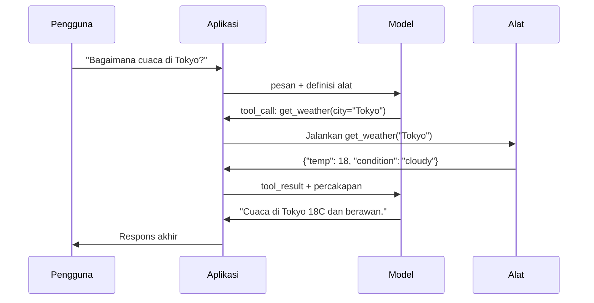

# Function Calling & Penggunaan Alat

> LLM tidak bisa melakukan apa pun. Mereka menghasilkan teks. Itu saja seluruh kemampuannya. Mereka tidak dapat mengecek cuaca, mengkueri basis data, mengirim email, menjalankan kode, atau membaca berkas. Setiap "agen AI" yang pernah Anda lihat adalah sebuah LLM yang menghasilkan JSON yang menyebutkan fungsi mana yang harus dipanggil -- lalu kode Anda yang benar-benar memanggilnya. Model adalah otaknya. Alat adalah tangannya. Function calling adalah sistem saraf yang menghubungkan keduanya.

**Jenis:** Build
**Bahasa:** Python
**Prasyarat:** Fase 11 Pelajaran 03 (Structured Outputs)
**Waktu:** ~75 menit
**Terkait:** Fase 11 · 14 (Model Context Protocol) -- ketika sebuah alat digunakan bersama oleh banyak host, beralihlah dari function calling sebaris ke server MCP. Pelajaran ini membahas kasus sebaris; MCP membahas kasus protokol.

## Tujuan Pembelajaran

- Implementasikan loop function calling: definisikan skema alat, uraikan JSON pemanggilan alat dari model, jalankan fungsi, dan kembalikan hasilnya
- Rancang skema alat dengan deskripsi yang jelas dan parameter bertipe yang dapat dipanggil secara andal oleh model
- Bangun loop agen multi-giliran yang merangkai beberapa pemanggilan fungsi untuk menjawab kueri kompleks
- Tangani kasus tepi function calling: pemanggilan alat paralel, propagasi galat, dan pencegahan loop alat tak berhenti

## Masalah

Anda membangun sebuah chatbot. Seorang pengguna bertanya: "Bagaimana cuaca di Tokyo sekarang?"

Model menjawab: "Saya tidak memiliki akses ke data cuaca real-time, tetapi berdasarkan musimnya, Tokyo kemungkinan sekitar 15 derajat Celsius..."

Itu adalah halusinasi yang dibungkus dengan penafian. Model tidak tahu cuacanya. Model tidak akan pernah tahu. Cuaca berubah setiap jam. Data latihan model sudah berusia berbulan-bulan.

Jawaban yang benar memerlukan pemanggilan API OpenWeatherMap, mengambil suhu saat ini, dan mengembalikan angka yang sebenarnya. Model tidak dapat memanggil API. Kode Anda dapat. Bagian yang hilang: sebuah protokol terstruktur yang memungkinkan model mengatakan "saya perlu memanggil API cuaca dengan argumen-argumen ini" dan memungkinkan kode Anda mengeksekusinya serta mengembalikan hasilnya.

Inilah function calling. Model mengeluarkan JSON terstruktur yang mendeskripsikan fungsi mana yang harus dipanggil dengan argumen apa. Aplikasi Anda mengeksekusi fungsi tersebut. Hasilnya masuk kembali ke percakapan. Model menggunakan hasil itu untuk menghasilkan jawaban akhirnya.

Tanpa function calling, LLM adalah ensiklopedia. Dengan function calling, LLM menjadi agen.

## Konsep

### Loop Function Calling

Setiap interaksi penggunaan alat mengikuti loop 5 langkah yang sama.



Langkah 1: pengguna mengirim sebuah pesan. Langkah 2: model menerima pesan itu beserta definisi alat (JSON Schema yang mendeskripsikan fungsi-fungsi yang tersedia). Langkah 3: alih-alih merespons dengan teks, model mengeluarkan sebuah pemanggilan alat -- objek JSON terstruktur yang berisi nama fungsi dan argumennya. Langkah 4: kode Anda mengeksekusi fungsi dan menangkap hasilnya. Langkah 5: hasil dikirim kembali ke model, yang kini memiliki data nyata untuk menghasilkan jawaban akhir.

Model tidak pernah mengeksekusi apa pun. Model hanya memutuskan apa yang harus dipanggil dan dengan argumen apa. Kode Andalah yang menjadi pelaksananya.

### Definisi Alat: Kontrak JSON Schema

Setiap alat didefinisikan oleh sebuah JSON Schema yang memberi tahu model apa fungsi itu lakukan, argumen apa yang diperlukannya, dan tipe apa yang harus dimiliki argumen tersebut.

```json
{
  "type": "function",
  "function": {
    "name": "get_weather",
    "description": "Get current weather for a city. Returns temperature in Celsius and conditions.",
    "parameters": {
      "type": "object",
      "properties": {
        "city": {
          "type": "string",
          "description": "City name, e.g. 'Tokyo' or 'San Francisco'"
        },
        "units": {
          "type": "string",
          "enum": ["celsius", "fahrenheit"],
          "description": "Temperature units"
        }
      },
      "required": ["city"]
    }
  }
}
```

Kolom `description` sangat penting. Model membacanya untuk memutuskan kapan dan bagaimana menggunakan alat tersebut. Deskripsi yang kabur seperti "mendapatkan cuaca" menghasilkan pemilihan alat yang lebih buruk daripada "Ambil cuaca terkini untuk sebuah kota. Mengembalikan suhu dalam Celsius dan kondisinya." Deskripsi adalah prompt untuk pemilihan alat.

### Perbandingan Penyedia

Setiap penyedia besar mendukung function calling, tetapi permukaan API-nya berbeda.

| Penyedia | Parameter API | Format Pemanggilan Alat | Panggilan Paralel | Pemanggilan Wajib |
|----------|--------------|-----------------|---------------|----------------|
| OpenAI (GPT-5, o4) | `tools` | `tool_calls[].function` | Ya (beberapa per giliran) | `tool_choice="required"` |
| Anthropic (Claude 4.6/4.7) | `tools` | `content[].type="tool_use"` | Ya (beberapa blok) | `tool_choice={"type":"any"}` |
| Google (Gemini 3) | `function_declarations` | `functionCall` | Ya | `function_calling_config` |
| Open-weight (Llama 4, Qwen3, DeepSeek-V3) | `tools` native pada Llama 4; Hermes atau ChatML pada lainnya | Campuran | Bergantung model | Berbasis prompt atau `tool_choice` jika didukung |

Pada 2026, ketiga penyedia tertutup telah konvergen ke format berbasis JSON Schema yang hampir identik. Llama 4 hadir dengan kolom `tools` native yang mengikuti bentuk OpenAI. Fine-tuning open-weight masih beragam -- format Hermes (NousResearch) adalah yang paling umum untuk fine-tuning pihak ketiga. Untuk alat bersama lintas host, lebih baik gunakan MCP (Fase 11 · 14) daripada function calling sebaris -- servernya sama untuk semua host itu.

### Pilihan Alat: Auto, Wajib, Spesifik

Anda mengontrol kapan model menggunakan alat.

**Auto** (bawaan): model memutuskan apakah akan memanggil alat atau merespons langsung. "Berapa 2+2?" -- merespons langsung. "Bagaimana cuacanya?" -- memanggil alat.

**Wajib**: model harus memanggil setidaknya satu alat. Gunakan ini ketika Anda tahu niat pengguna memerlukan alat. Ini mencegah model menebak alih-alih mencari data nyata.

**Fungsi spesifik**: paksa model memanggil fungsi tertentu. `tool_choice={"type":"function", "function": {"name": "get_weather"}}` menjamin alat cuaca dipanggil, apa pun kuerinya. Gunakan ini untuk perutean -- ketika logika di hulu sudah menentukan alat mana yang dibutuhkan.

### Function Calling Paralel

GPT-4o dan Claude dapat memanggil beberapa fungsi dalam satu giliran. Seorang pengguna bertanya: "Bagaimana cuaca di Tokyo dan New York?" Model mengeluarkan dua pemanggilan alat secara bersamaan:

```json
[
  {"name": "get_weather", "arguments": {"city": "Tokyo"}},
  {"name": "get_weather", "arguments": {"city": "New York"}}
]
```

Kode Anda mengeksekusi keduanya (idealnya secara konkuren), mengembalikan kedua hasilnya, dan model menyusun satu respons gabungan. Ini memangkas perjalanan pulang-pergi dari 2 menjadi 1. Untuk agen dengan 5-10 pemanggilan alat per kueri, pemanggilan paralel mengurangi latensi sebesar 60-80%.

### Structured Outputs versus Function Calling

Pelajaran 03 membahas structured outputs. Function calling menggunakan mesin JSON Schema yang sama, tetapi untuk tujuan yang berbeda.

**Structured outputs**: memaksa model menghasilkan data dalam bentuk tertentu. Keluarannya adalah produk akhir. Contoh: mengekstrak informasi produk dari teks menjadi `{name, price, in_stock}`.

**Function calling**: model menyatakan niat untuk mengeksekusi sebuah aksi. Keluarannya adalah langkah antara. Contoh: `get_weather(city="Tokyo")` -- model meminta sebuah aksi, bukan menghasilkan jawaban akhir.

Gunakan structured outputs ketika Anda menginginkan ekstraksi data. Gunakan function calling ketika Anda ingin model berinteraksi dengan sistem eksternal.

### Keamanan: Aturan yang Tidak Bisa Ditawar

Function calling adalah kemampuan paling berbahaya yang bisa Anda berikan kepada LLM. Model yang memilih apa yang akan dieksekusi. Jika kumpulan alat Anda mencakup kueri basis data, model yang menyusun kuerinya. Jika mencakup perintah shell, model yang menuliskannya.

**Aturan 1: Jangan pernah meneruskan SQL hasil model langsung ke basis data.** Model dapat dan akan menghasilkan DROP TABLE, injeksi UNION, atau kueri yang mengembalikan setiap baris. Selalu gunakan parameterisasi. Selalu validasi. Selalu gunakan daftar putih operasi.

**Aturan 2: Buat daftar putih fungsi.** Model hanya dapat memanggil fungsi yang secara eksplisit Anda definisikan. Jangan pernah membangun alat generik "jalankan fungsi apa pun berdasarkan nama". Jika Anda memiliki 50 fungsi internal, ekspos hanya 5 yang dibutuhkan pengguna.

**Aturan 3: Validasi argumen.** Model bisa saja mengirim nama kota `"; DROP TABLE users; --"`. Validasi setiap argumen terhadap tipe, rentang, dan format yang diharapkan sebelum eksekusi.

**Aturan 4: Bersihkan hasil alat.** Jika sebuah alat mengembalikan data sensitif (kunci API, PII, galat internal), filterlah sebelum mengirimkannya kembali ke model. Model akan menyertakan hasil alat secara verbatim di dalam responsnya.

**Aturan 5: Batasi laju pemanggilan alat.** Model dalam loop dapat memanggil alat ratusan kali. Tetapkan batas maksimal (10-20 panggilan per percakapan sudah wajar). Putuskan loop tak berhenti.

### Penanganan Galat

Alat bisa gagal. API bisa mengalami waktu habis. Basis data bisa mati. Berkas bisa tidak ada. Model perlu tahu kapan sebuah alat gagal dan mengapa.

Kembalikan galat sebagai hasil alat terstruktur, bukan pengecualian:

```json
{
  "error": true,
  "message": "City 'Toky' not found. Did you mean 'Tokyo'?",
  "code": "CITY_NOT_FOUND"
}
```

Model membaca ini, menyesuaikan argumennya, dan mencoba lagi. Model sangat baik dalam memperbaiki diri dari pesan galat terstruktur. Model buruk dalam pulih dari respons kosong atau galat umum "ada yang salah".

### MCP: Model Context Protocol

MCP adalah standar terbuka dari Anthropic untuk interoperabilitas alat. Alih-alih setiap aplikasi mendefinisikan alatnya sendiri, MCP menyediakan protokol universal: alat-alat disajikan oleh server MCP dan dikonsumsi oleh klien MCP (seperti Claude Code, Cursor, atau aplikasi Anda).

Satu server MCP dapat mengekspos alat kepada klien kompatibel mana pun. Server MCP Postgres memberi agen apa pun akses basis data. Server MCP GitHub memberi agen apa pun akses repositori. Alat didefinisikan sekali, digunakan di mana-mana.

MCP terhadap function calling seperti HTTP terhadap jaringan. MCP membakukan lapisan transpor sehingga alat menjadi portabel.

```figure
mx-tool-call-loop
```

## Bangunlah

### Langkah 1: Definisikan Registri Alat

Bangun sebuah registri yang menyimpan definisi alat dan implementasinya. Setiap alat memiliki definisi JSON Schema (yang dilihat model) dan sebuah fungsi Python (yang dieksekusi kode Anda).

```python
import ast
import json
import math
import time
import hashlib


TOOL_REGISTRY = {}


def register_tool(name, description, parameters, function):
    TOOL_REGISTRY[name] = {
        "definition": {
            "type": "function",
            "function": {
                "name": name,
                "description": description,
                "parameters": parameters,
            },
        },
        "function": function,
    }
```

### Langkah 2: Implementasikan 5 Alat

Bangun kalkulator, pencarian cuaca, simulator pencarian web, pembaca berkas, dan penjalan kode.

```python
def calculator(expression, precision=2):
    allowed = set("0123456789+-*/.() ")
    if not all(c in allowed for c in expression):
        return {"error": True, "message": f"Invalid characters in expression: {expression}"}
    try:
        result = eval(expression, {"__builtins__": {}}, {"math": math})
        return {"result": round(float(result), precision), "expression": expression}
    except Exception as e:
        return {"error": True, "message": str(e)}


WEATHER_DB = {
    "tokyo": {"temp_c": 18, "condition": "cloudy", "humidity": 72, "wind_kph": 14},
    "new york": {"temp_c": 22, "condition": "sunny", "humidity": 45, "wind_kph": 8},
    "london": {"temp_c": 12, "condition": "rainy", "humidity": 88, "wind_kph": 22},
    "san francisco": {"temp_c": 16, "condition": "foggy", "humidity": 80, "wind_kph": 18},
    "sydney": {"temp_c": 25, "condition": "sunny", "humidity": 55, "wind_kph": 10},
}


def get_weather(city, units="celsius"):
    key = city.lower().strip()
    if key not in WEATHER_DB:
        suggestions = [c for c in WEATHER_DB if c.startswith(key[:3])]
        return {
            "error": True,
            "message": f"City '{city}' not found.",
            "suggestions": suggestions,
            "code": "CITY_NOT_FOUND",
        }
    data = WEATHER_DB[key].copy()
    if units == "fahrenheit":
        data["temp_f"] = round(data["temp_c"] * 9 / 5 + 32, 1)
        del data["temp_c"]
    data["city"] = city
    return data


SEARCH_DB = {
    "python function calling": [
        {"title": "OpenAI Function Calling Guide", "url": "https://platform.openai.com/docs/guides/function-calling", "snippet": "Learn how to connect LLMs to external tools."},
        {"title": "Anthropic Tool Use", "url": "https://docs.anthropic.com/en/docs/tool-use", "snippet": "Claude can interact with external tools and APIs."},
    ],
    "MCP protocol": [
        {"title": "Model Context Protocol", "url": "https://modelcontextprotocol.io", "snippet": "An open standard for connecting AI models to data sources."},
    ],
    "weather API": [
        {"title": "OpenWeatherMap API", "url": "https://openweathermap.org/api", "snippet": "Free weather API with current, forecast, and historical data."},
    ],
}


def web_search(query, max_results=3):
    key = query.lower().strip()
    for db_key, results in SEARCH_DB.items():
        if db_key in key or key in db_key:
            return {"query": query, "results": results[:max_results], "total": len(results)}
    return {"query": query, "results": [], "total": 0}


FILE_SYSTEM = {
    "data/config.json": '{"model": "gpt-4o", "temperature": 0.7, "max_tokens": 4096}',
    "data/users.csv": "name,email,role\nAlice,alice@example.com,admin\nBob,bob@example.com,user",
    "README.md": "# My Project\nA tool-use agent built from scratch.",
}


def read_file(path):
    if ".." in path or path.startswith("/"):
        return {"error": True, "message": "Path traversal not allowed.", "code": "FORBIDDEN"}
    if path not in FILE_SYSTEM:
        available = list(FILE_SYSTEM.keys())
        return {"error": True, "message": f"File '{path}' not found.", "available_files": available, "code": "NOT_FOUND"}
    content = FILE_SYSTEM[path]
    return {"path": path, "content": content, "size_bytes": len(content), "lines": content.count("\n") + 1}


def run_code(code, language="python"):
    if language != "python":
        return {"error": True, "message": f"Language '{language}' not supported. Only 'python' is available."}
    try:
        tree = ast.parse(code)
    except SyntaxError as e:
        return {"error": True, "message": f"SyntaxError: {e}", "code": "SYNTAX_ERROR"}
    unsafe_names = {"exec", "eval", "compile", "__import__", "open", "globals", "locals", "vars", "getattr", "setattr", "delattr"}
    for node in ast.walk(tree):
        if isinstance(node, (ast.Import, ast.ImportFrom)):
            return {"error": True, "message": "Forbidden operation: import is not allowed", "code": "SECURITY_VIOLATION"}
        if isinstance(node, ast.Attribute) and node.attr.startswith("__") and node.attr.endswith("__"):
            return {"error": True, "message": "Forbidden operation: dunder attribute access is not allowed", "code": "SECURITY_VIOLATION"}
        if isinstance(node, ast.Name) and node.id in unsafe_names:
            return {"error": True, "message": f"Forbidden operation: {node.id} is not allowed", "code": "SECURITY_VIOLATION"}
    try:
        local_vars = {}
        exec(code, {"__builtins__": {"print": print, "range": range, "len": len, "str": str, "int": int, "float": float, "list": list, "dict": dict, "sum": sum, "min": min, "max": max, "abs": abs, "round": round, "sorted": sorted, "enumerate": enumerate, "zip": zip, "map": map, "filter": filter, "math": math}}, local_vars)
        result = local_vars.get("result", None)
        return {"success": True, "result": result, "variables": {k: str(v) for k, v in local_vars.items() if not k.startswith("_")}}
    except Exception as e:
        return {"error": True, "message": f"{type(e).__name__}: {e}"}
```

Daftar hitungan substring membaca kode sebagai teks, sehingga meleset pada apa pun yang tidak dieja persis oleh pencocokan string. Mengurai kode menjadi pohon sintaks lalu menelusurinya memungkinkan penjaga menolak pernyataan `import`, akses atribut dunder (rantai `__class__` dan `__globals__` yang menjangkau kembali interpreter asli), dan nama builtin yang tidak aman berdasarkan struktur, bukan ejaan. Meski demikian, perlakukan ini sebagai filter pengajaran, bukan batas nyata. Penjaga apa pun yang berada dalam satu proses dengan kode yang dijalankannya berbagi interpreter dengan kode itu, dan pemanggil yang tekun tetap dapat menemukan objek yang dapat dijangkau. Sistem produksi menjalankan kode yang tidak dipercaya dalam proses atau kontainer terpisah (subproses dengan hak yang diturunkan, gVisor, Firecracker, atau penjalan kode terkelola), di mana upaya keluar (escape) hanya membawa penyerang ke kotak sekali pakai, bukan ke layanan Anda.

### Langkah 3: Daftarkan Semua Alat

```python
def register_all_tools():
    register_tool(
        "calculator", "Evaluate a mathematical expression. Supports +, -, *, /, parentheses, and decimals. Returns the numeric result.",
        {"type": "object", "properties": {"expression": {"type": "string", "description": "Math expression, e.g. '(10 + 5) * 3'"}, "precision": {"type": "integer", "description": "Decimal places in result", "default": 2}}, "required": ["expression"]},
        calculator,
    )
    register_tool(
        "get_weather", "Get current weather for a city. Returns temperature, condition, humidity, and wind speed.",
        {"type": "object", "properties": {"city": {"type": "string", "description": "City name, e.g. 'Tokyo' or 'San Francisco'"}, "units": {"type": "string", "enum": ["celsius", "fahrenheit"], "description": "Temperature units, defaults to celsius"}}, "required": ["city"]},
        get_weather,
    )
    register_tool(
        "web_search", "Search the web for information. Returns a list of results with title, URL, and snippet.",
        {"type": "object", "properties": {"query": {"type": "string", "description": "Search query"}, "max_results": {"type": "integer", "description": "Maximum results to return", "default": 3}}, "required": ["query"]},
        web_search,
    )
    register_tool(
        "read_file", "Read the contents of a file. Returns the file content, size, and line count.",
        {"type": "object", "properties": {"path": {"type": "string", "description": "Relative file path, e.g. 'data/config.json'"}}, "required": ["path"]},
        read_file,
    )
    register_tool(
        "run_code", "Run a small Python snippet behind a static-analysis guard and a restricted interpreter. This is a teaching filter, not real isolation. Set a 'result' variable to return output.",
        {"type": "object", "properties": {"code": {"type": "string", "description": "Python code to execute"}, "language": {"type": "string", "enum": ["python"], "description": "Programming language"}}, "required": ["code"]},
        run_code,
    )
```

### Langkah 4: Bangun Loop Function Calling

Ini adalah mesin intinya. Loop ini menyimulasikan model yang memutuskan alat mana akan dipanggil, mengeksekusi alat, dan mengembalikan hasilnya.

```python
def simulate_model_decision(user_message, tools, conversation_history):
    msg = user_message.lower()

    if any(word in msg for word in ["weather", "temperature", "forecast"]):
        cities = []
        for city in WEATHER_DB:
            if city in msg:
                cities.append(city)
        if not cities:
            for word in msg.split():
                if word.capitalize() in [c.title() for c in WEATHER_DB]:
                    cities.append(word)
        if not cities:
            cities = ["tokyo"]
        calls = []
        for city in cities:
            calls.append({"name": "get_weather", "arguments": {"city": city.title()}})
        return calls

    if any(word in msg for word in ["calculate", "compute", "math", "what is", "how much"]):
        for token in msg.split():
            if any(c in token for c in "+-*/"):
                return [{"name": "calculator", "arguments": {"expression": token}}]
        if "+" in msg or "-" in msg or "*" in msg or "/" in msg:
            expr = "".join(c for c in msg if c in "0123456789+-*/.() ")
            if expr.strip():
                return [{"name": "calculator", "arguments": {"expression": expr.strip()}}]
        return [{"name": "calculator", "arguments": {"expression": "0"}}]

    if any(word in msg for word in ["search", "find", "look up", "google"]):
        query = msg.replace("search for", "").replace("look up", "").replace("find", "").strip()
        return [{"name": "web_search", "arguments": {"query": query}}]

    if any(word in msg for word in ["read", "file", "open", "cat", "show"]):
        for path in FILE_SYSTEM:
            if path.split("/")[-1].split(".")[0] in msg:
                return [{"name": "read_file", "arguments": {"path": path}}]
        return [{"name": "read_file", "arguments": {"path": "README.md"}}]

    if any(word in msg for word in ["run", "execute", "code", "python"]):
        return [{"name": "run_code", "arguments": {"code": "result = 'Hello from the sandbox!'", "language": "python"}}]

    return []


def execute_tool_call(tool_call):
    name = tool_call["name"]
    args = tool_call["arguments"]

    if name not in TOOL_REGISTRY:
        return {"error": True, "message": f"Unknown tool: {name}", "code": "UNKNOWN_TOOL"}

    tool = TOOL_REGISTRY[name]
    func = tool["function"]
    start = time.time()

    try:
        result = func(**args)
    except TypeError as e:
        result = {"error": True, "message": f"Invalid arguments: {e}"}

    elapsed_ms = round((time.time() - start) * 1000, 2)
    return {"tool": name, "result": result, "execution_time_ms": elapsed_ms}


def run_function_calling_loop(user_message, max_iterations=5):
    conversation = [{"role": "user", "content": user_message}]
    tool_definitions = [t["definition"] for t in TOOL_REGISTRY.values()]
    all_tool_results = []

    for iteration in range(max_iterations):
        tool_calls = simulate_model_decision(user_message, tool_definitions, conversation)

        if not tool_calls:
            break

        results = []
        for call in tool_calls:
            result = execute_tool_call(call)
            results.append(result)

        conversation.append({"role": "assistant", "content": None, "tool_calls": tool_calls})

        for result in results:
            conversation.append({"role": "tool", "content": json.dumps(result["result"]), "tool_name": result["tool"]})

        all_tool_results.extend(results)
        break

    return {"conversation": conversation, "tool_results": all_tool_results, "iterations": iteration + 1 if tool_calls else 0}
```

### Langkah 5: Validasi Argumen

Bangun sebuah validator yang memeriksa argumen pemanggilan alat terhadap JSON Schema sebelum eksekusi.

```python
def validate_tool_arguments(tool_name, arguments):
    if tool_name not in TOOL_REGISTRY:
        return [f"Unknown tool: {tool_name}"]

    schema = TOOL_REGISTRY[tool_name]["definition"]["function"]["parameters"]
    errors = []

    if not isinstance(arguments, dict):
        return [f"Arguments must be an object, got {type(arguments).__name__}"]

    for required_field in schema.get("required", []):
        if required_field not in arguments:
            errors.append(f"Missing required argument: {required_field}")

    properties = schema.get("properties", {})
    for arg_name, arg_value in arguments.items():
        if arg_name not in properties:
            errors.append(f"Unknown argument: {arg_name}")
            continue

        prop_schema = properties[arg_name]
        expected_type = prop_schema.get("type")

        type_checks = {"string": str, "integer": int, "number": (int, float), "boolean": bool, "array": list, "object": dict}
        if expected_type in type_checks:
            if not isinstance(arg_value, type_checks[expected_type]):
                errors.append(f"Argument '{arg_name}': expected {expected_type}, got {type(arg_value).__name__}")

        if "enum" in prop_schema and arg_value not in prop_schema["enum"]:
            errors.append(f"Argument '{arg_name}': '{arg_value}' not in {prop_schema['enum']}")

    return errors
```

### Langkah 6: Jalankan Demo

```python
def run_demo():
    register_all_tools()

    print("=" * 60)
    print("  Function Calling & Tool Use Demo")
    print("=" * 60)

    print("\n--- Registered Tools ---")
    for name, tool in TOOL_REGISTRY.items():
        desc = tool["definition"]["function"]["description"][:60]
        params = list(tool["definition"]["function"]["parameters"].get("properties", {}).keys())
        print(f"  {name}: {desc}...")
        print(f"    params: {params}")

    print(f"\n--- Argument Validation ---")
    validation_tests = [
        ("get_weather", {"city": "Tokyo"}, "Valid call"),
        ("get_weather", {}, "Missing required arg"),
        ("get_weather", {"city": "Tokyo", "units": "kelvin"}, "Invalid enum value"),
        ("calculator", {"expression": 123}, "Wrong type (int for string)"),
        ("unknown_tool", {"x": 1}, "Unknown tool"),
    ]
    for tool_name, args, label in validation_tests:
        errors = validate_tool_arguments(tool_name, args)
        status = "VALID" if not errors else f"ERRORS: {errors}"
        print(f"  {label}: {status}")

    print(f"\n--- Tool Execution ---")
    direct_tests = [
        {"name": "calculator", "arguments": {"expression": "(10 + 5) * 3 / 2"}},
        {"name": "get_weather", "arguments": {"city": "Tokyo"}},
        {"name": "get_weather", "arguments": {"city": "Mars"}},
        {"name": "web_search", "arguments": {"query": "python function calling"}},
        {"name": "read_file", "arguments": {"path": "data/config.json"}},
        {"name": "read_file", "arguments": {"path": "../etc/passwd"}},
        {"name": "run_code", "arguments": {"code": "result = sum(range(1, 101))"}},
        {"name": "run_code", "arguments": {"code": "import os; os.system('rm -rf /')"}},
    ]
    for call in direct_tests:
        result = execute_tool_call(call)
        print(f"\n  {call['name']}({json.dumps(call['arguments'])})")
        print(f"    -> {json.dumps(result['result'], indent=None)[:100]}")
        print(f"    time: {result['execution_time_ms']}ms")

    print(f"\n--- Full Function Calling Loop ---")
    test_queries = [
        "What's the weather in Tokyo?",
        "Calculate (100 + 250) * 0.15",
        "Search for MCP protocol",
        "Read the config file",
        "Run some Python code",
        "Tell me a joke",
    ]
    for query in test_queries:
        print(f"\n  User: {query}")
        result = run_function_calling_loop(query)
        if result["tool_results"]:
            for tr in result["tool_results"]:
                print(f"    Tool: {tr['tool']} ({tr['execution_time_ms']}ms)")
                print(f"    Result: {json.dumps(tr['result'], indent=None)[:90]}")
        else:
            print(f"    [No tool called -- direct response]")
        print(f"    Iterations: {result['iterations']}")

    print(f"\n--- Parallel Tool Calls ---")
    multi_city_query = "What's the weather in tokyo and london?"
    print(f"  User: {multi_city_query}")
    result = run_function_calling_loop(multi_city_query)
    print(f"  Tool calls made: {len(result['tool_results'])}")
    for tr in result["tool_results"]:
        city = tr["result"].get("city", "unknown")
        temp = tr["result"].get("temp_c", "N/A")
        print(f"    {city}: {temp}C, {tr['result'].get('condition', 'N/A')}")

    print(f"\n--- Security Checks ---")
    security_tests = [
        ("read_file", {"path": "../../etc/passwd"}),
        ("run_code", {"code": "import subprocess; subprocess.run(['ls'])"}),
        ("calculator", {"expression": "__import__('os').system('ls')"}),
    ]
    for tool_name, args in security_tests:
        result = execute_tool_call({"name": tool_name, "arguments": args})
        blocked = result["result"].get("error", False)
        print(f"  {tool_name}({list(args.values())[0][:40]}): {'BLOCKED' if blocked else 'ALLOWED'}")
```

## Gunakanlah

### Function Calling OpenAI

```python
# from openai import OpenAI
#
# client = OpenAI()
#
# tools = [{
#     "type": "function",
#     "function": {
#         "name": "get_weather",
#         "description": "Get current weather for a city",
#         "parameters": {
#             "type": "object",
#             "properties": {
#                 "city": {"type": "string"},
#                 "units": {"type": "string", "enum": ["celsius", "fahrenheit"]}
#             },
#             "required": ["city"]
#         }
#     }
# }]
#
# response = client.chat.completions.create(
#     model="gpt-4o",
#     messages=[{"role": "user", "content": "Weather in Tokyo?"}],
#     tools=tools,
#     tool_choice="auto",
# )
#
# tool_call = response.choices[0].message.tool_calls[0]
# args = json.loads(tool_call.function.arguments)
# result = get_weather(**args)
#
# final = client.chat.completions.create(
#     model="gpt-4o",
#     messages=[
#         {"role": "user", "content": "Weather in Tokyo?"},
#         response.choices[0].message,
#         {"role": "tool", "tool_call_id": tool_call.id, "content": json.dumps(result)},
#     ],
# )
# print(final.choices[0].message.content)
```

OpenAI mengembalikan pemanggilan alat sebagai `response.choices[0].message.tool_calls`. Setiap pemanggilan memiliki `id` yang harus Anda sertakan saat mengembalikan hasilnya. Model menggunakan ID ini untuk mencocokkan hasil dengan pemanggilan. GPT-4o dapat mengembalikan beberapa pemanggilan alat dalam satu respons -- telusuri dan jalankan semuanya.

### Penggunaan Alat Anthropic

```python
# import anthropic
#
# client = anthropic.Anthropic()
#
# response = client.messages.create(
#     model="claude-sonnet-5",
#     max_tokens=1024,
#     tools=[{
#         "name": "get_weather",
#         "description": "Get current weather for a city",
#         "input_schema": {
#             "type": "object",
#             "properties": {
#                 "city": {"type": "string"},
#                 "units": {"type": "string", "enum": ["celsius", "fahrenheit"]}
#             },
#             "required": ["city"]
#         }
#     }],
#     messages=[{"role": "user", "content": "Weather in Tokyo?"}],
# )
#
# tool_block = next(b for b in response.content if b.type == "tool_use")
# result = get_weather(**tool_block.input)
#
# final = client.messages.create(
#     model="claude-sonnet-5",
#     max_tokens=1024,
#     tools=[...],
#     messages=[
#         {"role": "user", "content": "Weather in Tokyo?"},
#         {"role": "assistant", "content": response.content},
#         {"role": "user", "content": [{"type": "tool_result", "tool_use_id": tool_block.id, "content": json.dumps(result)}]},
#     ],
# )
```

Anthropic mengembalikan pemanggilan alat sebagai blok konten dengan `type: "tool_use"`. Hasil alat dimasukkan ke dalam pesan pengguna dengan `type: "tool_result"`. Perhatikan perbedaan utamanya: Anthropic menggunakan `input_schema` untuk definisi parameter alat, sementara OpenAI menggunakan `parameters`.

### Integrasi MCP

```python
# Server MCP mengekspos alat melalui protokol yang terstandarisasi.
# Klien kompatibel MCP mana pun dapat menemukan dan memanggil alat-alat ini.
#
# Contoh: terhubung ke server MCP Postgres
#
# from mcp import ClientSession, StdioServerParameters
# from mcp.client.stdio import stdio_client
#
# server_params = StdioServerParameters(
#     command="npx",
#     args=["-y", "@modelcontextprotocol/server-postgres", "postgresql://localhost/mydb"],
# )
#
# async with stdio_client(server_params) as (read, write):
#     async with ClientSession(read, write) as session:
#         await session.initialize()
#         tools = await session.list_tools()
#         result = await session.call_tool("query", {"sql": "SELECT count(*) FROM users"})
```

MCP memisahkan implementasi alat dari konsumsi alat. Server Postgres tahu SQL. Server GitHub tahu API. Agen Anda cukup menemukan dan memanggil alat -- ia tidak memerlukan kode khusus penyedia untuk setiap integrasi.

## Kirimkanlah

Pelajaran ini menghasilkan `outputs/prompt-tool-designer.md` -- templat prompt yang dapat dipakai ulang untuk merancang definisi alat. Berikan deskripsi tentang apa yang ingin Anda lakukan sebuah alat, dan templat ini menghasilkan definisi JSON Schema lengkap beserta deskripsi, tipe, dan batasan.

Pelajaran ini juga menghasilkan `outputs/skill-function-calling-patterns.md` -- kerangka keputusan untuk mengimplementasikan function calling di produksi, mencakup desain alat, penanganan galat, keamanan, dan pola khusus penyedia.

## Latihan

1. **Tambahkan alat ke-6: kueri basis data.** Implementasikan alat SQL simulasi dengan sebuah tabel dalam memori. Alat menerima nama tabel dan kondisi filter (bukan SQL mentah). Validasi bahwa nama tabel masuk daftar putih dan bahwa operator filter hanya `=`, `>`, `<`, `>=`, `<=`. Kembalikan baris yang cocok sebagai JSON.

2. **Implementasikan percobaan ulang dengan umpan balik galat.** Ketika sebuah pemanggilan alat gagal (mis. kota tidak ditemukan), berikan pesan galat kembali ke fungsi keputusan model dan biarkan model memperbaiki argumennya. Lacak berapa kali percobaan ulang yang dibutuhkan setiap pemanggilan. Tetapkan maksimal 3 percobaan ulang per pemanggilan alat.

3. **Bangun agen multilangkah.** Beberapa kueri memerlukan perantaian pemanggilan alat: "Baca berkas konfigurasi dan beri tahu saya model apa yang dikonfigurasi, lalu cari di web harga model itu." Implementasikan loop yang berjalan sampai model memutuskan tidak ada alat lagi yang dibutuhkan, dengan meneruskan hasil yang terkumpul ke setiap langkah keputusan. Batasi hingga 10 iterasi untuk mencegah loop tak berhenti.

4. **Ukur akurasi pemilihan alat.** Buat 30 kueri uji beserta nama alat yang diharapkan. Jalankan fungsi keputusan Anda pada ke-30 kueri itu dan ukur persentase pemilihan alat yang benar. Identifikasi kueri mana yang paling membingungkan antaralat.

5. **Implementasikan penembolokan pemanggilan alat.** Jika alat yang sama dipanggil dengan argumen identik dalam waktu 60 detik, kembalikan hasil dari cache alih-alih menjalankannya ulang. Gunakan dictionary yang dikunci oleh `(tool_name, frozenset(args.items()))`. Ukur tingkat tembakan cache dalam sebuah percakapan dengan 20 kueri.

## Istilah Kunci

| Istilah | Yang orang katakan | Makna sebenarnya |
|------|----------------|----------------------|
| Function calling | "Penggunaan alat" | Model mengeluarkan JSON terstruktur yang mendeskripsikan fungsi untuk dipanggil dengan argumen tertentu -- kode Andalah yang mengeksekusinya, bukan model |
| Definisi alat | "Skema fungsi" | Objek JSON Schema yang mendeskripsikan nama, tujuan, parameter, dan tipe sebuah alat -- model membacanya untuk memutuskan kapan dan bagaimana menggunakan alat itu |
| Pilihan alat | "Mode pemanggilan" | Mengontrol apakah model harus memanggil alat (wajib), boleh memanggil alat (auto), atau harus memanggil alat tertentu (bernama) |
| Pemanggilan paralel | "Multi-alat" | Model mengeluarkan beberapa pemanggilan alat dalam satu giliran, mengurangi perjalanan pulang-pergi -- GPT-4o dan Claude sama-sama mendukungnya |
| Hasil alat | "Keluaran fungsi" | Nilai kembalian dari eksekusi alat, dikirim kembali ke model sebagai pesan agar model dapat memakai data nyata dalam responsnya |
| Validasi argumen | "Pengecekan masukan" | Memverifikasi bahwa argumen hasil model sesuai dengan tipe, rentang, dan batasan yang diharapkan sebelum alat dieksekusi |
| MCP | "Protokol alat" | Model Context Protocol -- standar terbuka Anthropic untuk mengekspos alat melalui server yang dapat ditemukan dan dipanggil oleh klien kompatibel mana pun |
| Loop agen | "Loop ReAct" | Siklus iteratif model memutuskan alat, kode mengeksekusi alat, hasil dikirim kembali, sampai model memiliki cukup informasi untuk merespons |
| Keracunan alat | "Injeksi prompt lewat alat" | Serangan di mana hasil alat berisi instruksi yang memanipulasi perilaku model -- bersihkan semua keluaran alat |
| Pembatasan laju | "Anggaran panggilan" | Menetapkan jumlah maksimum pemanggilan alat per percakapan untuk mencegah loop tak berhenti dan biaya API yang meloncat |

## Bacaan Lanjutan

- [Panduan Function Calling OpenAI](https://platform.openai.com/docs/guides/function-calling) -- referensi definitif untuk penggunaan alat dengan GPT-4o, termasuk panggilan paralel, pemanggilan wajib, dan argumen terstruktur
- [Panduan Penggunaan Alat Anthropic](https://docs.anthropic.com/en/docs/tool-use) -- implementasi penggunaan alat Claude dengan input_schema, respons multi-alat, dan konfigurasi tool_choice
- [Spesifikasi Model Context Protocol](https://modelcontextprotocol.io) -- standar terbuka untuk interoperabilitas alat lintas aplikasi AI, dengan arsitektur server/klien
- [Schick et al., 2023 -- "Toolformer: Language Models Can Teach Themselves to Use Tools"](https://arxiv.org/abs/2302.04761) -- makalah fondasional tentang melatih LLM untuk memutuskan kapan dan bagaimana memanggil alat eksternal
- [Patil et al., 2023 -- "Gorilla: Large Language Model Connected with Massive APIs"](https://arxiv.org/abs/2305.15334) -- fine-tuning LLM untuk panggilan API yang akurat di 1.645 API dengan pengurangan halusinasi
- [Berkeley Function Calling Leaderboard](https://gorilla.cs.berkeley.edu/leaderboard.html) -- benchmark real-time yang membandingkan akurasi function calling di GPT-4o, Claude, Gemini, dan model terbuka
- [Yao et al., "ReAct: Synergizing Reasoning and Acting in Language Models" (ICLR 2023)](https://arxiv.org/abs/2210.03629) -- loop Thought-Action-Observation yang merupakan loop agen luar di setiap pemanggilan alat; di titik inilah pelajaran ini berakhir dan Fase 14 melanjutkannya.
- [Anthropic -- Building effective agents (Dec 2024)](https://www.anthropic.com/research/building-effective-agents) -- lima pola yang dapat dirangkai (prompt chaining, routing, parallelization, orchestrator-workers, evaluator-optimizer) yang dibangun dari satu primitif penggunaan alat.
