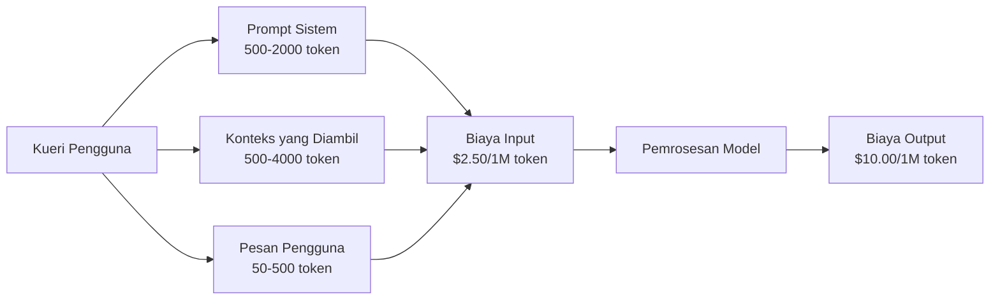
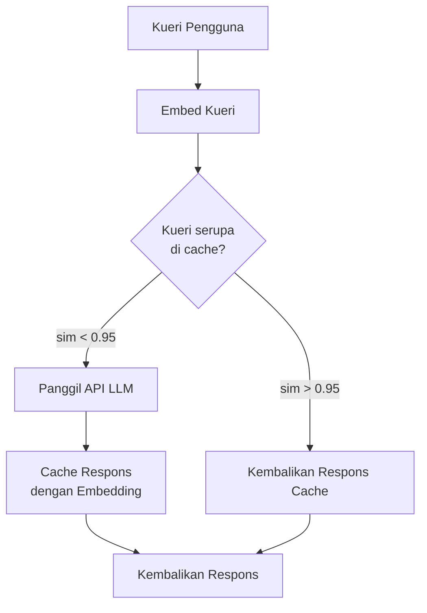
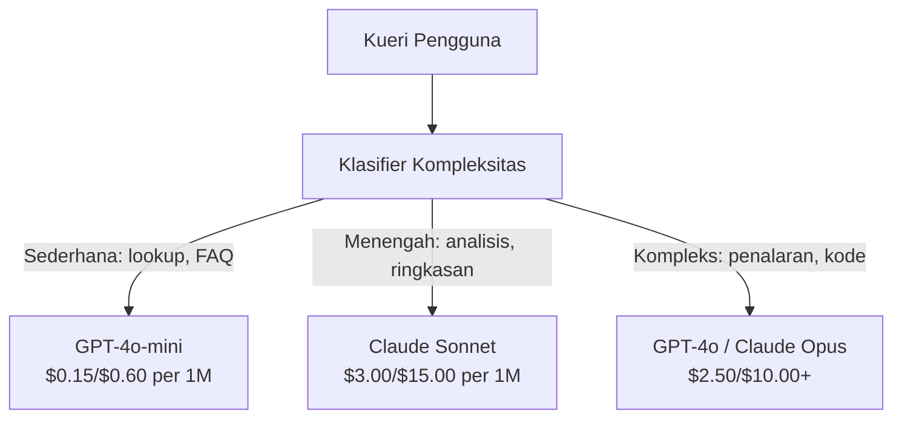

# Caching, Pembatasan Laju, & Optimasi Biaya

> Kebanyakan startup AI tidak mati karena model yang buruk. Mereka mati karena ekonomi unit yang buruk. Satu panggilan GPT-4o hanya menelan sebagian kecil sen. Sepuluh ribu pengguna yang melakukan sepuluh panggilan per hari menghabiskan $250 hanya untuk token input -- sebelum Anda menagih satu dolar pun. Perusahaan yang bertahan adalah mereka yang memperlakukan setiap panggilan API sebagai transaksi keuangan, bukan sekadar panggilan fungsi.

**Jenis:** Build
**Bahasa:** Python, TypeScript
**Prasyarat:** Fase 11 Pelajaran 09 (Function Calling)
**Waktu:** ~45 menit
**Terkait:** Fase 11 · 15 (Prompt Caching) — pelajaran ini membahas caching lapisan aplikasi (caching semantik, caching hash eksak, routing model). Pelajaran 15 membahas prompt caching lapisan penyedia (cache_control Anthropic, otomatis OpenAI, CachedContent Gemini). Gabungkan keduanya untuk pengurangan biaya 50-95%.

## Tujuan Pembelajaran

- Menerapkan caching semantik yang melayani kueri berulang atau serupa dari cache alih-alih melakukan panggilan API baru
- Menghitung biaya per permintaan di berbagai penyedia serta menerapkan pembatasan laju sadar-token dan peringatan anggaran
- Membangun lapisan optimasi biaya dengan kompresi prompt, routing model (mahal vs murah), dan caching respons
- Merancang strategi caching bertingkat menggunakan pencocokan eksak, kemiripan semantik, dan caching prefiks untuk berbagai jenis kueri

## Masalahnya

Anda membangun chatbot RAG. Kerjanya luar biasa. Penggunanya menyukainya.

Lalu tagihan datang.

GPT-5 dikenakan $1.25 per juta token input dan $10 per juta token output. Claude Opus 4.7 sebesar $5 input / $25 output. Gemini 3.1 Pro sebesar $2 input / $12 output (prompt hingga 200K token). GPT-5-mini sebesar $0.25/$2. GPT-4o, model dalam perhitungan di bawah, sebesar $2.50/$10. Harga bersifat ilustratif; selalu periksa halaman harga terkini penyedia.

Berikut perhitungan yang membunuh startup:

- 10,000 pengguna aktif harian
- 10 kueri per pengguna per hari
- 1,000 token input per kueri (prompt sistem + konteks + pesan pengguna)
- 500 token output per respons

**Biaya input harian:** 10,000 x 10 x 1,000 / 1,000,000 x $2.50 = **$250/hari**
**Biaya output harian:** 10,000 x 10 x 500 / 1,000,000 x $10.00 = **$500/hari**
**Total bulanan:** **$22,500/bulan**

Itu baru LLM-nya saja. Tambahkan embedding, hosting basis data vektor, infrastruktur. Anda melihat angka $30,000/bulan untuk sebuah chatbot.

Bagian yang kejam: 40-60% dari kueri tersebut adalah near-duplikat. Pengguna menanyakan pertanyaan yang sama dengan kata-kata yang sedikit berbeda. Prompt sistem Anda -- identik di setiap permintaan -- tetap ditagih setiap kali. Dokumen konteks yang diambil oleh RAG berulang di antara pengguna yang bertanya tentang topik yang sama.

Anda membayar harga penuh atas komputasi yang berulang.

## Konsepnya

### Anatomi Biaya sebuah Panggilan LLM

Setiap panggilan API memiliki lima komponen biaya.



Prompt sistem adalah pembunuh senyap. Prompt sistem 1,500 token yang dikirim pada setiap permintaan menelan $3.75 per juta permintaan hanya untuk prefiks itu. Pada 100K permintaan per hari, itu $375/hari -- $11,250/bulan -- untuk teks yang tidak pernah berubah.

### Caching Penyedia: Diskon Bawaan

Ketiga penyedia besar menawarkan prompt caching sisi penyedia pada 2026, tetapi mekanismenya berbeda. Lihat Fase 11 · 15 untuk pembahasan mendalam.

| Penyedia | Mekanisme | Diskon | Minimum | Durasi Cache |
|----------|-----------|--------|---------|----------------|
| Anthropic | Penanda cache_control eksplisit | 90% saat cache hit (bayar tambahan 25% saat write) | 1,024 token (Sonnet/Opus), 2,048 (Haiku) | 5 menit default; 1 jam extended (premi write 2x) |
| OpenAI | Pencocokan prefiks otomatis | 50% saat cache hit | 1,024 token | Best-effort hingga 1 jam |
| Google Gemini | API CachedContent eksplisit | ~75% pengurangan (ditambah penyimpanan) | 4,096 (Flash) / 32,768 (Pro) | TTL dapat dikonfigurasi pengguna |

**Pendekatan Anthropic** bersifat eksplisit. Anda menandai bagian-bagian prompt dengan `cache_control: {"type": "ephemeral"}`. Permintaan pertama membayar premi write 25%. Permintaan berikutnya dengan prefiks yang sama mendapat diskon 90%. Prompt sistem 2,000 token yang normalnya menelan $0.005 menjadi $0.000625 saat cache hit. Dalam 100K permintaan, itu menghemat $437.50/hari.

**Pendekatan OpenAI** bersifat otomatis. Setiap prefiks prompt yang cocok dengan permintaan sebelumnya mendapat diskon 50%. Tidak perlu penanda. Trade-off-nya: diskon lebih kecil, kontrol lebih sedikit, tetapi usaha implementasi nol.

### Caching Semantik: Lapisan Kustom Anda

Caching penyedia hanya bekerja untuk prefiks yang identik. Caching semantik menangani kasus yang lebih sulit: kueri berbeda dengan makna yang sama.

"Apa kebijakan pengembalian?" dan "Bagaimana saya mengembalikan barang?" adalah string yang berbeda tetapi niat yang identik. Sebuah cache semantik men-embed kedua kueri, menghitung kemiripan kosinus, dan mengembalikan respons cache jika kemiripan melebihi ambang batas (biasanya 0.92-0.95).



Biaya embedding tidak signifikan. text-embedding-3-small dari OpenAI menelan $0.02 per juta token. Memeriksa cache hampir tidak menelan biaya dibandingkan panggilan LLM penuh.

### Caching Eksak: Hash dan Pencocokan

Untuk panggilan deterministik (temperature=0, model sama, prompt sama), caching eksak lebih sederhana dan lebih cepat. Hash prompt lengkap, periksa cache, kembalikan jika ditemukan.

Ini bekerja sempurna untuk:
- Prompt sistem + konteks tetap + kueri pengguna identik
- Function calling dengan definisi alat yang identik
- Pemrosesan batch di mana dokumen yang sama diproses berkali-kali

### Pembatasan Laju: Melindungi Anggaran Anda

Pembatasan laju bukan hanya soal keadilan. Ini soal kelangsungan hidup.

**Algoritma token bucket:** setiap pengguna mendapat ember berisi N token yang terisi kembali dengan laju R per detik. Sebuah permintaan mengonsumsi token dari ember. Jika ember kosong, permintaan ditolak. Ini memungkinkan ledakan (memakai seluruh ember sekaligus) sembari memberlakukan laju rata-rata.

**Kuota per pengguna:** tetapkan batas token harian/bulanan per tingkatan pengguna.

| Tingkatan | Batas Token Harian | Maks Permintaan/menit | Akses Model |
|------|------------------|------------------|-------------|
| Free | 50,000 | 10 | hanya GPT-4o-mini |
| Pro | 500,000 | 60 | GPT-4o, Claude Sonnet |
| Enterprise | 5,000,000 | 300 | semua model |

### Routing Model: Model yang Tepat untuk Tugas yang Tepat

Tidak setiap kueri membutuhkan GPT-4o.

"Jam berapa toko tutup?" tidak memerlukan model $10/M-output. GPT-4o-mini dengan $0.60/M output menangannya dengan sempurna. Claude Haiku dengan $1.25/M output juga bisa. Sebuah classifier sederhana mengarahkan kueri murah ke model murah dan kueri kompleks ke model mahal.



Router yang disetel dengan baik menghemat 40-70% hanya dari biaya model.

### Pelacakan Biaya: Tahu ke Mana Uang Pergi

Anda tidak dapat mengoptimalkan apa yang tidak Anda ukur. Catat setiap panggilan API dengan:

- Cap waktu
- Nama model
- Token input
- Token output
- Latensi (ms)
- Biaya terhitung ($)
- ID pengguna
- Cache hit/miss
- Kategori permintaan

Data ini mengungkap fitur mana yang mahal, pengguna mana yang konsumtif, dan di mana caching memberi dampak paling besar.

### Batching: Diskon Grosir

Batch API OpenAI memproses permintaan secara asinkron dengan diskon 50%. Anda mengirim batch hingga 50,000 permintaan, dan hasilnya kembali dalam 24 jam.

Gunakan batching untuk:
- Pemrosesan dokumen malam hari
- Klasifikasi massal
- Proses evaluasi
- Pipeline pengayaan data

Bukan untuk: kueri real-time yang dihadapi pengguna (latensi penting).

### Peringatan Anggaran dan Pemutus Sirkuit

Pemutus sirkuit menghentikan pengeluaran saat Anda mencapai batas. Tanpa itu, bug atau penyalahgunaan dapat membakar anggaran bulanan Anda dalam hitungan jam.

Tetapkan tiga ambang batas:
1. **Peringatan** (70% dari anggaran): kirim notifikasi
2. **Pembatasan** (85% dari anggaran): beralih hanya ke model yang lebih murah
3. **Penghentian** (95% dari anggaran): tolak permintaan baru, kembalikan hanya respons cache

### Tumpukan Optimasi

Terapkan teknik-teknik ini secara berurutan. Setiap lapisan memperkuat lapisan sebelumnya.

| Lapisan | Teknik | Penghematan Khas | Usaha Implementasi |
|-------|-----------|----------------|----------------------|
| 1 | Prompt caching penyedia | 30-50% | Rendah (tambah penanda cache) |
| 2 | Caching eksak | 10-20% | Rendah (hash + dict) |
| 3 | Caching semantik | 15-30% | Menengah (embedding + kemiripan) |
| 4 | Routing model | 40-70% | Menengah (classifier) |
| 5 | Pembatasan laju | Perlindungan anggaran | Rendah (token bucket) |
| 6 | Kompresi prompt | 10-30% | Menengah (menulis ulang prompt) |
| 7 | Batching | 50% pada yang memenuhi syarat | Rendah (batch API) |

Aplikasi RAG yang menerapkan lapisan 1-5 biasanya menurunkan biaya dari $22,500/bulan menjadi $4,000-6,000/bulan. Itulah perbedaan antara membakar runway dan membangun bisnis.

### Penghematan Nyata: Sebelum dan Sesudah

Berikut rincian nyata untuk chatbot RAG yang melayani 10,000 DAU.

| Metrik | Sebelum Optimasi | Sesudah Optimasi | Penghematan |
|--------|--------------------|--------------------|---------|
| Biaya LLM bulanan | $22,500 | $5,200 | 77% |
| Rata-rata biaya per kueri | $0.0075 | $0.0017 | 77% |
| Tingkat cache hit | 0% | 52% | -- |
| Kueri yang diarahkan ke mini | 0% | 65% | -- |
| Latensi P95 | 2,800ms | 900ms (cache hit: 50ms) | 68% |
| Biaya embedding bulanan | $0 | $180 | (biaya baru) |
| Total biaya bulanan | $22,500 | $5,380 | 76% |

Biaya embedding untuk caching semantik ($180/bulan) kembali modal dalam satu jam pertama cache hit.

```figure
semantic-cache
```

## Bangunlah

### Langkah 1: Kalkulator Biaya

Bangun kalkulator biaya token yang mengetahui harga terkini model-model utama.

```python
import hashlib
import time
import json
import math
from dataclasses import dataclass, field


MODEL_PRICING = {
    "gpt-4o": {"input": 2.50, "output": 10.00, "cached_input": 1.25},
    "gpt-4o-mini": {"input": 0.15, "output": 0.60, "cached_input": 0.075},
    "gpt-4.1": {"input": 2.00, "output": 8.00, "cached_input": 0.50},
    "gpt-4.1-mini": {"input": 0.40, "output": 1.60, "cached_input": 0.10},
    "gpt-4.1-nano": {"input": 0.10, "output": 0.40, "cached_input": 0.025},
    "o3": {"input": 2.00, "output": 8.00, "cached_input": 0.50},
    "o3-mini": {"input": 1.10, "output": 4.40, "cached_input": 0.55},
    "o4-mini": {"input": 1.10, "output": 4.40, "cached_input": 0.275},
    "claude-opus-4": {"input": 15.00, "output": 75.00, "cached_input": 1.50},
    "claude-sonnet-4": {"input": 3.00, "output": 15.00, "cached_input": 0.30},
    "claude-haiku-3.5": {"input": 0.80, "output": 4.00, "cached_input": 0.08},
    "gemini-2.5-pro": {"input": 1.25, "output": 10.00, "cached_input": 0.3125},
    "gemini-2.5-flash": {"input": 0.15, "output": 0.60, "cached_input": 0.0375},
}


def calculate_cost(model, input_tokens, output_tokens, cached_input_tokens=0):
    if model not in MODEL_PRICING:
        return {"error": f"Unknown model: {model}"}
    pricing = MODEL_PRICING[model]
    non_cached = input_tokens - cached_input_tokens
    input_cost = (non_cached / 1_000_000) * pricing["input"]
    cached_cost = (cached_input_tokens / 1_000_000) * pricing["cached_input"]
    output_cost = (output_tokens / 1_000_000) * pricing["output"]
    total = input_cost + cached_cost + output_cost
    return {
        "model": model,
        "input_tokens": input_tokens,
        "output_tokens": output_tokens,
        "cached_input_tokens": cached_input_tokens,
        "input_cost": round(input_cost, 6),
        "cached_input_cost": round(cached_cost, 6),
        "output_cost": round(output_cost, 6),
        "total_cost": round(total, 6),
    }
```

### Langkah 2: Cache Eksak

Hash prompt lengkap dan kembalikan respons cache untuk permintaan yang identik.

```python
class ExactCache:
    def __init__(self, max_size=1000, ttl_seconds=3600):
        self.cache = {}
        self.max_size = max_size
        self.ttl = ttl_seconds
        self.hits = 0
        self.misses = 0

    def _hash(self, model, messages, temperature):
        key_data = json.dumps({"model": model, "messages": messages, "temperature": temperature}, sort_keys=True)
        return hashlib.sha256(key_data.encode()).hexdigest()

    def get(self, model, messages, temperature=0.0):
        if temperature > 0:
            self.misses += 1
            return None
        key = self._hash(model, messages, temperature)
        if key in self.cache:
            entry = self.cache[key]
            if time.time() - entry["timestamp"] < self.ttl:
                self.hits += 1
                entry["access_count"] += 1
                return entry["response"]
            del self.cache[key]
        self.misses += 1
        return None

    def put(self, model, messages, temperature, response):
        if temperature > 0:
            return
        if len(self.cache) >= self.max_size:
            oldest_key = min(self.cache, key=lambda k: self.cache[k]["timestamp"])
            del self.cache[oldest_key]
        key = self._hash(model, messages, temperature)
        self.cache[key] = {
            "response": response,
            "timestamp": time.time(),
            "access_count": 1,
        }

    def stats(self):
        total = self.hits + self.misses
        return {
            "hits": self.hits,
            "misses": self.misses,
            "hit_rate": round(self.hits / total, 4) if total > 0 else 0,
            "cache_size": len(self.cache),
        }
```

### Langkah 3: Cache Semantik

Embed kueri dan kembalikan respons cache ketika kemiripan melebihi ambang batas.

```python
def simple_embed(text):
    words = text.lower().split()
    vocab = {}
    for w in words:
        vocab[w] = vocab.get(w, 0) + 1
    norm = math.sqrt(sum(v * v for v in vocab.values()))
    if norm == 0:
        return {}
    return {k: v / norm for k, v in vocab.items()}


def cosine_similarity(a, b):
    if not a or not b:
        return 0.0
    all_keys = set(a) | set(b)
    dot = sum(a.get(k, 0) * b.get(k, 0) for k in all_keys)
    return dot


class SemanticCache:
    def __init__(self, similarity_threshold=0.85, max_size=500, ttl_seconds=3600):
        self.entries = []
        self.threshold = similarity_threshold
        self.max_size = max_size
        self.ttl = ttl_seconds
        self.hits = 0
        self.misses = 0

    def get(self, query):
        query_embedding = simple_embed(query)
        now = time.time()
        best_match = None
        best_sim = 0.0
        for entry in self.entries:
            if now - entry["timestamp"] > self.ttl:
                continue
            sim = cosine_similarity(query_embedding, entry["embedding"])
            if sim > best_sim:
                best_sim = sim
                best_match = entry
        if best_match and best_sim >= self.threshold:
            self.hits += 1
            best_match["access_count"] += 1
            return {"response": best_match["response"], "similarity": round(best_sim, 4), "original_query": best_match["query"]}
        self.misses += 1
        return None

    def put(self, query, response):
        if len(self.entries) >= self.max_size:
            self.entries.sort(key=lambda e: e["timestamp"])
            self.entries.pop(0)
        self.entries.append({
            "query": query,
            "embedding": simple_embed(query),
            "response": response,
            "timestamp": time.time(),
            "access_count": 1,
        })

    def stats(self):
        total = self.hits + self.misses
        return {
            "hits": self.hits,
            "misses": self.misses,
            "hit_rate": round(self.hits / total, 4) if total > 0 else 0,
            "cache_size": len(self.entries),
        }
```

### Langkah 4: Pembatas Laju

Pembatas laju token bucket dengan kuota per pengguna.

```python
class TokenBucketRateLimiter:
    def __init__(self):
        self.buckets = {}
        self.tiers = {
            "free": {"capacity": 50_000, "refill_rate": 500, "max_requests_per_min": 10},
            "pro": {"capacity": 500_000, "refill_rate": 5_000, "max_requests_per_min": 60},
            "enterprise": {"capacity": 5_000_000, "refill_rate": 50_000, "max_requests_per_min": 300},
        }

    def _get_bucket(self, user_id, tier="free"):
        if user_id not in self.buckets:
            tier_config = self.tiers.get(tier, self.tiers["free"])
            self.buckets[user_id] = {
                "tokens": tier_config["capacity"],
                "capacity": tier_config["capacity"],
                "refill_rate": tier_config["refill_rate"],
                "last_refill": time.time(),
                "request_timestamps": [],
                "max_rpm": tier_config["max_requests_per_min"],
                "tier": tier,
                "total_tokens_used": 0,
            }
        return self.buckets[user_id]

    def _refill(self, bucket):
        now = time.time()
        elapsed = now - bucket["last_refill"]
        refill = int(elapsed * bucket["refill_rate"])
        if refill > 0:
            bucket["tokens"] = min(bucket["capacity"], bucket["tokens"] + refill)
            bucket["last_refill"] = now

    def check(self, user_id, tokens_needed, tier="free"):
        bucket = self._get_bucket(user_id, tier)
        self._refill(bucket)
        now = time.time()
        bucket["request_timestamps"] = [t for t in bucket["request_timestamps"] if now - t < 60]
        if len(bucket["request_timestamps"]) >= bucket["max_rpm"]:
            return {"allowed": False, "reason": "rate_limit", "retry_after_seconds": 60 - (now - bucket["request_timestamps"][0])}
        if bucket["tokens"] < tokens_needed:
            deficit = tokens_needed - bucket["tokens"]
            wait = deficit / bucket["refill_rate"]
            return {"allowed": False, "reason": "token_limit", "tokens_available": bucket["tokens"], "retry_after_seconds": round(wait, 1)}
        return {"allowed": True, "tokens_available": bucket["tokens"]}

    def consume(self, user_id, tokens_used, tier="free"):
        bucket = self._get_bucket(user_id, tier)
        bucket["tokens"] -= tokens_used
        bucket["request_timestamps"].append(time.time())
        bucket["total_tokens_used"] += tokens_used

    def get_usage(self, user_id):
        if user_id not in self.buckets:
            return {"error": "User not found"}
        b = self.buckets[user_id]
        return {
            "user_id": user_id,
            "tier": b["tier"],
            "tokens_remaining": b["tokens"],
            "capacity": b["capacity"],
            "total_tokens_used": b["total_tokens_used"],
            "utilization": round(b["total_tokens_used"] / b["capacity"], 4) if b["capacity"] else 0,
        }
```

### Langkah 5: Pelacak Biaya

Catat setiap panggilan dan hitung total berjalan.

```python
class CostTracker:
    def __init__(self, monthly_budget=1000.0):
        self.logs = []
        self.monthly_budget = monthly_budget
        self.alerts = []

    def log_call(self, model, input_tokens, output_tokens, cached_input_tokens=0, latency_ms=0, user_id="anonymous", cache_status="miss"):
        cost = calculate_cost(model, input_tokens, output_tokens, cached_input_tokens)
        entry = {
            "timestamp": time.time(),
            "model": model,
            "input_tokens": input_tokens,
            "output_tokens": output_tokens,
            "cached_input_tokens": cached_input_tokens,
            "latency_ms": latency_ms,
            "cost": cost["total_cost"],
            "user_id": user_id,
            "cache_status": cache_status,
        }
        self.logs.append(entry)
        self._check_budget()
        return entry

    def _check_budget(self):
        total = self.total_cost()
        pct = total / self.monthly_budget if self.monthly_budget > 0 else 0
        if pct >= 0.95 and not any(a["level"] == "stop" for a in self.alerts):
            self.alerts.append({"level": "stop", "message": f"Budget 95% consumed: ${total:.2f}/${self.monthly_budget:.2f}", "timestamp": time.time()})
        elif pct >= 0.85 and not any(a["level"] == "throttle" for a in self.alerts):
            self.alerts.append({"level": "throttle", "message": f"Budget 85% consumed: ${total:.2f}/${self.monthly_budget:.2f}", "timestamp": time.time()})
        elif pct >= 0.70 and not any(a["level"] == "warning" for a in self.alerts):
            self.alerts.append({"level": "warning", "message": f"Budget 70% consumed: ${total:.2f}/${self.monthly_budget:.2f}", "timestamp": time.time()})

    def total_cost(self):
        return round(sum(e["cost"] for e in self.logs), 6)

    def cost_by_model(self):
        by_model = {}
        for e in self.logs:
            m = e["model"]
            if m not in by_model:
                by_model[m] = {"calls": 0, "cost": 0, "input_tokens": 0, "output_tokens": 0}
            by_model[m]["calls"] += 1
            by_model[m]["cost"] = round(by_model[m]["cost"] + e["cost"], 6)
            by_model[m]["input_tokens"] += e["input_tokens"]
            by_model[m]["output_tokens"] += e["output_tokens"]
        return by_model

    def cache_savings(self):
        cache_hits = [e for e in self.logs if e["cache_status"] == "hit"]
        if not cache_hits:
            return {"saved": 0, "cache_hits": 0}
        saved = 0
        for e in cache_hits:
            full_cost = calculate_cost(e["model"], e["input_tokens"], e["output_tokens"])
            saved += full_cost["total_cost"]
        return {"saved": round(saved, 4), "cache_hits": len(cache_hits)}

    def summary(self):
        if not self.logs:
            return {"total_calls": 0, "total_cost": 0}
        total_latency = sum(e["latency_ms"] for e in self.logs)
        cache_hits = sum(1 for e in self.logs if e["cache_status"] == "hit")
        return {
            "total_calls": len(self.logs),
            "total_cost": self.total_cost(),
            "avg_cost_per_call": round(self.total_cost() / len(self.logs), 6),
            "avg_latency_ms": round(total_latency / len(self.logs), 1),
            "cache_hit_rate": round(cache_hits / len(self.logs), 4),
            "cost_by_model": self.cost_by_model(),
            "cache_savings": self.cache_savings(),
            "budget_remaining": round(self.monthly_budget - self.total_cost(), 2),
            "budget_utilization": round(self.total_cost() / self.monthly_budget, 4) if self.monthly_budget > 0 else 0,
            "alerts": self.alerts,
        }
```

### Langkah 6: Router Model

Arahkan kueri ke model termurah yang mampu menanganinya.

```python
SIMPLE_KEYWORDS = ["what time", "hours", "address", "phone", "price", "return policy", "hello", "hi", "thanks", "yes", "no"]
COMPLEX_KEYWORDS = ["analyze", "compare", "explain why", "write code", "debug", "architect", "design", "trade-off", "evaluate"]


def classify_complexity(query):
    q = query.lower()
    if len(q.split()) <= 5 or any(kw in q for kw in SIMPLE_KEYWORDS):
        return "simple"
    if any(kw in q for kw in COMPLEX_KEYWORDS):
        return "complex"
    return "medium"


def route_model(query, tier="pro"):
    complexity = classify_complexity(query)
    routing_table = {
        "simple": {"free": "gpt-4.1-nano", "pro": "gpt-4o-mini", "enterprise": "gpt-4o-mini"},
        "medium": {"free": "gpt-4o-mini", "pro": "claude-sonnet-4", "enterprise": "claude-sonnet-4"},
        "complex": {"free": "gpt-4o-mini", "pro": "gpt-4o", "enterprise": "claude-opus-4"},
    }
    model = routing_table[complexity].get(tier, "gpt-4o-mini")
    return {"query": query, "complexity": complexity, "model": model, "tier": tier}
```

### Langkah 7: Jalankan Demo

```python
def simulate_llm_call(model, query):
    input_tokens = len(query.split()) * 4 + 500
    output_tokens = 150 + (len(query.split()) * 2)
    latency = 200 + (output_tokens * 2)
    return {
        "model": model,
        "response": f"[Simulated {model} response to: {query[:50]}...]",
        "input_tokens": input_tokens,
        "output_tokens": output_tokens,
        "latency_ms": latency,
    }


def run_demo():
    print("=" * 60)
    print("  Caching, Rate Limiting & Cost Optimization Demo")
    print("=" * 60)

    print("\n--- Model Pricing ---")
    for model, pricing in list(MODEL_PRICING.items())[:6]:
        cost_1k = calculate_cost(model, 1000, 500)
        print(f"  {model}: ${cost_1k['total_cost']:.6f} per 1K in + 500 out")

    print("\n--- Cost Comparison: 100K Requests ---")
    for model in ["gpt-4o", "gpt-4o-mini", "claude-sonnet-4", "claude-haiku-3.5"]:
        cost = calculate_cost(model, 1000 * 100_000, 500 * 100_000)
        print(f"  {model}: ${cost['total_cost']:.2f}")

    print("\n--- Anthropic Cache Savings ---")
    no_cache = calculate_cost("claude-sonnet-4", 2000, 500, 0)
    with_cache = calculate_cost("claude-sonnet-4", 2000, 500, 1500)
    saving = no_cache["total_cost"] - with_cache["total_cost"]
    print(f"  Without cache: ${no_cache['total_cost']:.6f}")
    print(f"  With 1500 cached tokens: ${with_cache['total_cost']:.6f}")
    print(f"  Savings per call: ${saving:.6f} ({saving/no_cache['total_cost']*100:.1f}%)")

    exact_cache = ExactCache(max_size=100, ttl_seconds=300)
    semantic_cache = SemanticCache(similarity_threshold=0.75, max_size=100)
    rate_limiter = TokenBucketRateLimiter()
    tracker = CostTracker(monthly_budget=100.0)

    print("\n--- Exact Cache ---")
    messages_1 = [{"role": "user", "content": "What is the return policy?"}]
    result = exact_cache.get("gpt-4o-mini", messages_1, 0.0)
    print(f"  First lookup: {'HIT' if result else 'MISS'}")
    exact_cache.put("gpt-4o-mini", messages_1, 0.0, "You can return items within 30 days.")
    result = exact_cache.get("gpt-4o-mini", messages_1, 0.0)
    print(f"  Second lookup: {'HIT' if result else 'MISS'} -> {result}")
    result = exact_cache.get("gpt-4o-mini", messages_1, 0.7)
    print(f"  With temp=0.7: {'HIT' if result else 'MISS (non-deterministic, skip cache)'}")
    print(f"  Stats: {exact_cache.stats()}")

    print("\n--- Semantic Cache ---")
    test_queries = [
        ("What is the return policy?", "Items can be returned within 30 days with receipt."),
        ("How do I return an item?", None),
        ("What are your store hours?", "We are open 9am-9pm Monday through Saturday."),
        ("When does the store open?", None),
        ("Tell me about quantum computing", "Quantum computers use qubits..."),
        ("Explain quantum mechanics", None),
    ]
    for query, response in test_queries:
        cached = semantic_cache.get(query)
        if cached:
            print(f"  '{query[:40]}' -> CACHE HIT (sim={cached['similarity']}, original='{cached['original_query'][:40]}')")
        elif response:
            semantic_cache.put(query, response)
            print(f"  '{query[:40]}' -> MISS (stored)")
        else:
            print(f"  '{query[:40]}' -> MISS (no match)")
    print(f"  Stats: {semantic_cache.stats()}")

    print("\n--- Rate Limiting ---")
    for i in range(12):
        check = rate_limiter.check("user_1", 1000, "free")
        if check["allowed"]:
            rate_limiter.consume("user_1", 1000, "free")
        status = "OK" if check["allowed"] else f"BLOCKED ({check['reason']})"
        if i < 5 or not check["allowed"]:
            print(f"  Request {i+1}: {status}")
    print(f"  Usage: {rate_limiter.get_usage('user_1')}")

    print("\n--- Model Routing ---")
    routing_queries = [
        "What time do you close?",
        "Summarize this quarterly earnings report",
        "Analyze the trade-offs between microservices and monoliths",
        "Hello",
        "Write code for a binary search tree with deletion",
    ]
    for q in routing_queries:
        route = route_model(q, "pro")
        print(f"  '{q[:50]}' -> {route['model']} ({route['complexity']})")

    print("\n--- Full Pipeline: Before vs After Optimization ---")
    queries = [
        "What is the return policy?",
        "How do I return something?",
        "What are your hours?",
        "When do you open?",
        "Explain the difference between TCP and UDP",
        "Compare TCP vs UDP protocols",
        "Hello",
        "What is your phone number?",
        "Write a Python function to sort a list",
        "Analyze the pros and cons of serverless architecture",
    ]

    print("\n  [Before: no caching, single model (gpt-4o)]")
    tracker_before = CostTracker(monthly_budget=1000.0)
    for q in queries:
        result = simulate_llm_call("gpt-4o", q)
        tracker_before.log_call("gpt-4o", result["input_tokens"], result["output_tokens"], latency_ms=result["latency_ms"], cache_status="miss")
    before = tracker_before.summary()
    print(f"  Total cost: ${before['total_cost']:.6f}")
    print(f"  Avg cost/call: ${before['avg_cost_per_call']:.6f}")
    print(f"  Avg latency: {before['avg_latency_ms']}ms")

    print("\n  [After: caching + routing + rate limiting]")
    exact_c = ExactCache()
    semantic_c = SemanticCache(similarity_threshold=0.75)
    tracker_after = CostTracker(monthly_budget=1000.0)

    for q in queries:
        messages = [{"role": "user", "content": q}]
        cached = exact_c.get("gpt-4o", messages, 0.0)
        if cached:
            tracker_after.log_call("gpt-4o-mini", 0, 0, latency_ms=5, cache_status="hit")
            continue
        sem_cached = semantic_c.get(q)
        if sem_cached:
            tracker_after.log_call("gpt-4o-mini", 0, 0, latency_ms=15, cache_status="hit")
            continue
        route = route_model(q)
        result = simulate_llm_call(route["model"], q)
        tracker_after.log_call(route["model"], result["input_tokens"], result["output_tokens"], latency_ms=result["latency_ms"], cache_status="miss")
        exact_c.put(route["model"], messages, 0.0, result["response"])
        semantic_c.put(q, result["response"])

    after = tracker_after.summary()
    print(f"  Total cost: ${after['total_cost']:.6f}")
    print(f"  Avg cost/call: ${after['avg_cost_per_call']:.6f}")
    print(f"  Avg latency: {after['avg_latency_ms']}ms")
    print(f"  Cache hit rate: {after['cache_hit_rate']:.0%}")

    if before["total_cost"] > 0:
        savings_pct = (1 - after["total_cost"] / before["total_cost"]) * 100
        print(f"\n  SAVINGS: {savings_pct:.1f}% cost reduction")
        print(f"  Latency improvement: {(1 - after['avg_latency_ms'] / before['avg_latency_ms']) * 100:.1f}% faster")

    print("\n--- Budget Alerts Demo ---")
    alert_tracker = CostTracker(monthly_budget=0.01)
    for i in range(5):
        alert_tracker.log_call("gpt-4o", 5000, 2000, latency_ms=500)
    print(f"  Total spent: ${alert_tracker.total_cost():.6f} / ${alert_tracker.monthly_budget}")
    for alert in alert_tracker.alerts:
        print(f"  ALERT [{alert['level'].upper()}]: {alert['message']}")

    print("\n--- Cost Breakdown by Model ---")
    multi_tracker = CostTracker(monthly_budget=500.0)
    for _ in range(50):
        multi_tracker.log_call("gpt-4o-mini", 800, 200, latency_ms=150)
    for _ in range(30):
        multi_tracker.log_call("claude-sonnet-4", 1500, 500, latency_ms=400)
    for _ in range(10):
        multi_tracker.log_call("gpt-4o", 2000, 800, latency_ms=600)
    for _ in range(10):
        multi_tracker.log_call("claude-opus-4", 3000, 1000, latency_ms=1200)
    breakdown = multi_tracker.cost_by_model()
    for model, data in sorted(breakdown.items(), key=lambda x: x[1]["cost"], reverse=True):
        print(f"  {model}: {data['calls']} calls, ${data['cost']:.6f}, {data['input_tokens']:,} in / {data['output_tokens']:,} out")
    print(f"  Total: ${multi_tracker.total_cost():.6f}")

    print("\n" + "=" * 60)
    print("  Demo complete.")
    print("=" * 60)


if __name__ == "__main__":
    run_demo()
```

## Gunakanlah

### Prompt Caching Anthropic

```python
# import anthropic
#
# client = anthropic.Anthropic()
#
# response = client.messages.create(
#     model="claude-sonnet-5",
#     max_tokens=1024,
#     system=[
#         {
#             "type": "text",
#             "text": "You are a helpful customer support agent for Acme Corp...",
#             "cache_control": {"type": "ephemeral"},
#         }
#     ],
#     messages=[{"role": "user", "content": "What is the return policy?"}],
# )
#
# print(f"Input tokens: {response.usage.input_tokens}")
# print(f"Cache creation tokens: {response.usage.cache_creation_input_tokens}")
# print(f"Cache read tokens: {response.usage.cache_read_input_tokens}")
```

Panggilan pertama menulis ke cache (premi 25%). Setiap panggilan berikutnya dengan prefiks prompt sistem yang sama membaca dari cache (diskon 90%). Cache bertahan 5 menit dan mengatur ulang timer pada setiap hit.

### Caching Otomatis OpenAI

```python
# from openai import OpenAI
#
# client = OpenAI()
#
# response = client.chat.completions.create(
#     model="gpt-4o",
#     messages=[
#         {"role": "system", "content": "You are a helpful customer support agent..."},
#         {"role": "user", "content": "What is the return policy?"},
#     ],
# )
#
# print(f"Prompt tokens: {response.usage.prompt_tokens}")
# print(f"Cached tokens: {response.usage.prompt_tokens_details.cached_tokens}")
# print(f"Completion tokens: {response.usage.completion_tokens}")
```

OpenAI melakukan caching secara otomatis. Setiap prefiks prompt 1,024+ token yang cocok dengan permintaan terbaru mendapat diskon 50%. Tidak perlu perubahan kode -- cukup periksa `prompt_tokens_details.cached_tokens` dalam respons untuk memverifikasi bahwa itu bekerja.

### OpenAI Batch API

```python
# import json
# from openai import OpenAI
#
# client = OpenAI()
#
# requests = []
# for i, query in enumerate(queries):
#     requests.append({
#         "custom_id": f"request-{i}",
#         "method": "POST",
#         "url": "/v1/chat/completions",
#         "body": {
#             "model": "gpt-4o-mini",
#             "messages": [{"role": "user", "content": query}],
#         },
#     })
#
# with open("batch_input.jsonl", "w") as f:
#     for r in requests:
#         f.write(json.dumps(r) + "\n")
#
# batch_file = client.files.create(file=open("batch_input.jsonl", "rb"), purpose="batch")
# batch = client.batches.create(input_file_id=batch_file.id, endpoint="/v1/chat/completions", completion_window="24h")
# print(f"Batch ID: {batch.id}, Status: {batch.status}")
```

Batch API memberi diskon tetap 50% pada semua token. Hasil tiba dalam 24 jam. Sempurna untuk beban kerja non-real-time: evaluasi, pelabelan data, ringkasan massal.

### Cache Semantik Produksi dengan Redis

```python
# import redis
# import numpy as np
# from openai import OpenAI
#
# r = redis.Redis()
# client = OpenAI()
#
# def get_embedding(text):
#     response = client.embeddings.create(model="text-embedding-3-small", input=text)
#     return response.data[0].embedding
#
# def semantic_cache_lookup(query, threshold=0.95):
#     query_emb = np.array(get_embedding(query))
#     keys = r.keys("cache:emb:*")
#     best_sim, best_key = 0, None
#     for key in keys:
#         stored_emb = np.frombuffer(r.get(key), dtype=np.float32)
#         sim = np.dot(query_emb, stored_emb) / (np.linalg.norm(query_emb) * np.linalg.norm(stored_emb))
#         if sim > best_sim:
#             best_sim, best_key = sim, key
#     if best_sim >= threshold and best_key:
#         response_key = best_key.decode().replace("cache:emb:", "cache:resp:")
#         return r.get(response_key).decode()
#     return None
```

Di produksi, ganti pemindaian linear dengan indeks vektor (Redis Vector Search, Pinecone, atau pgvector). Pemindaian linear bekerja untuk <1,000 entri. Di atas itu, gunakan ANN (approximate nearest neighbor) untuk pencarian $O(\log n)$.

## Kirimkan

Pelajaran ini menghasilkan `outputs/prompt-cost-optimizer.md` -- prompt yang dapat digunakan ulang yang menganalisis aplikasi LLM Anda dan merekomendasikan optimasi biaya spesifik dengan proyeksi penghematan.

Pelajaran ini juga menghasilkan `outputs/skill-cost-patterns.md` -- kerangka keputusan untuk memilih strategi caching, konfigurasi pembatasan laju, dan aturan routing model yang tepat untuk kasus penggunaan Anda.

## Latihan

1. **Terapkan eviksi LRU untuk cache semantik.** Ganti eviksi oldest-first dengan least-recently-used. Lacak waktu akses terakhir untuk setiap entri dan buang entri dengan waktu akses paling lama saat cache penuh. Bandingkan tingkat hit antara kedua strategi dalam 100 kueri.

2. **Bangun alat proyeksi biaya.** Dengan sebuah log panggilan API (log CostTracker), proyeksikan biaya bulanan berdasarkan rata-rata 7 hari terakhir. Perhitungkan pola hari kerja/akhir pekan. Picu peringatan jika biaya bulanan proyeksian melebihi anggaran lebih dari 20%.

3. **Terapkan caching semantik bertingkat.** Gunakan dua ambang kemiripan: 0.98 untuk hit keyakinan tinggi (kembalikan segera) dan 0.90 untuk hit keyakinan menengah (kembalikan dengan catatan: "Berdasarkan pertanyaan sebelumnya yang serupa..."). Lacak dari tingkatan mana setiap hit berasal dan ukur perbedaan kepuasan pengguna.

4. **Bangun classifier routing model.** Ganti classifier berbasis kata kunci dengan yang berbasis embedding. Embed 50 kueri berlabel (sederhana/menengah/kompleks), lalu klasifikasikan kueri baru dengan mencari contoh berlabel terdekat. Ukur akurasi klasifikasi terhadap himpunan uji 20 kueri.

5. **Terapkan pemutus sirkuit dengan tingkat degradasi.** Pada 70% anggaran, catat peringatan. Pada 85%, alihkan otomatis seluruh routing ke model termurah (gpt-4o-mini). Pada 95%, sajikan hanya respons cache dan tolak kueri baru. Uji dengan menyimulasikan 1,000 permintaan terhadap anggaran $1.00 dan verifikasi setiap ambang batas terpicu dengan benar.

## Istilah Kunci

| Istilah | Yang orang katakan | Arti sebenarnya |
|------|----------------|----------------------|
| Prompt caching | "Cache prompt sistemnya" | Caching tingkat penyedia di mana prefiks prompt yang berulang mendapat diskon (90% Anthropic, 50% OpenAI) -- tanpa perubahan kode untuk OpenAI, penanda eksplisit untuk Anthropic |
| Caching semantik | "Caching pintar" | Men-embed kueri, menghitung kemiripan dengan kueri masa lalu, dan mengembalikan respons cache jika kemiripan melebihi ambang batas -- menangkap parafrasa yang terlewat oleh pencocokan eksak |
| Caching eksak | "Hash caching" | Meng-hash prompt lengkap (model + messages + temperature) dan mengembalikan respons cache untuk input identik -- hanya bekerja untuk panggilan deterministik temperature=0 |
| Token bucket | "Pembatas laju" | Algoritma di mana setiap pengguna memiliki ember berisi N token yang terisi ulang dengan laju R per detik -- mengizinkan ledakan hingga N sembari memberlakukan laju rata-rata R |
| Routing model | "Routing pelit" | Memakai classifier untuk mengirim kueri sederhana ke model murah (GPT-4o-mini, Haiku) dan kueri kompleks ke model mahal (GPT-4o, Opus) -- menghemat 40-70% pada biaya model |
| Pelacakan biaya | "Metering" | Mencatat setiap panggilan API beserta model, token, latensi, biaya, dan ID pengguna agar Anda tahu persis ke mana uang pergi dan fitur mana yang mahal |
| Pemutus sirkuit | "Kill switch" | Menurunkan layanan secara otomatis (model lebih murah, hanya cache) atau menghentikan permintaan sepenuhnya saat pengeluaran mendekati batas anggaran |
| Batch API | "Diskon grosir" | Pemrosesan asinkron OpenAI dengan diskon 50% -- kirim hingga 50,000 permintaan, dapatkan hasil dalam 24 jam |
| Kompresi prompt | "Diet token" | Menulis ulang prompt sistem dan konteks agar memakai lebih sedikit token sembari menjaga makna -- prompt lebih pendek menelan lebih sedikit biaya dan sering tampil lebih baik |
| Tingkat cache hit | "Efisiensi cache" | Persentase permintaan yang dilayani dari cache alih-alih memanggil LLM -- 40-60% lazim untuk chatbot produksi, menghemat biaya secara proporsional |

## Bacaan Lanjutan

- [Panduan Prompt Caching Anthropic](https://docs.anthropic.com/en/docs/build-with-claude/prompt-caching) -- dokumentasi resmi untuk penanda cache_control eksplisit Anthropic, harga, dan perilaku masa aktif cache
- [Prompt Caching OpenAI](https://platform.openai.com/docs/guides/prompt-caching) -- caching otomatis OpenAI, cara memverifikasi cache hit lewat kolom usage, dan panjang prefiks minimum
- [OpenAI Batch API](https://platform.openai.com/docs/guides/batch) -- diskon 50% untuk pemrosesan asinkron, format JSONL, jendela penyelesaian 24 jam, dan batas 50K permintaan
- [GPTCache](https://github.com/zilliztech/GPTCache) -- pustaka caching semantik sumber terbuka yang mendukung berbagai backend embedding, penyimpan vektor, dan kebijakan eviksi
- [Martian Model Router](https://docs.withmartian.com) -- routing model produksi yang secara otomatis memilih model termurah yang mampu menangani setiap kueri
- [Not Diamond](https://www.notdiamond.ai) -- router model berbasis ML yang belajar dari pola lalu lintas Anda untuk mengoptimalkan trade-off biaya/kualitas lintas penyedia
- [Helicone](https://www.helicone.ai) -- platform observabilitas LLM dengan pelacakan biaya, caching, pembatasan laju, dan peringatan anggaran sebagai lapisan proksi
- [Dean & Barroso, "The Tail at Scale" (CACM 2013)](https://research.google/pubs/the-tail-at-scale/) -- latensi, throughput, persentil TTFT/TPOT, dan hedged requests; model biaya di balik "pilih model termurah yang tetap memenuhi P95."
- [Kwon et al., "Efficient Memory Management for Large Language Model Serving with PagedAttention" (SOSP 2023)](https://arxiv.org/abs/2309.06180) -- makalah vLLM; mengapa KV-cache halaman + continuous batching mengalahkan server naif 24× dalam throughput, lapisan infrastruktur di balik "caching dan biaya."
- [Dao et al., "FlashAttention-2: Faster Attention with Better Parallelism and Work Partitioning" (ICLR 2024)](https://arxiv.org/abs/2307.08691) -- pengurangan biaya tingkat kernel yang ortogonal terhadap prompt caching; baca bersamaan dengan dekode spekulatif dan GQA untuk gambaran kurva biaya lengkap.
