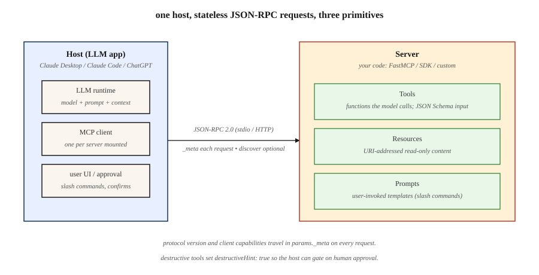

# Model Context Protocol (MCP)

> MCP memberi sebuah host AI satu protokol untuk menemukan dan memanggil alat, sumber daya, dan prompt. Revisi 2026-07-28 membuat protokol ini stateless: konteks kapabilitas dan versi ikut bersama setiap permintaan, bukan dalam jabat tangan yang terikat koneksi.

**Jenis:** Build
**Bahasa:** Python, TypeScript
**Prasyarat:** Fase 11 · 09 (Pemanggilan Fungsi), Fase 11 · 03 (Keluaran Terstruktur)
**Waktu:** ~75 menit

## Tujuan Pembelajaran

- Membedakan host MCP, klien, server, transpor, dan primitif server.
- Membangun permintaan JSON-RPC dengan metadata yang diperlukan MCP 2026-07-28.
- Menggunakan `server/discover` untuk memeriksa versi, identitas, dan kapabilitas.
- Mengembalikan hasil bertipe dan sadar-tembolok dari alat, sumber daya, dan prompt.
- Menjelaskan bagaimana MCP stateless modern berinteroperasi dengan server era jabat tangan.
- Memilih batas keadaan, transpor, dan persetujuan yang aman untuk sebuah server.

## Masalahnya

Aplikasi Anda memerlukan kueri basis data, operasi kalender, dan pembaca berkas. Tanpa protokol bersama, setiap host AI memerlukan perekat khusus untuk penemuan, pemanggilan, galat, transpor, dan otorisasi bagi kapabilitas yang sama itu.

MCP mengurangi matriks integrasi itu. Server mempublikasikan permukaan JSON-RPC standar. Klien yang patuh dapat menemukan permukaan itu, menyajikannya kepada model atau pengguna, memanggilnya, dan menafsirkan hasilnya tanpa adapter khusus server.

Batas yang penting mudah terlewat. MCP membakukan komunikasi. MCP tidak memutuskan alat mana yang harus dipanggil model, membuat konten yang tidak tepercaya menjadi aman, atau mengubah permintaan stateless menjadi keadaan aplikasi yang awet. Host dan server Anda tetap memiliki keputusan itu.

## Konsepnya



### Tiga primitif server

1. **Tools** adalah tindakan yang dapat dipanggil. Setiap alat memiliki nama, deskripsi, masukan JSON Schema, dan handler.
2. **Resources** adalah konten bernama yang dialamati URI dan dapat dibaca klien.
3. **Prompts** adalah templat yang dapat digunakan ulang dan dapat disajikan host kepada pengguna.

Host adalah aplikasi AI. Klien MCP di dalam host itu berbicara dengan satu server. Transpor membawa pesan JSON-RPC di antara keduanya.

### Permintaan stateless menggantikan jabat tangan

MCP 2026-07-28 menghapus `initialize` dan `notifications/initialized`. Protokol ini juga menghapus sesi tingkat protokol. Setiap permintaan membawa konteks yang diperlukan untuk menafsirkannya dalam `params._meta`:

```json
{
  "jsonrpc": "2.0",
  "id": 1,
  "method": "tools/list",
  "params": {
    "_meta": {
      "io.modelcontextprotocol/protocolVersion": "2026-07-28",
      "io.modelcontextprotocol/clientCapabilities": {},
      "io.modelcontextprotocol/clientInfo": {
        "name": "lesson-client",
        "version": "1.0.0"
      }
    }
  }
}
```

Versi protokol dan kapabilitas klien wajib. Identitas klien direkomendasikan. `_meta` yang hilang, kolom wajib yang hilang, atau kolom wajib bertipe salah adalah malformed dan mengembalikan Invalid Params (`-32602`). String versi yang terbentuk baik tetapi tidak didukung server mengembalikan `UnsupportedProtocolVersionError` (`-32022`). Server dapat memproses permintaan yang valid tanpa memulihkan catatan negosiasi sebelumnya.

Stateless tidak berarti aplikasi tidak pernah dapat mempertahankan keadaan. Itu berarti keadaan tidak disembunyikan di balik koneksi MCP atau `Mcp-Session-Id`. Jika alur kerja memerlukan kontinuitas, server mencetak gagangan opak dan klien meneruskan gagangan itu sebagai argumen alat biasa pada panggilan berikutnya. Otorisasi tetap harus diperiksa pada setiap permintaan.

### Penemuan dan pemilihan versi

Setiap server modern menerapkan `server/discover`. Hasilnya mengiklankan versi yang didukung, kapabilitas, dan identitas server:

```json
{
  "jsonrpc": "2.0",
  "id": 1,
  "result": {
    "resultType": "complete",
    "supportedVersions": ["2026-07-28"],
    "capabilities": {
      "tools": {},
      "resources": {},
      "prompts": {}
    },
    "ttlMs": 3600000,
    "cacheScope": "public",
    "_meta": {
      "io.modelcontextprotocol/serverInfo": {
        "name": "demo-server",
        "version": "1.0.0"
      }
    }
  }
}
```

Klien boleh memanggil metode lain secara langsung dan menangani galat versi, tetapi penemuan membuat tampilan kapabilitas dan pemilihan versi menjadi eksplisit. Versi yang tidak didukung mengembalikan `UnsupportedProtocolVersionError` dengan kode `-32022`. Datanya berisi `supported`, larik revisi server, dan `requested`, revisi yang ditolak.

Pada stdio, klien dwiera melakukan probe dengan `server/discover`. Hasil penemuan atau galat modern yang dikenal seperti `UnsupportedProtocolVersionError` mengidentifikasi server modern. Galat atau timeout apa pun yang tidak dikenal sebagai modern mengizinkan jatuh kembali ke alur `initialize` 2025-11-25. Perilaku lama adalah kode kompatibilitas, bukan bawaan modern.

### Hasil bersifat eksplisit

Setiap hasil inti 2026-07-28 memiliki `resultType`:

- `complete` berarti operasi selesai.
- `input_required` berarti server memerlukan satu putaran lagi melalui pola Multi Round-Trip Requests. Server inti boleh mengembalikannya hanya dari `tools/call`, `resources/read`, atau `prompts/get`.

Klien harus memperlakukan hasil lama yang mengabaikan `resultType` sebagai complete.

Server sebaiknya menyertakan `io.modelcontextprotocol/serverInfo` dalam `_meta` setiap hasil. Identitas ini dilaporkan sendiri dan hanya untuk tampilan, pencatatan, dan debugging, bukan untuk keputusan keamanan.

Hasil daftar dan baca juga membawa `ttlMs` dan `cacheScope`. Urutan `tools/list` yang deterministik ditambah petunjuk kesegaran memungkinkan klien menembolokkan penemuan dengan aman dan meningkatkan stabilitas tembolok prompt. `cacheScope: public` mengizinkan penembolokan bersama; `private` membatasi penggunaan ulang pada konteks pemanggil.

### Format kawat dan transpor

MCP menggunakan JSON-RPC 2.0 lewat stdio atau Streamable HTTP.

- Permintaan memiliki `jsonrpc`, `id`, `method`, dan `params`.
- Respons memiliki `id` yang cocok serta `result` atau `error`.
- Notifikasi tidak memiliki `id` dan tidak mengharapkan respons.

Streamable HTTP modern mengekspos satu endpoint yang menerima POST. Setiap pesan JSON-RPC mendapat POST tersendiri. POST permintaan menerima baik satu objek JSON maupun aliran Server-Sent Events yang dibatasi permintaan dan diakhiri respons akhir. POST notifikasi yang diterima menerima HTTP 202 tanpa isi respons; revisi inti ini tidak mendefinisikan notifikasi klien-ke-server apa pun lewat Streamable HTTP.

Tidak ada aliran MCP GET mandiri, endpoint sesi DELETE, `Mcp-Session-Id`, atau pemutaran `Last-Event-ID` dalam 2026-07-28. Notifikasi perubahan berumur panjang menggunakan POST `subscriptions/listen` yang responsnya tetap terbuka sebagai aliran SSE.

### Masukan klien tanpa permintaan yang dimulai server

Revisi lama mengizinkan server mengirim permintaan seperti `sampling/createMessage`, `roots/list`, atau `elicitation/create` lewat aliran. Protokol saat ini menggunakan Multi Round-Trip Requests sebagai gantinya. Panggilan alat, pembacaan sumber daya, atau pengambilan prompt yang memenuhi syarat mengembalikan `resultType: input_required` dengan setidaknya salah satu dari `inputRequests` atau `requestState`. Klien mengumpulkan masukan yang diminta, mencoba ulang metode asli dengan ID JSON-RPC baru dan `inputResponses` yang sesuai, serta menggema `requestState` persis saat disediakan. Jika tidak ada `inputRequests`, percobaan ulang mengabaikan `inputResponses`.

Roots, Sampling, dan Logging tetap berfungsi tetapi sudah usang, sehingga implementasi baru sebaiknya tidak mengadopsinya. Permintaan Roots atau Sampling yang ada berjalan di dalam `inputRequests` MRTR, bukan sebagai permintaan JSON-RPC server-ke-klien mandiri. Utamakan parameter berkas atau direktori eksplisit, URI sumber daya, konfigurasi server, dan integrasi langsung dengan penyedia model. Gunakan stderr untuk diagnostik stdio dan OpenTelemetry untuk telemetri produksi.

```figure
mcp-nxm-collapse
```

## Bangunlah

### Langkah 1: daftarkan permukaan server

Pendaftaran tetap sederhana meskipun kontrak permintaan berubah:

```python
server = MCPServer("demo-server")

@server.tool(
    "add",
    "Add two integers.",
    {
        "type": "object",
        "properties": {
            "a": {"type": "integer"},
            "b": {"type": "integer"}
        },
        "required": ["a", "b"]
    }
)
def add(a: int, b: int) -> dict:
    return {"sum": a + b}
```

Implementasi yang disertakan dalam `code/main.py` juga mendaftarkan sumber daya dan prompt. Implementasi itu sengaja menggunakan pustaka standar agar Anda dapat melihat setiap amplop daripada menyerahkan protokol kepada SDK.

### Langkah 2: pasang metadata pada setiap permintaan

```python
def request(method, params=None):
    body_params = dict(params or {})
    body_params["_meta"] = {
        "io.modelcontextprotocol/protocolVersion": "2026-07-28",
        "io.modelcontextprotocol/clientCapabilities": {},
        "io.modelcontextprotocol/clientInfo": {
            "name": "demo-client",
            "version": "1.0.0"
        }
    }
    return {
        "jsonrpc": "2.0",
        "id": 1,
        "method": method,
        "params": body_params
    }
```

Jangan menembolokkan metadata ini hanya dalam objek koneksi. Server memvalidasinya pada setiap permintaan.

### Langkah 3: opsional, temukan sebelum mendaftar

Panggil `server/discover`, pilih versi yang didukung, lalu panggil `tools/list`. `tools/list` langsung juga valid jika Anda sudah mengetahui versinya dan dapat menangani `-32022`.

Demo mengembalikan daftar alat menurut urutan nama dan melampirkan `ttlMs`, `cacheScope`, `resultType`, serta identitas server. Panggilan alat mengembalikan hasil yang complete dan tidak dapat ditembolokkan karena keluarannya dapat bergantung pada keadaan saat ini.

### Langkah 4: petakan permintaan yang sama ke HTTP

POST `tools/call` jarak jauh menyertakan header yang mencerminkan isi JSON-RPC:

```http
POST /mcp HTTP/1.1
Content-Type: application/json
Accept: application/json, text/event-stream
MCP-Protocol-Version: 2026-07-28
Mcp-Method: tools/call
Mcp-Name: add
```

Header `MCP-Protocol-Version` harus cocok dengan versi dalam `_meta`. `Mcp-Method` wajib pada setiap permintaan JSON-RPC dan harus cocok dengan `method`. `Mcp-Name` hanya wajib untuk `tools/call`, `resources/read`, dan `prompts/get`, di mana nilainya harus cocok dengan nama alat, URI sumber daya, atau nama prompt. Header wajib yang hilang atau ketidaksesuaian mengembalikan HTTP 400 dengan kode `HeaderMismatch` `-32020`.

### Langkah 5: terapkan keamanan di luar keadaan protokol

- Validasi otorisasi dan audiens pada setiap permintaan HTTP.
- Ikat server lokal ke localhost dan validasi `Origin` pada Streamable HTTP.
- Tandai alat yang mengubah keadaan dengan `destructiveHint: true` dan wajibkan persetujuan host.
- Teruskan cakupan direktori dan berkas secara eksplisit alih-alih bergantung pada Roots yang usang.
- Perlakukan sumber daya dan keluaran alat sebagai data yang tidak tepercaya.
- Simpan stdout khusus untuk JSON-RPC pada stdio; tulis diagnostik ke stderr.

## Gunakan

Jalankan pelajaran dari direktori yang bersangkutan:

```bash
python3 code/main.py
npx tsx code/main.ts
cd code
python3 -m unittest discover tests -v
```

Baris pertama seharusnya melaporkan penemuan `demo-server` pada protokol `2026-07-28`. Lalu periksa `MCPClient.request`: ia merekonstruksi `_meta` untuk setiap panggilan. Hapus metadata dari satu permintaan dan amati server menolaknya.

## Kirimkan

`outputs/skill-mcp-server-designer.md` mengubah sebuah domain menjadi rancangan MCP stateless. Gerbang penerimaannya mensyaratkan hasil penemuan, kebijakan metadata per permintaan, daftar deterministik yang sadar tembolok, gagangan keadaan eksplisit, header transpor, otorisasi, dan aturan persetujuan.

## Lanjutkan Pendalaman MCP

Pelajaran ini memberi Anda model protokol. Fase 13 mengubah empat batas produksi menjadi pelajaran bangun-dan-verifikasi terpisah:

1. [MCP Tool Contracts and Content](../../../13-tools-and-protocols/28-mcp-tool-contracts-and-content/docs/en.md) mencakup skema masukan tertutup, konten terstruktur, metadata perutean, paginasi opak, otorisasi penyelesaian, dan perbedaan antara galat protokol dan galat domain alat.
2. [MCP Reliability, Cancellation, and Flow Control](../../../13-tools-and-protocols/29-mcp-reliability-cancellation-and-flow-control/docs/en.md) mencakup pembatalan permintaan, pembatalan tugas awet, tenggat, idempotensi, backpressure, buffering proxy, dan perilaku penyambungan ulang.
3. [MCP Registry Supply Chain, Admission, Drift, and Rollback](../../../13-tools-and-protocols/30-mcp-registry-supply-chain-and-drift/docs/en.md) mencakup bukti namespace, provenansi artefak, pin tidak berubah, pergeseran langsung, status Registry, bukti admisi, dan pemutarbalikan.
4. [MCP Conformance Engineering](../../../13-tools-and-protocols/31-mcp-conformance-versioning-and-operations/docs/en.md) mencakup transkrip kawat emas dan negatif, era versi ketat, diferensial SDK, bukti proxy, penyembunyian, gerbang kesehatan, dan pemutarbalikan rilis.

Ikuti itu secara berurutan saat server akan melintasi batas tim atau kepercayaan. Bersama-sama, pelajaran itu bergerak dari "metodenya berfungsi" menjadi "kontraknya tetap aman dan dapat didiagnosis melalui penyebaran."

## Latihan

1. Tambahkan alat `subtract` dan pastikan `tools/list` tetap diurutkan menurut abjad.
2. Hapus kunci versi protokol dan verifikasi Invalid Params (`-32602`). Lalu kirim versi `2025-11-25` yang terbentuk baik tetapi tidak didukung, verifikasi `-32022`, pastikan `requested` menggema revisi itu, dan pilih dari `supported`.
3. Tambahkan `draftId` yang dicetak server pada operasi buat, lalu wajibkan sebagai argumen untuk pembaruan. Jelaskan mengapa itu adalah keadaan aplikasi, bukan sesi protokol.
4. Kembalikan `input_required` dari alat yang memerlukan konfirmasi pengguna. Coba ulang panggilan asli dengan ID baru, entri `inputResponses`, dan `requestState` persis, alih-alih mengarang permintaan JSON-RPC server-ke-klien.
5. Rancang skema klien stdio dwiera. Perlakukan hasil atau galat modern yang dikenal sebagai modern, dan izinkan jatuh kembali ke `initialize` hanya untuk galat atau timeout yang tidak dikenal.

## Istilah Kunci

| Istilah | Yang orang katakan | Arti sebenarnya |
|---------|--------------------|-----------------|
| MCP | "Protokol alat untuk LLM" | Protokol JSON-RPC untuk penemuan server, alat, sumber daya, prompt, dan ekstensi |
| Host | "Aplikasi AI" | Memiliki model dan UI serta memasang satu atau lebih klien MCP |
| Klien | "Konektor" | Berbicara MCP dengan satu server atas nama host |
| MCP Stateless | "Tanpa sesi" | Setiap permintaan membawa versi dan kapabilitas; tidak ada keadaan protokol yang dikunci oleh koneksi |
| `server/discover` | "Probe kapabilitas" | Metode server wajib yang mengiklankan versi, kapabilitas, dan identitas |
| `resultType` | "Keadaan hasil" | Menandai hasil sebagai `complete` atau `input_required` |
| Gagangan keadaan | "ID alur kerja" | Identifikasi aplikasi yang dicetak server dan diteruskan sebagai argumen biasa |
| Streamable HTTP | "Transpor jarak jauh" | Satu endpoint POST dengan respons JSON atau SSE yang dibatasi permintaan |
| MRTR | "Tanya lalu coba ulang" | Permintaan masukan yang disematkan dalam hasil, diikuti percobaan ulang operasi asli |

## Bacaan Lebih Lanjut

- [MCP 2026-07-28 key changes](https://modelcontextprotocol.io/specification/2026-07-28/changelog)
- [MCP server discovery](https://modelcontextprotocol.io/specification/2026-07-28/server/discover)
- [MCP Streamable HTTP](https://modelcontextprotocol.io/specification/2026-07-28/basic/transports/streamable-http)
- [MCP Multi Round-Trip Requests](https://modelcontextprotocol.io/specification/2026-07-28/basic/patterns/mrtr)
- [MCP deprecated features](https://modelcontextprotocol.io/specification/2026-07-28/deprecated)
