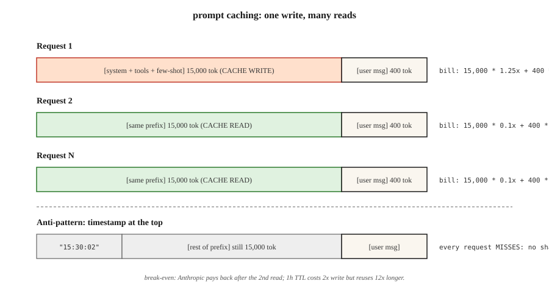

# Penembolokan Prompt dan Penembolokan Konteks

> Prompt sistem Anda berisi 4.000 token. Konteks RAG Anda berisi 20.000 token. Anda mengirim keduanya pada setiap permintaan. Anda juga membayar keduanya — setiap kali. Penembolokan prompt memungkinkan penyedia menjaga prefiks itu tetap hangat di sisi mereka dan menagih Anda 10% dari tarif normal saat penggunaan ulang. Jika digunakan dengan benar, ini memangkas biaya inferensi 50–90% dan latensi token pertama 40–85%.

**Jenis:** Build
**Bahasa:** Python, TypeScript
**Prasyarat:** Fase 11 · 01 (Rekayasa Prompt), Fase 11 · 05 (Rekayasa Konteks), Fase 11 · 11 (Penembolokan dan Biaya)
**Waktu:** ~60 menit

## Masalahnya

Agen coding mengirim prompt sistem 15.000 token yang sama ke Claude pada setiap giliran percakapan. Dua puluh giliran dengan $3/M token masukan berarti $0,90 hanya untuk biaya masukan — sebelum pesan aktual pengguna dihitung. Kalikan dengan 10.000 percakapan harian dan tagihannya mencapai $9.000/hari untuk teks yang tidak pernah berubah.

Anda tidak dapat memperkecil prompt tanpa merusak kualitas. Anda tidak dapat menghindari pengirimannya — model memerlukannya pada setiap giliran. Satu-satunya langkah adalah berhenti membayar harga penuh untuk prefiks yang sudah pernah dilihat penyedia.

Langkah itu adalah penembolokan prompt. Anthropic merilisnya pada Agustus 2024 (dengan varian TTL diperpanjang 1 jam pada 2025), OpenAI mengotomatiskannya kemudian pada tahun yang sama, Google merilis penembolokan konteks eksplisit bersama Gemini 1.5, dan ketiganya kini menawarkannya sebagai fitur kelas utama pada model frontier mereka.

## Konsepnya



**Mekanismenya.** Saat prefiks permintaan cocok dengan prefiks dari permintaan sebelumnya, penyedia menyajikan KV-cache dari hasil sebelumnya alih-alih menyandikan ulang token. Anda membayar biaya penulisan kecil pada pertama kali dan diskon pembacaan besar pada setiap kali setelahnya.

**Tiga varian penyedia tahun 2026.**

| Penyedia | Gaya API | Diskon tembak | Biaya penulisan | TTL default | Prefiks minimal dapat ditembolokkan |
|----------|----------|---------------|-----------------|-------------|-------------------------------------|
| Anthropic | Penanda `cache_control` eksplisit pada blok konten | 90% off masukan | Surcharge 25% | 5 menit (dapat diperpanjang 1 jam) | 1.024 token (Sonnet/Opus), 2.048 (Haiku) |
| OpenAI | Deteksi prefiks otomatis | 50% off masukan | tidak ada | Hingga 1 jam (best-effort) | 1.024 token |
| Google (Gemini) | API `CachedContent` eksplisit | Ditagih per penyimpanan; dibaca ~25% dari normal | Biaya penyimpanan per token·jam | Ditentukan pengguna (default 1 jam) | 4.096 token (Flash), 32.768 (Pro) |

**Invariannya.** Ketiganya hanya menembolokkan prefiks. Jika ada satu token pun yang berbeda antarpermintaan, segala sesuatu setelah token pertama yang berbeda adalah miss. Letakkan bagian yang *stabil* di atas, bagian yang *variabel* di bawah.

### Tata letak yang ramah tembolok

```
[prompt sistem]          <-- tembolokkan ini
[definisi alat]          <-- tembolokkan ini
[contoh few-shot]        <-- tembolokkan ini
[dokumen yang diambil]   <-- tembolokkan jika dipakai ulang, jika tidak jangan
[riwayat percakapan]     <-- tembolokkan hingga giliran terakhir
[pesan pengguna saat ini] <-- jangan pernah ditembolokkan (selalu berbeda)
```

Langgar urutannya — letakkan pesan pengguna di atas prompt sistem, selipkan pengambilan dinamis di antara contoh few-shot — dan tembolok tidak akan pernah tembak.

### Perhitungan titik impas

Biaya penulisan 25% dari Anthropic (TTL 5 menit) terbayar sendiri pada pembacaan pertama, karena pembacaan tembolok berbiaya 0,1x. 1 penulisan + 1 pembacaan rata-rata 0,675x biaya per permintaan (hemat 32%); 1 penulisan + 10 pembacaan rata-rata 0,205x (hemat 80%). TTL 1 jam menagih 2x biaya penulisan, sehingga blok itu memerlukan dua pembacaan agar menguntungkan. Aturan praktisnya: tembolokkan apa pun yang Anda perkirakan akan dipakai ulang setidaknya 3 kali dalam TTL; itu melewati titik impas pada kedua TTL.

```figure
prompt-cache-hit
```

## Bangunlah

### Langkah 1: Penembolokan prompt Anthropic dengan penanda eksplisit

```python
import anthropic

client = anthropic.Anthropic()

SYSTEM = [
    {
        "type": "text",
        "text": "You are a senior Python reviewer. Follow the rubric exactly.\n\n" + RUBRIC_15K_TOKENS,
        "cache_control": {"type": "ephemeral"},
    }
]

def review(code: str):
    return client.messages.create(
        model="claude-opus-4-7",
        max_tokens=1024,
        system=SYSTEM,
        messages=[{"role": "user", "content": code}],
    )
```

Penanda `cache_control` memberi tahu Anthropic untuk menyimpan blok selama 5 menit. Penggunaan ulang dalam jendela itu tembak; penggunaan ulang setelahnya kedaluwarsa dan menulis lagi.

**Kolom penggunaan pada respons:**

```python
response = review(code_a)
response.usage
# InputTokensUsage(
#     input_tokens=120,
#     cache_creation_input_tokens=15023,   # dibayar pada 1,25x
#     cache_read_input_tokens=0,
#     output_tokens=340,
# )

response_b = review(code_b)
response_b.usage
# cache_creation_input_tokens=0
# cache_read_input_tokens=15023           # dibayar pada 0,1x
```

Periksa kedua kolom dalam CI — jika `cache_read_input_tokens` tetap nol di seluruh permintaan, kunci tembolok Anda bergeser.

### Langkah 2: TTL diperpanjang satu jam

Untuk pekerjaan batch berjalan panjang, default 5 menit kedaluwarsa di antara pekerjaan. Tetapkan `ttl`:

```python
{"type": "text", "text": RUBRIC, "cache_control": {"type": "ephemeral", "ttl": "1h"}}
```

TTL 1 jam menagih 2x biaya penulisan (50% di atas baseline alih-alih 25%) tetapi cepat terbayar pada pekerjaan batch apa pun yang memakai ulang prefiks lebih dari 5 kali.

### Langkah 3: Penembolokan otomatis OpenAI

OpenAI tidak memberi Anda apa pun untuk dikonfigurasi. Prefiks apa pun di atas 1.024 token yang cocok dengan permintaan baru mendapat diskon 50% secara otomatis.

```python
from openai import OpenAI
client = OpenAI()

resp = client.chat.completions.create(
    model="gpt-5",
    messages=[
        {"role": "system", "content": SYSTEM_PROMPT},   # panjang dan stabil
        {"role": "user", "content": user_msg},
    ],
)
resp.usage.prompt_tokens_details.cached_tokens  # bagian yang didiskon
```

Aturan tata letak ramah tembolok tetap berlaku. Dua hal yang merusak tembolok OpenAI tetapi tidak merusak tembolok Anthropic: mengubah kolom `user` (dipakai sebagai komponen kunci tembolok) dan mengurutkan ulang alat.

### Langkah 4: Penembolokan konteks eksplisit Gemini

Gemini memperlakukan tembolok sebagai objek kelas utama yang Anda buat dan beri nama:

```python
from google import genai
from google.genai import types

client = genai.Client()

cache = client.caches.create(
    model="gemini-3.8-flash",
    config=types.CreateCachedContentConfig(
        display_name="rubric-v3",
        system_instruction=RUBRIC,
        contents=[FEW_SHOT_EXAMPLES],
        ttl="3600s",
    ),
)

resp = client.models.generate_content(
    model="gemini-3.8-flash",
    contents=["Review this code:\n" + code],
    config=types.GenerateContentConfig(cached_content=cache.name),
)
```

Gemini menagih penyimpanan per token·jam selama tembolok hidup, dan pembacaan sebesar ~25% dari tarif masukan normal. Ini bentuk yang tepat saat Anda memakai ulang prompt raksasa yang sama di banyak sesi selama berhari-hari.

### Langkah 5: mengukur tingkat tembak di produksi

Lihat `code/main.py` untuk akuntan tiga penyedia tersimulasi yang melacak jumlah penulisan/pembacaan/miss dan menghitung biaya campuran per 1K permintaan. Jadikan target tingkat tembak sebagai gerbang penyebaran — sebagian besar penyiapan Anthropic produksi seharusnya melihat fraksi pembacaan >80% setelah pemanasan.

## Jebakan yang masih muncul pada 2026

- **Stempel waktu dinamis di atas.** `"Current time: 2026-04-22 15:30:02"` di bagian atas prompt sistem. Setiap permintaan miss. Pindahkan stempel waktu ke bawah titik putus tembolok.
- **Pengurutan ulang alat.** Serialkan alat dalam urutan stabil — susunan ulang dict antarpenyebaran merusak setiap tembak.
- **Hampir-duplikat teks bebas.** "You are helpful." vs "You are a helpful assistant." — selisih satu byte = miss penuh.
- **Blok terlalu kecil.** Anthropic memberlakukan batas bawah 1.024 token (2.048 untuk Haiku). Blok lebih kecil diam-diam tidak ditembolokkan.
- **Dasbor biaya buta.** Pisahkan "token masukan" menjadi tembolok dan non-tembolok. Jika tidak, penurunan lalu lintas tampak seperti kemenangan tembolok.

## Gunakan

Tumpukan penembolokan tahun 2026:

| Situasi | Pilih |
|---------|-------|
| Agen dengan prompt sistem stabil 10k+ token, banyak giliran | Anthropic `cache_control` dengan TTL 5 menit |
| Pekerjaan batch yang memakai ulang prefiks selama 30+ menit | Anthropic dengan `ttl: "1h"` |
| Endpoint serverless pada GPT-5, tanpa infra kustom | OpenAI otomatis (cukup buat prefiks stabil dan panjang) |
| Penggunaan ulang korpus kode/dokumen raksasa selama berhari-hari | Gemini eksplisit `CachedContent` |
| Cadangan lintas penyedia | Pertahankan tata letak prefiks yang dapat ditembolokkan identik di semua penyedia agar tembak mana pun berfungsi |

Gabungkan dengan penembolokan semantik (Fase 11 · 11) untuk lapisan pesan pengguna: penembolokan prompt menangani penggunaan ulang yang *token-identik*, penembolokan semantik menangani penggunaan ulang yang *makna-identik*.

## Kirimkan

Simpan `outputs/skill-prompt-caching-planner.md`:

```markdown
---
name: prompt-caching-planner
description: Rancang tata letak prompt yang ramah tembolok dan pilih mode penembolokan penyedia yang tepat.
version: 1.0.0
phase: 11
lesson: 15
tags: [llm-engineering, caching, cost]
---

Diberikan sebuah prompt (sistem + alat + few-shot + pengambilan + riwayat + pengguna) dan profil penggunaan (permintaan per jam, TTL yang diperlukan, penyedia), keluarkan:

1. Tata letak. Bagian-bagian yang diurutkan ulang dengan satu titik putus tembolok yang ditandai; jelaskan bagian mana yang stabil, mana yang volatil.
2. Mode penyedia. Anthropic cache_control, OpenAI automatic, atau Gemini CachedContent. Beri alasan berdasarkan TTL dan pola penggunaan ulang.
3. Titik impas. Jumlah pembacaan yang diharapkan per penulisan dalam TTL; biaya bersih dibandingkan tanpa tembolok dengan perhitungan.
4. Rencana verifikasi. Pernyataan CI bahwa `cache_read_input_tokens > 0` pada permintaan identik kedua; dasbor yang dibagi menurut token tembolok dan non-tembolok.
5. Mode kegagalan. Cantumkan tiga alasan paling mungkin tembolok akan miss dalam penyiapan ini (stempel waktu dinamis, pengurutan ulang alat, teks hampir-duplikat) dan cara Anda mencegah masing-masing.

Tolak merilis rencana tembolok yang menempatkan kolom dinamis di atas titik putus. Tolak mengaktifkan TTL 1 jam tanpa jumlah penggunaan ulang yang membuat biaya penulisan 2x terbayar kembali.
```

## Latihan

1. **Mudah.** Ambil percakapan 10 giliran dengan prompt sistem 5.000 token pada Claude. Jalankan tanpa `cache_control`, lalu dengan. Laporkan tagihan token masukan untuk masing-masing.

2. **Sedang.** Tulis kerangka uji yang, diberikan templat prompt dan log permintaan, menghitung tingkat tembak yang diharapkan dan penghematan dolar per penyedia (Anthropic 5m, Anthropic 1h, OpenAI otomatis, Gemini eksplisit).

3. **Sulit.** Bangun pengoptimal tata letak: diberikan prompt dan daftar kolom yang ditandai `stable=True/False`, tulis ulang prompt untuk menempatkan satu titik putus tembolok pada posisi paling ramah tembolok tanpa kehilangan informasi. Verifikasi pada endpoint Anthropic sungguhan.

## Istilah Kunci

| Istilah | Yang orang katakan | Arti sebenarnya |
|---------|--------------------|-----------------|
| Penembolokan prompt | "Membuat prompt panjang jadi murah" | Penggunaan ulang KV-cache sisi penyedia untuk prefiks yang cocok; diskon 50-90% pada token masukan berulang. |
| `cache_control` | "Penanda Anthropic" | Atribut blok konten yang menyatakan "semuanya hingga di sini dapat ditembolokkan"; `{"type": "ephemeral"}`. |
| Penulisan tembolok | "Membayar biaya tambahan" | Permintaan pertama yang mengisi tembolok; ditagih ~1,25x tarif masukan pada Anthropic, gratis pada OpenAI. |
| Pembacaan tembolok | "Diskonnya" | Permintaan berikutnya yang cocok dengan prefiks; ditagih 10% (Anthropic), 50% (OpenAI), ~25% (Gemini). |
| TTL | "Berapa lama ia hidup" | Detik tembolok tetap hangat; Anthropic default 5m (dapat diperpanjang 1j), OpenAI best-effort hingga 1j, Gemini ditentukan pengguna. |
| TTL diperpanjang | "Tembolok Anthropic 1 jam" | `{"type": "ephemeral", "ttl": "1h"}`; biaya penulisan 2x tetapi sepadan untuk penggunaan ulang batch. |
| Pencocokan prefiks | "Mengapa tembolok saya miss" | Tembolok hanya tembak ketika setiap token dari awal hingga titik putus identik byte-per-byte. |
| Penembolokan konteks (Gemini) | "Yang eksplisit" | Objek tembolok bernama yang ditagih per penyimpanan dari Google; terbaik untuk penggunaan ulang korpus besar selama berhari-hari. |

## Bacaan Lebih Lanjut

- [Anthropic — Prompt caching](https://docs.anthropic.com/en/docs/build-with-claude/prompt-caching) — `cache_control`, TTL 1 jam, tabel titik impas.
- [OpenAI — Prompt caching](https://platform.openai.com/docs/guides/prompt-caching) — pencocokan prefiks otomatis.
- [Google — Context caching](https://ai.google.dev/gemini-api/docs/caching) — API `CachedContent` dan harga penyimpanan.
- [Anthropic engineering — Prompt caching for long-context workloads](https://www.anthropic.com/news/prompt-caching) — postingan peluncuran awal dengan angka latensi.
- Fase 11 · 05 (Rekayasa Konteks) — di mana memotong prompt agar tembolok dapat mendarat.
- Fase 11 · 11 (Penembolokan dan Biaya) — pasangkan penembolokan prompt dengan tembolok semantik pada pesan pengguna.
- [Pope et al., "Efficiently Scaling Transformer Inference" (2022)](https://arxiv.org/abs/2211.05102) — model memori KV-cache yang diekspos penembolokan prompt kepada pengguna; menjelaskan mengapa prefiks yang ditembolokkan ~10× lebih murah dibaca ulang daripada dihitung ulang.
- [Agrawal et al., "SARATHI: Efficient LLM Inference by Piggybacking Decodes with Chunked Prefills" (2023)](https://arxiv.org/abs/2308.16369) — prefill adalah fase yang dipotong cepat oleh penembolokan prompt; makalah ini menjelaskan mengapa TTFT turun drastis saat tembolok tembak sementara TPOT tidak berubah.
- [Leviathan et al., "Fast Inference from Transformers via Speculative Decoding" (2023)](https://arxiv.org/abs/2211.17192) — penembolokan prompt berdampingan dengan dekode spekulatif, Flash Attention, dan MQA/GQA sebagai tuas yang melengkungkan kurva biaya inferensi; baca ini untuk tiga tuas lainnya.
