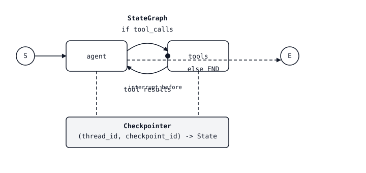

# Mesin Status Agen — Graf, Node, dan Checkpoint

> Sebuah loop ReAct yang ditulis dengan tangan adalah `while True`. Loop yang sama yang ditulis sebagai graf eksplisit adalah sesuatu yang dapat Anda checkpoint, interupsi, bercabang, dan telusuri mundur dalam waktu. Agennya tidak berubah. Yang berubah adalah kerangka (harness) di sekitarnya.

**Jenis:** Bangun
**Bahasa:** Python
**Prasyarat:** Fase 11 · 09 (Function Calling), Fase 11 · 14 (Model Context Protocol)
**Waktu:** ~75 menit

## Masalah

Anda merilis agen function-calling. Agen itu bekerja selama tiga giliran, lalu ada yang salah: model mencoba alat yang mengembalikan 500, pengguna berubah pikiran di tengah tugas, atau agen memutuskan untuk mengembalikan dana pesanan tanpa persetujuan manusia. Loop `while True:` tidak memiliki kait (hook). Anda tidak dapat menjedanya, tidak dapat memutarnya kembali, dan tidak dapat bercabang ke skenario "bagaimana jika model memilih alat yang lain?" Begitu Anda merilisnya melewati tahap demo, agen berubah menjadi kotak hitam yang entah berhasil atau tidak.

Langkah berikutnya menjadi jelas begitu Anda melihatnya. Agen itu sudah berupa mesin status — prompt sistem ditambah riwayat pesan ditambah panggilan alat yang tertunda ditambah tindakan berikutnya. Jadikan mesin status itu eksplisit: node untuk "model berpikir," "alat berjalan," "manusia menyetujui," dan edge untuk transisi bersyarat di antaranya. Begitu grafnya eksplisit, kerangka mendapatkan empat hal secara gratis: checkpointing (menyimpan status antarlangkah), interupsi (jeda untuk manusia), streaming (mengalirkan token dan peristiwa antara), dan time-travel (kembali ke status sebelumnya dan mencoba cabang yang berbeda).

Implementasi referensi dari abstraksi ini adalah LangGraph. Ini bukan kerangka kerja agen dalam arti LangChain ("ini sebuah AgentExecutor, semoga beruntung"). Ini adalah runtime graf dengan status tingkat utama, persistensi tingkat utama, dan interupsi tingkat utama. Loop agen adalah sesuatu yang Anda gambar, bukan sesuatu yang Anda tulis dengan tangan.

## Konsep



Sebuah `StateGraph` memiliki tiga hal.

1. **Status.** Dict bertipe (TypedDict atau model Pydantic) yang mengalir melalui graf. Setiap node menerima status lengkap dan mengembalikan pembaruan sebagian, yang digabungkan LangGraph menggunakan *reducer* per field — `operator.add` untuk daftar yang harus terakumulasi, overwrite secara default.
2. **Node.** Fungsi Python `state -> partial_state`. Masing-masing adalah langkah diskrit: "panggil model," "jalankan alat," "ringkas."
3. **Edge.** Transisi antarnode. Edge statis menuju satu tempat. Edge bersyarat mengambil fungsi router `state -> next_node_name` sehingga graf dapat bercabang berdasarkan keluaran model.

Anda mengompilasi graf. Kompilasi mengikat topologi, melampirkan checkpointer (opsional namun esensial untuk produksi), dan mengembalikan runnable. Anda memanggilnya dengan status awal dan sebuah `thread_id`. Setiap langkah eksekusi menyimpan checkpoint yang diberi kunci `(thread_id, checkpoint_id)`.

### Empat kekuatan utama

**Checkpointing.** Setiap transisi node menulis status baru ke sebuah penyimpanan (dalam memori untuk pengujian, Postgres/Redis/SQLite untuk produksi). Lanjutkan dengan memanggil graf lagi menggunakan `thread_id` yang sama. Graf mengambil kembali dari titik penghentiannya.

**Interupsi.** Tandai sebuah node dengan `interrupt_before=["human_review"]` dan eksekusi berhenti sebelum node itu berjalan. Status tersimpan. API Anda merespons pengguna dengan "menunggu persetujuan." Permintaan selanjutnya ke `thread_id` yang sama dengan `Command(resume=...)` melanjutkan eksekusi.

**Streaming.** `graph.stream(state, mode="updates")` menghasilkan delta status saat terjadi. `mode="messages"` mengalirkan token LLM di dalam node model. `mode="values"` menghasilkan snapshot lengkap. Anda memilih apa yang ditampilkan di UI.

**Time-travel.** `graph.get_state_history(thread_id)` mengembalikan seluruh log checkpoint. Teruskan `checkpoint_id` sebelumnya mana pun ke `graph.invoke` dan Anda bercabang dari titik itu. Sangat berguna untuk debugging ("bagaimana jika model memilih alat B saja?") dan untuk pengujian regresi yang memutar ulang jejak produksi.

### Reducer adalah intinya

Setiap field status memiliki reducer. Sebagian besar default sudah baik — nilai baru menimpa yang lama. Namun daftar pesan memerlukan `operator.add` agar pesan baru ditambahkan alih-alih menggantikan. Edge paralel menggabungkan pembaruan mereka melalui reducer. Jika dua node sama-sama memperbarui `messages` dan Anda lupa `Annotated[list, add_messages]`, yang kedua menang secara diam-diam dan Anda kehilangan separuh giliran. Reducer adalah satu-satunya hal yang substil di pustaka ini; dapatkan itu dengan benar dan sisanya tersusun.

### Graf ReAct dalam empat node

Agen ReAct produksi adalah empat node dan dua edge:

1. `agent` — memanggil LLM dengan riwayat pesan saat ini. Mengembalikan pesan asisten (yang mungkin berisi tool_calls).
2. `tools` — mengeksekusi tool_calls apa pun dalam pesan asisten terakhir, menambahkan hasil alat sebagai pesan tool.
3. Sebuah edge bersyarat dari `agent` yang mengarah ke `tools` jika pesan terakhir memiliki tool_calls, jika tidak ke `END`.
4. Sebuah edge statis dari `tools` kembali ke `agent`.

Hanya itu. Anda mendapatkan loop ReAct lengkap (Thought → Action → Observation → Thought → …) dengan checkpointing, interupsi, dan streaming, dalam kurang lebih 40 baris kode.

### StateGraph vs Send (fanout)

`Send(node_name, state)` memungkinkan sebuah node mengirim subgraph paralel. Contoh: agen memutuskan untuk mengueri tiga retriever sekaligus. Setiap `Send` memunculkan eksekusi paralel dari node target; keluarannya digabungkan melalui reducer status. Ini adalah cara LangGraph mengekspresikan pola orchestrator-workers tanpa primitif threading.

### Subgraph

Graf yang sudah dikompilasi dapat menjadi node dalam graf lain. Graf luar melihat satu node; graf dalam memiliki statusnya sendiri dan checkpointnya sendiri. Ini adalah cara tim membangun agen supervisor-worker: graf supervisor mengarahkan niat pengguna ke subgraph worker per domain.

```figure
l5-state-graph-ledger
```

## Bangun

### Langkah 1: status dan node

```python
from typing import Annotated, TypedDict
from langchain_core.messages import AnyMessage, HumanMessage, AIMessage
from langgraph.graph import StateGraph, END
from langgraph.graph.message import add_messages
from langgraph.prebuilt import ToolNode
from langgraph.checkpoint.memory import MemorySaver

class State(TypedDict):
    messages: Annotated[list[AnyMessage], add_messages]

def agent_node(state: State) -> dict:
    response = llm.invoke(state["messages"])
    return {"messages": [response]}

def should_continue(state: State) -> str:
    last = state["messages"][-1]
    return "tools" if getattr(last, "tool_calls", None) else END

tool_node = ToolNode(tools=[search_web, read_file])

graph = StateGraph(State)
graph.add_node("agent", agent_node)
graph.add_node("tools", tool_node)
graph.set_entry_point("agent")
graph.add_conditional_edges("agent", should_continue, {"tools": "tools", END: END})
graph.add_edge("tools", "agent")

app = graph.compile(checkpointer=MemorySaver())
```

`add_messages` adalah reducer yang membuat daftar pesan terakumulasi alih-alih ditimpa. Melupakannya adalah bug LangGraph yang paling umum.

### Langkah 2: jalankan dengan sebuah thread

```python
config = {"configurable": {"thread_id": "user-42"}}
for event in app.stream(
    {"messages": [HumanMessage("find the Anthropic headquarters address")]},
    config,
    stream_mode="updates",
):
    print(event)
```

Setiap pembaruan adalah dict `{node_name: state_delta}`. Frontend Anda dapat mengalirkan ini ke UI agar pengguna melihat "agen sedang berpikir… memanggil search_web… mendapat hasil… menjawab."

### Langkah 3: tambahkan interupsi human-in-the-loop

Tandai sebuah node agar eksekusi berhenti sebelum node itu berjalan.

```python
app = graph.compile(
    checkpointer=MemorySaver(),
    interrupt_before=["tools"],  # jeda sebelum setiap panggilan alat
)

state = app.invoke({"messages": [HumanMessage("delete the production database")]}, config)
# state["__interrupt__"] telah ditetapkan. Periksa panggilan alat yang diusulkan.
# Jika disetujui:
from langgraph.types import Command
app.invoke(Command(resume=True), config)
# Jika ditolak: tulis pesan penolakan dan lanjutkan
app.update_state(config, {"messages": [AIMessage("Blocked by human reviewer.")]})
```

Status, checkpoint, dan thread semuanya tetap bertahan melintasi interupsi. Tidak ada apa pun yang berada di memori kecuali selama eksekusi.

### Langkah 4: time-travel untuk debugging

```python
history = list(app.get_state_history(config))
for snapshot in history:
    print(snapshot.values["messages"][-1].content[:80], snapshot.config)

# Bercabang dari checkpoint sebelumnya
target = history[3].config  # tiga langkah ke belakang
for event in app.stream(None, target, stream_mode="values"):
    pass  # putar ulang dari titik itu ke depan
```

Meneruskan `None` sebagai input memutar ulang dari checkpoint yang diberikan; meneruskan sebuah nilai menambahkannya sebagai pembaruan pada status checkpoint itu sebelum melanjutkan. Ini adalah cara Anda mereproduksi eksekusi agen yang buruk tanpa menjalankan ulang seluruh percakapan.

### Langkah 5: ganti checkpointer untuk produksi

```python
from langgraph.checkpoint.postgres import PostgresSaver

with PostgresSaver.from_conn_string("postgresql://...") as checkpointer:
    checkpointer.setup()
    app = graph.compile(checkpointer=checkpointer)
```

SQLite, Redis, dan Postgres disediakan. `MemorySaver` untuk pengujian. Semua yang harus bertahan melintasi restart memerlukan penyimpanan sungguhan.

## Skill

> Anda membangun agen sebagai graf, bukan sebagai loop `while True`.

Sebelum Anda meraih LangGraph, lakukan desain 60 detik:

1. **Beri nama node-nya.** Setiap keputusan diskrit atau tindakan yang memiliki efek samping adalah sebuah node. "Agen berpikir," "alat berjalan," "pengulas menyetujui," "respons mengalir." Jika Anda tidak dapat mendaftarnya, tugas itu belum berbentuk agen.
2. **Deklarasikan statusnya.** TypedDict minimal dengan reducer untuk setiap field daftar. Jangan memasukkan semuanya ke `messages`; angkat field khusus tugas (`plan` yang sedang dikerjakan, penghitung `budget`, daftar `retrieved_docs`) ke level teratas.
3. **Gambar edge-nya.** Statis kecuali langkah berikutnya bergantung pada keluaran model. Setiap edge bersyarat memerlukan fungsi router dengan cabang-cabang bernama.
4. **Pilih checkpointer sejak awal.** `MemorySaver` untuk pengujian, Postgres/Redis/SQLite untuk yang lain. Jangan merilis tanpa checkpointer — tanpa checkpointer berarti tanpa lanjut, tanpa interupsi, tanpa time-travel.
5. **Tentukan interupsi sebelum alat berjalan, bukan sesudahnya.** Persetujuan ditempatkan pada edge menuju node yang ber-efek samping agar Anda dapat membatalkan sebelum kerugian terjadi; validasi ditempatkan pada edge keluar dari model agar Anda dapat menolak panggilan buruk dengan murah.
6. **Streaming secara default.** `mode="updates"` untuk UI, `mode="messages"` untuk streaming tingkat token di dalam node model, `mode="values"` untuk snapshot lengkap saat evaluasi.

Tolak untuk merilis agen LangGraph yang tidak memiliki checkpointer. Tolak untuk merilis agen yang melakukan interupsi *setelah* efek samping. Tolak untuk merilis field `messages` tanpa `add_messages` sebagai reducernya.

## Latihan

1. **Mudah.** Terapkan graf ReAct empat node di atas dengan alat kalkulator dan alat penelusuran web. Verifikasi bahwa `list(app.get_state_history(config))` mengembalikan setidaknya empat checkpoint untuk percakapan dua giliran.
2. **Sedang.** Tambahkan node `planner` yang berjalan sebelum `agent` dan menulis `plan: list[str]` terstruktur ke dalam status. Minta `agent` menandai langkah rencana sebagai selesai. Gagalkan pengujian jika `plan` hilang melintasi pemulihan checkpoint (reducer salah).
3. **Sulit.** Bangun graf supervisor yang mengarahkan di antara tiga subgraph (`researcher`, `writer`, `reviewer`) menggunakan `Send`. Setiap subgraph memiliki status dan checkpointernya sendiri. Tambahkan `interrupt_before=["writer"]` pada graf luar agar manusia dapat menyetujui ringkasan riset. Konfirmasi bahwa time-travel dari checkpoint sebelumnya menjalankan ulang hanya cabang yang dipilih itu.

## Istilah Kunci

| Istilah | Apa yang orang katakan | Apa artinya sebenarnya |
|---------|------------------------|------------------------|
| StateGraph | "graf LangGraph" | Objek builder yang Anda tambahi node dan edge sebelum kompilasi. |
| Reducer | "cara field digabungkan" | Fungsi `(old, new) -> merged` yang diterapkan ketika sebuah node mengembalikan pembaruan untuk field itu; default-nya adalah overwrite, `add_messages` menambahkan. |
| Thread | "ID percakapan" | String `thread_id` yang mencakup semua checkpoint untuk satu sesi. |
| Checkpoint | "status yang dijeda" | Snapshot persisten dari seluruh status graf setelah transisi node, diberi kunci `(thread_id, checkpoint_id)`. |
| Interrupt | "jeda untuk manusia" | `interrupt_before` / `interrupt_after` menghentikan eksekusi pada batas node; lanjutkan dengan `Command(resume=...)`. |
| Time-travel | "bercabang dari langkah sebelumnya" | `graph.invoke(None, config_with_old_checkpoint_id)` memutar ulang dari checkpoint itu ke depan. |
| Send | "pengiriman subgraph paralel" | Konstruktor yang dapat dikembalikan sebuah node untuk memunculkan N eksekusi paralel dari node target. |
| Subgraph | "graf terkompilasi sebagai node" | StateGraph terkompilasi yang digunakan sebagai node dalam graf lain; mempertahankan cakupan statusnya sendiri. |

## Bacaan Lanjutan

- [Dokumentasi LangGraph](https://langchain-ai.github.io/langgraph/) — referensi kanonik untuk StateGraph, reducer, checkpointer, dan interupsi.
- [Konsep LangGraph: status, reducer, checkpointer](https://langchain-ai.github.io/langgraph/concepts/low_level/) — model mental yang digunakan pelajaran ini, langsung dari sumbernya.
- [Persistensi dan Checkpoint LangGraph](https://langchain-ai.github.io/langgraph/concepts/persistence/) — detail tentang penyimpanan Postgres/SQLite/Redis, namespace checkpoint, dan ID thread.
- [LangGraph: human-in-the-loop](https://langchain-ai.github.io/langgraph/concepts/human_in_the_loop/) — `interrupt_before`, `interrupt_after`, `Command(resume=...)`, dan pola penyuntingan status.
- [Yao et al., "ReAct: Synergizing Reasoning and Acting in Language Models" (ICLR 2023)](https://arxiv.org/abs/2210.03629) — pola yang diimplementasikan setiap agen LangGraph; bacalah untuk rasional jejak penalaran.
- [Anthropic — Building effective agents (Dec 2024)](https://www.anthropic.com/research/building-effective-agents) — bentuk graf mana (chain, router, orchestrator-workers, evaluator-optimizer) yang lebih baik dipilih dan kapan.
- Fase 11 · 09 (Function Calling) — primitif panggilan alat yang digunakan ulang oleh setiap node agen LangGraph.
- Fase 11 · 14 (Model Context Protocol) — penemuan alat eksternal yang tersambung ke `ToolNode` LangGraph melalui adapter MCP.
- Fase 11 · 17 (trade-off kerangka kerja agen) — kapan memilih LangGraph alih-alih CrewAI, AutoGen, atau Agno.
