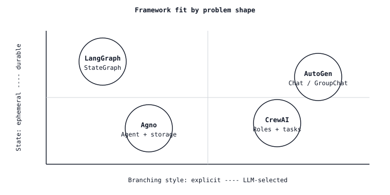

# Trade-off Kerangka Kerja Agen — Orkestrasi Graf, Peran, dan Aktor

> Setiap kerangka kerja menjual demo yang sama (agen riset menyusun laporan) dan menyembunyikan bug yang sama (skema status bertarung dengan lapisan orkestrasi). Pilih kerangka kerja yang abstraksinya cocok dengan bentuk masalah Anda; sisanya adalah lem yang Anda tulis dua kali.

**Jenis:** Pelajari
**Bahasa:** Python, TypeScript
**Prasyarat:** Fase 11 · 09 (Function Calling), Fase 11 · 16 (LangGraph)
**Waktu:** ~45 menit

## Masalah

Anda memiliki tugas yang memerlukan lebih dari satu panggilan LLM. Mungkin alur kerja riset (rencanakan, cari, ringkas, kutip). Mungkin pipeline peninjauan kode (uraikan diff, kritik, tambal, validasi). Mungkin asisten multi-giliran yang memesan penerbangan, menulis email, dan mengajukan laporan biaya. Anda memilih sebuah kerangka kerja.

Tiga hari kemudian, Anda menemukan abstraksi kerangka kerja itu bocor. CrewAI memberi Anda peran tetapi melawan ketika "peneliti" perlu menyerahkan rencana terstruktur kepada "penulis." AutoGen memberi Anda percakapan antaragen tetapi tidak memiliki status tingkat utama sehingga checkpoint Anda adalah pickle dari log percakapan. LangGraph memberi Anda graf status tetapi memaksa Anda menamai setiap transisi sebelum Anda tahu apa yang akan dilakukan agen. Agno memberi Anda abstraksi agen tunggal yang menjerit ketika Anda mencoba melakukan fanout ke tiga worker bersamaan.

Solusinya bukan "pilih kerangka kerja terbaik." Melainkan mencocokkan abstraksi inti kerangka kerja dengan bentuk masalah Anda. Pelajaran ini menggambar peta itu.

## Konsep



Empat kerangka kerja mendominasi lanskap 2026. Abstraksi inti mereka tidak sama.

| Kerangka kerja | Abstraksi inti | Paling cocok | Paling tidak cocok |
|----------------|----------------|--------------|--------------------|
| **LangGraph** | `StateGraph` — status bertipe, node, edge bersyarat, checkpointer. | Alur kerja dengan status eksplisit dan interupsi human-in-the-loop; agen produksi yang memerlukan debugging time-travel. | Brainstorming longgar yang digerakkan peran di mana topologinya belum diketahui. |
| **CrewAI** | `Crew` — peran (tujuan, latar belakang), tugas, proses (sekuensial atau hierarkis). | Alur kerja berbasis peran atau persona dengan rencana linear/hierarkis yang pendek. | Semua yang berstatus melampaui riwayat giliran crew; percabangan kompleks. |
| **AutoGen** | Pasangan `ConversableAgent` — dua agen atau lebih yang bergiliran berbicara hingga kondisi keluar. | *Dialog* multi-agen (guru-murid, pengusul-kritikus, aktor-pengulas) di mana penalaran muncul dari percakapan. | Alur kerja deterministik dengan DAG yang diketahui; apa pun yang memerlukan status awet melintasi restart. |
| **Agno** | `Agent` — satu LLM ditambah alat ditambah memori, dapat disusun menjadi tim. | Agen tunggal yang cepat dibangun dan tim ringan; multimodalitas kuat dan driver penyimpanan bawaan. | Graf dalam yang bercabang eksplisit dengan reducer kustom. |

### Apa yang sebenarnya dimaksud "abstraksi"

Abstraksi inti sebuah kerangka kerja adalah hal yang Anda gambar di papan tulis ketika mempresentasikan arsitektur.

- **LangGraph** → Anda menggambar graf. Node adalah langkah, edge adalah transisi, dan objek status di setiap titik bertipe. Model mentalnya adalah mesin status.
- **CrewAI** → Anda menggambar bagan organisasi. Setiap peran memiliki deskripsi pekerjaan dan seorang manajer mengarahkan tugas. Model mentalnya adalah tim kecil berisi spesialis.
- **AutoGen** → Anda menggambar DM Slack. Dua agen saling mengirim pesan; yang ketiga bergabung jika Anda memerlukan moderator. Model mentalnya adalah percakapan.
- **Agno** → Anda menggambar satu kotak dengan alat-alat yang menggantung di bawahnya. Letakkan kotak-kotak berdampingan untuk membentuk tim. Model mentalnya adalah "agen dengan baterai bawaan."

### Pertanyaan status

Status adalah tempat sebagian besar pilihan kerangka kerja gagal di produksi.

- **LangGraph.** Status bertipe (`TypedDict` atau model Pydantic), reducer per field, checkpointer tingkat utama (SQLite/Postgres/Redis). Lanjut, interupsi, dan time-travel didapatkan secara gratis. *(Lihat Fase 11 · 16.)*
- **CrewAI.** Status mengalir sebagai string antartugas melalui field `context`, atau terstruktur melalui `output_pydantic`. Tidak ada penyimpanan awet per-crew yang bawaan; Anda memasang sendiri jika crew harus bertahan setelah restart.
- **AutoGen.** Status adalah riwayat percakapan dan `context` yang ditentukan pengguna. Transkrip percakapan tersimpan; status alur kerja arbitrer tidak tersimpan kecuali Anda menulis adapter.
- **Agno.** Driver penyimpanan bawaan (SQLite, Postgres, Mongo, Redis, DynamoDB) yang melekat pada `Agent` melalui `storage=` — sesi percakapan dan memori pengguna tersimpan otomatis. Bukan checkpointer graf lengkap; melainkan penyimpan sesi.

### Pertanyaan percabangan

Setiap agen yang tidak sederhana bercabang. Siapa yang memutuskan cabang itu penting.

- **LangGraph** — Anda yang memutuskan, melalui edge bersyarat. Routing adalah fungsi Python dengan cabang-cabang bernama. Cabang adalah warga tingkat utama dalam graf terkompilasi; checkpointer mencatat cabang mana yang diambil.
- **CrewAI** — manajer memutuskan dalam mode hierarkis; dalam mode sekuensial Anda memutuskan saat membangun. Routing tersirat dalam daftar tugas; tidak ada "if" tingkat utama di luar prompt manajer.
- **AutoGen** — agen-agen memutuskan melalui percakapan. Percabangan muncul dari siapa yang bicara berikutnya. `GroupChatManager` memilih pembicara berikutnya; Anda dapat menulis `speaker_selection_method` sendiri tetapi default-nya digerakkan LLM.
- **Agno** — agen memutuskan lewat alat yang dipanggil berikutnya. Tim memiliki mode coordinator/router/collaborator; percabangan di luar itu menjadi tanggung jawab pengembang.

### Pertanyaan observabilitas

- **LangGraph** — OpenTelemetry melalui LangSmith atau eksportir OTel mana pun. Setiap transisi node adalah span trace; checkpoint merangkap sebagai trace yang dapat diputar ulang. LangSmith adalah opsi pihak pertama; Langfuse/Phoenix juga memiliki adapter.
- **CrewAI** — OpenTelemetry tingkat utama sejak akhir 2025; integrasi dengan Langfuse, Phoenix, Opik, AgentOps.
- **AutoGen** — integrasi OpenTelemetry melalui `autogen-core`; AgentOps dan Opik memiliki konektor. Granularitas tracing adalah per-pesan-agen, bukan per-node.
- **Agno** — flag `monitoring=True` bawaan ditambah eksportir OpenTelemetry; integrasi ketat dengan Langfuse untuk trace sesi.

### Biaya dan latensi

Keempat kerangka kerja menambahkan overhead per panggilan (logika kerangka kerja, validasi, serialisasi). Perkiraan urutan overhead yang meningkat: Agno ≈ LangGraph < CrewAI ≈ AutoGen. Selisihnya terutama ditentukan oleh seberapa banyak routing LLM tambahan yang dilakukan kerangka kerja. Manajer hierarkis CrewAI mengeluarkan token untuk memutuskan siapa yang berikutnya; `GroupChatManager` AutoGen juga demikian. LangGraph hanya mengeluarkan token di tempat Anda menulis `llm.invoke`. Jalur agen tunggal Agno sangat tipis.

Ketika biaya per eksekusi penting, utamakan routing eksplisit (edge LangGraph, `speaker_selection_method` AutoGen) alih-alih routing yang dipilih LLM.

### Interoperabilitas

- **LangGraph** ↔ alat, retriever, dan LLM LangChain. Adapter MCP tingkat utama (alat diimpor sebagai server MCP).
- **CrewAI** ↔ alat mewarisi dari `BaseTool`; alat LangChain, alat LlamaIndex, dan alat MCP semuanya dapat disesuaikan. Delegasi crew-ke-crew melalui `allow_delegation=True`.
- **AutoGen** → `FunctionTool` membungkus semua callable Python; adapter MCP tersedia. Kopling ketat ke ekosistem AG2 untuk pola agen-ke-agen.
- **Agno** → dekorator `@tool` atau subclass BaseTool; adapter MCP; alat dapat dibagikan lintas agen dan tim.

## Skill

> Anda dapat menjelaskan, dalam satu kalimat, mengapa sebuah kerangka kerja tepat untuk masalah agen tertentu.

Daftar periksa sebelum membangun:

1. **Gambar bentuknya.** Apakah ini graf (status bertipe, transisi bernama)? Peran-peran (spesialis saling menyerahkan pekerjaan)? Percakapan (agen bicara hingga selesai)? Agen tunggal dengan alat?
2. **Putuskan siapa yang bercabang.** Percabangan yang diputuskan pengembang → LangGraph. Diputuskan agen manajer → CrewAI hierarkis. Muncul dari percakapan → AutoGen. Diputuskan panggilan alat → Agno.
3. **Periksa anggaran status.** Apakah Anda memerlukan pemulihan dari checkpoint? Time-travel? Interupsi manusia di tengah eksekusi? Jika ya, LangGraph adalah default; sesi Agno mencakup status yang hanya berlaku dalam percakapan.
4. **Periksa anggaran biaya.** Routing yang dipilih LLM menelan token tambahan per giliran. Jika agen berjalan ribuan kali sehari, utamakan routing eksplisit.
5. **Anggarkan overhead kerangka kerja.** Setiap kerangka kerja adalah dependensi tambahan. Jika tugasnya hanya dua panggilan LLM dan satu alat, tulis 30 baris Python biasa; tidak ada kerangka kerja yang lebih murah daripada tanpa kerangka kerja.

Tolak meraih kerangka kerja sebelum Anda dapat menggambar graf, bagan organisasi, percakapan, atau kotak agen itu. Tolak memilih kerangka kerja yang memaksa Anda melawan model statusnya demi hal yang benar-benar Anda butuhkan.

## Matriks Keputusan

| Bentuk masalah | Kerangka kerja pilihan | Alasan |
|----------------|------------------------|--------|
| DAG alur kerja dengan status bertipe, persetujuan manusia, berjalan lama | LangGraph | Status tingkat utama, checkpointer, interupsi, time-travel. |
| Pipeline riset / penulisan dengan peran yang berbeda | CrewAI (sekuensial) atau subgraph LangGraph | Peran-per-tugas murah diungkapkan di CrewAI; tingkatkan ke LangGraph saat percabangan makin kompleks. |
| Dialog pengusul-kritikus atau guru-murid | AutoGen | Percakapan dua agen adalah bentuk aslinya. |
| Agen tunggal dengan alat, sesi, memori | Agno | Penyiapan paling tipis, penyimpanan dan memori bawaan. |
| Ribuan fanout paralel dengan reducer | LangGraph + `Send` | Satu-satunya yang memiliki API pengiriman paralel tingkat utama. |
| Prototipe cepat, tanpa komitmen kerangka kerja | Python biasa + SDK penyedia | Tanpa kerangka kerja adalah kerangka kerja tercepat. |

```figure
l5-framework-fit
```

## Latihan

1. **Mudah.** Ambil tugas yang sama — "teliti kantor pusat Anthropic, tulis ringkasan 200 kata, kutip sumber" — dan terapkan di LangGraph (empat node: rencanakan, cari, tulis, kutip) serta di CrewAI (tiga peran: peneliti, penulis, editor). Laporkan biaya token per eksekusi dan jumlah baris kode.
2. **Sedang.** Bangun tugas yang sama di AutoGen (percakapan peneliti ↔ penulis, editor bergabung melalui `GroupChat`) dan Agno (satu agen dengan `search_tools` dan `write_tools`, ditambah penyimpan sesi). Peringkatkan keempat implementasi berdasarkan (a) biaya per eksekusi, (b) kemampuan melanjutkan setelah crash, (c) kemampuan menyisipkan persetujuan manusia sebelum langkah penulisan.
3. **Sulit.** Bangun skrip pohon keputusan `pick_framework.py` yang menerima deskripsi masalah singkat (JSON: `{has_typed_state, has_roles, has_dialogue, has_parallel_fanout, needs_resume}`) dan mengembalikan rekomendasi dengan justifikasi satu kalimat. Verifikasi pada enam kasus yang Anda rancang sendiri.

## Istilah Kunci

| Istilah | Apa yang orang katakan | Apa artinya sebenarnya |
|---------|------------------------|------------------------|
| Orkestrasi | "cara agen berkoordinasi" | Lapisan yang memutuskan node/peran/agen mana yang berjalan berikutnya. |
| Status awet | "lanjut setelah restart" | Status yang bertahan setelah proses mati, melekat pada checkpoint atau penyimpan sesi. |
| Routing yang dipilih LLM | "biarkan model yang memutuskan" | LLM planner memilih langkah berikutnya setiap giliran; fleksibel tetapi membayar token pada setiap keputusan. |
| Routing eksplisit | "pengembang yang memutuskan" | Fungsi Python atau edge statis yang memilih langkah berikutnya; murah dan dapat diaudit. |
| Crew | "tim CrewAI" | Peran ditambah tugas ditambah proses (sekuensial atau hierarkis) yang diikat menjadi satu runnable. |
| GroupChat | "obrolan multi-agen AutoGen" | Percakapan terkelola antar-N agen dengan pemilih pembicara. |
| Team (Agno) | "Agno multi-agen" | Mode route / coordinate / collaborate di atas sekumpulan agen. |
| StateGraph | "graf LangGraph" | Abstraksi status bertipe, node, edge bersyarat, dan checkpointer. |

## Bacaan Lanjutan

- [Dokumentasi LangGraph](https://langchain-ai.github.io/langgraph/) — StateGraph, checkpointer, interupsi, time-travel.
- [Dokumentasi CrewAI](https://docs.crewai.com/) — Crew, Flow, Agent, Task, Process.
- [Dokumentasi AutoGen](https://microsoft.github.io/autogen/) — ConversableAgent, GroupChat, tim, alat.
- [Dokumentasi Agno](https://docs.agno.com/) — Agent, Team, Workflow, penyimpanan, memori.
- [Anthropic — Building effective agents (Dec 2024)](https://www.anthropic.com/research/building-effective-agents) — pustaka pola (prompt chaining, routing, parallelization, orchestrator-workers, evaluator-optimizer) yang agnostik terhadap kerangka kerja.
- [Yao et al., "ReAct: Synergizing Reasoning and Acting" (ICLR 2023)](https://arxiv.org/abs/2210.03629) — loop yang dipercantik oleh setiap kerangka kerja.
- [Wu et al., "AutoGen: Enabling Next-Gen LLM Applications via Multi-Agent Conversation" (2023)](https://arxiv.org/abs/2308.08155) — makalah desain AutoGen.
- [Park et al., "Generative Agents: Interactive Simulacra of Human Behavior" (UIST 2023)](https://arxiv.org/abs/2304.03442) — landasan role-play yang menjadi basis tumpukan persona gaya CrewAI.
- Fase 11 · 16 (LangGraph) — kerangka kerja yang dijadikan tolok ukur pelajaran ini.
- Fase 11 · 19 (Reflexion) — pola yang dipetakan dengan rapi ke LangGraph tetapi canggung di CrewAI.
- Fase 11 · 22 (observabilitas produksi) — cara menginstrumen kerangka kerja apa pun yang Anda pilih.
